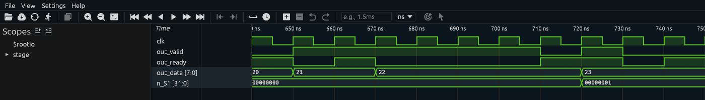

# Assertions for interface rules

This page answers: *the scoreboard says a beat came out wrong. How do you get a check that names
the rule the design broke, and the cycle it broke it in?*

You'll need the answer as soon as you start Lab 05. Your Lab 04 testbench already catches two of
that lab's three planted bugs, B10 and B12, but on B10 the first error it logs is
`output 0: got e5 last in cycle 34, expected 80`. The scoreboard sees a beat only when a sink takes
it, so that line is about the first wrong beat that output 0's sink took. While a beat waits on a
stalled output, the scoreboard has no way to notice it going wrong, and
[Part 1](../labs/lab-05-protocol-rules-and-backpressure-overview.md#part-1-the-lab-04-testbench-against-this-labs-bugs)
of the lab has you work out how many cycles before that line the router broke its rule. A check
that watches the pins themselves fires in the cycle in which the rule is broken, and its message
can say which rule it was. A check of that kind is a SystemVerilog **concurrent assertion**.
Assertions are the only SystemVerilog you write in this course: the testbench stays in Python, and
the assertions go in a module of their own that the build puts inside the design. In
[Lab 05, Part 2](../labs/lab-05-protocol-rules-and-backpressure-overview.md#part-2-assertions-for-the-output-rules)
you'll write three of them for the router's outputs, in a checker that the lab's package already
binds into the router.

So that this page doesn't write those three for you, its examples use a smaller design of our own,
a one-beat valid/ready stage. The stage takes a beat on its input and holds it on its output until
the sink takes it. Its source, its checker and the pyuvm test that drives it are in
[`guide-examples/assertions-for-interface-rules/`](https://github.com/uoftasic/dd105-b/tree/main/guide-examples/assertions-for-interface-rules),
and every output quoted below comes from a run of it in the course image.

## Three rules

The stage has three rules, written in the same style as the router specification's
[Valid/ready rules](../reference/router-spec.md#validready-rules):

- **S1**. Once `out_valid` is 1, it stays 1 until the handshake.
- **S2**. While `out_valid` is 1 and `out_ready` is 0, `out_data` doesn't change.
- **S3**. While the stage is empty (`out_valid` is 0), `in_ready` is 1.

S1 and S2 are the router's O1 and O2, written for a design with one output and no `out_last`. We
planted two bugs in the stage, and `make run BUG=` switches one of them on when the simulator
starts, as it does for the router's bugs. With `drop`, the stage throws away a beat that has waited
four cycles, which breaks S1. With `bubble`, it holds `in_ready` at 0 for a cycle after each beat
leaves, which breaks S3 whenever the stage is empty in that cycle.

The test, `StageTest`, runs for 200 cycles. In each cycle where it has no beat waiting on the
input, it puts a new one there with probability 70%, and it sets `out_ready` to 1 in half the
cycles, at random. It checks nothing itself. The checker does the checking, and at the end of the
test `BaseTest` reads how many assertion failures the checker counted.

## A rule as a property

Here is S1 as the checker writes it:

```systemverilog
a_S1: assert property (@(posedge clk) disable iff (!rst_n)
                       out_valid && !out_ready |=> out_valid)
  else begin n_S1++; $error("S1: out_valid fell without a handshake"); end
```

Read it from the left. `@(posedge clk)` says the property is evaluated at every rising edge, and
the values it uses are the ones the signals had just before that edge. Your drivers change the
inputs right after a rising edge and your monitors read the pins at the falling edge in the middle
of the cycle, and nothing changes between that falling edge and the next rising edge. So in each
cycle the property sees the same values that your monitor reads, which is also what the
specification means by the value of a signal "in a cycle".

The expression left of `|=>`, `out_valid && !out_ready`, is the **antecedent**. It picks the
cycles that the rule talks about, here the cycles in which a beat is on offer and isn't taken.
`|=>` means "then, in the next cycle". The expression after it is the **consequent**, which must
hold in that next cycle. In a cycle where the antecedent is false, the property checks nothing and
passes. The action block after `else` runs only on a failure. Ours adds one to the assertion's
own counter, `n_S1`, and calls `$error` with the rule's name, so the message tells you which rule
broke without your having to look up a line number.

S2 has the same antecedent and a different consequent, `$stable(out_data)`, which is 1 when
`out_data` has the same value as it had in the previous cycle. S3 is about a single cycle, so it
uses the other implication:

```systemverilog
a_S3: assert property (@(posedge clk) disable iff (!rst_n)
                       !out_valid |-> in_ready)
```

`|->` checks the consequent in the same cycle as the antecedent. A rule of the form "whenever this
is true, that is true too" uses `|->`, and a rule about what happens next uses `|=>`. Lab 05's O6
is of the first kind, because it's about the beat in the cycle of its own handshake.

`disable iff (!rst_n)` switches the property off while `rst_n` is 0, and abandons any attempt that
was waiting for its next cycle when the reset came. The router specification explains why every
rule about normal operation needs it. A reset ends whatever was in progress, and the router lowers
`out_valid` at once, with no handshake. O1 allows that, but without `disable iff` the assertion
for O1 (or for S1) would count it as a failure. The rules about what holds *during* a reset are
checked without `disable iff`, and you'll write some of them in Lab 07.

## Binding the checker into the design

The assertions are in a module of their own, `stage_sva`, whose inputs are the stage's pins, with
one counter for each assertion and their sum, `n_fail`. A `bind` statement at the end of the same
file, `stage_sva.sv`, puts a copy of that module inside the stage:

```systemverilog
bind stage stage_sva u_sva (
  .clk(clk), .rst_n(rst_n),
  .in_valid(in_valid), .in_ready(in_ready),
  .out_valid(out_valid), .out_ready(out_ready), .out_data(out_data)
);
```

`bind` instantiates `stage_sva` as `u_sva` in every instance of `stage`. The names on the right of
each connection are signals inside `stage`, so the checker sees the design's own ports, and the
stage's RTL doesn't change. The example's Makefile lists the file in `SVA_SRCS`, and
`labs/common/pyuvm.mk` compiles it with the design. cocotb's build passes Verilator
`--public-flat-rw`, which makes every signal reachable from Python, the bound module's counters
included, so the test reads the failure count through the design as `cocotb.top.u_sva.n_fail`.
Lab 05 binds its checker into the router the same way, from a file of its own,
`tb/router_sva_bind.sv`, and Part 2 asks you why the testbench attaches its checker with `bind`.

## Failure messages on Verilator

The checker is plain SystemVerilog, so the simulator reports its failures itself, and the messages
don't look like the lines your pyuvm components log. Here is the `drop` bug with Verilator's own
error limit, which is 1. The course's makefile raises the limit for every run of a folder with
`SVA_SRCS`, and `ERROR_LIMIT=1` puts it back, so the command is `make run BUG=drop ERROR_LIMIT=1`:

```text
[720000] %Error: stage_sva.sv:41: Assertion failed in stage.u_sva.a_S1: S1: out_valid fell without a handshake
```

That line is followed by a second `%Error` line, which says `Verilog $stop`, and then `Aborting...`.
The number in brackets is the simulation time in picoseconds, so the failure was at 720 ns. Our
clock has a 10 ns period with rising edges at 10 ns, 20 ns and so on, so cycle $n$ ends at the
rising edge at $10n$ ns, and the failure was found at the edge that ends cycle 72. A `|=>` failure
is reported in the cycle of the consequent, so the beat was still waiting in cycle 71, and
`out_valid` was 0 in cycle 72. The waveform of the same run shows both cycles:

{fig-alt="A Surfer window with five signals from 640 to 750 ns: clk, out_valid, out_ready, out_data and n_S1. out_data shows 21 from 650 ns, 22 from 670 ns and 23 from 720 ns. out_ready is 1 from 660 to 670 ns, 0 from 670 to 710 ns, then 1 again. out_valid is 1 from 650 to 710 ns, 0 from 710 to 720 ns, and 1 from 720 ns. n_S1 goes from 00000000 to 00000001 at 720 ns."}

*The sink takes `21` at the edge at 670 ns, and `22` goes onto the output in the same edge. `22`
waits in cycles 68 to 71, from 670 to 710 ns, with `out_ready` at 0. At 710 ns, the start of cycle
72, `out_valid` falls although the sink never took `22`, and at the edge at 720 ns, which ends
cycle 72, the assertion fails and `n_S1` counts it. (`23` went in during cycle 72, so the output is
busy again from 720 ns.)*

The message names the assertion by its full path, `stage.u_sva.a_S1`, so it also tells you which
instance of the checker fired. In Lab 05 the path tells you the output as well, because the
router's checker has one instance of `router_sva_out` for each output, `u_out0` and `u_out1`.

The run stopped at that failure, at 720 ns of its 2,020, and the simulator's exit status was 1.
cocotb marked `StageTest` failed, and `BaseTest`'s line at the end of the test never printed,
because the test never got there. The course's grader reads the log as well as cocotb's results,
and it called the run caught, with a note:

```text
 caught: 1 assertion   0.27 s   log: build/runs/StageTest-s1-drop/run.log
   stage_sva.sv:41: Assertion failed in stage.u_sva.a_S1: S1: out_valid fell without a handshake
   note: Verilator stopped the run at its error limit, so the rest of the test didn't run. Runs through make raise it (+verilator+error+limit+N).
```

The run-time option `+verilator+error+limit+<value>` raises the limit. `pyuvm.mk` passes
`+verilator+error+limit+100000` to every run of a folder with `SVA_SRCS`, which is a number no run
will reach, so `make run BUG=drop` prints every failure of the same bug:

```text
[720000] %Error: stage_sva.sv:41: Assertion failed in stage.u_sva.a_S1: S1: out_valid fell without a handshake
[1010000] %Error: stage_sva.sv:41: Assertion failed in stage.u_sva.a_S1: S1: out_valid fell without a handshake
[1850000] %Error: stage_sva.sv:41: Assertion failed in stage.u_sva.a_S1: S1: out_valid fell without a handshake
[1910000] %Error: stage_sva.sv:41: Assertion failed in stage.u_sva.a_S1: S1: out_valid fell without a handshake
[1990000] %Error: stage_sva.sv:41: Assertion failed in stage.u_sva.a_S1: S1: out_valid fell without a handshake
DD105-B BaseTest: 0 errors logged, 5 assertion failures (u_sva.n_fail)
```

After the first failure Verilator also prints, once, an `-Info` line saying that the `$stop` was
ignored because of `+verilator+error+limit`. This time the test ran to its end, `BaseTest` read
`n_fail` in its `final_phase`, printed the line above and raised `AssertionError`, and the grader
said `caught: 0 errors, 5 assertions`. Zero errors means that no pyuvm component logged one; the
five are the checker's.

## Reading the count in the test

pyuvm knows nothing about the checker. A failed assertion prints an `%Error` line and adds to a
counter, and neither of those raises anything in Python, so a test that never looks at the counter
ends the way it would have ended anyway. To see that, the example's `+UNCOUNTED` makes `StageTest`
skip `BaseTest`'s read of `n_fail`, as a test written without it would. On the same seed the
stimulus is the same, so `make run BUG=drop PLUSARGS=+UNCOUNTED` printed the same five `%Error`
lines, and then:

```text
DD105-B BaseTest: 0 errors logged, no bound assertions
```

and cocotb's summary said `PASS` for the test, as `results.xml` did. A grader that read only
cocotb's results would have called this run a pass. The course's grader also searches the log for
failed assertions, so it still said `caught: 0 errors`, with the note
`5 assertion failure(s) are in the log and the test passed: it doesn't read u_sva.n_fail, as BaseTest does.`
That catch comes from the grader's reading of the log, though, and cocotb itself reported a
passing test, so a testbench that relies on assertions has to turn their count into a failure on
its own. Every pyuvm test in the labs derives from `BaseTest`, which reads
`cocotb.top.u_sva.n_fail` at the end of every test of a design that has a checker bound into it,
and fails the test if the count isn't 0.

## When the antecedent never holds

Here is the same buggy stage again, with the sink ready in every cycle
(`make run BUG=drop PLUSARGS=+READY_PCT=100`):

```text
[STAGE] 147 beats in, 146 out; a beat waited in 0 cycles (cover property: 0); 0 assertion failures
```

and the grader's verdict on it was `MISSED`. The bug is still in the stage, but it acts only on a
beat that has waited four cycles, and with the sink always ready no beat waited at all. The
antecedent of S1 was false in every cycle, so the assertion passed in every cycle without checking
anything. A passing assertion tells you only that its rule held in the cycles where its antecedent
was true, and not whether there were any such cycles. Lab 05's B11 hides from your O6 assertion
for a related reason. O6's antecedent holds on the last beat of every 8-beat packet, but B11 acts
only on a packet longer than 8 beats, so O6 can fail only on the 8th beat of a packet that has a
9th. None of Lab 04's tests sends such a packet, and your virtual sequence in Part 4 is the first
stimulus that does.

The checker therefore also counts the cycles in which the antecedent of S1 and S2 holds. That is
`n_tried`, a counter in an `always` block beside the assertions, and on the golden stage, with the
sink ready half the time, it counted 83 cycles. The checker asks the same question a second way,
with a cover property whose statement adds one to `n_covered`:

```systemverilog
c_S1: cover property (@(posedge clk) disable iff (!rst_n) out_valid && !out_ready)
  n_covered++;
```

With the course's build flags, that statement never ran: `n_covered` was 0 in every run on this
page, the golden one included. Verilator runs a cover property's statement in a build with its
user coverage switched on. We built the stage once with `make build VFLAGS=--coverage-user` and ran
it with the same `VFLAGS`, and then `n_covered` counted the same 83 cycles as `n_tried`, and the run
also wrote Verilator's own coverage file, `coverage.dat`. The labs build without that switch, and
`make cov` reads cocotb-coverage's files, not `coverage.dat`, so in this course the evidence that a
rule was exercised comes from a counter that you write yourself, like `n_tried`, or from a
cocotb-coverage bin. Lab 05's `router.wait` is one
of those: for each packet an output delivers, it records the longest that any of its beats waited.

## Which rules suit an assertion

A rule about one or two cycles at a time becomes a short property like S1. I1, I2, O1 and O2 are
rules of that kind, and the specification says that most of its other rules are too. Assertions
for them name the rule and fire in the cycle in which it's broken. They need no model of the
design, so they keep working in any testbench that binds the file. The specification's Valid/ready
rules section lists the rules that need more than a short property:

- O5, O6 and O8 need state kept for each output (the order of the beats, how many beats the
  current packet has had, and the cycles in which each beat went in and was taken). They belong in
  the scoreboard, or in an assertion with tracking code beside it. Your O6 in Lab 05 uses a small
  counter, `beats`, which counts the beats of the current packet that have already been taken.
  It's written for you in `router_sva_out`.
- I4, O3 and O7 say what a signal does *not* depend on, which no single trace can show. A model
  that predicts the outputs checks them, and an assertion can catch only their consequences.
- I3 is a rule for your own source's stimulus, so it belongs in the driver or the sequence, not in
  an assertion.

The scoreboard knows what every beat should be, so it catches far more kinds of bug than the
assertions do, but its message says only that a beat was wrong. An assertion names the rule and
the cycle, which tells you where and when to look, so a testbench needs both kinds of check. In
Lab 05 you'll see both fire on the same bugs, often many cycles apart.

## Check yourself

1. The `drop` run's first failure printed `[720000]`. In which cycle was `out_valid` 0 without a
   handshake, and why is the failure reported at the edge that ends that cycle rather than one
   cycle earlier?

   <details>
   <summary>Answer</summary>

   720 ns is the edge that ends cycle 72 ($10 \times 72 = 720$), so `out_valid` was 0 in cycle 72.
   The antecedent held in cycle 71, when the beat was on offer and not taken, and `|=>` checks the
   consequent one cycle later, so the failure can't be known until the edge that ends cycle 72.

   </details>

2. A test of yours prints three `%Error: ... Assertion failed` lines, then
   `DD105-B BaseTest: 0 errors logged, no bound assertions`, and cocotb reports `PASS`. What is
   missing?

   <details>
   <summary>Answer</summary>

   The read of the checker's count. `BaseTest` looks for `u_sva.n_fail` under `cocotb.top`, and
   "no bound assertions" means it didn't read one: the design has no checker bound into it as
   `u_sva`, or the test has turned the read off, as `+UNCOUNTED` does in the example. A failed
   assertion raises nothing in Python, so without that read the test passes. Check that the bind
   file is in `SVA_SRCS` and that the test derives from `BaseTest`.

   </details>

3. With the sink always ready, the `drop` bug passed. Which number in that run's `[STAGE]` line
   tells you that S1 was never tried?

   <details>
   <summary>Answer</summary>

   `a beat waited in 0 cycles` is `n_tried`. Give every assertion you rely on a count like it, or a
   coverage bin that shows its antecedent held. The cover property's count beside it is 0 too, but
   it was 0 on the golden stage as well, so it tells you nothing in this build.

   </details>

4. Which implication would you use for the router's O6, "a beat taken when the packet has already
   had 7 beats has `out_last` = 1", and why?

   <details>
   <summary>Answer</summary>

   `|->`. The rule is about the beat in the cycle of its own handshake, so the consequent has to be
   checked in the same cycle as the antecedent. With `|=>` the check would look at `out_last` in
   the cycle after, when it belongs to a different beat or to no beat at all.

   </details>

## Further reading

ChipVerify's assertion pages are a good reference for the syntax, which is the same in this course
because the assertions are SystemVerilog. Their example output comes from commercial simulators,
so the failure messages look different from Verilator's, and their testbenches are SystemVerilog
modules, where yours is a pyuvm test reading a counter.

- [Property Implication](https://chipverify.com/systemverilog/systemverilog-assertions-property-implication):
  `|->` against `|=>`, and vacuous success, with the same trace read both ways.
- [disable iff](https://chipverify.com/systemverilog/systemverilog-assertions-disable-iff): where
  it goes, and why gating the antecedent instead isn't the same thing.
- [$rose, $fell, $stable](https://chipverify.com/systemverilog/systemverilog-sequence-rose-fell-stable).
- [Handshake Properties](https://chipverify.com/formal-verification/handshake-properties), in the
  formal section: the valid/ready rules, which side's rules are assertions and which are
  assumptions, and why a sink that is always ready hides a sender bug.
- [assert, assume & cover](https://chipverify.com/systemverilog/assertions-assert-assume-cover).
- [SystemVerilog Assertions](https://chipverify.com/systemverilog/systemverilog-assertions), the
  overview. Correction: it writes an immediate assertion as `$assert(...)`, which isn't
  SystemVerilog (the keyword is `assert`), and its practice solution asserts a bare sequence with
  no implication, so it fails in every cycle where `req` is 0.
- [Assertion Based Verification](https://chipverify.com/verification/assertion-based-verification).
  Correction: it says `assume` has no effect in simulation; the standard says a simulator checks an
  assumed property the same way as an assertion.

Next: [Reactive agents and backpressure](reactive-agents-and-backpressure.md).
