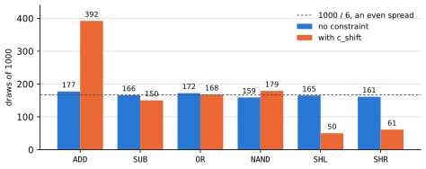

# Constrained random with pyvsc

This page answers: *how do I get the random stimulus I asked for from pyvsc, and how do I know I
got it?*

Lab 02's generator chose each packet's DST and length itself, with calls to Python's `random`
written into its loop. In [Lab 03](../labs/lab-03-constraints-and-coverage-overview.md) the
generator makes each packet as a `RandPacket` instead, and pyvsc randomizes it. The class declares
which of its fields are random and the rules that they must follow, and the generator calls
`randomize()`, which hands those rules to a solver and lets it choose the values. That moves the
decisions about what the stimulus looks like out of the generator's code and into one class, where
a test can change them. It also means that what comes out depends on how the solver chooses among
the values your rules allow, and pyvsc doesn't always choose evenly.

pyvsc 1.1.0 isn't in the course image. Lab 03, Part 1 has you make the course venv with `make venv`,
and that installs pyvsc along with its solver, Boolector. The examples on this page are in
[`guide-examples/constrained-random-with-pyvsc/`](https://github.com/uoftasic/dd105-b/tree/main/guide-examples/constrained-random-with-pyvsc).
Each is a small class built on SimProc's ALU operations, randomized inside a pyuvm test that
builds and runs with the course's `pyuvm.mk`, the same makefile that every lab uses. In
[Lab 03, Part 3](../labs/lab-03-constraints-and-coverage-overview.md#part-3-constraints-the-solver-honours)
you'll run the same kind of experiment on classes shaped like the router's packet, and then count
what comes out of the packet itself.

## randobj, random fields, constraints and randomize()

A pyvsc class is an ordinary Python class with the `@vsc.randobj` decorator. Its random fields are
pyvsc types, such as `vsc.rand_bit_t(8)` for an 8-bit value and `vsc.rand_enum_t(...)` for an enum,
and each method marked `@vsc.constraint` holds rules that the fields must follow. Here is a class
for one ALU vector:

```python
class AluOp(enum.IntEnum):
    ADD = 0
    SUB = 1
    OR = 2
    NAND = 3
    SHL = 4
    SHR = 5


@vsc.randobj
class AluVec:
    def __init__(self):
        self.op = vsc.rand_enum_t(AluOp)
        self.A = vsc.rand_bit_t(8)
        self.B = vsc.rand_bit_t(8)

    @vsc.constraint
    def c_shift(self):
        with vsc.implies(self.op.inside(vsc.rangelist(AluOp.SHL, AluOp.SHR))):
            self.B < 4
```

SimProc's shifts use only `B[1:0]`, so `c_shift` keeps `B` below 4 whenever the operation is a shift
and leaves it free otherwise. The lines in a constraint method look like Python comparisons, but
pyvsc never evaluates them as `True` or `False`. It runs the method once, when the object is made
(at the end of its `__init__`), and records each line as a rule for the solver. A call to
`v.randomize()` asks for values of `op`, `A` and `B` that meet every constraint that is switched
on, all at the same time. With `randomize_with()`, a call can add rules of its own, which apply on
top of the class's and only for that call:

```python
with v.randomize_with() as it:
    it.op == AluOp.SUB
    it.A == it.B
```

A constraint can be switched off with `v.c_shift.constraint_mode(False)`, and on again with
`True`.

`CrItemTest` randomizes one `AluVec` a few times:

```text
[ITEM] randomize():                         ADD  A=98 B=dd
[ITEM] randomize():                         SHR  A=5c B=03
[ITEM] randomize():                         NAND A=c3 B=b1
[ITEM] randomize():                         SUB  A=98 B=dc
[ITEM] randomize_with(op == SUB, A == B):   SUB  A=8a B=8a
[ITEM] randomize_with(op == SUB, A == B):   SUB  A=61 B=61
[ITEM] before:                              SUB  A=61 B=61
Solve failure: set 'solve_fail_debug=1' for more details
[ITEM] randomize_with(op == SHL, B == 5) raised SolveFailure: solve failure
[ITEM] after:                               SUB  A=b6 B=61
[ITEM] the same with c_shift off:           SHL  A=87 B=05
```

The call with `op == SHL` and `B == 5` can't be met, because `c_shift` says a shift has `B` below 4.
SystemVerilog's `randomize()` returns 0 when that happens, but pyvsc raises an exception,
`SolveFailure`, and prints the `Solve failure` line first. The failed call also changed the object.
`A` went from `61` to `b6` while `op` and `B` kept their old values, because pyvsc gives a field
that no constraint mentions, such as `A`, its new value before it hands the other fields to the
solver. So after the failure the object held a combination that no call had asked for. With
`c_shift` switched off, the same call succeeds.

So a test shouldn't carry on past a failed `randomize()`. A `SolveFailure` that the test doesn't
catch ends the run, and the course's graders call such a run BROKEN, because a test that stopped
in the middle of its stimulus says nothing about the design. Lab 04's `RouterRandSeq` catches the
failure only to raise a clearer error, which names the packet's class and the `route_en` bits that
the sequence was given. Lab 04, Part 4 describes a run that the graders called
`BROKEN: SolveFailure`, and why it failed.

## How pyvsc picks the values

pyvsc's constraints are meant to work as SystemVerilog's do, and Lab 03, Part 3 has you write down
what SystemVerilog's rules say the first six of its experiments should show. The standard makes every
combination of values that meets the constraints equally likely. pyvsc chooses differently, as its
source, `vsc/model/solvegroup_swizzler_partsel.py`, shows. It takes the random fields that the
constraints mention (up to four of them) in a random order, and gives each a random target inside
the range of values that it has worked out the field can take. An enum's target goes to the solver
as one piece, and a wider field's is split into pieces of a bit or a few bits each. Then pyvsc
offers all the pieces to the solver one at a time, in a random order, keeps each one that the
constraints still allow, and drops the rest. Wherever a piece was dropped, the field gets whatever
value the solver finds there, and that value isn't random.

`CrSkewTest` counts what comes out of 1,000 vectors with no constraint at all, and of 1,000 with
`c_shift`:

```text
[SKEW] no constraint:     ADD 177  SUB 166  OR 172  NAND 159  SHL 165  SHR 161   B < 4 in 18
[SKEW] with c_shift:      ADD 392  SUB 150  OR 168  NAND 179  SHL  50  SHR  61   B < 4 in 119
```



*The two `[SKEW]` lines as bars. The dashed line is 1,000 / 6, an even spread.*

Without the constraint, each operation came out close to 1,000 / 6 times, and `B` was below 4 in 18
draws, about the 16 that 4 values in 256 would give. With `c_shift`, a target of `SHL` or `SHR`
survives only if the solver is offered it before any piece of `B`'s target that would put `B` at 4
or more, and 252 of the 256 targets that `B` can get are 4 or more. When such a piece goes first,
the shift is dropped, and the solver puts `ADD` in its place. So the two shifts came out 50 and 61
times, and `ADD` 392. Every draw met `c_shift`, so pyvsc had nothing to warn you about. A
constraint says which values can come out, not how often each one does, and to know that you count
them, as Lab 03's coverage does for the router's packet.

The operations in the first line came out even because pyvsc draws each field that no constraint
mentions without the solver, evenly over its values. (In DD105-A, on Verilator 5.050, an enum whose
four names fill its two bits came out as its first name 813 times in 1,000.)

## Attributes that a constraint reads

A constraint can also read attributes that aren't random. In Lab 03's packet, `c_dst` reads
`route_en`, which holds the routing table's enable bits, to keep each packet on an enabled route.
pyvsc runs the constraint methods only once, when the object is made, so the way you declare such
an attribute decides whether the solver sees a change made to it after that. `CrAttrTest` uses
this class:

```python
@vsc.randobj
class Limited:
    def __init__(self):
        self.A = vsc.rand_bit_t(8)
        self.B = vsc.rand_bit_t(8)
        self.a_max = 4                 # a plain Python attribute
        self.b_max = vsc.uint8_t(4)    # a non-random pyvsc attribute

    @vsc.constraint
    def c_lim(self):
        self.A < self.a_max
        self.B < self.b_max
```

It randomizes the object 200 times, sets both limits to 200, and randomizes it 200 times more:

```text
[ATTR] a_max = 4, b_max = 4, 200 draws:     the largest A 3, the largest B 3
[ATTR] a_max = 200, b_max = 200, 200 draws: the largest A 3, the largest B 199
```

When pyvsc read `c_lim`, at the end of `__init__`, `self.a_max` was the number 4, and it went into
the rule as the number 4, so changing the attribute later changed nothing. `self.b_max` is a pyvsc
field, so the rule refers to the field and reads its value at every call. Lab 03's packet holds
`route_en` and its three length weights in `vsc.uint8_t` attributes for that reason. The generator
sets `route_en` on each new packet after making it, and the weights are fields so that a test can
change them before it randomizes. pyvsc gives no error or warning when a plain attribute has gone
into a rule as a fixed number.

## dist

`vsc.dist()` gives each value or range a weight, and the solver picks among them in proportion to
the weights. `AluVecWeighted` makes `ADD` five times as likely as each other operation:

```python
@vsc.constraint
def c_op(self):
    vsc.dist(self.op, [vsc.weight(AluOp.ADD, 5), vsc.weight(AluOp.SUB, 1),
                       vsc.weight(AluOp.OR, 1), vsc.weight(AluOp.NAND, 1),
                       vsc.weight(AluOp.SHL, 1), vsc.weight(AluOp.SHR, 1)])
```

A `dist` is one more constraint, so a call can add others on the same variable. `CrDistTest` draws
1,000 vectors, then asks for `SUB` 1,000 times with the `dist` still on:

```text
[DIST] op dist ADD 5, others 1:                   ADD 516  SUB  89  OR 103  NAND 100  SHL 104  SHR  88
[DIST] the same, then randomize_with(op == SUB):  failed 0 times in 1000; ADD   0  SUB 1000  OR   0  NAND   0  SHL   0  SHR   0
```

The weights ask for `ADD` in 5 draws of 10, and it came out in 516 of 1,000, so they came out
right. Asking for `SUB` with the `dist` still on never failed. pyvsc draws a target from the `dist` by its weights, up to four
times, and keeps the first one that the other constraints allow. If none of the four fits, it
falls back to a target from the field's own range of values. The weights in a `dist` can be enum
names, as here, or numbers.

The labs put the `dist` on a selector and choose the other fields from it with `vsc.if_then`. Lab
03's packet has a `kind`, weighted 25 / 50 / 25, and a `length` that `c_len` chooses from the kind.
`VecKind` does the same for `A`, with four kinds, weighted 10 / 20 / 30 / 40, that make `A` `00`,
make it `ff`, make it equal to `B`, or leave it free. Then the test asks for `A < 0x10`, which
rules out `K_ONES`:

```text
[DIST] kind dist 10/20/30/40:                     K_ZERO  89  K_ONES 194  K_SAME 295  K_ANY 422
[DIST] the same, then randomize_with(A < 0x10):   failed 0 times in 1000; K_ZERO 127  K_ONES   0  K_SAME 374  K_ANY 499
```

No call failed, and the other three kinds shared the draws in about the ratio 10 : 30 : 40 of their
weights. In DD105-A, Verilator failed 921 and 199 times in 1,000 on the same two shapes, because it
behaves as if it picks an entry of the `dist` first and solves the rest afterwards. On pyvsc you
can constrain a packet's length inline whatever its weights, and line 3 of Lab 03's experiments
shows it on a class with the same `kind` and `length` constraints as the router's packet.

## soft

A soft constraint holds unless something else contradicts it, and then it gives way instead of
failing the call. `SoftVec` makes `B` 1 by default, and has two soft constraints on `A` that
disagree:

```python
@vsc.constraint
def c_b(self):
    vsc.soft(self.B == 1)

@vsc.constraint
def c_a(self):
    vsc.soft(self.A == 0x11)
    vsc.soft(self.A == 0x22)
```

`CrSoftTest` randomizes it 100 times, then 100 times with `B == 7` inline:

```text
[SOFT] randomize(), 100 times:              A=22 B=01 x100
[SOFT] randomize_with(B == 7), 100 times:   failed 0; A=22 B=07 x100
```

The inline `B == 7` is a hard constraint, and it beat the soft `B == 1` without a failure, as the
SystemVerilog standard says a hard constraint always does. Of the two soft constraints that
disagreed, the later one won every time, which is the order that the standard fixes: a later soft
constraint beats an earlier one. The standard also puts an inline soft constraint ahead of the
class's soft ones, which `CrSoftTest` doesn't try.

## solve_order

`vsc.solve_order(a, b)` asks for `a` to be chosen before `b`. That changes how often each value of
`a` comes out, without changing which values are legal. `ShiftSel` has a bit, `is_shift`, that
picks between the two shifts and the four other operations, and `ShiftSelOrdered` adds
`vsc.solve_order(self.is_shift, self.op)`:

```text
[SOLVE] solve_order(is_shift, op): is_shift in 509 of 1000;   ADD 251  SUB  60  OR  89  NAND  91  SHL  82  SHR 427
[SOLVE] without solve_order:       is_shift in 412 of 1000;   ADD 224  SUB 105  OR 133  NAND 126  SHL 144  SHR 268
```

By the standard, `is_shift` should come out about 500 times in 1,000 with `solve_order`, because
it's chosen first and has two values, and about 333 without, because two of the six operations are
shifts. pyvsc gave 509, and 412. So `solve_order` gave `is_shift` the spread that the standard asks
for, but the operations within each half are far from even, with `SHR` at 427 and `SHL` at 82.
Once `is_shift` is fixed, `op`'s target is still one of all six operations, and a target that
disagrees with `is_shift` is dropped. When `is_shift` is 1, the target is an operation that isn't
a shift two times in three, and each time it's dropped the solver puts `SHR`. When `is_shift` is
0, a target of `SHL` or `SHR` is dropped, and the solver puts `ADD`.

## unique and sum

Lab 03's experiments also try `vsc.unique()` on a list and a constraint on a list's `sum`, the two
constraints that DD105-A found Verilator gets wrong on an array. Lab 03, Part 4 uses the second, in
a `FillPlan` whose eight lengths add up to 8.

## Seeds

Every run starts Python's `random` from a seed, which `make` passes as `COCOTB_RANDOM_SEED` from
its `SEED` variable (1 unless you set it). cocotb seeds `random` for each test from that seed and
the test's name, so two tests with the same body send different values. A pyvsc object takes its
own random state from Python's `random` once, at its first `randomize()`, and `CrSeedTest` shows
it. Each of its three rows starts from the random state that the test started with. The first row
makes an object and randomizes it six times, the second calls `random.seed(99)` between making the
object and its first `randomize()`, and the third calls it after the first `randomize()`. On
seed 1:

```text
[SEED] make, then randomize() 6 times:          NAND SUB SHL SHL SHL NAND
[SEED] make, random.seed(99), then randomize(): SUB SHL ADD SUB OR OR
[SEED] make, randomize(), random.seed(99), ...: NAND SUB SHL SHL SHL NAND
```

and on seed 2:

```text
[SEED] make, then randomize() 6 times:          SHR SUB SHR SHL OR SHL
[SEED] make, random.seed(99), then randomize(): SUB SHL ADD SUB OR OR
[SEED] make, randomize(), random.seed(99), ...: SHR SUB SHR SHL OR SHL
```

The run's seed decided the first and third rows, and reseeding after the first `randomize()`
changed nothing. Reseeding before it decided the second row, whatever the run's seed. So an object
that the test makes and randomizes repeats with the seed, and you can rerun a failing seed and watch
the same failure happen again. Lab 03's generator makes and randomizes every packet inside the test,
so the run's seed decides them all.

A seed reproduces a run only when the testbench draws the same numbers in the same order. Every
random value in the labs comes from Python's `random`, one draw after another, including pyvsc's
state for each new packet, the payload bytes and the idle cycles. A change that draws one number
more changes every value after it, and for this reason Lab 03 says that your own constraints may
give different counts from ours with the same seed.

## Speed

pyvsc is slow next to Python's own `random`. `CrSpeedTest` timed 1,000 calls of `randomize()` on one
`AluVec`, 1,000 on a new `AluVec` each time, and 100,000 of three `random.randrange()` calls:

```text
[SPEED] per second: randomize() on one AluVec 531; a new AluVec each time 494; three random.randrange() calls 1037162
```

That's about 1.9 ms a call, against about 1 µs for three `random.randrange()` calls, so the labs give
the solver only the fields that a constraint mentions. Lab 03's packet randomizes its DST, its kind
and its length with pyvsc. pyvsc then calls the packet's `post_randomize()`, as it does after every
`randomize()`, and that method fills in the payload bytes and the idle cycles with `random`.

Importing pyvsc takes time too, and every run that uses pyvsc pays it once. `make import-time`
timed `import vsc` in the venv's Python three times:

```text
 import vsc: 1.41 s
 import vsc: 1.00 s
 import vsc: 0.99 s
```

Lab 03's graded test takes about 5 s once Part 3's constraints are in, where Lab 02's took 0.25 s.
Part of the difference is the import and the solver, and part is that Lab 03's test sends 800
packets to Lab 02's 100.

## Counting what came out

In a testbench with a design in it, a skew like `CrSkewTest`'s wouldn't fail anything either,
because the scoreboard checks the design's answers and not how often each input was sent. In Lab 03
you count with coverpoints. Their first run shows a third of the router's packets 1 beat long and a
third 8 beats long (263 of 800 each), because the packet's length comes from `kind`, an enum with
three names, and nothing weights it yet.
[Functional coverage you can read](functional-coverage-you-can-read.md) explains how to read those
counts.

## Check yourself

1. A packet class has a constraint `self.length <= self.max_len`, with `self.max_len = 8` set in
   `__init__`. A test sets `p.max_len = 4` before it randomizes, and still gets 8-beat packets. Why,
   and what do you change?

   <details>
   <summary>Answer</summary>

   `max_len` is a plain Python attribute. pyvsc read the constraint at the end of `__init__`, when
   `max_len` was 8, so the rule holds the number 8, and setting the attribute afterwards changes
   nothing. Declare it as a pyvsc field, `self.max_len = vsc.uint8_t(8)`, and the solver reads its
   value at every call, as it reads `b_max` in `CrAttrTest` and the weights in Lab 03's packet.

   </details>

2. A sequence calls `randomize_with()` with an inline constraint that contradicts one of the class's
   constraints, catches the `SolveFailure`, and sends the item anyway. What does the design get?

   <details>
   <summary>Answer</summary>

   An item that no call asked for. The failed call can change some fields and leave others as they
   were, as `A` changed from `61` to `b6` in `CrItemTest` while `op` and `B` didn't. Let the
   exception end the run, or switch the class's constraint off with `constraint_mode(False)` before
   that call, and on again after it.

   </details>

3. You add a monitor that calls `random.random()` once at the start of its `run_phase`, and a test
   that sent the same packets on seed 3 every time now sends different ones. Which values change, and
   why?

   <details>
   <summary>Answer</summary>

   Every packet whose first `randomize()` comes after that call, and every payload byte and idle
   cycle drawn after it. Each packet takes its random state from Python's `random` at its first
   `randomize()`, so one extra draw before it moves every value after it.

   </details>

## Further reading

pyvsc's own documentation is the authority on its API. ChipVerify's SystemVerilog pages explain the
constructs that pyvsc copies, with longer examples. Their code is SystemVerilog, and their output
comes from commercial simulators, so where pyvsc behaves differently, trust the counts on this page
and in Lab 03.

- pyvsc's [Constraints](https://fvutils.github.io/pyvsc/constraints.html),
  [Methods](https://fvutils.github.io/pyvsc/methods.html) and
  [Data Types](https://fvutils.github.io/pyvsc/data_types.html) pages. The Methods page says that
  an object's random state is made at its first `randomize()` if nothing has set it, as `CrSeedTest`
  shows. It doesn't say what a failed call does; `CrItemTest` shows that.
- ChipVerify's [SystemVerilog Randomization](https://chipverify.com/systemverilog/systemverilog-randomization)
  and [Inline Constraints](https://chipverify.com/systemverilog/systemverilog-inline-constraints).
  Both say that a failed `randomize()` returns 0 and leaves the variables as they were. pyvsc raises
  `SolveFailure` instead, and the failed call in `CrItemTest` changed `A`.
- [Soft Constraints](https://chipverify.com/systemverilog/systemverilog-soft-constraints).
  Correction: it says that when two soft constraints on one variable conflict, which one wins
  depends on the solver. The standard fixes the order (the later one wins), and pyvsc gave the
  later one in all 100 draws of `CrSoftTest`.
- [solve before](https://chipverify.com/systemverilog/systemverilog-solve-before) explains
  correctly what the standard means. pyvsc's `solve_order()` gave 509 in 1,000 for a bit that the
  standard puts at 50%.
- [Disable Constraints](https://chipverify.com/systemverilog/systemverilog-disable-constraints),
  for `constraint_mode()`.

Next: [Functional coverage you can read](functional-coverage-you-can-read.md).
