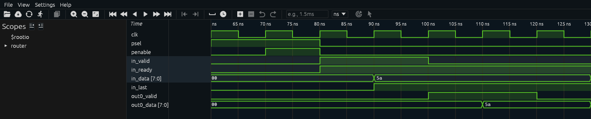

# Driving and sampling on the clock

This page answers: *the router's flip-flops change at every rising edge. When should a testbench
change the router's inputs, and when should it read the pins, so that every value it reads is the
value that the specification gives for that cycle?*

Lab 01's ALU has no clock, so its driver and monitor kept time with a 10 ns period that they shared
through `AluIf`. The router has a clock, and its specification states every rule cycle by cycle. In
[Lab 02](../labs/lab-02-a-layered-testbench-without-pyuvm-overview.md), the driver, the sinks and
the APB master that the lab ships all change the router's inputs right after a rising edge, and
every class that reads the pins, including the monitor you'll write, reads them at the falling edge
in the middle of the cycle. Lab 02's code calls this the timing rule. In DD105-A the same timing
came from SystemVerilog clocking blocks. This course has no clocking blocks, so each class keeps the
rule in its own code. This page first shows the rule at work on the router. Then it compares what
the same pins read at two other moments that a testbench could choose: as soon as the rising edge
comes, and in cocotb's `ReadOnly` phase after it.

The examples on this page drive the golden router from `labs/common/rtl`, and we ran them in the
course image. Their source is in
[`guide-examples/driving-and-sampling-on-the-clock/`](https://github.com/uoftasic/dd105-b/tree/main/guide-examples/driving-and-sampling-on-the-clock),
and the section for this page in `guide-examples/README.md` gives the command behind each output.

## Cycles and handshakes

The specification's [Cycles and handshakes](../reference/router-spec.md#cycles-and-handshakes)
section numbers the clock periods: cycle *n* is the period that ends at rising edge *n*, and the
value of a signal "in cycle *n*" is the value it holds just before that edge. The router samples its
inputs at rising edges, and most of its outputs come straight from flip-flops, so they change just
after a rising edge. A **handshake** on a stream is a cycle in which `valid` and `ready` are both 1,
and the beat moves at the rising edge that ends that cycle.

So if a testbench changes an input right after rising edge *n*, the input has its new value in
cycle *n* + 1, and the router acts on it at the edge that ends that cycle. At the falling edge in the
middle of a cycle no signal changes, because the router's outputs and the testbench's inputs both
changed just after the rising edge before it. Every signal then holds the value it has for the whole
cycle, which is the value the specification calls its value in that cycle.

## The rule in a driver

The example's `send_beat()` offers one beat on the router's input the way Lab 02's `Driver` does.
It's called right after a rising edge:

```python
async def send_beat(dut, data, last):
    dut.in_valid.value = 1
    dut.in_data.value = data
    dut.in_last.value = int(last)
    while True:
        await FallingEdge(dut.clk)
        if dut.in_ready.value:
            break
        await RisingEdge(dut.clk)
    await RisingEdge(dut.clk)                   # the beat moves at this edge
```

The three writes give the beat's signals their values in the cycle that has just started. At the
falling edge in the middle of that cycle the loop looks at `in_ready`. If it's 1, `in_valid` is 1 in
the same cycle, so this cycle is the handshake, and the beat moves at the rising edge that ends it.
`send_beat()` returns right after that edge, so the caller can offer the next beat in the cycle that
edge starts. If `in_ready` is 0, the loop waits for the rising edge with the beat still on offer, and
looks again at the next falling edge. The beat is driven once, before the loop, and stays on the
pins while the loop runs. Each pass of the loop takes one clock cycle, from just after one rising
edge to just after the next. The example's `apb_write()` is a copy of Lab 02's `ApbMaster.write()`
and works the same way. It reads `pready` at the falling edge of each access cycle.

## What the pins read at each moment

`edge_test` holds the router in reset through the rising edges at 0, 10 and 20 ns, as Lab 02's test
does. Then it writes `ROUTE0` (enabled, `PORT` 0) and `CTRL.EN` with `apb_write()`, and offers a
two-beat packet, `00` and then `5a`, to `DST` 0 with `send_beat()`. While it does, a watcher task
reads `in_valid`, `in_ready` and `out0_valid` three times around every rising edge: at the falling
edge before it, as soon as the rising edge comes (`await RisingEdge(dut.clk)` and then a read), and
in cocotb's `ReadOnly` phase after it. `ReadOnly` is cocotb's name for the end of a time step, after
the simulator has applied everything for it, so every value has settled. The watcher's first line
names the three columns, and then it prints the three readings for each edge from 70 ns to 120 ns,
in that order. The lines in between are the test's own, printed when the `CTRL.EN` write finished
and as each beat moved:

```text
  20 ns: (in_valid in_ready out0_valid)
  70 ns: falling edge before: 0 0 0 | at the edge: 0 0 0 | ReadOnly: 0 0 0
  80 ns: CTRL.EN written
  80 ns: falling edge before: 0 0 0 | at the edge: 0 0 0 | ReadOnly: 1 1 0
  90 ns: beat 00 moved
  90 ns: falling edge before: 1 1 0 | at the edge: 1 1 0 | ReadOnly: 1 1 0
 100 ns: beat 5a moved
 100 ns: falling edge before: 1 1 0 | at the edge: 1 1 0 | ReadOnly: 0 1 1
 110 ns: falling edge before: 0 1 1 | at the edge: 0 1 1 | ReadOnly: 0 1 1
 120 ns: falling edge before: 0 1 1 | at the edge: 0 1 1 | ReadOnly: 0 1 0
```

Here is the same run in Surfer, from 60 ns to 130 ns:



*The `CTRL` write's setup cycle runs from 60 to 70 ns and its access cycle from 70 to 80 ns, and
`in_ready` rises at the 80 ns edge, when the write takes effect. `in_valid` also rises at 80 ns,
because the test drove it right after that edge. The router takes `00` at the 90 ns edge and `5a`
at the 100 ns edge, and `out0_valid` is high from 100 to 120 ns.*

Each beat came out on output 0 two cycles after its handshake on the input, as rule O8 of the
specification gives for a sink that takes every beat as soon as it appears. `00`'s handshake was
the cycle from 80 to 90 ns, and `out0_valid` is 1 with `00` on `out0_data` in the cycle from 100 to
110 ns.

Here is the cycle that each of the three readings belongs to:

- **The falling edge before edge *n*** reads the values in cycle *n*, which is the cycle that edge
  *n* ends. At 85 ns, the falling edge before the 90 ns edge, the watcher read `in_valid` and
  `in_ready` both 1. So the cycle from 80 to 90 ns is `00`'s handshake, and the beat moved at 90 ns,
  as the test printed.
- **At the edge**, on Verilator 5.050 in the course image, Python got the values from before the
  edge, the same ones that the falling edge before it read. At 80 ns it read `in_ready` as 0.
- **In `ReadOnly` after edge *n*** the watcher read the values in cycle *n* + 1, the cycle that edge
  *n* starts. At 80 ns it read `in_ready` as 1, and `in_valid` as 1 too, because the test's write
  right after that edge had already been applied.

So at 80 ns `in_ready` read 0 or 1 depending on when, within that one time step, the read was made.
The waveform shows `in_ready` rising at 80 ns and can't tell you which of the two a read would get,
because Surfer draws a change made at the edge and a change made just after it at the same instant.

## A write at the edge

A value you write at an edge isn't there yet for another task that reads as soon as the same edge
comes. `same_edge_test` starts three tasks that wait for the same rising edge: a reader, a writer
that sets `in_data` to `aa`, and a second reader, in that order. The second reader runs after the
write and still reads the old value, and `aa` first shows up in the `ReadOnly` reading at the end of
that time step:

```text
  55 ns: at the falling edge: in_data 00, in_ready 1
  60 ns: reader 1: in_data reads 00, in_ready reads 1
  60 ns: writer: in_data = aa
  60 ns: reader 2: in_data reads 00, in_ready reads 1
  60 ns: ReadOnly: in_data aa, in_ready 1
```

cocotb's documentation says that writes "are not applied immediately, but delayed until the next
write cycle". The router doesn't see the write at that edge either, so a value written right after
rising edge *n* is the input's value in cycle *n* + 1. In `edge_test`, `send_beat()` wrote `5a` to
`in_data` right after the 90 ns edge, when `in_ready` was already 1, and the router took `00` at that
edge and `5a` at the next one, at 100 ns.

## Reading in ReadOnly

DD104's *Clocks, resets and triggers* page listed `ReadOnly` as one way to read settled values after
an edge, and in every row of `edge_test` it read the next cycle's values. In a testbench that also
drives the pins, it has two drawbacks. The first is that you can't write in it. `readonly_test`
waits for a rising edge, waits for `ReadOnly`, and writes `in_valid`:

```text
  30 ns: in the ReadOnly phase after the rising edge; writing in_valid
    30.00ns WARNING  ..Test readonly_test.readonly_test Attempting settings a value during the ReadOnly phase.
```

The test stops there with a `RuntimeError`, and `make run` reports `BROKEN: RuntimeError`. A loop
that reads in `ReadOnly` has to wait for another trigger before it can drive anything.

The second drawback is that a `ReadOnly` reading is stamped with the time of the edge that starts
the cycle it describes. A log line at 80 ns describes the cycle from 80 to 90 ns, while a
falling-edge reading of the same cycle is stamped 85 ns.

## Three monitors

`monitor_test` sends 73 beats in 20 random packets through the router, with an idle gap of 1 to 3
cycles before about one beat in four, as Lab 02's generator does. It runs three copies of an
input monitor, which are the same code except for when they read the pins: at the falling edge, as
soon as the rising edge comes, or in `ReadOnly` after the rising edge. Each one records the beats of
every handshake, and the time at which it saw each packet's last beat:

```text
1260 ns: the driver sent 73 beats in 20 packets; the first: 00 75 96 ab
1260 ns:  falling monitor: 73 beats in 20 packets, 20 the same as sent; the first: 00 75 96 ab at 215 ns
1260 ns:   rising monitor: 73 beats in 20 packets, 20 the same as sent; the first: 00 75 96 ab at 220 ns
1260 ns: readonly monitor: 73 beats in 20 packets, 20 the same as sent; the first: 00 75 96 ab at 210 ns
```

In this run, on Verilator, all three got every beat right. Each one reads all four of the stream's
signals at the same moment, so the four values it gets always come from the same cycle. They stamp
the first packet's last beat at three different times, all for the cycle from 210 to 220 ns: the
falling-edge monitor at 215 ns, in the middle of that cycle; the rising-edge monitor at 220 ns, the
edge that ends it; and the `ReadOnly` monitor at 210 ns, the edge that starts it.

One piece of code that reads at two of these moments can get its readings from two cycles. In
`edge_test`'s row for 80 ns, the falling-edge reading `0 0 0` and the `ReadOnly` reading `1 1 0`
come from one pass of the watcher's loop, 5 ns apart, and they belong to the cycles before and after
the 80 ns edge. A tracker that reads the input's handshakes at one moment and an output's at another
puts one of them in the wrong cycle. Lab 03's tracker works out, cycle by cycle, how many beats are
waiting in output 0 from the handshakes on the input and on output 0. So it reads both streams at
the same falling edge, and within each cycle it handles the input's handshake before the output's.
Every class in the course's testbenches reads the router's outputs at the falling edge, and every
monitor reads all of its signals there. That is also why the times that Lab 02's monitors log all
end in 5, such as `265.00ns` for the first packet into the router.

## The job a clocking block did

In DD105-A, each class reached the pins through an interface with a clocking block, which sampled
its inputs just before each rising edge and drove its outputs 1 ns after it. The rule on this page
does the same job. Reading at the falling edge gets the cycle's value half a period before the
edge, where the clocking block got it just before the edge. Writing right after the rising edge
gives the router a value that it first acts on at the next edge, as the 1 ns output skew did,
though in the waves the change is drawn at the edge itself.

Plain Python does the interface's other job, which was to give a class a handle to one stream's
signals. Lab 02's `Monitor` is given the prefix of a stream's signal names, such as `in` or `out0`,
and looks up each of its four signals with `getattr()`, as in `getattr(dut, f"{prefix}_valid")`, so
one class watches either stream. It never writes to the signals it holds, though Python would let
it. In DD105-A a monitor's interface made every signal an input, so a monitor couldn't drive the
stream it watched.

## Check yourself

1. A driver writes `in_valid = 1` right after the rising edge at 80 ns, and `in_ready` is 1 from
   then on. At which falling edge does a monitor see the handshake, and at which edge does the beat
   move?

   <details>
   <summary>Answer</summary>

   The monitor sees `in_valid` and `in_ready` both 1 at the falling edge at 85 ns, so the cycle from
   80 to 90 ns is the handshake, and the beat moves at the 90 ns edge. `edge_test` printed
   `beat 00 moved` at 90 ns.

   </details>

2. In the waveform, `in_valid` and `in_ready` both go to 1 at 80 ns, the same instant as a rising
   edge. Did the router take a beat at the 80 ns edge?

   <details>
   <summary>Answer</summary>

   No. Both changed at that edge, so in the cycle that the 80 ns edge ends they were both 0, as the
   falling edge at 75 ns read them. The first cycle with both at 1 is the one from 80 to 90 ns, and
   the router took `00` at 90 ns. A waveform draws the change at the same instant as the edge, so
   read a cycle's values in the middle of the cycle, where nothing changes.

   </details>

3. Your monitor reads `valid` and `ready` at the falling edge, but reads `data` after
   `await RisingEdge(dut.clk)` and `await ReadOnly()`. What can go wrong?

   <details>
   <summary>Answer</summary>

   The data it reads belongs to the next cycle, so whenever the driver puts a new beat on the pins
   right after the edge, the monitor pairs this cycle's handshake with the next beat's data. Read
   every signal of a stream at the same falling edge.

   </details>

## Further reading

- The router specification's [Cycles and handshakes](../reference/router-spec.md#cycles-and-handshakes)
  and [Valid/ready rules](../reference/router-spec.md#validready-rules), which state every rule in
  the cycle numbering this page uses.
- DD104's [Clocks, resets and triggers](https://uoftasic.com/dd104/guide/clocks-resets-and-triggers.html),
  "Reading at the clock edge". It reads a counter's output at the rising edge on Icarus 14.0 and gets
  the old value, as this page did on Verilator, and it lists the falling edge as the best of three
  ways to read a settled value.
- cocotb 2.0.1's [Writing Testbenches](https://docs.cocotb.org/en/v2.0.1/writing_testbenches.html),
  "Assigning values to signals", which says that writes are delayed, as `same_edge_test` shows.
- ChipVerify's [Clocking Blocks](https://chipverify.com/systemverilog/systemverilog-clocking-blocks)
  and [Clocking Blocks Part 2](https://chipverify.com/systemverilog/systemverilog-clocking-blocks-part2):
  what DD105-A's clocking blocks do, with input and output skews and `#1step`. They are
  SystemVerilog, and nothing in this course uses one.

Next: [Lab 02: A layered testbench without pyuvm](../labs/lab-02-a-layered-testbench-without-pyuvm-overview.md).
