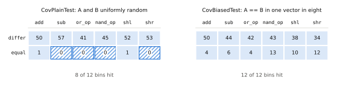

# Functional coverage you can read

This page answers: *how do I find out what my random stimulus reached, and how do I read the numbers
cocotb-coverage gives me?*

In DD104's [Coverage is a question](https://uoftasic.com/dd104/guide/coverage-is-a-question.html),
functional coverage was a list of questions that you kept yourself (have I run `SUB` with two
different operands? have I taken a backward branch?), and you could answer each of them with a `for`
loop and a set. cocotb-coverage 2.0 keeps the same kind of list in Python. You name the values you
care about, it counts how often the stimulus produces each one, and each run in the labs writes the
counts to a file that `make cov` merges and reports. In
[Lab 03, Part 2](../labs/lab-03-constraints-and-coverage-overview.md#part-2-coverage-you-can-read)
you write coverpoints for the router's packets. `router_rand_test` passes there and catches neither
of the two bugs planted in that lab's router, and your coverage shows you the holes in the test's
stimulus where those bugs are.

cocotb-coverage, like pyvsc, is in the course venv that Lab 03, Part 1 makes. The example for this
page,
[`guide-examples/functional-coverage-you-can-read/`](https://github.com/uoftasic/dd105-b/tree/main/guide-examples/functional-coverage-you-can-read),
sends random vectors to SimProc's ALU and samples each one.

## Coverpoints, bins and crosses

Here is coverage for ALU vectors. It counts the operations, three kinds of value for `A`, and
whether the two operands were equal:

```python
OPS = ["add", "sub", "or_op", "nand_op", "shl", "shr"]


def in_range(value, rng):
    """rel= for a bin written as (low, high)."""
    return rng[0] <= value <= rng[1]


@CoverPoint("alu.op", xf=lambda op, a, b: op, bins=list(range(6)), bins_labels=OPS)
@CoverPoint("alu.a", xf=lambda op, a, b: a, bins=[(0, 0), (1, 254), (255, 255)], rel=in_range,
            bins_labels=["zero", "other", "ones"])
@CoverPoint("alu.eq", xf=lambda op, a, b: int(a == b), bins=[0, 1], bins_labels=["differ", "equal"])
@CoverCross("alu.x_op_eq", items=["alu.op", "alu.eq"])
def sample(op, a, b):
    pass
```

Each **bin** is one question, and its count is the number of samples that answered yes. A
**coverpoint** groups the bins for one value. In cocotb-coverage a coverpoint is a decorator on a
function, here `sample()`, and every call to the function is one sample: `xf=` takes the value out
of the call's arguments, and the call counts that value in the bin it matches. A **cross** makes one
bin for every combination of two coverpoints' bins, so `alu.x_op_eq` has 6 × 2 = 12 bins, named by
the pairs of labels they stand for, from `('add', 'differ')` to `('shr', 'equal')`. It asks DD104's
question about operands for every operation. The cross goes below the coverpoints it crosses,
because the decorators run from the top down at each call, and the cross reads which bin each of
its coverpoints has just counted.

Every name is a dotted path, and the part before the last dot names a **group**. `alu` is the group
of everything whose name starts with `alu.`, and its counts are the sums of theirs. The test calls
`sample(op, a, b)` once for every vector it sends.

SimProc programs use equal operands on purpose, because `SUB rX, rX` is how you zero a register and
`NAND rX, rX` is how you write NOT. Equal operands also hide two of Lab 01's ALU bugs. With
`A == B`, `SUB` gives 0 whichever way round it subtracts (A01), and a `NAND` that computes NOR (A02)
still gives the right answer, because `~(A & A)` and `~(A | A)` are both `~A`.

## Ranges and rel=

cocotb-coverage puts a value in a bin when `value == bin`. That's fine for single values, but no
number is equal to a tuple, so a bin written as a range such as `(1, 254)` needs a relation
function, given as `rel=`, that says what "in the bin" means. `alu.a` has one, `in_range()`. The
example also has a coverpoint with two single values and a range written as a tuple between them,
and no `rel=`:

```python
@CoverPoint("quirk.a_no_rel", xf=lambda op, a, b: a, bins=[0, (1, 254), 255],
            bins_labels=["zero", "other", "ones"])
```

After 300 random vectors, `CovPlainTest` prints its counts:

```text
[COV] quirk.a_no_rel: {'zero': 1, 'other': 0, 'ones': 1}
```

Two values of `A` landed in the single-value bins, and the other 298 matched no bin at all, so
`other` stayed at 0, with no warning. You find it only by reading a bin's count against what you
know the test sent. A `rel=` applies to every bin of its coverpoint, so write every bin as a range,
`(0, 0)` included, as `alu.a` does. Lab 03, Part 2 has you meet this on the router's level
coverpoint.

## coverage.xml and make cov

Each test in the example ends by writing every bin's count to `coverage.xml` in its run folder:

```python
coverage_db.export_to_xml("coverage.xml")
```

`make cov` finds every `coverage.xml` under `build/runs`, merges them with cocotb-coverage's own
`merge_coverage()`, and prints each group, coverpoint and cross with the bins that were never hit.
Here is what it printed after one run of `CovPlainTest`, which sends 300 vectors with `A` and `B`
uniformly random:

```text
========================================================================
 COVERAGE   1 run, merged by cocotb-coverage into build/coverage/merged.xml
========================================================================
  top                                           81.48 %   22 of 27 bins
    top.alu                                       82.61 %   19 of 23 bins
      top.alu.op                                   100.00 %   6 of 6 bins
      top.alu.a                                    100.00 %   3 of 3 bins
      top.alu.eq                                   100.00 %   2 of 2 bins
      top.alu.x_op_eq                               66.67 %   8 of 12 bins
          not hit: ('sub', 'equal'), ('or_op', 'equal'), ('nand_op', 'equal'), ('shr', 'equal')
    top.quirk                                     75.00 %   3 of 4 bins
      top.quirk.a_no_rel                            66.67 %   2 of 3 bins
          not hit: other
      top.quirk.op_legal                           100.00 %   1 of 1 bins
          not hit: FAIL
========================================================================
```

The merge puts every group under one named `top`. `quirk` holds the example's other two items,
`a_no_rel` above and `op_legal` below, in a group of their own so that they don't change `alu`'s
counts.
In `alu`, every operation and every kind of `A` came up, but only `ADD` and `SHL` had a vector with
equal operands, so four of the twelve cross bins are empty. Only 2 of the 300 vectors had `A == B`,
which is about what uniform random operands give, because `B` matches `A` in one vector in 256.
`CovBiasedTest` makes `A == B` in one vector in eight, and one run of it filled the cross:



*The `[COV] x_op_eq` lines of the two runs, as grids. A hatched bin is empty.*

`make cov` names only the empty bins. The merged file, `build/coverage/merged.xml`, has every bin
with its count, and Lab 03, Part 2 has you read the length bins' counts from it with `grep`.

## The percentage

cocotb-coverage's `82.61 %` for `alu` is the number of bins hit divided by the number of bins, 19 of
23, with every bin of every coverpoint and cross under the group counted the same. The standard works
it out another way, and gives a group the average of its coverpoints' and crosses' coverage. For
`alu` that's the average of 100, 100, 100 and 66.67%, which is 91.67%. The two differ because the
cross has 12 of the group's 23 bins, so it weighs more than half of cocotb-coverage's number. `top`
comes to 81.48%, 22 of 27, because it counts `quirk`'s four bins too.

In Lab 03, Part 2 you work the same sums for the router's 41 bins, and get 46.34% by
cocotb-coverage's formula and 61% by the standard's. Twelve of those bins can't be hit by any test in
that lab, and they count in both percentages, so neither can reach 100% however good your stimulus
is. The counts don't depend on either formula, so to find the holes, read the list of bins that were
never hit, as you did above for the four `equal` bins.

## Ignore bins and illegal values

A coverpoint has no ignore bins. A value that matches none of its bins isn't counted anywhere, so
the way to ignore a value is to leave it out of the bins. SimProc's ALU has no operations 6 and 7,
and `alu.op` has no bins for them. A cross can ignore combinations: `CoverCross` takes
`ign_bins`, a list of label pairs such as `("full", "empty")`, and leaves those bins out of the cross
and out of its count. The course's reference testbench for the router,
[`labs/ref`](https://github.com/uoftasic/dd105-b/tree/main/labs/ref), ignores seven combinations of
one of its crosses that the router can't produce, and that cross then has 13 bins, all of them hit in
its regression. Lab 03 leaves
its impossible bins in, and has you sort them out by reading.

A value that should never happen at all goes in a `CoverCheck`, which counts a pass for every sample
and a failure for every sample its `f_fail` function picks out. The example's check fails on an
operation the ALU doesn't have:

```python
@CoverCheck("quirk.op_legal", f_fail=lambda op, a, b: op > 5, f_pass=lambda op, a, b: True)
```

`CovIllegalTest` sends `CovPlainTest`'s kind of vectors and then one vector with `ALUop` 6. Among
its `[COV]` lines are:

```text
[COV] quirk: 2 of 4 bins, 50.00%
[COV] quirk.a_no_rel: 2 of 3 bins, 66.67%
[COV] quirk.op_legal: 0 of 1 bins, 0.00%
```

and the check's counts, `{'PASS': 300, 'FAIL': 1}`. The run ended `ok`, because a `CoverCheck` raises
no error. The check counted as one bin of its group, which is why a check belongs in a group of its
own. Then `make cov` merged all three runs:

```text
    top.quirk                                    100.00 %   4 of 4 bins
      top.quirk.a_no_rel                            66.67 %   2 of 3 bins
          not hit: other
      top.quirk.op_legal                           200.00 %   2 of 1 bins
```

The merge counted the check's `PASS` and `FAIL` as two bins hit, out of a size of 1, so a check that
failed came out at 200%. That lifted `quirk` to 100%, with `other` still empty below it. So read a
check by its `FAIL` count, and make the test fail on an illegal value with a check of its own, in the
scoreboard, rather than leaving it to the coverage. (In the merged report of the passing runs, `make
cov` lists the check's `FAIL` bin as "not hit", which for a check is the result you want.)

## Three kinds of empty bin

A bin can be empty for one of three reasons. Some bins can't be hit by any test, because the
specification rules them out. In Lab 03, seven of the router's cross bins are like that, such as
`('full', 'empty')`, because the router drops a packet as FULL only when the output its route names
holds more than 8 beats. Some bins can be hit, but not by the testbench you have, because of how it
was built. Lab 03's tracker takes output 1's level as 0, for example, so `('out1', 'low')` stays
empty until Lab 04, and no test in Lab 03 asks for a FULL drop at all. The rest are holes in the
stimulus, like the `equal` bins above, and those are the ones worth your time, because a bug can sit
in them. Lab 03, Part 2 asks you to sort the router's 41 bins into these three groups, and both of
the lab's planted bugs are in bins of the third.

## Check yourself

1. A coverpoint for an output's level has `bins=[0, (1, 7), 8, 9, (10, 16)]` and no `rel=`. A run's
   tracker says the levels went up to 12. Which bins can be hit, and what do you change?

   <details>
   <summary>Answer</summary>

   Only the three written as numbers, 0, 8 and 9. No level is equal to a tuple, so the two range
   bins stay empty, with no warning. Write every bin as a range, `(0, 0)`, `(1, 7)`, `(8, 8)`,
   `(9, 9)` and `(10, 16)`, and give the coverpoint a `rel=` that tests `low <= value <= high`.

   </details>

2. After a regression, `make cov` says a group is at 100%, but one bin under it is listed as not
   hit. How can that be?

   <details>
   <summary>Answer</summary>

   Something under the group counts more than its size. In the example, a `CoverCheck` that failed
   in one run of three came out as `2 of 1` after the merge, and that extra bin made up for the empty
   `other`. Read each coverpoint, cross and check on its own, and read a check by its `FAIL` count
   rather than by the group's percentage.

   </details>

3. After `CovPlainTest`, `make cov` reports `19 of 23 bins` for `alu`. Which of the four empty bins
   would more seeds of the same test fill?

   <details>
   <summary>Answer</summary>

   All four, but slowly. They are `equal` bins, and only about one vector in 256 has equal operands,
   so each operation gets one about once in every 1,500 vectors. A test that makes `A == B` on
   purpose, as `CovBiasedTest` does, fills them in one run.

   </details>

## Further reading

cocotb-coverage's own documentation is the authority on its API. ChipVerify's coverage pages explain
the same ideas in SystemVerilog's covergroup syntax. Where they give a percentage, it's the
standard's average, not cocotb-coverage's share of bins hit.

- cocotb-coverage's [Tutorials](https://cocotb-coverage.readthedocs.io/en/latest/tutorials.html),
  for `rel=` and `ign_bins`, under "Translating SystemVerilog Constructs to cocotb-coverage".
  Correction: in "Using CoverCheck as Assertions", the callback that should fail the test is a
  `lambda` with a `raise` statement in it, which isn't valid Python. Write it as a function with
  `def`.
- cocotb-coverage's [Reference](https://cocotb-coverage.readthedocs.io/en/latest/reference.html),
  for `CoverPoint`, `CoverCross`, `CoverCheck` and `merge_coverage()`. It says that a failed
  `CoverCheck` is set to 0 "permanently". That holds within one run; after `merge_coverage()`, the
  example's failed check came out at 200%.
- ChipVerify's [Covergroup and Coverpoint](https://chipverify.com/systemverilog/systemverilog-covergroup-coverpoint),
  for what bins are for.
- ChipVerify's [Cross Coverage](https://chipverify.com/systemverilog/systemverilog-cross-coverage).
  Its `illegal_bins` raise an error at run time. cocotb-coverage's nearest thing, a `CoverCheck`,
  doesn't, as `CovIllegalTest` shows.

Next: [Lab 03: Constraints and coverage](../labs/lab-03-constraints-and-coverage-overview.md).
