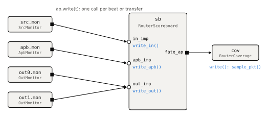

# Monitors, analysis ports and scoreboards

This page answers: *how does what a monitor sees on the pins get to the scoreboard and the
coverage, and what does the scoreboard do with it?*

Lab 01's pyuvm testbench for the ALU already used an analysis port. Its monitor wrote each vector to
the port, and the scoreboard checked each vector in its `write()` method. Lab 02's router testbench
was built without pyuvm, and its classes passed packets through queues. Your monitor turned the
handshakes on a stream into whole packets and put them in a queue, and the scoreboard ran a coroutine
of its own that took them out. Lab 03 added a tracker, with a loop of its own, that watched the pins
directly.

In [Lab 04](../labs/lab-04-the-same-testbench-in-pyuvm-overview.md) the router testbench is
rewritten in pyuvm, and it uses **analysis ports**, as Lab 01's did. Each of its monitors writes
every beat, or every APB transfer, to its analysis port as soon as it sees it, and the scoreboard
has no coroutine at all. It's a component with three write methods, and the monitors call them. This
page shows how that works on the ALU, what Lab 04's scoreboard does when a beat arrives, and what
goes wrong when a monitor reuses one object for every write.

The example for this page,
[`guide-examples/monitors-analysis-ports-and-scoreboards/`](https://github.com/uoftasic/dd105-b/tree/main/guide-examples/monitors-analysis-ports-and-scoreboards),
tests SimProc's ALU with a complete agent, made of a sequencer, the driver from the example for
[Sequences, sequencers and drivers](sequences-sequencers-and-drivers.md), and a monitor. The
environment connects three subscribers to the monitor's one analysis port: a scoreboard, a coverage
collector and a history that keeps every item it's given. The ALU is the one from Lab 01, and its
bug switch works here too. You set it when you run the simulator, so `make run BUG=A01` runs the same
test, on the same build, with the ALU whose `SUB` computes `B - A`.

## The monitor

A monitor reads the pins and reports what it saw. It doesn't drive anything, and it doesn't know
what the driver sent or what the answer should be, so the same monitor can feed a scoreboard, a
coverage collector and anything else you add later. The example's monitor reads the pins 5 ns into
every 10 ns period, as Lab 01's did, while the driver holds them steady:

```python
def next_item(self):
    return AluItem.create("seen")          # a new item every time

async def run_phase(self):
    vif, d = self.vif, self.vif.dut
    await Timer(vif.PERIOD_NS // 2, "ns")
    while True:
        if vif.valid:
            t = self.next_item()
            t.op = AluOp(int(d.ALUop.value))
            t.A = int(d.A.value)
            t.B = int(d.B.value)
            t.ALUout = int(d.ALUout.value)
            t.N = int(d.N.value)
            t.Z = int(d.Z.value)
            self.n_seen += 1
            self.ap.write(t)
        await Timer(vif.PERIOD_NS, "ns")
```

(`next_item()` is a separate method only so that a test can swap in a monitor that gets its items
some other way, as `MonAliasTest` does in "One object per write", below.)

Lab 04's monitors do the same for the router's streams, with one `StreamBeat` per handshake, stamped
with its cycle number, and for its APB port, with one `ApbItem` per completed transfer. They read the
pins at the falling edge in the middle of each cycle, the course's rule since Lab 02.

## Analysis ports

The monitor makes its port in `build_phase`, with `self.ap = uvm_analysis_port("ap", self)`. The
port's `write(t)` is an ordinary method, not a coroutine, so it can't wait. It calls the `write()` of
every subscriber connected to the port, one after another in the order they were connected, before
it returns. A port with no subscribers is allowed, and `write()` then does nothing. The monitor can't
tell who, if anyone, is connected to its port. The environment makes the connections, in its
`connect_phase`:

```python
def connect_phase(self):
    self.agt.mon.ap.connect(self.sb.analysis_export)
    self.agt.mon.ap.connect(self.cov.analysis_export)
    self.agt.mon.ap.connect(self.hist.analysis_export)
```

All three subscribers derive from `uvm_subscriber`, which gives each one its receiving end already
built, as a member called `analysis_export`, and you write only its `write(t)` method. The port
connects to that export, not to the component itself. `MonConnectTest` swaps in an environment that
writes `self.agt.mon.ap.connect(self.sb)`, and the run stopped in `connect_phase`:

```text
 BROKEN: UVMTLMConnectionError   1.83 s   log: build/runs/MonConnectTest-s1/run.log
   MonConnectTest: UVMTLMConnectionError: uvm_test_top.env.sb must be a subclass of uvm_export_base
```

Here are the report lines from one run of `MonRandTest`, which sends 200 vectors. The history kept
200 items and the scoreboard checked 200, the same number that the monitor wrote:

```text
  2000.00ns INFO     ..-and-scoreboards/mon_env.py(184) [uvm_test_top]: [MON] the monitor wrote 200 items
  2000.00ns INFO     ..-and-scoreboards/mon_env.py(106) [uvm_test_top.env.sb]: [SB] 200 vectors checked: 0 wrong
  2000.00ns INFO     ..-and-scoreboards/mon_env.py(126) [uvm_test_top.env.cov]: [COV] alu: 20 of 20 bins hit
  2000.00ns INFO     ..-and-scoreboards/mon_env.py(141) [uvm_test_top.env.hist]: [HIST] kept 200 handles to 200 different objects
```

### A scoreboard with several inputs

A subscriber has one export, and it calls the one method named `write()`. A scoreboard that listens
to several monitors needs a separate method for each input, and SystemVerilog UVM declares a new kind
of export for each with the macro `` `uvm_analysis_imp_decl ``. pyuvm 4.0.1 has no such macro. Lab
04 gives its scoreboard a small subscriber for each input instead, a `Fwd`, which passes everything
written to it on to a method of the scoreboard:

```python
class Fwd(uvm_subscriber):
    def __init__(self, name, parent, fn):
        super().__init__(name, parent)
        self.fn = fn

    def write(self, t):
        self.fn(t)
```

`RouterScoreboard.build_phase` makes three of them as its children:

```python
self.in_imp = Fwd("in_imp", self, self.write_in)
self.out_imp = Fwd("out_imp", self, self.write_out)
self.apb_imp = Fwd("apb_imp", self, self.write_apb)
```

and the environment connects each monitor to the right one. The figure shows which monitors write to
each.



*The connections that Lab 04's `RouterEnv.connect_phase` makes once you've done Part 2, which adds
output 1's agent. Before Part 2, only output 0's monitor is connected to `out_imp`. Both output
monitors write to the same `out_imp`, and each `StreamBeat` carries its port number, so
`write_out()` can tell which output a beat came from. The scoreboard decides what happens to each
packet and writes a record of it to its own analysis port, `fate_ap`, which the coverage subscribes
to.*

## The scoreboard

A scoreboard predicts what the design should have done and compares that with what the monitors saw.
The example's scoreboard does all its work inside `write()`. It gets the expected answer from
`predict()`, a model of the ALU written from SimProc's instruction set, as Lab 01's scoreboard does,
and compares it with the item:

```python
def write(self, t):
    out, n, z = predict(t)
    bad = t.ALUout != out
    if self.check_flags:
        bad = bad or t.N != n or t.Z != z
    self.n_checked += 1
    if bad:
        self.n_bad += 1
        self.logger.error(f"[SB] {t}, expected ALUout={out:02x} N={n} Z={z}")
```

On the ALU with bug A01 the run logged 30 errors, and this is the first one:

```text
    75.00ns ERROR    ..s-and-scoreboards/mon_env.py(97) [uvm_test_top.env.sb]: [SB] SUB A=9a B=db -> ALUout=41 N=0 Z=0, expected ALUout=bf N=1 Z=0
```

Logging the error fails nothing by itself. The test derives from the course's `BaseTest`, which
counted the 30 errors and failed the test in `final_phase`, and the verdict was `caught: 30 errors`.
In `check_phase` the scoreboard also makes sure that it checked at least one vector, because a
scoreboard that was never called would report no errors either.

Because `write()` can't wait, a scoreboard can't wait inside it for the design's answer. The ALU is
combinational, so the monitor reads its inputs and its result in the same period, and they arrive in
the same item. In the router, a packet goes in on one stream and comes out on another several cycles
later, so Lab 04's scoreboard splits the work between its write methods. When a packet's header comes
in, `write_in()` decides what the router must do with the packet: forward it to output 0 or 1, or drop
it as NOROUTE or FULL. It decides from the routing table, as it has seen it written over APB, and
from the level of each output, which `level()` works out from the beats written and taken. If the
router should forward the packet, `write_in()` queues each beat that it expects to come out of that
output. `write_out()` takes the next expected beat off the queue for the output that the beat came
from, and compares the two. `write_apb()` keeps the scoreboard's copy of the routing table up to
date, and checks every read of `DROP_CNT` against the drops the scoreboard has counted. At the end of
the test, `check_phase` reports any beats still left in the queues, because those are beats the
router never delivered. (As shipped, `write_in()` queues only output 0's beats, and `level()` takes
output 1's level as 0. Parts 2 and 3 of Lab 04 have you change those.)

The monitors all read the pins at the same falling edge, and cocotb runs them in no fixed order, so
in the cycle a header arrives, `write_out()` may already have counted a beat that left in that same
cycle. `level()` adds that beat back, because the specification counts only earlier cycles.

A scoreboard catches only the bugs that show up in what it compares. With `check_flags` off, which is
the default, the example's scoreboard compares `ALUout` and nothing else. Against Lab 01's three
bugs, `make check-all` gave:

```text
  caught  tier 1  A01_sub_operands_swapped         30 errors                       2.5s
  caught  tier 1  A02_nand_is_nor                  25 errors                       2.5s
  MISSED  tier 1  A03_zero_flag_low_nibble         0 errors                        2.5s
```

A03 makes the zero flag look only at the low four bits of `ALUout`. The monitor put every wrong `Z`
into an item, but no subscriber compared `Z` with anything. The next page,
[The factory and ConfigDB](the-factory-and-configdb.md), turns `check_flags` on from a test, without
editing the scoreboard.

## One object per write

`ap.write(t)` passes the same handle to every subscriber, so they all see one object. That's cheap,
and it's safe as long as no code changes the object after the write. The example's monitor makes a
new `AluItem` for every vector. `MonAliasTest` swaps in a monitor that makes one item and fills it in
again for every vector. (The swap is a factory override, which the next page explains.) The history
subscriber keeps every handle it's given, and at the end of that test it prints this:

```text
  2000.00ns INFO     ..-and-scoreboards/mon_env.py(141) [uvm_test_top.env.hist]: [HIST] kept 200 handles to 1 different objects
  2000.00ns INFO     ..-and-scoreboards/mon_env.py(145) [uvm_test_top.env.hist]: [HIST] vector 0: OR A=e7 B=01 -> ALUout=e7 N=1 Z=0
  2000.00ns INFO     ..-and-scoreboards/mon_env.py(145) [uvm_test_top.env.hist]: [HIST] vector 1: OR A=e7 B=01 -> ALUout=e7 N=1 Z=0
  2000.00ns INFO     ..-and-scoreboards/mon_env.py(145) [uvm_test_top.env.hist]: [HIST] vector 2: OR A=e7 B=01 -> ALUout=e7 N=1 Z=0
  2000.00ns INFO     ..-and-scoreboards/mon_env.py(145) [uvm_test_top.env.hist]: [HIST] vector 199: OR A=e7 B=01 -> ALUout=e7 N=1 Z=0
```

All 200 handles point at one object, which holds the last vector. The scoreboard in the same run
still reported `200 vectors checked: 0 wrong`, because it finishes with each item inside `write()`,
before the monitor fills the object in with the next vector. A subscriber that keeps the handle for
later, or queues it to compare when the answer arrives, sees the wrong values. So a monitor should
make a new object for every write. A subscriber that keeps anything should either copy the values it
needs, as Lab 04's scoreboard does when it queues `(data, last)` for each expected beat, or keep the
handle and never change the object.

## Coverage as a subscriber

A coverage collector is the simplest kind of subscriber, because its `write()` only samples. The
example's calls `sample(t)`, a function decorated with cocotb-coverage's coverpoints for the
operation, for equal operands, and their cross, and in `report_phase` it writes `coverage.xml` into
the run's folder, where `make cov` finds it.
[Functional coverage you can read](functional-coverage-you-can-read.md) explains the coverpoints.

What a collector subscribes to depends on what it covers. The example covers what went into the
ALU, so it subscribes to the monitor. Lab 04's `RouterCoverage` covers each packet's fate and the
level of its route's output when its header came in. Only the scoreboard works those out, so
`RouterCoverage` subscribes to the scoreboard's `fate_ap`.

## Check yourself

1. An analysis port's `write()` is an ordinary method. What does that rule out for a scoreboard's
   `write()`, and how does Lab 04's scoreboard live with it?

   <details>
   <summary>Answer</summary>

   The scoreboard's `write()` can't wait for anything, so it can't `await` a clock edge or a queue.
   The router's answer comes out cycles after the packet goes in, so `write_in()` predicts and queues
   the expected beats, and `write_out()` compares each beat when an output monitor reports it. The
   scoreboard doesn't need a coroutine of its own for any of that.

   </details>

2. In `MonAliasTest` the scoreboard passed and the history was wrong. Would a scoreboard that kept
   each input item on a list and compared it when an output arrived have passed?

   <details>
   <summary>Answer</summary>

   No. Every handle on its list would point at the one object, which by the time an output arrives
   holds a later vector, so the scoreboard would compare the wrong inputs with each output. The
   example's scoreboard passed only because it finished with each item inside `write()`.

   </details>

3. Two output monitors write `StreamBeat`s to the same `out_imp`. How does `write_out()` tell output
   0's beats from output 1's?

   <details>
   <summary>Answer</summary>

   Each output monitor stamps every beat with its port number, which it takes from its `OutCfg`, and
   `write_out()` uses `b.port` to pick which queue of expected beats to compare with.

   </details>

## Further reading

pyuvm's analysis ports and `uvm_subscriber` are in its source,
[`s12_uvm_tlm_interfaces.py`](https://github.com/pyuvm/pyuvm/blob/4.0.1/pyuvm/s12_uvm_tlm_interfaces.py)
and
[`s13_predefined_component_classes.py`](https://github.com/pyuvm/pyuvm/blob/4.0.1/pyuvm/s13_predefined_component_classes.py)
at 4.0.1. ChipVerify's pages are SystemVerilog UVM:

- [UVM Monitor](https://www.chipverify.com/uvm/uvm-monitor) builds a monitor for a register file.
  Correction: it says a monitor that didn't get its virtual interface can keep running after a
  `uvm_error`. It can't do anything useful, and in pyuvm a `ConfigDB().get()` with nothing to find
  and no default raises `UVMConfigItemNotFound` and ends the test, as the next page shows.
- [UVM TLM Analysis Port](https://www.chipverify.com/uvm/uvm-tlm-analysis-port), with a broadcast
  to three subscribers. Its warning that every receiver gets the same handle is the one
  `MonAliasTest` shows. Its log comes from UVM 1.1d.
- [Using _decl macro in TLM](https://www.chipverify.com/uvm/using-decl-macro-in-tlm) builds a
  two-input scoreboard with a macro that pyuvm doesn't have; Lab 04's `Fwd` does the same job.
  Correction: it says the macro can't go inside a class because SystemVerilog doesn't allow a class
  inside another class. SystemVerilog does allow nested classes.
- [UVM Scoreboard](https://www.chipverify.com/uvm/uvm-scoreboard). Its only check at the end of
  the test prints a count of mismatches, so a scoreboard that was never called passes it. The
  example's scoreboard and Lab 04's check for that in `check_phase`.

Next: [The factory and ConfigDB](the-factory-and-configdb.md).
