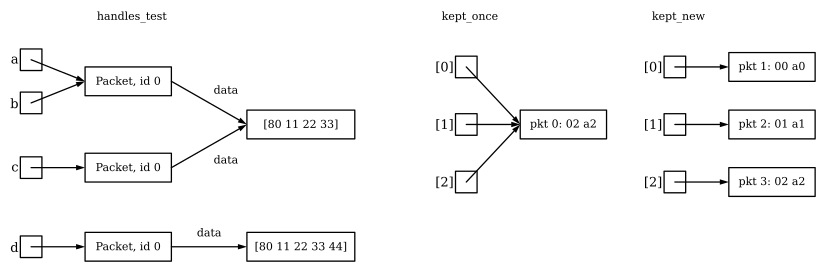
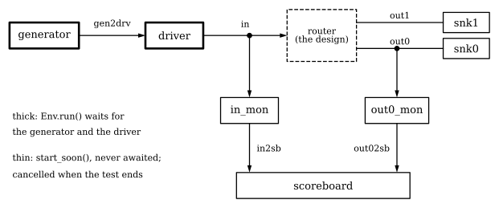

# Python classes and cocotb concurrency

This page answers: *a testbench has to drive, watch and check all at once, and hand packets from one
piece to the next. What do I need to know about Python objects and cocotb tasks before I write a
monitor and a scoreboard?*

In [Lab 02](../labs/lab-02-a-layered-testbench-without-pyuvm-overview.md) you'll write the router's
monitor and scoreboard, two plain Python classes in a testbench with no pyuvm in it. The rest of that
testbench is shipped: a generator that makes packets, a driver that offers them to the router's
input, a sink for each output, and an environment that makes all of them and runs the test. Seven
pieces run at the same time, and they pass packets to each other through three queues. The first
half of this page is about the objects those pieces pass around, and the second half is about
running the pieces side by side as cocotb tasks.

We ran every example on this page in the course image. The source is in
[`guide-examples/python-classes-and-cocotb-concurrency/`](https://github.com/uoftasic/dd105-b/tree/main/guide-examples/python-classes-and-cocotb-concurrency),
and `guide-examples/README.md` gives the command for each output, in its section for this page.

## Names and objects

The examples use a cut-down version of Lab 02's `Packet`, with a serial number added:

```python
class Packet:
    n_made = 0                    # a class attribute: one for the class

    def __init__(self, data=None):
        self.id = Packet.n_made   # instance attributes: one set per object
        Packet.n_made += 1
        self.data = list(data or [])

    def __str__(self):
        return f"pkt {self.id}: " + " ".join(f"{b:02x}" for b in self.data)
```

Each call of `Packet(...)` makes a new object and runs `__init__` on it. Lab 02's generator makes a
new `Packet` for every packet it sends, and your monitor will make one for every packet it sees on
its stream. A variable doesn't hold an object. It's a name that refers to one, and
assigning one name to another gives the same object a second name. The example `handles_test` does
this:

```python
a = None
print(f"a is {a}")
a = Packet([0x80, 0x11])
b = a
b.data.append(0x22)
c = copy.copy(a)
c.data.append(0x33)
d = copy.deepcopy(a)
d.data.append(0x44)
```

and prints the four packets, and then which names share what:

```text
a is None
a: pkt 0: 80 11 22 33
b: pkt 0: 80 11 22 33
c: pkt 0: 80 11 22 33
d: pkt 0: 80 11 22 33 44
a is b: True, a is c: False, a.data is c.data: True, a.data is d.data: False, Packet.n_made: 1
```

{fig-alt="Two drawings. On the left, under handles_test, small squares labelled a and b both have arrows to one box reading Packet, id 0, and a square labelled c has an arrow to a second box reading Packet, id 0. Both of those boxes have an arrow labelled data to one box reading [80 11 22 33]. A square labelled d has an arrow to a third box reading Packet, id 0, whose data arrow goes to its own box reading [80 11 22 33 44]. On the right, under kept_once, three squares labelled [0], [1] and [2] all have arrows to one box reading pkt 0: 02 a2. Under kept_new, three squares labelled [0], [1] and [2] each have an arrow to its own box: pkt 1: 00 a0, pkt 2: 01 a1 and pkt 3: 02 a2."}

*Left, `handles_test`: `a` and `b` name one `Packet`; `c` is a second `Packet` that shares the first
one's list; `d` has a list of its own. Right, `reuse_test`, from the next section: `kept_once` holds
three references to one reused `Packet`, and `kept_new` holds three `Packet`s. The values are the
ones the tests printed.*

`b = a` made no packet. The `22` appended through `b` shows when you print `a`, and `a is b` is
`True`, because `is` asks whether two names refer to the same object. Two different packets with the
same beats are not the same object, which is why Lab 02's `Packet` has a `same()` method that
compares the beats.

`copy.copy(a)` made a new `Packet` and copied each of `a`'s attributes into it, but an attribute
that refers to a list copies the reference, not the list. So `c.data` is `a.data`, and the `33`
appended through `c` changed `a` too. This is a *shallow* copy. `copy.deepcopy(a)` copied the list as
well, so the `44` went into `d` alone. Neither copy ran `__init__`, so all three packets have `id` 0
and `Packet.n_made` is still 1.

You won't often copy packets in the labs, but you'll pass references around all the time, and
every place that keeps a reference to an object shares that object with every other place that kept
one.

## The same object kept three times

`reuse_test` has two loops, and each one stands in for a monitor. Each loop builds the same three
two-byte packets and keeps them in a list, as Lab 02's scoreboard keeps the packets it expects. The
first loop makes one `Packet` before it starts and reuses it for every packet, and the second makes a
new `Packet` for each one:

```python
p = Packet()
for k in range(3):
    p.data.clear()
    p.data.append(k)
    p.data.append(0xA0 + k)
    kept_once.append(p)

for k in range(3):
    p = Packet()
    p.data.append(k)
    p.data.append(0xA0 + k)
    kept_new.append(p)
```

```text
one Packet, reused: [0] pkt 0: 02 a2
one Packet, reused: [1] pkt 0: 02 a2
one Packet, reused: [2] pkt 0: 02 a2
a new Packet each:  [0] pkt 1: 00 a0
a new Packet each:  [1] pkt 2: 01 a1
a new Packet each:  [2] pkt 3: 02 a2
```

`kept_once` holds three references to one object, and that object holds the last packet, `02 a2`,
so the list shows it three times and the first two packets are gone. A queue behaves the same way,
because what you put into it is a reference. That's why the `TODO` in Lab 02's `monitor.py` has you
start a new packet when `p` is `None`, and set `p = None` once you've put a finished packet into the
queue. The next packet then gets an object of its own, and the object the scoreboard was given keeps
the beats it had.

## None

If you use an attribute of a name that still refers to `None`, Python raises an exception, and the
test stops there. `none_test` sets `p = None`, prints a line, and then appends a beat to `p.data`:

```text
appending a beat to p
     0.00ns WARNING  cocotb.Test none_test.none_test    'NoneType' object has no attribute 'data'
                                                        Traceback (most recent call last):
                                                          File "/w/guide-examples/python-classes-and-cocotb-concurrency/classes_demo.py", line 78, in none_test
                                                            p.data.append(0x80)
                                                            ^^^^^^
                                                        AttributeError: 'NoneType' object has no attribute 'data'
```

and the course's verdict on the run is

```text
 BROKEN: AttributeError   0.23 s   log: build/runs/none_test-s1/run.log
```

The traceback names the file and the line where the `None` was used. The graders mark a run like
this `BROKEN` rather than caught, because the exception is a mistake in the testbench and not a check
that fired. In Lab 02 you'll see this error if your monitor appends a beat to `p.data` before it has
made `p`.

## Inheritance and super()

A class can derive from another. It inherits all of that class's attributes and methods, and it can
override any of those methods with a version of its own. In Python every method call is looked up on
the object's own class when the call happens, so a method written in the base class that calls
another method gets the derived class's version, if there is one. In `dispatch_test`, `Component`
has a `report()` method that calls `self.kind()`, and `Scoreboard` derives from `Component` and
overrides `kind()`:

```python
class Component:
    def __init__(self, name):
        self.name = name
        self.n_errors = 0

    def kind(self):
        return "a Component"

    def report(self):
        print(f"report() of Component, on {self.name}: {self.kind()}, {self.n_errors} errors")


class Scoreboard(Component):
    def __init__(self, name):
        super().__init__(name)
        self.expected = []

    def kind(self):
        return "a Scoreboard"
```

`Component("c").report()` and `Scoreboard("sb").report()` both run `Component`'s `report()`, and
the call to `self.kind()` inside it went to the object's own class:

```text
report() of Component, on c: a Component, 0 errors
report() of Component, on sb: a Scoreboard, 0 errors
```

pyuvm calls your code the same way. Its phase machinery calls `build_phase()` and `run_phase()` on
each component, and when the component is your `AluDriver`, it runs your versions.

`Scoreboard.__init__` starts with `super().__init__(name)`, which runs `Component`'s `__init__` and
sets `name` and `n_errors`. Leave that line out and Python doesn't complain when the object is made,
only when something first uses an attribute that `Component.__init__` would have set.
`super_test` makes a `ForgetfulScoreboard`, whose `__init__` is `Scoreboard`'s without the `super()`
line:

```text
made a ForgetfulScoreboard; its attributes: ['expected']
     0.00ns WARNING  cocotb.Test super_test.super_test  'ForgetfulScoreboard' object has no attribute 'name'
```

The traceback points at the `print` in `report()`, not at the constructor that left the attribute
out. In pyuvm the same rule applies to every method you override where the base class does work of
its own: `RouterBaseTest.build_phase()` puts the router in `ConfigDB`, and `BaseTest.final_phase()`
counts the errors, so a test that overrides either one calls the base version through `super()`.

## Class attributes

An attribute assigned in the class body belongs to the class, so every object shares it.
`Packet.n_made` is one, on purpose, because it counts packets across all of them. A list made in the
class body is shared the same way, which is almost never what you meant. `class_attr_test` makes two
sinks from each of two classes, `Sink`, whose `beats = []` is in the class body, and `OwnSink`, which
sets `self.beats = []` in `__init__`, and appends one beat to each sink:

```text
Sink: out0 took ['0x11', '0x22'], out1 took ['0x11', '0x22']
OwnSink: out0 took ['0x11'], out1 took ['0x22']
```

Lab 02's classes make every list and counter in `__init__`, and yours should too.

## Tasks

A coroutine is an `async def` function, and `await coro()` runs it inside your own task until it
returns. To run it alongside the code that started it, you hand it to `cocotb.start_soon()`, which
wraps it in a **task** and returns the `Task` object. The task doesn't start at once: it runs once
the code that started it reaches its next `await`. You can wait for a task later, or never.

The example's `start_test` starts three tasks, A, B and C, which finish 10, 20 and 30 ns after they
start, three times over. The first time it waits for all three with `await Combine(a, b, c)`, the
second time for the first one with `await First(a, b, c)`, and the third time for none of them:

```text
  0 ns: start A, B and C, and await Combine(a, b, c)
 10 ns:   A finished
 20 ns:   B finished
 30 ns:   C finished
 30 ns: the test goes on after Combine
 30 ns: start A, B and C, and await First(a, b, c)
 40 ns:   A finished
 40 ns: the test goes on after First
 50 ns:   B finished
 60 ns:   C finished
 60 ns: Combine returns
 60 ns: start A, B and C, and await none of them
 60 ns: the test goes on at once
 70 ns:   A finished
 80 ns:   B finished
 90 ns:   C finished
```

- `Combine` waits for every task, so the test went on at 30 ns, when the slowest one finished.
- `First` waits for the first to finish, so the test went on at 40 ns, when A finished. It doesn't
  stop the other two, and B and C kept running until 50 and 60 ns. The test then waited for them
  with `Combine` before it went on.
- Waiting for none of them lets the test go on at once, while the three tasks run.

{fig-alt="A block diagram. A generator box has an arrow labelled gen2drv to a driver box, which has an arrow labelled in to a dashed box labelled router (the design). The router's outputs out1 and out0 go to boxes labelled snk1 and snk0. A dot on the in arrow leads down to an in_mon box, and a dot on the out0 line leads down to an out0_mon box. Arrows labelled in2sb and out02sb lead from the two monitors to a scoreboard box at the bottom. The generator and driver have thick outlines; the note says thick boxes are what Env.run() waits for, and thin boxes are started with start_soon, never awaited, and cancelled when the test ends."}

*From Lab 02's `env.py`. Each solid box is an object whose `run()` method runs as a task, or, for
the driver, inside the test's own task. The dashed box is the router. The arrows labelled
`gen2drv`, `in2sb` and `out02sb` are the three queues, and `in`, `out0` and `out1` are the router's
streams.*

Lab 02's `Env.run()` starts the two sinks, the two monitors and the scoreboard with
`cocotb.start_soon()` and never waits for them, because each runs a `while True` loop that never
returns. It starts the generator with `cocotb.start_soon()` too, and then runs the driver itself,
with `await self.drv.run(self.cfg.n)`, so the driver and the generator work at the same time. When the driver has sent every
packet, `await gen` waits for the generator's task, which by then has finished. Then the
environment waits 50 cycles for the outputs to drain and calls the scoreboard's `report()`, while the
sinks, the monitors and the scoreboard are still running.

### Tasks started in a loop

`capture_test` starts three tasks in a loop,
first as a coroutine defined inside the loop that reads the loop variable `i`, then as a coroutine
that is given `i` as an argument:

```python
for i in range(3):
    async def show():
        say(f"  i = {i}")
    cocotb.start_soon(show())
...
for i in range(3):
    cocotb.start_soon(show_arg(i))
```

```text
  0 ns: three tasks, each a closure that reads i
  0 ns: the loop has finished
  0 ns:   i = 2
  0 ns:   i = 2
  0 ns:   i = 2
  5 ns: three tasks, each given i as an argument
  5 ns: the loop has finished
  5 ns:   j = 0
  5 ns:   j = 1
  5 ns:   j = 2
```

None of the six tasks ran before its loop had finished. The first three read `i` when they ran, by
which time the loop had left it at 2. A function defined inside another one reads the outer
variables when it runs, not when it's defined. The second three were each given the value of `i` at
the moment `show_arg(i)` was called, so they printed 0, 1 and 2. Give a task what it needs as
arguments. Lab 02's environment starts its tasks in a loop too, with `cocotb.start_soon(piece.run())`,
and that's safe, because `piece.run()` is called inside the loop and each coroutine it makes keeps
its own `piece`.

## Queues

A `cocotb.queue.Queue` carries values from tasks that `put()` them to tasks that `get()` them, in the
order they were put. `await q.get()` waits while the queue is empty, and if you gave the queue a
`maxsize`, `await q.put()` waits while it's full. `queue_test` has a generator that makes four items
as fast as it can and a driver that takes 10 ns over each, joined first by an unbounded queue and
then by one with room for one item:

```text
  0 ns: Queue(maxsize=0)
  0 ns: gen put 0
  0 ns: gen put 1
  0 ns: gen put 2
  0 ns: gen put 3
  0 ns: gen has made all four
  0 ns:   drv got 0
 10 ns:   drv got 1
 20 ns:   drv got 2
 30 ns:   drv got 3
 40 ns: Queue(maxsize=1)
 40 ns: gen put 0
 40 ns:   drv got 0
 40 ns: gen put 1
 50 ns:   drv got 1
 50 ns: gen put 2
 60 ns:   drv got 2
 60 ns: gen put 3
 60 ns: gen has made all four
 70 ns:   drv got 3
```

`maxsize=0`, the default, means no limit. With it, the generator made all four items at once, and
the driver worked through them, one every 10 ns. With room for one, each `put()` waited until the
driver had taken the item before it, so the generator kept pace with the driver and finished 20 ns
after it started. The driver got the same items, 10 ns apart, both ways.

Lab 02's queues are all unbounded (`Queue()`), so its generator makes every packet at the start and
the driver works through them. The monitors' queues are the other way round, with the reader waiting
for the writer. A monitor puts a packet into its queue each time one finishes on its stream, and the
scoreboard's `get()` waits until the next one arrives. The scoreboard reads two of these queues,
`from_in` and `from_out0`, and they fill at their own pace. A task waiting in `from_out0.get()` can't
take a packet from `from_in` at the same time, so the scoreboard's `run()` starts two tasks of its
own. One predicts each input packet as it arrives, and the other checks each packet from output 0
against the predictions made so far.

## Events

A `cocotb.triggers.Event` lets one task tell others that something has happened. `e.set()` sets it,
and every task waiting in `await e.wait()` goes on. The event stays set until something calls
`e.clear()`, so a task that starts waiting after the `set()` doesn't wait at all. `event_test` starts
a waiter, sets the event at 10 ns and starts a second waiter in the same moment, then clears the
event at 20 ns and starts a third:

```text
  0 ns:   first: waiting
 10 ns: done.set()
 10 ns:   first: done.wait() returned
 10 ns:   second: waiting
 10 ns:   second: done.wait() returned
 20 ns: done.clear()
 20 ns:   third: waiting
 30 ns: end of the test
```

The third waiter never returned, because nothing set the event again. Lab 02 has no events. You'll
meet one in Lab 04, whose scoreboard sets an `Event` called `stop` at its 50th error, and whose tests
wait on it so that the run ends there. pyuvm uses one too: it ends the run phase by setting an event
when the last objection is dropped.

## Stopping tasks

`t.cancel()` stops a task: cocotb raises `CancelledError` inside it at the `await` where it's
waiting, and unless the task catches it, the task ends there. `cancel_test` starts a monitor that
counts a tick every 10 ns, and a parent task that counts its own ticks and has started a child that
counts too. At 25 ns it cancels the monitor and the parent, and 50 ns later it prints the counts
again:

```text
 25 ns: cancel the monitor and the parent: {'mon': 2, 'parent': 2, 'child': 2}
 75 ns: 50 ns later: {'mon': 2, 'parent': 2, 'child': 7}
 75 ns: mon.cancelled() is True, par.cancelled() is True
```

The monitor and the parent stopped at 2, and the child went on counting. cocotb doesn't keep track of
which task started which, so cancelling a task leaves the tasks it started running. To stop those
too, keep their `Task` objects and cancel each one.

You don't have to stop the tasks that run for the whole test, because cocotb cancels every task the
test started when the test ends. `end_test` starts a monitor whose loop catches `CancelledError`,
prints a line and raises it again, and returns 35 ns later:

```text
 35 ns: the test returns
 35 ns:   the monitor was cancelled
```

That's how Lab 02's sinks, monitors and scoreboard stop: the test's `assert` comes after
`Env.run()` returns, and when the test function returns, cocotb cancels every task that is still
running.

## An exception in a task

A mistake in a task, such as a misspelt name, raises an exception in that task, and what happens
next depends on whether anything is waiting for the task. The example's `broken_monitor()` waits
20 ns and then appends to a list called `pkts`, which doesn't exist. Four tests start it as a task:

| Test | What it does after starting the task | Verdict |
|---|---|---|
| `unwatched_test` | waits 100 ns and never looks at the task | `BROKEN: NameError`, at 20 ns |
| `joined_test` | `await t` | `BROKEN: NameError`, at 20 ns |
| `first_test` | `await First(t.complete, Timer(100, unit="ns"))` | `ok: passed`, at 20 ns |
| `first_result_test` | the same, then `t.result()` | `BROKEN: NameError`, at 20 ns |

When nothing waits for a task, cocotb fails the test with the task's exception as soon as it
happens:

```text
    20.00ns WARNING  cocotb.Task 2.broken_monitor       name 'pkts' is not defined
```

`await t` raises the task's exception in the task that waits for it, so `joined_test` failed the
same way. `first_test` is the case to watch for. cocotb counts the task as watched because something
is waiting on its `complete` trigger, `First` returns once the task has finished, and nothing raises
the exception again:

```text
 20 ns: First returned; t.done() is True
 20 ns: the test reached its end
```

The test passed with a monitor that crashed at 20 ns. A testbench whose monitor stops at 20 ns
sends nothing more to its scoreboard, so the same test would pass on a broken design too. If you ever wait on `t.complete`, call `t.result()` on
the task once it's done, which raises its exception if it had one, as `first_result_test` shows.
Lab 04's `RouterLabTest`, which its tests derive from, does exactly that. It waits with `First` for
its stimulus task, a watchdog task or the scoreboard's `stop` event, and then calls `result()` on
each task that has finished and `cancel()` on each that hasn't. Lab 02's environment waits for its
tasks only with `await gen`, and starts the rest without waiting for them, so an exception in your
monitor or scoreboard fails the test as `BROKEN` with its traceback in the log.

## Check yourself

1. Your scoreboard reports that every packet it expected has the same beats, those of the last packet
   the input monitor saw. The monitor does `p = Packet()` once, in its `__init__`. What's wrong, and
   how do you fix it?

   <details>
   <summary>Answer</summary>

   The monitor puts the same object into the queue for every packet and refills it each time, so
   every reference the scoreboard kept refers to one object, and that object holds whatever was
   written into it last. Make a new `Packet` for each packet the monitor sees, and stop using the old
   one once it's in the queue, which is what setting `p = None` after the `put()` does.

   </details>

2. A test starts eight tasks in a loop, `for k in range(8)`, each a coroutine defined inside the loop
   that logs `k`. Every task logs 7. Why, and what's the fix?

   <details>
   <summary>Answer</summary>

   None of the tasks runs until the test next waits for something, by which time the loop has
   finished and left `k` at 7, and each coroutine reads `k` when it runs. Pass `k` to the coroutine
   as an argument, as `show_arg(i)` was in `capture_test`, so that each task gets the value `k` had
   when it was started.

   </details>

3. What would happen if `Env.run()` started the scoreboard with `await self.sb.run()` instead of
   `cocotb.start_soon(self.sb.run())`?

   <details>
   <summary>Answer</summary>

   Once you've written it, the scoreboard's `run()` waits for its two loops, which never return, so
   `Env.run()` would wait there for ever. It would never get to the driver, no packet would be sent,
   and the run would go on until `make` stopped it after `RUN_TIMEOUT`, 300 s by default, and graded
   it `BROKEN`.

   </details>

4. Your scoreboard's output loop has a typo that raises `NameError` at the first packet from output 0.
   What does the verdict say in Lab 02, and what would it say if `Env.run()` had waited for the
   scoreboard's task with `First(task.complete, ...)`?

   <details>
   <summary>Answer</summary>

   In Lab 02 the exception fails the test, and the verdict is `BROKEN: NameError`, with the
   traceback in the log. With `First(task.complete, ...)` the task would count as watched,
   the exception would be dropped, and the test could pass with a scoreboard that stopped checking
   at the first packet, unless the code called `task.result()` afterwards.

   </details>

## Further reading

- The Python tutorial's chapter on [classes](https://docs.python.org/3.12/tutorial/classes.html).
  Its section on class and instance variables shows the shared-list mistake that
  `class_attr_test` makes.
- The [`copy` module](https://docs.python.org/3.12/library/copy.html): shallow and deep copies, and
  how a class can define its own.
- The Python FAQ's answer to
  [why lambdas defined in a loop all return the same result](https://docs.python.org/3.12/faq/programming.html#why-do-lambdas-defined-in-a-loop-with-different-values-all-return-the-same-result),
  which is `capture_test`'s first loop with a `lambda` in place of a coroutine.
- cocotb 2.0.1's [Coroutines and Tasks](https://docs.cocotb.org/en/v2.0.1/coroutines.html):
  `start_soon`, `First` and `Combine`, and waiting for several things at once. It says that `First`
  doesn't cancel the tasks that hadn't finished, as `start_test` shows. It doesn't say what happens
  to tasks still running when a test ends, or to an exception in a task that nothing waits for;
  `end_test` and the four exception tests on this page show what cocotb 2.0.1 does.

Next: [Driving and sampling on the clock](driving-and-sampling-on-the-clock.md).
