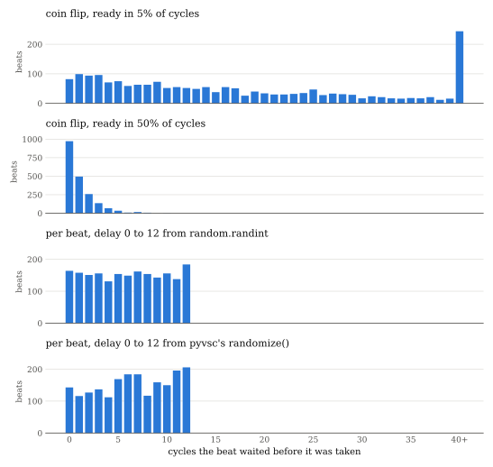

# Reactive agents and backpressure

This page answers: *the design decides when each beat appears on its output. How does a testbench
answer each one, and how do you choose how long each beat waits?*

Your Lab 04 sink flipped a coin in every cycle to set `out_ready`, which was 1 with probability
`ready_pct` percent whether or not a beat was on offer. That is backpressure, but `ready_pct` was
the only thing about it you could set. In
[Lab 05, Part 1](../labs/lab-05-protocol-rules-and-backpressure-overview.md#part-1-the-lab-04-testbench-against-this-labs-bugs),
the coverage group `router.wait` takes each packet that an output delivers and records the
longest that any of its beats waited for `out_ready`. Its bins are `none` for 0 cycles,
`short_wait` for 1 to 3, `long_wait` for 4 to 20 and `stalled` for more than 20, crossed with the
two outputs, and with Lab 04's sinks `make cov` reports:

```text
      top.router.wait                               92.86 %   13 of 14 bins
        top.router.wait.port                         100.00 %   2 of 2 bins
        top.router.wait.wait                         100.00 %   4 of 4 bins
        top.router.wait.x_port_wait                   87.50 %   7 of 8 bins
            not hit: ('out1', 'short_wait')
```

No packet on output 1 had a longest wait of 1 to 3 cycles. In
[Part 3](../labs/lab-05-protocol-rules-and-backpressure-overview.md#part-3-a-sink-that-answers-each-beat)
you'll finish a sink driver that answers each beat separately, with an item from a sequence. This
page shows how an agent like that is put together in pyuvm, using a small design of our own in
[`guide-examples/reactive-agents-and-backpressure/`](https://github.com/uoftasic/dd105-b/tree/main/guide-examples/reactive-agents-and-backpressure),
and measures how long the beats wait with each kind of sink.

## Who starts a transfer

In the agents of Labs 01 and 04 that take items from a sequence, the testbench decides when each
transfer happens. Lab 04's source driver, for example, calls `get_next_item()`, waits until its
sequence hands over a packet, and then puts the packet on the input. Nothing happens on the input
until the driver has a packet, so the driver can wait as long as it likes.

A **reactive** agent works the other way round. The design decides when something happens, and the
testbench answers. A sink is the simplest example. The router decides when a beat appears on an
output, and the sink decides how long that beat waits before it's taken. Other examples are a
memory model that answers a processor's read requests, and a bus slave. A reactive agent has the
usual pieces (an item, a sequence, a sequencer, a driver and a monitor), but each of its items
describes an answer to something the design does, rather than a transfer for the driver to start.
Its driver also has to drive its side of the interface in every cycle, whether or not it has an
item.

Our example's design, `beat_src`, numbers its beats 0, 1, 2 and so on. After each handshake it
leaves its output idle for 1 to 4 cycles, a number it takes from an LFSR, and then puts the next
beat on the output, where the beat stays until the sink takes it. The sink agent has two modes,
which `+MODE=` picks. In `coin` mode its driver does what Lab 04's did. In `beat` mode the driver
answers each beat with one `SnkItem`, and the item says how many cycles the beat waits after it
first appears:

```python
class SnkItem(uvm_sequence_item):
    def __init__(self, name="snk_item"):
        super().__init__(name)
        self.delay = 0
        self.max_delay = 12

    def randomize(self):
        self.delay = random.randint(0, self.max_delay)
```

A delay of 0 means `ready` is already 1 when the beat appears.

## A sequence that never ends

The sink's sequence makes one item per beat, for as long as the test runs:

```python
async def body(self):
    make = vsc_item_class() if self.cfg.item == "vsc" else SnkItem
    while True:
        it = make("snk_item")
        await self.start_item(it)
        it.max_delay = self.cfg.max_delay
        self.timed(it.randomize)
        await self.finish_item(it)
```

(`vsc_item_class()` makes the pyvsc version of the item that one of the measurements below uses,
and `timed()` calls `randomize()` and adds up how long it took.) The test starts this sequence with
`cocotb.start_soon(seq.start(self.snk.sqr))`, so the sequence runs beside the test's `run_phase`
and nothing ever waits for it to return. A pyuvm sequence raises no objection of its own. The test
raises one, and it drops it once the monitor has counted 2,000 beats, so the test's objection
alone decides when the run ends. Lab 05's base test starts a `SinkSeq` on each output the same
way, before it resets the router.

pyuvm hands the item over in two steps. `start_item()` puts the item in the sequencer's queue and
waits there until the driver's `get_next_item()` takes it. Only then does the sequence go on, set
the item's fields and call `finish_item()`, which tells `get_next_item()` that the item is ready
and then waits until the driver calls `item_done()`. So the sequence is never more than one item
ahead of the beats, and it decides each item's values when the driver asks for the item, not
before. No simulation time passes in that exchange. In the run with per-beat delays from
`random.randint`, the driver's `[DRV]` line at the end said:

```text
[DRV] get_next_item() returned 2000 items, 1 of them at a later time than it was called (called at 5 ns, returned at 10 ns)
```

The one late item was the first, which the driver asked for at 5 ns, before the test had started
the sequence at 10 ns. Every other `get_next_item()` returned in the time step in which the driver
called it.

## A driver that can't wait

The driver's loop has two halves, one for each half of the clock cycle. Here it is with the
countdown of the item's delay left out, since you'll write the router's in Part 3:

```python
while True:
    await RisingEdge(d.clk)
    if cfg.mode == "coin":
        rdy = int(random.randrange(100) < cfg.ready_pct)
    d.ready.value = rdy                         # ready for the cycle that starts here
    if cfg.mode == "coin":
        continue
    await FallingEdge(d.clk)                    # the middle of the cycle
    v = bool(d.valid.value)
    if v and rdy:                               # a handshake at the next edge
        self.seq_item_port.item_done()
        it = None
    ...                                         # one more cycle of this beat's wait
    if it is None:
        it = await self.seq_item_port.get_next_item()
        ...
    rdy = ...                                   # ready in the next cycle
```

It drives `ready` just after the rising edge, and it looks at `valid` at the falling edge, the
course's timing rule from Lab 02. At the falling edge it knows whether a beat moves at the next
rising edge. If one does, that beat has had its answer, so the driver calls `item_done()` and asks
for the item for the next beat.

A pyuvm driver has `get_next_item()`, which waits until its sequence hands over an item, and no
call that returns at once when the sequence has nothing ready. The sink's driver can't afford to
wait, because it has to drive `ready` at the next edge whatever happens. It gets away with
`get_next_item()` because the sequence never ends and is always waiting in `start_item()` with
the next item, so the call comes back in the same time step, as the `[DRV]` line showed. When no
sequence is running on the sink, the call doesn't come back at all. With `+NOSEQ` the test starts
none, and in beat mode it printed, after the 3,000 cycles it was given:

```text
[WAIT] per beat, delays 0 to 12 from random.randint: 0 beats taken in 3001 cycles
[DRV] get_next_item() returned 0 items, 0 of them at a later time than it was called; it has been waiting in get_next_item() since 5 ns
```

The driver drove `ready` to 0 at the first rising edge, called `get_next_item()` at the first
falling edge, and never got past it, so `ready` stayed 0 and the first beat waited for the whole
run. Lab 05's `SinkDriver` has the same shape, and Part 3 asks you why it needs a sequence that
never ends.

## Measured waits for each sink

We ran 2,000 beats through each sink and counted, for each beat, the cycles it waited between
appearing and being taken. The table sorts the waits into the same ranges as `router.wait`'s
bins, but it counts every beat, where `router.wait` counts each packet once, by its longest wait.

| Sink | Waited 0 | 1 to 3 | 4 to 20 | More than 20 | Mean wait |
|---|---|---|---|---|---|
| coin flip, 5% | 82 | 289 | 911 | 718 | 18.98 |
| coin flip, 50% | 973 | 890 | 137 | 0 | 1.06 |
| coin flip, 95% | 1890 | 110 | 0 | 0 | 0.06 |
| per beat, delays 0 to 12 from `random.randint` | 164 | 465 | 1371 | 0 | 6.03 |
| per beat, delays 0 to 12 from pyvsc's `randomize()` | 143 | 380 | 1477 | 0 | 6.48 |

{width=720 fig-alt="Four bar charts, one above the other, sharing an x-axis of wait in cycles from 0 to 40 or more. Coin flip at 5 percent: between 38 and 99 beats at each wait from 0 to 17, then between 12 and 47 at each wait from 18 to 39, with a tall last bar of 244 beats at 40 or more. Coin flip at 50 percent: 973 beats at 0, 495 at 1, 259 at 2, 136 at 3, 68 at 4, and fewer than 40 at each wait from 5 to 10. Per beat from random.randint, delays 0 to 12: bars of 131 to 184 at every wait from 0 to 12, and nothing after. Per beat from pyvsc's randomize: bars of 112 to 143 at 0 to 4 and 117 at 8, and 150 to 206 at 5 to 7 and 9 to 12, the tallest at 12."}

A coin-flip sink gives each beat the same chance of being taken in every cycle, so its waits fall
off geometrically. If $p$ is `ready_pct` as a fraction, a beat waits $w$ cycles with probability
$p\,(1-p)^{w}$, and the mean wait is $(1-p)/p$, which is 19 cycles at $p = 5\%$, 1 cycle at 50%
and 0.05 at 95%, against our measured 18.98, 1.06 and 0.06. Whatever the setting, a wait of 0
cycles is the most likely, and each wait is $1-p$ times as likely as a wait one cycle shorter, so
`ready_pct` sets only how quickly the waits fall off. At 5%, 1,629 of the 2,000 beats waited 4
cycles or more, and only 289 waited 1 to 3. At 50%, no beat waited more than 10 cycles. At 95%,
1,890 of the 2,000 beats were taken in the cycle they appeared.

The test you inherit from Lab 04 runs each sink at 100% or 5% in its four phases, and stalls
output 0 completely while `close_holes()` runs. At 100% a beat never waits. At 5% a packet of
more than one beat nearly always has a beat that waits 4 cycles or more, so a packet whose longest
wait is 1 to 3 cycles is rare, and output 1 delivered none.

A per-beat sink makes each beat wait for the delay in its item, so the spread of the waits is the
spread of the delays that the sequence produced. With delays of 0 to 12, between 1,371 and 1,477
beats waited 4 to 20 cycles, and none waited more than 20. Lab 05's `OutCfg.mode` offers both kinds
of sink. `SNK_PCT` is Lab 04's coin flip, and in `SNK_FAST`, `SNK_SLOW` and `SNK_RANDOM` the
driver answers each beat with an item.

## Check the distribution you got

If the sequence picked each of the thirteen delays from 0 to 12 equally often, each would come up
about 154 times in 2,000. With `random.randint` every value came up between 131 and 184 times on
seed 1. The pyvsc item leaves the delay to pyvsc's solver, with the constraint
`self.delay <= self.max_delay` on an 8-bit random field, and its values weren't spread evenly. On
seed 1 the delays 11 and 12 came up 196 and 206 times, and 1 and 4 only 116 and 112 times. On
seeds 2 and 3, 12 came up 225 and 235 times, and on all three seeds each of the values 0 to 4 and
8 came up fewer than 154 times. As in Lab 03, a constraint tells you which values are allowed, not
how often each one comes out, so count what the stimulus actually produced.

The solver is also slow for a job that runs once per beat. The 2,000 calls to pyvsc's
`randomize()` took 2.02 s, which is 988 a second, and the run as a whole took 6.36 s against
1.04 s with `random.randint`. The router's sinks make one item for every beat that leaves the
router, so Lab 05's `ReadyItem` draws from Python's `random` instead. Its `randomize()` first
picks the range a delay comes from (0 for half the items, 1 to 3 for three in ten, 4 to 12 for the
rest) and then the value inside it, and `router.wait` is where you check the result.

## The sink's configuration object

The sink's driver reads its mode and `ready_pct` from a configuration object, `SnkCfg`, in every
cycle, and its sequence reads `max_delay` for every item. So a test, or a virtual sequence, can
change the backpressure in the middle of a run just by writing a field of that object, without
starting anything on the sink's sequencer. In Lab 05, Part 4, `backpressure()` changes both
sinks' modes this way, by writing their `OutCfg`, every 30 to 250 cycles while the packets go
in. [Virtual sequences](virtual-sequences.md) explains how a sequence gets hold of the object.

## Check yourself

1. A coin-flip sink has `ready_pct` set to 20. What fraction of the beats are taken in the cycle
   they appear, and what is the mean wait?

   <details>
   <summary>Answer</summary>

   20% of beats wait 0 cycles, because the coin comes up 1 in the beat's first cycle with
   probability 0.2. The mean wait is $(1-p)/p = 0.8/0.2 = 4$ cycles.

   </details>

2. `SinkTest` starts the sink's sequence with `cocotb.start_soon(seq.start(self.snk.sqr))`.
   What would happen if it wrote `await seq.start(self.snk.sqr)` instead?

   <details>
   <summary>Answer</summary>

   The sequence's `body()` loops forever, so `seq.start()` never returns, and the test's
   `run_phase` would wait at that line for the rest of the run. It would never reach the wait for
   2,000 beats or drop its objection, so the run would go on until something stopped it from
   outside. In the course that's `make`'s run timeout, and a run that it stops is graded BROKEN.

   </details>

3. An item with a delay of 0 reaches the driver while the design's output is idle. What does the
   driver drive, and how long does the beat wait when it appears?

   <details>
   <summary>Answer</summary>

   From the next edge on it drives `ready` = 1, because a delay of 0 leaves nothing to wait for.
   When the beat appears, `ready` is already 1, so the handshake happens in the beat's first cycle
   and the beat waits 0 cycles. A coin-flip sink can promise that for a particular beat only when
   its `ready_pct` is 100.

   </details>

## Further reading

ChipVerify's pages are SystemVerilog UVM. The ideas carry over, but pyuvm's driver has
`get_next_item()` and no `try_next_item()`, and a pyuvm sequence raises no objection.

- [UVM Reactive Sequence](https://www.chipverify.com/uvm/uvm-reactive-sequence): the responder
  pattern for a slave agent, with a sequence that keeps its own memory model and answers the
  design's reads and writes from it. The test starts that sequence in a background thread, with
  no objection.
- [Using get_next_item()](https://www.chipverify.com/uvm/uvm-using-get-next-item): the
  driver-sequencer handshake, which call blocks and what releases it, and `try_next_item()`, which
  pyuvm doesn't have.
- [UVM Driver](https://www.chipverify.com/uvm/uvm-driver). Correction: its "simplified" loop
  calls `item_done()` after one edge and never clears the request, which is the mistake the same
  page warns against further down.
- [Handshake Properties](https://chipverify.com/formal-verification/handshake-properties), in the
  formal section, on why a sink that is always ready hides bugs in the sender.

Next: [Virtual sequences](virtual-sequences.md).
