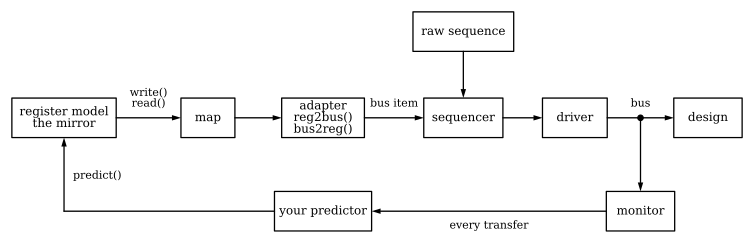

# Register models in pyuvm

This page answers: *what does a register model know about a design's registers, what does pyuvm's
register layer do for you, and what do you have to write yourself?*

Up to the end of Lab 05, your testbench reached the router's registers with raw APB transfers. In
the virtual sequence, `route()` and `ctrl()` write the routing table and `CTRL`, and
`rd(DROP_CNT)` reads the two drop counters. The scoreboard checked reads of one register, `DROP_CNT`, and nothing
in the testbench read any of the other nine. So the testbench had no way to notice a register that
reset to the wrong value, or one that read back with its fields swapped.
[Lab 06](../labs/lab-06-the-register-block-overview.md) plants one bug of each of those kinds among
its five, and your Lab 05 testbench misses all five. In that lab you'll give the testbench a
**register model**, which is a set of pyuvm objects that describes every register and field as the
specification's [Register map](../reference/router-spec.md#register-map) does, and that can turn an
operation such as "write 1 to `CTRL.EN`" into an APB transfer.

pyuvm 4.0.1 has the classes for the model, for the map that places its registers at their
addresses, and for the adapter that turns a register operation into a bus item. It has nothing that
keeps the model's copy of the registers up to date, and none of the ready-made register sequences
that SystemVerilog UVM's library has, so in Lab 06 you write a predictor, a reset sequence and a
bit-bash sequence as well. We wrote a small register block for this page, `regblk`, and a pyuvm
testbench for it with a register model, an adapter and a predictor. Both are in
[`guide-examples/register-models-in-pyuvm/`](https://github.com/uoftasic/dd105-b/tree/main/guide-examples/register-models-in-pyuvm),
and the sections below use them to show how the pieces work together, and what pyuvm does when one
of them is missing.

## The example block

`regblk` has four 16-bit registers on a simple bus. Each transfer takes one cycle, in which `sel`
is 1. The block answers in that same cycle, and a write takes effect at the rising edge that ends
it.

| Address | Register | Access | Fields |
|---|---|---|---|
| `0x0` | `ID` | RO | [15:0], reads `105B` |
| `0x4` | `CTRL` | RW | [0] `EN`, [3:1] `MODE`; resets to 0 |
| `0x8` | `FLAGS` | W1C | [0] `OVF`, [1] `ERR`; set by the design when an event happens |
| `0xC` | `COUNT` | WC | [7:0], the number of events since the last write; any write clears it |

Apart from a reset, only a write changes `CTRL`, so it holds whatever software last wrote to it,
which here means the testbench. `FLAGS` and `COUNT` change on their own, whenever the design sees
an event, the way the router's `STATUS` and `DROP_CNT` do. A register model has to treat the two
kinds of register differently, as the sections on prediction and on volatile fields show.

## Fields, registers and the map

Each register is a subclass of `uvm_reg`, and its `build()` creates the register's fields and
configures each one. This is `CTRL`'s:

```python
class CtrlReg(uvm_reg):
    def __init__(self, name="CTRL"):
        super().__init__(name, 16)

    def build(self):
        self.EN = uvm_reg_field("EN")
        self.EN.configure(self, 1, 0, "RW", False, 0)
        self.MODE = uvm_reg_field("MODE")
        self.MODE.configure(self, 3, 1, "RW", False, 0)
```

The 16 is the register's width. A field's `configure()` takes six arguments: the register it
belongs to, its width in bits, its lowest bit, its access policy, whether it's **volatile**
(changed by the design on its own), and its reset value. Both fields of `FLAGS` are configured as
`"W1C"` with volatile set to `True`, and the field in `COUNT` as `"WC"`, also volatile. pyuvm
checks each field against the one configured just before it, and raises `AssertionError` if the
new field's lowest bit isn't above the previous field's highest, so configure the fields from bit 0
up; Lab 06, Part 2 shows the message you get otherwise. pyuvm doesn't check the access policy,
though. When we configured a field with `"W1c"`, a typo for `"W1C"`, pyuvm accepted it without a
word and gave the field the policy `NOACCESS`.

The register block creates the four registers, gives each one its address, and puts each one in a
map:

```python
class RegBlk(uvm_reg_block):
    def __init__(self, name="regs"):
        super().__init__(name)
        self.map = uvm_reg_map("map")
        self.map.configure(self, 0)
        self.ID = self.add(IdReg("ID"), 0x0, "RO")
        self.CTRL = self.add(CtrlReg("CTRL"), 0x4)
        self.FLAGS = self.add(FlagsReg("FLAGS"), 0x8)
        self.COUNT = self.add(CountReg("COUNT"), 0xC)

    def add(self, reg, addr, rights="RW"):
        reg.configure(self, hex(addr), "", False, False)
        self.map.add_reg(reg, "0x0", rights)
        return reg
```

In pyuvm a register's address is a string, given to the register's `configure()`, which also calls
`build()`. The map's `add_reg()` takes an offset, also a string, and files the register under its
address plus that offset, written the way Python's `hex()` writes it. When you read or write the
register, the map looks it up by the string the register was configured with. So `"0x4"` works
and `"0x04"` doesn't. A register we configured at `"0x00"` raised `KeyError: '0x00'` on its first
write, before any transfer reached the bus. That is why `add()` gives every address as
`hex(addr)`. In a lab that has a register model, `make regcheck` builds the model outside the
simulator and stops on overlapping fields or an address written any other way, and the graders run
the same check before any verdict. It lists each field's policy, so a `NOACCESS` there is a typo
you can see. For `regblk` it printed:

```text
 REGCHECK  test_regblk.py:RegBlk
     0x0  ID         ID[15:0] RO
     0x4  CTRL       EN[0:0] RW, MODE[3:1] RW
     0x8  FLAGS      OVF[0:0] W1C, ERR[1:1] W1C
     0xc  COUNT      COUNT[7:0] WC
   the model builds: 4 registers
```

For every field, the model keeps a **mirror**, which is what the model believes the design holds
right now, and a register's `get_mirrored_value()` puts its fields' mirrors together into one
value.

## From a register operation to a transfer

A test calls `regs.CTRL.write(0x0005, regs.map, path_t.FRONTDOOR, check_t.NO_CHECK)`. All four
arguments are required, and the call returns a `uvm_resp_t`, `PASS_RESP` or `ERROR_RESP`.
(`read(map, path, check)` returns the status and the value read.) The map makes an operation out of
the call, a write of `0005` to the address `"0x4"`, and hands it to an **adapter**. The adapter's
`reg2bus()` turns that operation into the sequence item that your bus agent uses, and the map
starts that item on the agent's sequencer, so it goes through the same driver as every other
transfer. When the driver has called `item_done()`, the map calls the adapter's `bus2reg()` with
the same item, and `bus2reg()` fills in the operation's data and status from it. Here is the
example's adapter:

```python
class BusAdapter(uvm_reg_adapter):
    def reg2bus(self, rw):
        """rw.addr is the address as the string the register was configured with."""
        write = rw.kind == access_e.UVM_WRITE
        return BusItem("reg", write, int(rw.addr, 16), rw.data if write else 0)

    def bus2reg(self, t, rw):
        rw.kind = access_e.UVM_WRITE if t.write else access_e.UVM_READ
        rw.data = t.wdata if t.write else t.rdata
        rw.status = uvm_resp_t.PASS_RESP
```

Those two methods are the only code in the register layer that knows what your bus looks like. The
environment gives the map its sequencer and its adapter, with `map.set_sequencer()` and
`map.set_adapter()`. In Lab 06, Part 2 you'll write the two methods for the router's APB agent,
where `bus2reg()` also has to report a transfer that ended with `PSLVERR` as `ERROR_RESP`.

{width=720 fig-alt="A block diagram. On the left is the register model, which holds the mirror. An arrow labelled write and read goes from the model to the map, and further arrows carry the operation on through the adapter, with reg2bus and bus2reg, to the sequencer as a bus item, then to the driver and along the bus into the design. A box labelled raw sequence has its own arrow straight to the sequencer, so its transfers never pass through the model. The bus has a tap down to a monitor, which sends every transfer to a box labelled your predictor, and an arrow labelled predict goes from the predictor back up to the register model."}

## Keeping the mirror

The model's mirror follows the bus only if something tells the model about each transfer, by
calling a register's `predict()` with the value written or read. pyuvm's map can do that itself
after each operation it sends, which SystemVerilog UVM calls auto-predict, but in pyuvm 4.0.1 the
switch for it, `enable_auto_predict`, is off. Turned on, it needs a predictor object, and pyuvm's
`uvm_reg_predictor` class is empty, with no methods of its own. So in pyuvm the mirror moves only
when your code calls `predict()`, and the place to do that is a **predictor** of your own, a
`uvm_subscriber` connected to the bus monitor's analysis port. It sees every transfer the monitor
reports, whoever started it, and calls `predict()` on the register at that address.

Our example's `RegMirrorTest` writes `0005` to `CTRL` through the model, then writes `000b` with a
raw bus sequence that goes around the model, the way Lab 05's `wr()` does. Then it reads `CTRL`
through the model and compares the value read with what the mirror held before the read. We ran it
three times, with `+PREDICT=` choosing how the mirror is kept each time:

| `+PREDICT=` | Mirror after the model's write | After the raw write | The read of `000b` against the mirror |
|---|---|---|---|
| `predictor` | `0005` | `000b` | match |
| `none` | `0000` | `0000` | `MISMATCH` |
| `auto` | the write raised `UVMError: map -- predictor Not set` | | |

With no predictor, even the model's own write left the mirror at its reset value, `0000`, and the
read of `000b` didn't match. `regblk` ran as the golden design, with no bug switched on, and a check
that fails on the golden design means the testbench is wrong. The `auto` run is the map's own
auto-predict switched on, with no predictor object to call, and the test ended there; the grader
called it BROKEN. So this testbench needs the predictor, and in Lab 06, Part 3 you write one for the
router and connect it to the APB monitor, which the scoreboard already listens to.

## Kinds of prediction

`predict()` takes the value and a kind, which says what to do with it. `UVM_PREDICT_WRITE` means
the value was written, so each field takes what its access policy gives it. `UVM_PREDICT_READ`
means the value was read. `UVM_PREDICT_DIRECT` means take it as it is. `RegPredictTest` calls
`predict()` on four of the example's mirrors, with no bus transfers at all, and printed:

```text
[RAL] FLAGS (W1C), after the reset: 0x0
[RAL]   then predict(0x3, UVM_PREDICT_DIRECT)     0x3
[RAL]   then predict(0x1, UVM_PREDICT_WRITE)      0x2
[RAL]   then predict(0x2, UVM_PREDICT_READ)       0x0
[RAL]   then predict(0x2, UVM_PREDICT_DIRECT)     0x2
[RAL] COUNT (WC), after the reset: 0x0
[RAL]   then predict(0x2a, UVM_PREDICT_DIRECT)    0x2a
[RAL]   then predict(0x5, UVM_PREDICT_WRITE)      0x0
[RAL]   then predict(0x2a, UVM_PREDICT_DIRECT)    0x2a
[RAL]   then predict(0x2a, UVM_PREDICT_READ)      0x0
[RAL] CTRL (RW), after the reset: 0x0
[RAL]   then predict(0xb, UVM_PREDICT_WRITE)      0xb
[RAL]   then predict(0x5, UVM_PREDICT_READ)       0x5
[RAL] ID (RO), after the reset: 0x105b
[RAL]   then predict(0x1234, UVM_PREDICT_WRITE)   0x105b
```

The write predictions follow the policies: writing `0x1` to `FLAGS` clears only `OVF`, any write
clears `COUNT`, a write to `CTRL` sets it, and `ID` ignores a write. The read predictions don't all
do what the name suggests. After a read of `0x5`, `CTRL`'s mirror is `0x5`, but after a read of
`0x2` the mirror of `FLAGS` is 0, and after a read of `0x2a` the mirror of `COUNT` is 0. In
pyuvm's source, a field's `predict_read()` returns the field's reset value for `W1C`, `WC` and
twelve other policies, whatever the value read was, so after those reads the mirror no longer holds
what the design holds. Your predictor calls `predict()` after every read it sees, and Lab 06,
Part 3 asks you which kind it should use.

## Volatile fields

`FLAGS` is set by the design, so the model can't know its value until it reads it. In the run with
the predictor, `RegMirrorTest` pulses the design's `ev_ovf` input, which sets `FLAGS.OVF`, and then
reads `FLAGS` through the model:

```text
[RAL] after an overflow event, the mirror of FLAGS holds 0000
[RAL] read FLAGS through the model: 0001; the mirror now holds 0001
```

The mirror said `0000` while the design held `0001`, and only the read brought it up to date. A
mirror of a volatile field is out of date whenever the design has changed the field since the last
read, so nothing should compare a read of a volatile field with its mirror. In pyuvm nothing
compares any read with the mirror unless you write the comparison. `read()` takes a `check_t`, but
`check_t.CHECK` compared nothing in our run. After a raw write of `0007` to `CTRL`, we set
`CTRL`'s mirror to `0003` by hand and read the register with `CHECK`:

```text
[RAL] read(CHECK) of CTRL returned PASS_RESP with 0007, against a mirror of 0003
```

and nothing else was logged. In Lab 06 your predictor does the comparing. It compares every read
it sees with the mirror, outside the volatile fields. The router's `STATUS`, `DROP_CNT` and `LEVEL`
are all volatile, so the predictor can't check them, and the Lab 06 scoreboard keeps its own copies
of `STATUS` and `INT_EN`, which it updates cycle by cycle the way the router does, and checks
`STATUS` reads and `irq` against them.

## One operation per register at a time

pyuvm allows one operation at a time on each register. When two coroutines wrote `CTRL` at once,
the first write went through and the second raised an exception before it reached the bus:

```text
[RAL] two writes to CTRL at once: the first PASS_RESP; the second UVMFatalError: CTRL -- write cannot perform an operation while                       another is in progress
```

(The run of spaces is in pyuvm's message itself.) SystemVerilog UVM makes the second operation wait
for the first instead. `UVMFatalError` isn't a check, so the course's grader calls a run that
raises it BROKEN. Lab 06's helpers in `RouterBaseVseq` (`wr_reg()`, `rd_reg()`, `check_reg()` and `rd_all_regs()`) take a
cocotb `Lock` for each register before they use it, so that two parts of a virtual sequence that
reach the same register take turns.

## Pieces pyuvm doesn't have

These are the parts of SystemVerilog UVM's register layer that pyuvm 4.0.1 doesn't have, as the
example's `RegQuirksTest` found them:

- `uvm_reg` has no `mirror`, `update`, `needs_update`, `peek`, `poke`, `set` or `get_reset`.
  (A field has `get_reset()`.) In SystemVerilog UVM, `mirror()` reads a register and can compare
  the value with the mirror, `set()` and `update()` write a register only when the value you want
  differs from the mirror, and `peek()` and `poke()` are the back door.
- A back-door access, which reads or writes a register through the signal that holds it rather than
  over the bus, raised `UVMNotImplemented: map -- BACKDOOR not implemented`.
- Of `uvm_reg_hw_reset_seq`, `uvm_reg_bit_bash_seq`, `uvm_reg_access_seq` and
  `uvm_reg_predictor`, pyuvm has only `uvm_reg_predictor`, and that class has no methods of its
  own.

So in Lab 06 you write three pieces that a SystemVerilog UVM student gets from the library. The
predictor is the first. The second is a **reset sequence**, which puts the mirror at the reset
values (`map.reset("HARD")`), then reads every register that has a field it can check, which means
one that isn't volatile, and compares the value read with the register's reset value outside its
volatile fields. On `regblk` it would read `ID` and `CTRL` and leave `FLAGS` and `COUNT` alone,
because every field in them is volatile. It has to run while the design still holds its reset
values, which in the labs means before anything has written a register. The third is a
**bit-bash sequence**, which writes each bit that isn't in a volatile field with the opposite of
the mirror's value, reads the register back and compares, then does it all a second time, so each
bit is written both ways. It treats a bit with no field as read-only and expects it to read 0, so
it checks the reserved bits too, such as bits 2 to 15 of `FLAGS`.

The model can't send a transfer to an address that has no register, because there's no register
to name, so the router's 246 bad addresses still need raw transfers (Lab 06, Part 4). The model
also knows nothing about what the registers *do* to the rest of the design. The router's `irq`
output depends on `STATUS` and `INT_EN`, and the scoreboard checks it (Part 5).

## Check yourself

1. A testbench has a register model and an adapter, and no predictor. A test writes `0x1` to
   `CTRL` with the model's `write()`, then reads `CTRL` and compares the value with what the mirror
   held before the read. What happens on the golden design?

   <details>
   <summary>Answer</summary>

   The read returns `0x1` and the mirror still holds `0x0`, so the comparison fails although the
   design is right. pyuvm's auto-predict is off, so not even the model's own `write()` updates the
   mirror; only `predict()` does, and with no predictor nothing calls it. Lab 06, Part 3, step 2
   finds the same thing on the router.

   </details>

2. Why would a reset sequence on `regblk` read only `ID` and `CTRL`, and what would a bit bash
   still test in `FLAGS`?

   <details>
   <summary>Answer</summary>

   Every field of `FLAGS` and `COUNT` is volatile, so a read of either register has nothing that
   can be compared with a reset value, and the reset sequence skips them. The bit bash skips the
   bits of volatile fields too, but bits 2 to 15 of `FLAGS` hold no field, so it treats them as
   read-only and checks that they still read 0 after it writes 1 to each.

   </details>

3. After `predict(0x2, UVM_PREDICT_READ)`, the mirror of `FLAGS` is `0x0`. Does the design hold
   0 in `FLAGS`?

   <details>
   <summary>Answer</summary>

   No. It returned `0x2` in the read, so `FLAGS.ERR` is set. pyuvm's read prediction puts a `W1C`
   field at its reset value, whatever was read. A predictor that used it would leave the mirror
   of `FLAGS` wrong after every read, and code that used that mirror, for example to clear exactly
   the bits it last read, would go wrong.

   </details>

## Further reading

ChipVerify's register-layer pages (section 12) build one SystemVerilog UVM model for one small APB
block, across several pages. The structure of fields, registers, maps and adapters is the same in
pyuvm. The corrections below are where pyuvm 4.0.1 differs.

- [UVM Register Abstraction Layer](https://www.chipverify.com/uvm/uvm-register-layer): registers,
  fields, maps, and the path of a model write down to the bus.
- [UVM Register Model Classes](https://www.chipverify.com/uvm/uvm-register-model), the clearest
  account of the desired and mirrored values; pyuvm's `uvm_reg` has no `update()`, so this course
  uses only the mirror. Correction: its block maps the status register with
  `"RO"` rights, but its write-1-to-clear bit can only be cleared through a map that allows writes.
- [UVM Register Environment](https://www.chipverify.com/uvm/uvm-register-environment): the adapter,
  and auto-predict against a predictor. In pyuvm auto-predict is off, and the predictor is yours.
- [UVM Register Access Methods](https://www.chipverify.com/uvm/uvm-register-access-methods).
  Correction: it says a front-door `write()` or `read()` always updates the mirror. That's true in
  SystemVerilog UVM only with auto-predict on or a predictor connected, which the same page says
  further down; in pyuvm only a predictor that calls `predict()` updates it.
- [UVM Register Sequences](https://www.chipverify.com/uvm/uvm-register-sequences): the built-in
  sequences, why the reset test goes before the bit bash, and how to leave a register out. pyuvm
  has none of them; Lab 06 has you write the reset and bit-bash sequences.

Next: [Regressions and seeds](regressions-and-seeds.md).
