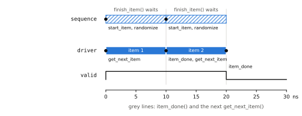

# Sequences, sequencers and drivers

This page answers: *how does a transaction get from the code that makes it to the design's pins?*

In Labs 02 and 03 the generator made packets and put them into a cocotb `Queue`, and the driver
took them out one at a time and drove them. In
[Lab 04](../labs/lab-04-the-same-testbench-in-pyuvm-overview.md) a **sequence** makes the items, a
**sequencer** passes them on, and a **driver** puts each one on the pins. The table in Lab 04's
Part 5 lists what changed. The sequence calls `start_item()` and `finish_item()` where the generator
called the queue's `put()`, and the driver calls `get_next_item()` and `item_done()` where it called
`get()`. Everything else the driver does is the same as before, including the idle cycles it leaves
before beats and the way it drives the pins.

This page follows one item along that path. The example for it drives SimProc's ALU in the way Lab
01's pyuvm testbench did, holding each vector on the pins for one 10 ns period, and prints a line,
with the time, at every step. Its files are in
[`guide-examples/sequences-sequencers-and-drivers/`](https://github.com/uoftasic/dd105-b/tree/main/guide-examples/sequences-sequencers-and-drivers).

## The pieces

The item is an object whose class derives from `uvm_sequence_item`. Lab 04's item is `RouterPkt`,
and the example's is `AluItem`, which holds an operation and two operands, and the ALU's answer once
the vector has been driven. Both are also pyvsc classes, decorated with `@vsc.randobj`, so a
sequence can call `randomize()` on them.

A sequence is an object too, not a component. Its class derives from `uvm_sequence`, and its
`body()` coroutine makes the items and sends them. A test makes one when it needs it, sets its knobs,
and runs it with `await seq.start(sequencer)`, which returns when `body()` has finished. A pyuvm
sequence has no logger of its own, so the example's sequences print their lines, and the register
sequences in the course's reference testbench,
[`labs/ref`](https://github.com/uoftasic/dd105-b/tree/main/labs/ref), report through a component's
logger instead.

The sequencer is a component in the agent. It sits between any number of sequences and one driver,
and it hands the driver one item at a time. You don't write a sequencer class: Lab 04's input agent
and APB agent each make pyuvm's own, as `uvm_sequencer("sqr", self)`.

The driver is a component too. Lab 04's `SrcDriver` derives from `uvm_driver`, and that base class
gives it a port called `seq_item_port`, which the agent connects to the sequencer in
`connect_phase`:

```python
self.drv.seq_item_port.connect(self.sqr.seq_item_export)
```

The port is on the driver because the driver asks for each item when it's ready for one. That lets
the driver set the pace. It takes the next item only when the pins can take it, and the sequence
waits until then.

## One item through the handshake

Here are the loops in the example's sequence and driver, without the lines that print each step:

```python
# AluRandSeq.body()
for _ in range(self.n):
    req = AluItem.create("req")
    await self.start_item(req)          # wait until the driver takes it
    req.randomize()
    await self.finish_item(req)         # hand it over; wait until the driver is done

# AluDriver.run_phase()
while True:
    req = await self.seq_item_port.get_next_item()   # wait for an item
    d.ALUop.value = int(req.op)
    d.A.value = int(req.A)
    d.B.value = int(req.B)
    vif.valid = True
    await Timer(vif.PERIOD_NS, "ns")    # the vector holds for one 10 ns period
    req.ALUout = int(d.ALUout.value)
    vif.valid = False
    self.seq_item_port.item_done()      # let finish_item() return
```

(The files also tag each item with the name of the sequence that sent it, which is `a` here.)
`SqTimelineTest` runs this sequence for three items. These are the lines for the first two:

```text
0    ns  [drv]     get_next_item: waiting for an item
0    ns  [seq a]   start_item(req): waiting for the driver
0    ns  [seq a]   start_item returned; randomize()
0    ns  [drv]     get_next_item returned a: SHR A=bd B=14
10   ns  [drv]     item_done, ALUout was bd
10   ns  [drv]     get_next_item: waiting for an item
10   ns  [seq a]   finish_item returned: a: SHR A=bd B=14 is done
10   ns  [seq a]   start_item(req): waiting for the driver
10   ns  [seq a]   start_item returned; randomize()
10   ns  [drv]     get_next_item returned a: SHL A=ce B=eb
20   ns  [drv]     item_done, ALUout was 70
```

`start_item()` puts the item in the sequencer's queue and returns once the driver's
`get_next_item()` has taken it. At time 0 the driver was already waiting, so `start_item()` returned
at once. The sequence then randomized the item and called `finish_item()`, which hands the item over
and blocks. Only then did `get_next_item()` return, in the same time step, because pyuvm's
`get_next_item()` waits for `finish_item()` before it gives the driver the item. The driver held the
vector on the pins for one period and called `item_done()` at 10 ns, which let `finish_item()`
return in the same time step. So the sequence's loop runs at the driver's pace, which here is one item every 10 ns:



*The handshake for the first two items of `SqTimelineTest`. The sequence spends all its time blocked
in `finish_item()`, while the driver holds each vector on the pins. `valid` is the Python flag that
the driver sets while a vector is on the pins, as in Lab 01, and it stays high from 0 to 20 ns
because the second vector goes on in the same time step as the first one's `item_done()`.*

Because the sequence randomizes the item after `start_item()` returns, the item gets its values when
the driver is ready for it rather than when the sequence made it, and the constraints can use
anything that the sequence has set by then. Lab 04's `RouterRandSeq` copies `route_en` into each
packet before it randomizes the packet. `route_en` holds the enable bits of the routing table that
the test wrote for the current phase, and the packet's `c_dst` constraint uses those bits to keep
the packet on an enabled route.

The ALU has no clock, so the example's driver drives as soon as it has the item. The router has one,
and Lab 04's drivers follow the course's timing rule from
[Lab 02, Part 2](../labs/lab-02-a-layered-testbench-without-pyuvm-overview.md#part-2-the-monitor):
every driver changes the router's inputs right after a rising edge, and every monitor reads the pins
at the falling edge in the middle of the cycle. So after `get_next_item()` returns, `SrcDriver` and
`ApbDriver` make sure they're just after a rising edge, waiting for one if they need to, before their
first drive of the item, and the sequence waits in `finish_item()` all the while.

## Two sequences on one sequencer

A sequencer can serve several sequences at once, so one test can run background traffic and a
directed burst on the same agent at the same time. `SqTwoTest` starts two sequences of two items
each, `a` and `b`, as two cocotb tasks, and waits for both. These are the lines it prints, with some
of the driver's left out:

```text
0    ns  [seq a]   start_item(req): waiting for the driver
0    ns  [seq b]   start_item(req): waiting for the driver
0    ns  [seq a]   start_item returned; randomize()
0    ns  [drv]     get_next_item returned a: ADD A=6d B=23
10   ns  [seq a]   finish_item returned: a: ADD A=6d B=23 is done
10   ns  [seq a]   start_item(req): waiting for the driver
10   ns  [seq b]   start_item returned; randomize()
10   ns  [drv]     get_next_item returned b: ADD A=85 B=c8
20   ns  [seq b]   finish_item returned: b: ADD A=85 B=c8 is done
20   ns  [seq b]   start_item(req): waiting for the driver
20   ns  [seq a]   start_item returned; randomize()
20   ns  [drv]     get_next_item returned a: SUB A=22 B=c4
```

The items alternate between the two sequences. pyuvm's sequencer keeps one queue and hands the
driver items in the order their `start_item()` calls arrived, and each sequence asks again only after
its last item is done. So whenever an item finishes, the other sequence's request has been waiting
longer than the new one from the sequence that just finished, and the other sequence goes next. A
sequence that you start on a sequencer that's already busy therefore takes turns with the one running
there, item by item. pyuvm 4.0.1's sequencer has no other way to choose: its source has no
arbitration modes, priorities or locks, which SystemVerilog UVM's sequencer has. Lab 05 starts a
sequence that runs for the whole test on each output agent, so another sequence started on one of
those sequencers would take turns with it.

## Sequences that start sequences

A sequence's `body()` can start other sequences on the same sequencer, so you can build a larger
sequence out of smaller ones. `start()` stores the sequencer in the sequence's `sequencer`
attribute, so a child is started with `await child.start(self.sequencer)`. (SystemVerilog UVM calls
it `m_sequencer`, and has a `p_sequencer` as well; pyuvm has neither.) `SqNestedTest` runs a
sequence that starts two others: first one that sends two random vectors, then one that sends two
directed `SUB`s. From the point where the random sequence finishes, the run prints these lines:

```text
20   ns  [seq r]   finish_item returned: r: SHL A=ff B=ec is done
20   ns  [drv]     get_next_item returned sub: SUB A=5a B=5a
30   ns  [drv]     item_done, ALUout was 00
30   ns  [drv]     get_next_item: waiting for an item
30   ns  [seq sub] sent sub: SUB A=5a B=5a
30   ns  [drv]     get_next_item returned sub: SUB A=5a B=21
40   ns  [drv]     item_done, ALUout was 39
```

The directed sequence never calls `randomize()`. It sets `op`, `A` and `B` by hand between
`start_item()` and `finish_item()`, which is the simplest way to send exactly the item you mean. Lab
04's `close_holes()` builds its fill packets by hand too, with `RouterPkt.make()`, and sends each one
with `RouterOneSeq`, a sequence that only calls `start_item()` and `finish_item()`.

A test starts sequences too. Lab 04's base test writes a register by starting a one-item sequence on
the APB agent's sequencer, and reads one the same way:

```python
async def write_reg(self, addr, data):
    await ApbRwSeq("wr", True, addr, data).start(self.env.apb.sqr)

async def read_reg(self, addr):
    s = ApbRwSeq("rd", False, addr)
    await s.start(self.env.apb.sqr)
    return s.t.rdata
```

`read_reg()` reads the result out of the sequence's item. That works because the APB driver fills
in the item's `rdata` before it calls `item_done()`, and `start()` doesn't return until
`finish_item()` has. `SqReadTest` does the same on the ALU, whose driver fills in `ALUout`:

```text
[READ] SUB(c8, 3c) = 8c
[READ] NAND(c3, 1d) = fe
[READ] SHR(f8, 03) = 1f
```

## get_next_item() and item_done()

A SystemVerilog UVM driver can call `try_next_item()`, which returns at once with no item when none
is waiting. To get an item, pyuvm 4.0.1's `seq_item_port` has only `get_next_item()`, which waits,
so a driver that must act in every cycle, whether or not an item has arrived, needs a sequence that
always has the next item ready. The sink driver you finish in Lab 05, Part 3 has one, a sequence that
never ends.

A driver must also call `item_done()` before it asks for the next item. `SqDoubleGetTest` has a
driver that calls `get_next_item()` twice, and pyuvm stopped the test at once:

```text
 BROKEN: UVMSequenceError   1.88 s   log: build/runs/SqDoubleGetTest-s1/run.log
   SqDoubleGetTest: UVMSequenceError: You must call item_done() before calling get_next_item again
```

The graders call the run BROKEN rather than a failure, because the exception came from the
testbench, so the run says nothing about the design.

## Check yourself

1. In `SqTimelineTest`, `finish_item()` for the first item returns at 10 ns, not at 0 ns. What is
   it waiting for?

   <details>
   <summary>Answer</summary>

   The driver's `item_done()`. The driver got the item at 0 ns, held it on the pins for one 10 ns
   period, and then called `item_done()`, which let `finish_item()` return.

   </details>

2. At what time is the second item randomized, and what has to happen first?

   <details>
   <summary>Answer</summary>

   At 10 ns. Its `start_item()` can't return until the driver takes it, and the driver asks for
   another item only after it has held the first one for its period and called `item_done()`.

   </details>

3. Lab 04's `close_holes()` needs its fill packets to arrive exactly as it built them, with set
   lengths and no idle cycles between their beats. Why does it build them with `RouterPkt.make()`
   and send them with `RouterOneSeq`, instead of starting `RouterRandSeq`?

   <details>
   <summary>Answer</summary>

   `RouterRandSeq` makes each packet and calls `randomize()` on it, so the solver would choose the
   DST and the length, and the packet's `post_randomize()` would put idle cycles before about one
   beat in four. `make()` sets the DST and the length by hand and puts the beats back to back, and
   `RouterOneSeq` sends the packet it's given without changing it. (pyvsc could also meet an inline
   `length == n`, as line 3 of Lab 03's experiments shows, but the idle cycles would still come.)

   </details>

## Further reading

pyuvm's sequences are in its source,
[`s14_15_python_sequences.py` at 4.0.1](https://github.com/pyuvm/pyuvm/blob/4.0.1/pyuvm/s14_15_python_sequences.py),
which explains in its comments how `start_item()`, `finish_item()`, `get_next_item()` and
`item_done()` meet. ChipVerify's walkthrough builds these pieces in SystemVerilog UVM for a small
register file:
[UVM Sequence](https://www.chipverify.com/uvm/uvm-sequence),
[UVM Sequencer](https://www.chipverify.com/uvm/uvm-sequencer) and
[UVM Driver](https://www.chipverify.com/uvm/uvm-driver).

- [Using get_next_item()](https://www.chipverify.com/uvm/uvm-using-get-next-item), for the handshake
  in more detail. It also covers `try_next_item()`, which pyuvm 4.0.1 doesn't have.
- [How to execute sequences via start()](https://www.chipverify.com/uvm/how-to-execute-sequences-via-start-method),
  for the hooks around `body()`. pyuvm's `start()` takes the sequencer and a flag for whether to call
  `pre_body()` and `post_body()`, and no parent sequence or priority.
- [UVM Sequence Arbitration](https://www.chipverify.com/uvm/uvm-sequence-arbitration) describes
  arbitration modes that pyuvm 4.0.1's sequencer doesn't have; it hands out items in the order they
  were asked for.

Next: [Monitors, analysis ports and scoreboards](monitors-analysis-ports-and-scoreboards.md).
