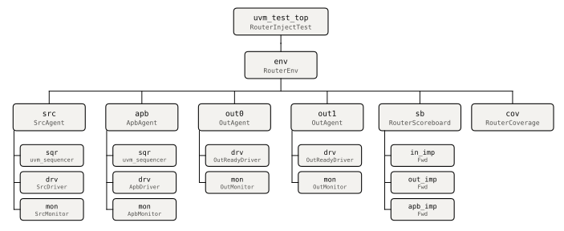
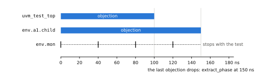

# The pyuvm skeleton

This page answers: *what are the pieces of a pyuvm testbench, and in what order does pyuvm run
them?*

In Lab 01 you read a whole pyuvm testbench, the ALU's `tb/alu_uvm.py`, from its tests down to its
driver, monitor and scoreboard, and you added the flag check to its scoreboard. Labs 02 and 03 were
plain cocotb. Each test was a function marked `@cocotb.test()`, and an `Env` class made the pieces
in its constructor, handed them queues, and started each one's coroutine. In
[Lab 04](../labs/lab-04-the-same-testbench-in-pyuvm-overview.md) the router testbench becomes pyuvm
classes, and Part 5 of that lab counts what this costs in lines against your Lab 03 testbench. Much
of what it counts is the structure that this page describes. The drivers, the monitors and the
scoreboard become components in a tree, pyuvm builds the tree and connects it in a fixed order of
phases, and objections decide when the run ends.

The example for this page,
[`guide-examples/the-pyuvm-skeleton/`](https://github.com/uoftasic/dd105-b/tree/main/guide-examples/the-pyuvm-skeleton),
has no design to test. Lab 01's ALU is its toplevel only because cocotb needs one. It has a test, an
environment, two agents with one child each, and a component called `mon` that loops forever the
way a monitor does. Each of them prints a line in every phase, so you can watch the order in which
pyuvm calls them.

## Objects and components

Every pyuvm class in a testbench derives from either `uvm_object` or `uvm_component`. (In the
library, `uvm_component` is itself built on `uvm_object`, but a testbench uses the two in different
ways.)

A **`uvm_object`** is data: a packet, an APB transfer, a beat that a monitor saw. You make one
whenever you need it, pass it around and drop it, and many of them come and go in a run. Lab 04's
`RouterPkt`, `StreamBeat` and `ApbItem` derive from `uvm_sequence_item`, which is a `uvm_object`.
Its `OutCfg`, the knobs of one output agent, is a plain Python class, because nothing needs it to be
more.

A **`uvm_component`** is one of the testbench's fixed parts, such as a driver, a monitor, a
scoreboard or the test. It's made once, at the start, and lasts for the whole run. Every component
has a name and a parent, given to it when it's made, as in `SrcAgent.create("src", self)`, and the
parents link the components into a tree. Lab 04's tree looks like this:



*The components that `RouterLabTest`, `RouterEnv` and the agents build in Lab 04, once you've added
`out1` in Part 2, drawn from a printout of the solution's tree. The printout also had the ports
(each monitor's `ap`, each driver's `seq_item_port`, each sequencer's `seq_item_export`, and an
`analysis_export` under each `Fwd` and under `cov`), which are left out here. When a component logs
a message, the line names it by its path down this tree, such as `uvm_test_top.env.sb` for the
scoreboard.*

The test is at the top of everything the testbench builds, and pyuvm always names it
`uvm_test_top`. Above it sits pyuvm's own root, `uvm_root`, which has no name in a path. The test
makes the environment, `env`, and the environment makes the agents, the scoreboard and the coverage.
An agent holds the components for one interface: a driver that drives its pins, a monitor that
watches them, and, if the agent sends items, a sequencer that hands the driver its items.

In pyuvm, ports and exports are components too, so they're in the tree with everything else. The
example's `mon` makes an analysis port called `ap`, and the tree printed below has it under `mon`.
That matters to the course's `BaseTest`, which walks the whole tree, ports included, when it sets up
its count of errors.

pyuvm has a class for each job: `uvm_test`, `uvm_env`, `uvm_agent`, `uvm_driver`, `uvm_monitor`,
`uvm_sequencer`, `uvm_scoreboard` and `uvm_subscriber`. Most of them add little or nothing to
`uvm_component`. `uvm_driver` adds the port it gets items through, `seq_item_port`, and
`uvm_subscriber` adds the export it receives transactions on, `analysis_export`; the next two pages
describe both. `uvm_agent`'s `build_phase` reads an `is_active` setting. `uvm_monitor` and
`uvm_scoreboard` add nothing, and each is a plain component whose name says what it's for. In Lab
04's output agent, `OutReadyDriver` takes no items, so it derives from `uvm_component` rather than
`uvm_driver`.

pyuvm has no registration lines like SystemVerilog UVM's `` `uvm_component_utils ``. It registers
every class that derives from one of its own with the factory as soon as Python defines the class,
under the class's name. Components are made with `ClassName.create(name, parent)` rather than the
constructor, so that a test can tell the factory to make something else; the
[factory page](the-factory-and-configdb.md) explains how.

## @pyuvm.test() and TEST=

cocotb runs functions marked `@cocotb.test()`. `@pyuvm.test()` wraps a test class in such a
function, named after the class, and when cocotb calls it, it asks pyuvm's `uvm_root` to make the
class as `uvm_test_top` and run the phases. `make run TEST=SkPhaseTest` passes cocotb a filter that
matches that name exactly, and cocotb runs only the test it matches. That's how one build serves
every test in a lab.

`@pyuvm.test()` adds the cocotb test to the module that the decorator is written in, and cocotb looks
for tests only in the modules that the lab's `TEST_MODULES` names. So put the decorator in the
module where the class is defined, even for a test that derives from a class in another module.

If the name matches no test, nothing runs. `make run TEST=SkPhaseTset`, with two letters of the name
swapped, printed:

```text
     0.00ns WARNING  cocotb.regression                  No tests left after filtering with: (^|\.)SkPhaseTset$
```

and the verdict `BROKEN: every test skipped`, with a hint to compare the name with `make tests`.

## Phases

Instead of running each component as soon as it's made, pyuvm calls a fixed list of methods, the
**phases**, on every component in the tree, and finishes each phase everywhere before it starts the
next. A component overrides the phases it needs. pyuvm 4.0.1 has these nine, in this order:

| Phase | Kind | Order in the tree | What goes in it |
|---|---|---|---|
| `build_phase` | function | top down | make the children; read configuration |
| `connect_phase` | function | bottom up | connect ports between children |
| `end_of_elaboration_phase` | function | top down | print or check the finished tree |
| `start_of_simulation_phase` | function | top down | last settings before time moves |
| `run_phase` | `async` | all at once | everything that takes simulated time |
| `extract_phase`, `check_phase`, `report_phase` | function | top down | collect results, look for leftovers, print summaries |
| `final_phase` | function | top down | the very end |

The function phases take no simulated time. `run_phase` is a coroutine, and pyuvm starts every
component's `run_phase` at the same moment, each as a cocotb task of its own. SystemVerilog UVM runs
every phase but `build_phase` and `final_phase` from the bottom up, and has twelve more run-time
phases (`reset_phase`, `main_phase` and so on) beside `run_phase`. pyuvm 4.0.1's `s09_phasing.py`
runs only `connect_phase` from the bottom up and has no run-time phases, so if you read SystemVerilog
UVM material, expect the order of the later phases to differ. Here is the start of `SkPhaseTest`'s
output:

```text
0    ns  build_phase                uvm_test_top
0    ns  build_phase                uvm_test_top.env
0    ns  build_phase                uvm_test_top.env.mon
0    ns  build_phase                uvm_test_top.env.a1
0    ns  build_phase                uvm_test_top.env.a1.child
0    ns  build_phase                uvm_test_top.env.a0
0    ns  build_phase                uvm_test_top.env.a0.child
0    ns  connect_phase              uvm_test_top.env.mon
0    ns  connect_phase              uvm_test_top.env.a1.child
0    ns  connect_phase              uvm_test_top.env.a1
0    ns  connect_phase              uvm_test_top.env.a0.child
0    ns  connect_phase              uvm_test_top.env.a0
0    ns  connect_phase              uvm_test_top.env
0    ns  connect_phase              uvm_test_top
```

The build phase has to go from the top down, because a component's children don't exist until its
own `build_phase` makes them, so pyuvm can't call `env`'s `build_phase` until the test's has created
`env`. Within each parent, pyuvm visits the children in the order the parent made them: `env` made
`mon`, then `a1`, then `a0`, and that's the order above. (DD105-A's SystemVerilog UVM library
visited them in the order of their names.)

The connect phase goes from the bottom up, so by the time `env` connects its agents' monitors to the
scoreboard, every agent has already connected its own pieces. A component connects ports in
`connect_phase` and not in `build_phase`, because during its own `build_phase` the components below
its children don't exist yet. pyuvm finishes `build_phase` in the whole tree before any
`connect_phase` starts, so every component exists by the time it connects.

pyuvm has no method that prints the tree, so the example's test walks it in
`end_of_elaboration_phase`, printing each component's name and class:

```text
uvm_test_top            SkPhaseTest
  env                   SkEnv
    mon                 SkWatcher
      ap                uvm_analysis_port
    a1                  SkLongAgent
      child             SkLongLeaf
    a0                  SkAgent
      child             SkLeaf
```

## Objections

A driver loops forever asking for items, and a monitor loops forever watching pins, so the run phase
can't wait for every `run_phase` to return. Instead, pyuvm keeps the run phase going while any
component holds an **objection**. A component that is in the middle of something calls
`self.raise_objection()`, and calls `self.drop_objection()` when it's done, and the run phase ends
as soon as every objection has been dropped. SystemVerilog UVM can also keep the phase open for a
drain time after the last drop; pyuvm 4.0.1 has no drain time.

In `SkPhaseTest` the test holds an objection for 100 ns, `env.a1.child` holds one for 150 ns, and
`env.mon` loops forever, printing every 40 ns:

```text
0    ns  run_phase: still looping   uvm_test_top.env.mon
0    ns  run_phase starts           uvm_test_top.env.a1.child
0    ns  run_phase starts           uvm_test_top.env.a0.child
0    ns  run_phase starts           uvm_test_top
40   ns  run_phase: still looping   uvm_test_top.env.mon
80   ns  run_phase: still looping   uvm_test_top.env.mon
100  ns  drops after 100 ns         uvm_test_top
120  ns  run_phase: still looping   uvm_test_top.env.mon
150  ns  drops after 150 ns         uvm_test_top.env.a1.child
150  ns  extract_phase              uvm_test_top
```



*The run phase of `SkPhaseTest`. When the test dropped its objection at 100 ns, `a1.child` still
held one. The phase ended when that one dropped, at 150 ns, and the remaining phases ran in the same
time step. `mon`'s loop, which had been running the whole time without holding the phase open,
printed nothing more, because the test ended at 150 ns.*

`SkNoObjTest` builds the same tree with no component holding an objection. Every `run_phase` still
starts at 0 ns, pyuvm logs a warning, and the phase ends in the same time step:

```text
0    ns  run_phase starts           uvm_test_top
     0.00ns WARNING  root                               You did not call self.raise_objection() in any run_phase
0    ns  extract_phase              uvm_test_top
```

A new test can pass this way without testing anything. If it starts its sequence in `run_phase` and
forgets to raise an objection, the run ends before the first item reaches the driver, and the
warning is the only sign. Lab 04's `RouterLabTest` raises its objection at the start of `run_phase`,
resets the router, runs the test's `body()` and drops the objection when `body()` returns, or sooner
if the watchdog below fires or the scoreboard logs its 50th error. The tests
built on it override `body()` and leave `run_phase` alone, so none of them has to raise an objection
itself.

A test that holds its objection forever never ends on its own either. `RouterLabTest` runs a
watchdog beside `body()`, and if the test is still running after `+MAX_CYCLES` clock cycles (200,000
unless you set it), the watchdog logs an error that starts `[WATCHDOG]`, and the test ends. The
other way is a time limit on the decorator: `SkHangTest`, marked
`@pyuvm.test(timeout_time=1, timeout_unit="us")`, raises an objection and waits 10 µs, and cocotb
stopped it at 1,000 ns with the verdict `FAIL: SimTimeoutError`.

## After the run phase

Checks that need the whole run go in the three function phases that follow the run phase,
`extract_phase`, `check_phase` and `report_phase`. Lab 04's scoreboard uses `check_phase` to report,
for each output, the beats it expected and never saw, and an error if it checked no beat at all. It
uses `report_phase` to print the `[SB]` lines you'll read in every run.

pyuvm reports through Python's `logging`, and every component has a logger, `self.logger`. A
logged error prints a line and fails nothing. `SkPlainErrorTest` derives from pyuvm's `uvm_test` and
logs one error at 50 ns, and with `make run TEST=SkPlainErrorTest BASE_TEST=0` it printed:

```text
    50.00ns ERROR    ..-pyuvm-skeleton/sk_tests.py(175) [uvm_test_top]: a check failed at 50 ns
    50.00ns INFO     cocotb.regression                  sk_tests.SkPlainErrorTest passed
```

and the verdict `ok: passed`. The line has the shape of every message that the labs' components log:
the time, the level, the file and line that logged it, the component's full name in brackets, and
the text. cocotb cuts a long file path to fit its column, which is why the path starts with `..`.

The course's `BaseTest`, which every pyuvm test in the labs derives from, fixes that. In
`end_of_elaboration_phase` it adds a counting handler to the logger of every component in the tree,
and in `final_phase` it prints one line with the count and raises `AssertionError` if the count isn't
0. `SkErrorTest` logs the same error and derives from `BaseTest`:

```text
    50.00ns ERROR    ..-pyuvm-skeleton/sk_tests.py(166) [uvm_test_top]: a check failed at 50 ns
DD105-B BaseTest: 1 error logged, no bound assertions
```

and the verdict was `FAIL: 1 error`, with `AssertionError: 1 error logged, the first: a check failed
at 50 ns` under it. The graders count that `AssertionError` as a check that fired. They also call a
test BROKEN if it passes without `BaseTest`'s line, as `make run TEST=SkPlainErrorTest` without
`BASE_TEST=0` did (`BROKEN: no BaseTest line`), because a logged error in such a test would have
failed nothing.

`final_phase` runs from the top down, so the test's `final_phase` runs before its children's. In
`SkPhaseTest` the `DD105-B BaseTest:` line came straight after `final_phase` on `uvm_test_top` and
before it on `env`. An error that a component logs in its own `final_phase` comes too late to be
counted, so put your checks in `check_phase` or `report_phase`.

## Check yourself

1. In Lab 04, `RouterEnv.build_phase` makes the agents and the scoreboard. Why can't it connect
   `self.src.mon.ap` to the scoreboard there, straight after making them?

   <details>
   <summary>Answer</summary>

   `src.mon` doesn't exist yet. `SrcAgent.build_phase` makes the monitor, and pyuvm calls it only
   after `RouterEnv.build_phase` has returned, because the build phase goes from the top down. The
   scoreboard's inputs are made in its own `build_phase` too. By `connect_phase`, every component in
   the tree has been built.

   </details>

2. A test's `run_phase` starts a sequence of 200 packets and doesn't raise an objection. What
   happens, and which of Lab 04's checks would notice?

   <details>
   <summary>Answer</summary>

   The run phase ends at 0 ns, as `SkNoObjTest`'s did, before any packet reaches the pins, and pyuvm
   logs only a warning. Lab 04's scoreboard expected nothing and saw nothing, so it finds no leftover
   beats, but its `check_phase` also logs an error when it checked no beat at all, and `BaseTest`
   fails the test on it.

   </details>

3. A scoreboard compares its counts in `final_phase` and logs an error when they disagree. The run
   logs the error and passes. Why?

   <details>
   <summary>Answer</summary>

   `final_phase` runs from the top down, so `BaseTest`'s `final_phase` in `uvm_test_top` had already
   counted the errors, printed its line and returned before the scoreboard's `final_phase` ran.
   Move the comparison to `check_phase` or `report_phase`.

   </details>

## Further reading

- pyuvm's [documentation](https://pyuvm.readthedocs.io/en/latest/docsources/README.html) walks
  through a whole testbench for a small ALU, from its tests to its monitor and driver, and
  [UVM and Python](https://pyuvm.readthedocs.io/en/latest/docsources/UVM_and_Python.html) explains
  what pyuvm changes from SystemVerilog UVM. The pages are for pyuvm's latest release, which is newer
  than the course's 4.0.1: their SV-UVM-style reporting, turned on with
  `set_sv_uvm_style_reporting_enabled()`, isn't in 4.0.1.
- pyuvm's phases are in its source,
  [`s09_phasing.py` at 4.0.1](https://github.com/pyuvm/pyuvm/blob/4.0.1/pyuvm/s09_phasing.py), and
  each phase class says whether it runs from the top down or the bottom up.
- ChipVerify's [UVM Phases](https://www.chipverify.com/uvm/uvm-phases) and
  [UVM Objection](https://www.chipverify.com/uvm/uvm-objection) describe SystemVerilog UVM. Its
  order of phases, with every phase but build and final from the bottom up, and its twelve run-time
  phases are SystemVerilog UVM's, not pyuvm 4.0.1's. Its objections take the component as an
  argument, `phase.raise_objection(this)`, where pyuvm's are the component's own methods, and pyuvm
  has no drain time.
- ChipVerify's [UVM Component](https://www.chipverify.com/uvm/uvm-component) and
  [UVM Object](https://www.chipverify.com/uvm/uvm-object), for the two kinds of class.

Next: [Sequences, sequencers and drivers](sequences-sequencers-and-drivers.md).
