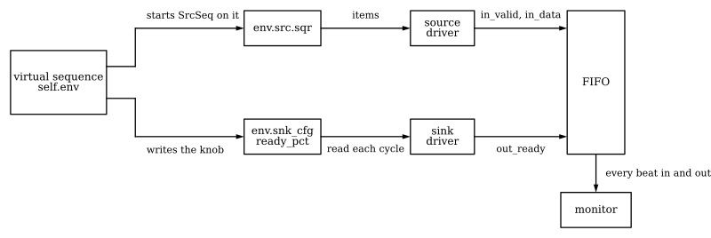

# Virtual sequences

This page answers: *the routing table, the packets and the backpressure are each driven by a
different agent. How do you make them change together, from one place?*

Lab 04's tests did one thing at a time, in the test's own steps. A test wrote the routing table,
set the sinks, sent packets, drained, read `DROP_CNT` and then started again, and each step waited
for the one before it to finish. In
[Lab 05, Part 4](../labs/lab-05-protocol-rules-and-backpressure-overview.md#part-4-a-virtual-sequence)
you'll want routes that move to the other output while packets are still going in, and both sinks
changing their behaviour at the same time. So the APB agent, the source agent and both sinks'
agents all have work to do at once, in an order that you choose. You do this with a **virtual
sequence**, which is a sequence that starts other sequences on several agents' sequencers and
changes those agents' knobs, but makes no items of its own.

This page builds one for a small design of our own, a FIFO that holds four beats and has a
valid/ready stream on each side. The files are in
[`guide-examples/virtual-sequences/`](https://github.com/uoftasic/dd105-b/tree/main/guide-examples/virtual-sequences).
A source agent drives the FIFO's input, and its sequence, `SrcSeq`, sends one beat per item. A sink
driver drives `out_ready` on the output side, and how often it's ready depends on `ready_pct`, a
knob in a configuration object. Neither of the two knows about the other, and the sink has no
sequencer at all. Lab 05's sinks do have one, but a virtual sequence steers them the way you steer
this sink, by changing their configuration rather than by sending them items, so this sink is a
good stand-in for them.

## A sequence given the environment

An ordinary sequence runs on its agent's sequencer, which passes its items to the driver. A
virtual sequence has no driver to feed, so in pyuvm it runs on no sequencer at all. What it needs
is a way to reach every agent it steers, and pyuvm has no `p_sequencer` handle for that, so the
sequence is given the environment when it's made, and keeps it:

```python
class BaseVseq(uvm_sequence):
    def __init__(self, name="vseq", env=None):
        super().__init__(name)
        self.env = env
        self.traffic_done = False

    def info(self, msg):
        self.env.logger.info(f"[VSEQ] {msg}")
    ...
    async def send(self, n, base):
        await SrcSeq(f"src_{base:02x}", n, base).start(self.env.src.sqr)

    def sink(self, pct):
        self.env.snk_cfg.ready_pct = pct
        self.info(f"sink ready {pct}% of cycles")
```

`send()` runs the source agent's own sequence on the source agent's sequencer, as a test would.
`sink()` only writes the knob, without starting anything, and the sink's driver reads the new value
at its next rising edge. The test starts the virtual sequence with `start()` and no sequencer:

```python
v = cocotb.start_soon(self.VSEQ("v", self.env).start())
```

Lab 05's `RouterTest` does the same with `await RouterLab05Vseq("vseq", self.env).start()`, and
Lab 05's `RouterBaseVseq` gives you helpers like these, among them `route()`, `ctrl()`, `burst()`,
`send_rand()`, `sink()`, `stall()` and `drain()`. Most of them are the base test's steps from
Lab 04, rewritten as methods of a sequence.

{width=720 fig-alt="A block diagram. On the left, a box labelled virtual sequence, self.env. One line from it, labelled starts SrcSeq on it, goes to env.src.sqr, which passes items to the source driver, which drives in_valid and in_data into the FIFO. A second line, labelled writes the knob, goes to env.snk_cfg ready_pct, which the sink driver reads each cycle; the sink driver drives out_ready into the FIFO. Below the FIFO, a monitor watches every beat in and out."}

*Our example's testbench. The virtual sequence reaches the source through the source's sequencer,
and the sink through the sink's configuration object, using the environment it was given. The
monitor checks every beat, whatever caused it.*

Two things follow from running on no sequencer. The first is that a virtual sequence can't send an
item itself. `VseqItemTest` runs a virtual sequence whose `body()` calls `start_item()`, and pyuvm
raised an exception at once, which the grader called BROKEN:

```text
 BROKEN: UVMSequenceError   0.27 s   log: build/runs/VseqItemTest-s1/run.log
   VseqItemTest: UVMSequenceError: Tried start_item in a virtual sequence v
```

The second is that a pyuvm sequence has no logger of its own, since it isn't a component, so
`info()` reports through the environment's. Every message from the virtual sequence therefore
carries the environment's path, `[uvm_test_top.env]`, and the `[VSEQ]` tag at the start of the
message is what tells it apart from the environment's own lines. Lab 06's register sequences
report through the environment's logger in the same way.

## Doing two things at once

The test starts our virtual sequence, `DemoVseq`. Its first step stalls the sink and then sends
six beats in one branch while a second branch waits 15 cycles and lets the sink go. `par()` starts
each coroutine it's given as a cocotb task, and then waits for each task in turn, so it returns
when all of them are done:

```python
@staticmethod
async def par(*coros):
    tasks = [cocotb.start_soon(c) for c in coros]
    for t in tasks:
        await t
```

and the first step is

```python
self.sink(0)

async def beats():
    await self.send(6, 0x10)
    self.info("step 1: all 6 beats have gone in")

async def release():
    await self.cycles(15)
    self.info(f"step 1: the FIFO holds {int(d.level.value)} beats")
    self.sink(100)

await self.par(beats(), release())
```

It printed:

```text
    10.00ns INFO     ..tual-sequences/test_vseq.py(172) [uvm_test_top.env]: [VSEQ] sink ready 0% of cycles
   160.00ns INFO     ..tual-sequences/test_vseq.py(172) [uvm_test_top.env]: [VSEQ] step 1: the FIFO holds 4 beats
   160.00ns INFO     ..tual-sequences/test_vseq.py(172) [uvm_test_top.env]: [VSEQ] sink ready 100% of cycles
   200.00ns INFO     ..tual-sequences/test_vseq.py(172) [uvm_test_top.env]: [VSEQ] step 1: all 6 beats have gone in
```

By 160 ns the FIFO held four beats and was full, and `send()` still had two of its six beats to
send. It could only return once the sink had taken some beats, and the sink would only take beats
once something set `ready_pct` again. If you wrote the two one after the other, `send()` and then
`sink(100)`, they would deadlock, because `send()` waits for the sink and the line that releases
the sink waits for `send()` to return. The example's `+SERIAL` does exactly that, and the test's
own limit of 2,000 cycles ended the run:

```text
 20010.00ns ERROR    ..tual-sequences/test_vseq.py(281) [uvm_test_top]: [TEST] the virtual sequence is still running after 2000 cycles; the FIFO holds 4 beats
 20010.00ns INFO     ..tual-sequences/test_vseq.py(147) [uvm_test_top.env.mon]: [MON] 4 beats in, 0 out, 0 out of order
```

With `par()` the two branches run at the same time, and the step ended at 200 ns, when the last
beat had gone in.

`par()` awaits each task, and that matters when a branch goes wrong. Awaiting a cocotb task raises
again any exception the task raised, so a branch that fails fails the sequence and the test.
`labs/ref`'s probe of cocotb 2.0.1 found that a test which instead waits on a task's `complete`
trigger and never looks at the task again passes, with the exception lost. So if you wait on
`complete`, as our test does to give up after 2,000 cycles, call the task's `result()` afterwards,
which raises the exception if there was one.

## A loop that ends with the traffic

The second step sends 30 beats while another branch keeps changing how often the sink is ready.
That branch can't know how long the traffic will take, so it loops until the traffic branch sets a
flag, `traffic_done`:

```python
self.traffic_done = False

async def traffic():
    await self.send(30, 0x40)
    self.traffic_done = True
    self.info("step 2: all 30 beats have gone in")

async def backpressure():
    while not self.traffic_done:
        self.sink(random.choice([0, 30, 100]))
        await self.cycles(random.randint(4, 12))

await self.par(traffic(), backpressure())
```

The loop set the sink eleven times between 200 ns and 1,070 ns, and the last beat went in at
1,130 ns. The loop saw the flag the next time it checked, at 1,150 ns, and then `par()` returned.
Step 4 of the sequence you write in Lab 05, Part 4 has the same shape, with `backpressure()` as
the looping branch and a third branch that moves routes. If the traffic branch didn't set
`traffic_done`, the loop would go on changing the sink for ever, and `par()` would never return.

None of these sequences checks anything. In this example the monitor does the checking, and in the
labs the scoreboard and the assertions do. The monitor watches both sides of the FIFO in every
cycle and checks every beat that comes out, whatever is driving the FIFO, and at the end of this
run it said `[MON] 44 beats in, 44 out, 0 out of order`.

## Two sequences on one sequencer

The third step starts two source sequences at once on the same sequencer. Each sends four beats.
The first numbers its beats from `80`, and the second from `a0`:

```python
await self.par(self.send(4, 0x80), self.send(4, 0xA0))
```

and the beats came out of the FIFO as

```text
step 3: the sink took 80 a0 81 a1 82 a2 83 a3
```

pyuvm's sequencer keeps one queue. Each `start_item()` puts its item at the back of it, and the
sequencer hands items to the driver from the front, in the order they were asked for. Each sequence
asks for its next item only after the driver has finished its last one, so the two sequences
alternated item by item. Sometimes that's what you want, for example to mix two traffic streams
together. It also means that a sequence you start on a sequencer that already has one running
shares the driver with the first one rather than replacing it, and pyuvm 4.0.1's sequencer has no
way for one sequence to keep the driver to itself. Each of Lab 05's sinks runs a sequence that
never ends, and Part 4 asks you why `sink()` and `stall()` change the sink's `OutCfg` rather than
starting a sequence on the sink's sequencer.

## Configuration changes and the scoreboard

With a virtual sequence it's easy to change the configuration while traffic is moving, and then
the scoreboard has to apply each change from the right cycle. In Lab 04 the tests wrote the
routing table only between phases, so the scoreboard could apply a write as soon as it saw it.
In Lab 05 a route can change between one header and the next, and the specification says that a
header accepted in the same cycle as the write completes still uses the old route. Lab 05's
scoreboard stamps each route write with the cycle it completed in, and Part 4 asks you why it uses
the cycle rather than the order in which the two monitors report.

A virtual sequence also has to be added to a test with some care about random values. Every random
value in the labs comes from Python's `random`, one after another, so a sequence that draws values
early in a test moves every value drawn after it. Making a pyuvm sequence and starting it draws
nothing, though, so it's only what the sequence itself draws that moves anything.
[Regressions and seeds](regressions-and-seeds.md) has the measurements, and in Lab 06, Part 5 you'll
see the packets of Labs 04 and 05 change because of eight values drawn early in `RouterTest`.

## Check yourself

1. In step 1, why can't `self.sink(100)` simply follow `await self.send(6, 0x10)` in the same
   branch?

   <details>
   <summary>Answer</summary>

   `send()` returns only when all six beats have gone into the FIFO, and the FIFO holds four. The
   fifth beat waits for `in_ready`, which comes back only when the sink takes a beat, and the sink
   takes beats only after `sink(100)`. In the same branch as `send()`, `sink(100)` would never be
   reached, which is what the `+SERIAL` run showed: 4 beats in, 0 out, after 2,000 cycles.

   </details>

2. What does `par()` wait for in step 2, and what would happen if the traffic branch forgot to set
   `traffic_done`?

   <details>
   <summary>Answer</summary>

   For both tasks to finish. Without the flag the backpressure loop never ends, so the virtual
   sequence never returns, the test never drops its objection, and the run goes on until something
   stops it. In our example that's the test's limit of 2,000 cycles; in the labs it's the test's
   watchdog (`+MAX_CYCLES`) or `make`'s run timeout.

   </details>

3. You want the four beats from `80` to go in before the four from `a0`, with both sends still
   started by the virtual sequence. What do you change?

   <details>
   <summary>Answer</summary>

   Await them one after the other instead of in `par()`:
   `await self.send(4, 0x80)` and then `await self.send(4, 0xA0)`. The second sequence then
   starts only when the first has returned.

   </details>

## Further reading

ChipVerify's pages are SystemVerilog UVM, where a virtual sequence usually runs on a virtual
sequencer and reaches its handles through `p_sequencer`. pyuvm has neither, and the pattern on
this page, a sequence given the environment, is the one the labs use.

- [UVM Virtual Sequence](https://www.chipverify.com/uvm/uvm-virtual-sequence): both of
  SystemVerilog UVM's styles, `p_sequencer` and `start(null)`; the second is the one closest to
  pyuvm's. Correction: two of its three example virtual sequences create their child sequences in
  `pre_body()` and start them without a parent, against the page's own advice.
- [UVM Virtual Sequencer](https://www.chipverify.com/uvm/uvm-virtual-sequencer): the sequencer
  that holds handles, which pyuvm doesn't need. Its log was made from a different version of the
  code than the page shows, so the names in it don't match.
- [UVM Sequence Arbitration](https://www.chipverify.com/uvm/uvm-sequence-arbitration): how a
  SystemVerilog UVM sequencer chooses between sequences that run on it at the same time. pyuvm
  4.0.1's sequencer has one order, first come first served.
- [How to execute sequences via start()](https://www.chipverify.com/uvm/how-to-execute-sequences-via-start-method).
  Its example test starts a sequence without raising an objection, which works only because that
  sequence takes no simulation time.

Next: [Lab 05: Protocol rules and backpressure](../labs/lab-05-protocol-rules-and-backpressure-overview.md).
