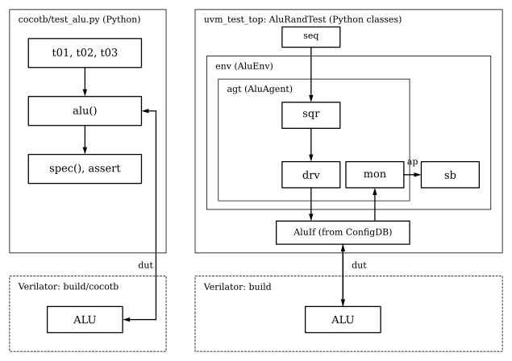

# What a framework buys you

This page answers: *what is pyuvm for, and what does it cost compared with the cocotb tests you
already write?*

A testbench framework is a library of base classes plus a set of rules for how the pieces you build
from them fit together and when each one runs. UVM, the Universal Verification Methodology, is the
one this course uses, and pyuvm is UVM written in Python. In
[Lab 01](../labs/lab-01-one-alu-two-frameworks-overview.md) you'll test SimProc's ALU twice, once
with the cocotb test from DD104 Lab 03 and once with a pyuvm testbench, both on Verilator. You'll
measure what each costs in lines, build time and run time, and see what each reports on three
planted bugs. This page goes through what we measured when we ran the lab, so you know what you're
looking at when your own numbers come in. Your times will differ a little from ours, but the counts
(lines, vectors and errors) should match.

DD105-A teaches the same course with UVM in SystemVerilog, and its Lab 01 measured a SystemVerilog
UVM testbench of the same ALU. This course doesn't build that testbench, so the numbers this page
gives for it come from DD105-A's runs.

## What pyuvm is

UVM is standardised as IEEE 1800.2, which defines it as a library of SystemVerilog classes. pyuvm's
README calls pyuvm "a clean implementation of IEEE 1800.2 in Python". pyuvm uses cocotb to talk to
the simulator. The course image has pyuvm 4.0.1 installed beside cocotb 2.0.1, and because pyuvm is
plain Python, none of it is compiled. Verilator builds a simulator from the ALU alone. When that
simulator starts, cocotb imports your testbench, and your testbench imports pyuvm like any other
Python package.

The library gives you a base class for each job a testbench does, and the code that builds those
pieces, connects them and runs them in order. Lab 01's testbench uses these parts of it:

- base classes for the pieces: `uvm_sequence_item` for one transaction, `uvm_sequence` for a
  stream of them, and `uvm_sequencer`, `uvm_driver`, `uvm_monitor`, `uvm_subscriber` (for the
  scoreboard), `uvm_agent`, `uvm_env` and `uvm_test` for the components;
- **phases**, which build every component, connect them, run them, and then call each one's check
  and report methods, in that order, and **objections**, which the test raises and drops to tell
  pyuvm when the run phase is over;
- `ConfigDB`, a table of named values. The code that sets a value gives a path, and only the
  components whose paths match it can read the value. Lab 01's test sets the object that holds the
  ALU's pins for the path `*`, which every component matches, so the driver and the monitor can
  both read it;
- **analysis ports**, which pass each transaction that the monitor writes to every component
  connected to the port. In Lab 01 the scoreboard is the only component connected to it;
- the **factory**, through which every component and transaction is made, with
  `AluDriver.create("drv", self)` rather than `AluDriver("drv", self)`.
  [Lab 04](../labs/lab-04-the-same-testbench-in-pyuvm-overview.md) adds a factory override, which
  lets a test swap one class for another without editing the code that makes it;
- `@pyuvm.test()`, which turns a test class into a cocotb test named after the class, so that
  `make run TEST=AluDirectedTest` picks it when the simulator starts.

pyuvm leaves out some of SystemVerilog UVM. It has no macros, because Python doesn't need them to
register a class with the factory or to print and copy an object. It reports through Python's
`logging` instead of a report server, so when a component calls `self.logger.error()`, pyuvm prints
the message and the test still passes. Every pyuvm test in the course derives from the course's
`BaseTest`, which counts those errors and fails the test at the end if there were any. The course's
verdict calls a pyuvm run `BROKEN` if it passed without printing `BaseTest`'s closing line.
[From cocotb tests to pyuvm components](from-cocotb-tests-to-pyuvm-components.md#logged-errors-and-basetest)
shows a test with and without it.

## The two testbenches

{fig-alt="Two drawings side by side. On the left, a frame labelled cocotb/test_alu.py (Python) holds three boxes stacked with arrows between them: t01, t02, t03; alu(); and spec(), assert. A line with an arrowhead at each end, labelled dut, joins alu() to an ALU box in a dashed frame labelled Verilator: build/cocotb. On the right, a frame labelled uvm_test_top: AluRandTest (Python classes) holds a seq box above a frame labelled env (AluEnv). Inside env is a frame labelled agt (AluAgent) with boxes sqr, drv and mon, and outside the agent but inside env a box sb. Arrows go from seq to sqr and from sqr to drv, and an arrow labelled ap goes from mon to sb. Below env, still in the Python frame, a box labelled AluIf (from ConfigDB) has an arrow from drv and an arrow to mon. A line with an arrowhead at each end, labelled dut, joins AluIf to an ALU box in a dashed frame labelled Verilator: build."}

*Lab 01's two testbenches. Each is Python that cocotb runs inside a simulator of its own, and each
simulator is Verilator's build of `rtl/alu.sv` alone. The cocotb test reaches the pins through
`dut`; the pyuvm testbench reaches them through `AluIf`, which holds `dut`.*

Both testbenches do the same three things: make vectors, put them on the ALU's pins, and compare
what comes back with a model. The cocotb test does all three in one file of plain functions:
`alu()` drives the pins and reads them back, `spec()` is the model, and each test function loops
over its vectors and asserts.

The pyuvm testbench gives each job its own class. A sequence makes `AluItem` objects and hands them
to the sequencer, which passes them to the driver. The ALU has no clock, so the driver and the
monitor share a 10 ns period and a `valid` flag through `AluIf`. The driver holds each vector on
the pins for one period and sets `valid` while it does. The monitor reads the pins 5 ns into every
period, and in each period that carries a vector it copies the vector and the ALU's answer into a
new `AluItem`. The monitor writes each item to its analysis port without knowing what the answer
should be, because deciding that is the scoreboard's job. The scoreboard receives each item in its
`write()` method, works out the right answer with `predict()`, and compares it with what the
monitor saw. The agent and the environment create the pieces and connect them. In its check phase
the environment also makes sure that the scoreboard checked every vector that the driver sent. The
test picks which sequence to start. Lab 01, Part 3 has a table that matches each class with the
part of `test_alu.py` that does the same job.

## What it costs

These are the costs we measured in Lab 01, in the course image on 2 CPUs. The third column comes
from DD105-A's Lab 01, on the same Verilator:

| | cocotb | pyuvm | SystemVerilog UVM (DD105-A) |
|---|---|---|---|
| Lines of code (not counting blank lines, comments and docstrings) | 94 | 161 | 282 |
| First build | 7.3 to 7.6 s | 7.3 s; 1.6 to 1.8 s after the cocotb build | 102 s |
| Rebuild after you change the testbench | none | none | 26 s to 99 s |
| Run | 11.0 to 11.7 s, 10.6 to 11.2 s of it in `t02`'s 393,216 vectors | 0.54 s for 2000 vectors | 1.17 s for 2000 vectors |
| Time per vector | about 0.03 ms | about 0.1 ms | at most 0.6 ms |

**Lines.** The pyuvm testbench has about 1.7 times the cocotb test's code lines. The extra lines go
into pieces that the cocotb test doesn't need. The agent and the environment only create and
connect the other pieces, `AluIf` carries the period and the `valid` flag, and the driver and the
monitor between them do what `alu()` does in five lines. DD105-A's SystemVerilog testbench had
three times the cocotb test's code lines. Lab 01, Part 3 asks you which of those lines Python
doesn't need.

**Build.** Whichever testbench you run, Verilator compiles only the ALU, because both testbenches
are Python. Most of the first build's 7.3 s goes on compiling the support code that Verilator and
cocotb add to the simulator, and the compiler cache keeps that code for the next build
([Getting started](getting-started.md#how-long-things-take) has the numbers). DD105-A's build took
102 s because Verilator compiled the whole UVM library along with the ALU and the testbench. Its
build report counted 24.157 MB of source in 386 modules, and g++ spent 98.5 s of the 102.

**Rebuilds.** When you change either Python testbench, nothing has to be rebuilt before the next
run, because cocotb imports the testbench each time the simulator starts. After the flag-check edit
in Lab 01, Part 5, `make build` prints `Vtop is up to date.`, and it took 0.07 s when we timed it.
In DD105-A the same edit to the SystemVerilog scoreboard cost a rebuild of 99 s. DD105-A also timed
two one-line edits: a change inside a task's body rebuilt in 26 s, and one new class member in 93 s.

**Speed.** The table that cocotb prints at the end of a run puts `AluRandTest`'s 2000 vectors at
0.19 s of real time, about 0.1 ms each, and `t02`'s 393,216 at 10.64 s, about 0.03 ms each. In the
pyuvm testbench each vector goes through a sequence, the sequencer, the driver, the monitor and its
analysis port, and the scoreboard. In `t02` each vector is one call to `alu()` and one to `spec()`.
The pyuvm run is still quick, because `AluRandTest` sends 2000 random vectors rather than sweeping
all 393,216 as DD104's `t02` does. DD105-A's 2000 vectors in 1.17 s come to at most 0.6 ms each,
because the 1.17 s also covers starting the simulator.

## What it buys

For that cost, Lab 01's pyuvm testbench gives you two things, both of them modest on a design as
small as one ALU.

- **Checking kept apart from stimulus.** In Lab 01, Part 5 you add a check of the `N` and `Z` flags
  to the scoreboard. Both `AluRandTest` and `AluDirectedTest` use it without being edited, because
  neither test does any checking of its own. In `test_alu.py`, `t01` and `t02` each do their own
  comparison, so a new check would have to be written into each of them.
- **Tests that reuse the pieces.** All that `AluDirectedTest` adds is a short sequence that sends
  DD104's six `t01` vectors and a short test class that starts it. It reuses the driver, the
  monitor and the scoreboard as they are. You choose it when you run, without a rebuild, but
  cocotb chooses a plain cocotb test by name in the same way when the simulator starts, so pyuvm
  doesn't add that part.

In DD105-A, UVM's report server counted the errors by their ID, and printed `[VALUE]   282` at the
end of a run with A01 switched on. pyuvm 4.0.1 has no report server, so in this course the
scoreboard keeps its own counts by kind and prints them on the `[SB]` line in its `report_phase`.
On A01 that line is `[SB] 2000 vectors checked: 291 value mismatches (SUB 291)`.

You still decide what the scoreboard checks, and Lab 01's shipped scoreboard checks only the
value. Against Lab 01's three bugs it caught A01 with 291 errors and A02 with 278, but on A03 it
logged no errors at all, so it missed that bug. The cocotb test caught all three, because its `t02` compares
the flags as well as the value. Once you add the flag check, the pyuvm test catches A03 with 125
errors in 2000 vectors.

You get more back on a bigger design, and UVM was made for designs like the router you'll test from
Lab 02 on. The router has a register bus, an input stream and two output streams, so a testbench
for it has a driver and a monitor for each of those interfaces, and a scoreboard that predicts
which output each packet comes out of. In Labs 02 and 03 you build that testbench from plain Python
classes on cocotb first, so that each pyuvm piece has an obvious job when it appears. In Lab 04 you
finish our pyuvm port of it, count its lines against your Lab 03 testbench, and work
out which pieces moved across, which changed shape and which are new.

## Check yourself

1. In Lab 01's scoreboard you change the body of `predict()`. How long will the rebuild take? How
   long did the same kind of change take in DD105-A?

   

   
Answer

   Nothing is rebuilt. The simulator is built from `rtl/alu.sv` alone, and the scoreboard is Python
   that cocotb imports when the simulator starts, so `make build` prints `Vtop is up to date.`
   In DD105-A the whole testbench is compiled into the simulator, so any edit to it means a
   rebuild. DD105-A measured 26 s for a change inside a task's body.

   

2. Lab 01's shipped scoreboard logs 291 `[VALUE]` errors on A01. If `AluBaseTest` derived from
   pyuvm's `uvm_test` instead of the course's `BaseTest`, what would cocotb report for the test?

   

   
Answer

   That it passed. pyuvm logs each error through Python's `logging`, and a logged error doesn't
   fail a test. In this course `BaseTest` counts the errors and fails the test at the end. Without
   `BaseTest`'s line in the log, the course's verdict calls the run `BROKEN`.

   

3. The shipped pyuvm testbench misses A03 and the cocotb test catches it. Does that tell you
   anything about pyuvm?

   

   
Answer

   No. The cocotb test compares the flags and the shipped scoreboard compares only the value, so the
   two testbenches check different things. With the flag check added, the pyuvm testbench catches
   A03 too.

   

## Further reading

- pyuvm's [README at release 4.0.1](https://github.com/pyuvm/pyuvm/tree/4.0.1): "IEEE 1800.2 and
  pyuvm" goes through the standard section by section and says what pyuvm keeps, changes or leaves
  out, and "The pyuvm testbench" walks through a testbench for an ALU.
- ChipVerify's [UVM Tutorial](https://www.chipverify.com/uvm/uvm-tutorial): a map of the
  library's main pieces. Its code is SystemVerilog, written for commercial simulators.
- ChipVerify's [UVM Introduction](https://www.chipverify.com/uvm/uvm-introduction): why UVM exists,
  and the difference between components and objects. Correction: its monitor fragment never
  constructs its analysis port, so as written its `ap.write()` would use a null handle. Lab 01's
  `AluMonitor` makes its port in `build_phase`, with `uvm_analysis_port("ap", self)`.

Next: [From cocotb tests to pyuvm components](from-cocotb-tests-to-pyuvm-components.md).
