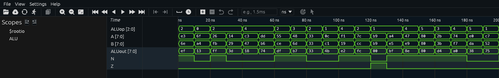
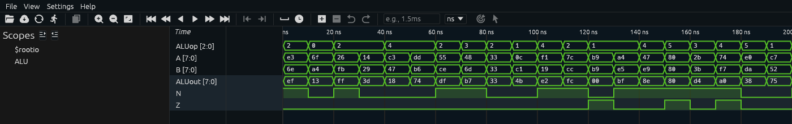

# Lab 01: One ALU, two frameworks

You'll test SimProc's ALU from DD104 with two testbenches, both on Verilator. The first is the
cocotb test from DD104 Lab 03. The second is written with pyuvm, a Python library that implements
UVM's classes and runs on cocotb. For each one you'll time the build and the run, see what it
reports on three planted bugs and count its lines. DD105-A made the same measurements on a
SystemVerilog UVM testbench for this ALU, and you'll compare your numbers with DD105-A's. Last,
you'll extend the pyuvm scoreboard so that it catches A03. A03 is a bug in the zero flag, and the
scoreboard as shipped misses it.

Package: [`labs/lab-01-one-alu-two-frameworks/`](https://github.com/uoftasic/dd105-b/tree/main/labs/lab-01-one-alu-two-frameworks)

## Before you start

- Finish [DD104](https://uoftasic.com/dd104/), and
  [Lab 03](https://uoftasic.com/dd104/labs/lab-03-three-blocks-before-the-processor-overview.html)
  in particular. You don't need its files, because this lab ships the ALU and a reference copy of
  the finished Lab 03 test, but you'll get more from the comparison if you wrote that test yourself.
- Read [Getting started](../guide/getting-started.md),
  [What a framework buys you](../guide/what-a-framework-buys-you.md) and
  [From cocotb tests to pyuvm components](../guide/from-cocotb-tests-to-pyuvm-components.md).
- Copy this table into your notes. You'll fill in the cocotb and pyuvm columns as you go. This
  course doesn't build the SystemVerilog testbench, so the third column already holds DD105-A's
  numbers, which were measured in
  [its Lab 01](https://uoftasic.com/dd105-a/labs/lab-01-one-alu-two-testbenches-overview.html)
  with the same 2 CPUs that we used for the times on this page. The questions at the end ask you
  to compare the columns.

  | | cocotb | pyuvm | SystemVerilog UVM (DD105-A) |
  |---|---|---|---|
  | Lines (all / code) | | | 424 / 282 |
  | First build | | | 102 s |
  | Rebuild after you change the testbench | | | 26 s to 99 s |
  | Run | | | 1.17 s for 2000 vectors |
  | A01 | | | caught, 282 `UVM_ERROR`s |
  | A02 | | | caught, 255 `UVM_ERROR`s |
  | A03 | | | missed |

Time: about 1 h 15 min.

## Part 1: Load the course

Can you reach DD105-B's files, and are your tools the versions that this lab's outputs were
recorded with? If you haven't set up the workbench yet, do
[IC101 Lab 03](https://uoftasic.com/ic101/labs/lab-03-launch-the-workbench-overview.html) first.

1. From your `workspace` clone, start the desktop (`./scripts/start_vnc.sh`, or
   `scripts\start_vnc.bat` on Windows), open <http://localhost/> and open a terminal on the
   desktop. Type every command from here on in that terminal.

2. Load the environment and get the course files:

   ```bash
   . /foss/designs/common/.designinit   # a new terminal loads this by itself; safe to rerun
   mod add dd105-b                      # first time only: clones github.com/uoftasic/dd105-b
   mod dd105-b                          # every time, including the first
   ```

   `mod dd105-b` prints:

   ```text
   cwd: /foss/designs/modules/dd105-b
   ```

3. Check the tool versions:

   ```bash
   verilator --version
   cocotb-config --version
   python3 -c "import pyuvm; print(pyuvm.__version__)"
   python3 --version
   surfer --version
   ```

   You should see:

   ```text
   Verilator 5.050 2026-07-01 rev v5.050
   2.0.1
   4.0.1
   Python 3.12.3
   surfer 0.7.0 (git: v0.7.0)
   ```

   The second line is cocotb's version and the third is pyuvm's.

| If you see | Do this |
|---|---|
| `bash: /foss/designs/common/.designinit: No such file or directory` | The workspace isn't mounted, so relaunch `start_vnc` from your `workspace` clone. In the meantime you can run this lab from a plain `git clone` of `github.com/uoftasic/dd105-b` inside the workbench image, because `make` needs neither `.designinit` nor `mod`. |
| `bash: mod: command not found` | Run the first line of step 2 in this terminal. It loads `.designinit`, which defines `mod`. |
| `mod: no such module: dd105-b` | You ran `mod dd105-b` before `mod add dd105-b`. |

For anything else, see IC101's [Troubleshooting](https://uoftasic.com/ic101/reference/troubleshooting.html) page.

Check: `verilator --version` prints `5.050` and you are in `/foss/designs/modules/dd105-b`.

## Part 2: The cocotb testbench

What does the cocotb test cost to build and run on Verilator, and what does it report on each bug?

1. Go to the lab folder:

   ```bash
   cd labs/lab-01-one-alu-two-frameworks
   ```

2. Open `rtl/alu.sv`. It's the `ALU` module from DD104 (lines 790 to 823 of
   `simproc_system.sv`) with the same name and ports, so a cocotb test written for DD104 drives it
   without changes. Three of its lines now choose between the correct expression and a bug, and
   an `initial` block at the bottom reads `+BUG` from the simulator's command line at time 0. The
   bugs are DD104's three ALU bugs, renamed so you can't confuse them with the router's bugs later
   in the course:

   | Bug | What's wrong | DD104 name |
   |---|---|---|
   | A01 | `SUB` computes `B - A` instead of `A - B` | `B01_sub_operands_swapped` |
   | A02 | `NAND` computes NOR instead of NAND | `B02_nand_is_nor` |
   | A03 | `Z` looks only at `ALUout[3:0]` | `B03_zero_flag_low_nibble` |

   One simulator holds all four ALUs. With no `+BUG` you get the golden ALU, and with `+BUG=A03`
   you get A03.

3. `cocotb/test_alu.py` is DD104 Lab 03's reference solution, with only its docstring changed.
   DD104 ran it on Icarus, and here it runs on Verilator, like everything else in this course. If
   you'd rather run your own test, copy it in under a new name and add `TB=test_alu_mine` to every
   `make cocotb`, `make cocotb-all` and `make loc` command in this lab:

   ```bash
   cp /foss/designs/modules/dd104/labs/lab-03-three-blocks-before-the-processor/test_alu.py cocotb/test_alu_mine.py
   ```

   The outputs below come from the reference. Your messages may be worded differently, but the
   counts should match.

4. `rtl/alu.sv` is 95 lines, and 53 of them are code. Write down how long you expect Verilator to
   take to build it, then build it and run the test on the golden ALU:

   ```bash
   make cocotb
   ```

   It took us about 19 seconds. The build comes first:

   ```text
   ========================================================================
    BUILD  ALU   (Verilator, 2 jobs)
    Full log: /foss/designs/modules/dd105-b/labs/lab-01-one-alu-two-frameworks/build/cocotb/build.log
   ========================================================================
   ========================================================================
    built /foss/designs/modules/dd105-b/labs/lab-01-one-alu-two-frameworks/build/cocotb/sim_build/Vtop in 7.3 s (1.5M in /foss/designs/modules/dd105-b/labs/lab-01-one-alu-two-frameworks/build/cocotb/sim_build)
    ccache:  Hits: 0 / 7 ( 0.00%)  Misses: 7 / 7 (100.0%)
   ========================================================================
   ```

   and you should see, at the end:

   ```text
   393224.00ns INFO     cocotb.regression                  ********************************************************************************************************
                                                           ** TEST                                            STATUS  SIM TIME (ns)  REAL TIME (s)  RATIO (ns/s) **
                                                           ********************************************************************************************************
                                                           ** test_alu.t01_one_vector_per_operation            PASS           6.00           0.00      12360.42  **
                                                           ** test_alu.t02_every_vector_the_alu_can_be_given   PASS      393216.00          10.64      36965.46  **
                                                           ** test_alu.t03_the_undefined_opcodes               PASS           2.00           0.00      15768.06  **
                                                           ********************************************************************************************************
                                                           ** TESTS=3 PASS=3 FAIL=0 SKIP=0                               393224.00          10.64      36957.32  **
                                                           ********************************************************************************************************
   - :0: Verilog $finish
   ------------------------------------------------------------------------
    ok: passed   10.94 s   log: build/cocotb/runs/test_alu-s1/run.log
   ------------------------------------------------------------------------
   ========================================================================
    cocotb, test_alu on Verilator, the golden ALU: build 7.6 s, run 11.0 s
   ========================================================================
   ```

   The `ok: passed` line is the course's verdict on the run, from DD104's verdict script adapted
   for this course. The line between the last two rules is the lab's makefile reporting how long
   the build and the run took. The run is mostly `t02` driving all 393,216 vectors. Write both times in your table.
   Times are ballpark, but the counts in this lab are exact.

   The build took 7.3 s, which is probably longer than you guessed for a 95-line file. Why does it
   take that long?

   <details>
   <summary>Answer</summary>

   Verilator turns the ALU into C++, and g++ compiles that C++ into a simulator, together with
   Verilator's and cocotb's own support code. The ccache line counts seven compiled files. One of
   them, `Vtop__ALL.o`, is the ALU. The other six are the support code: `verilated.o`,
   `verilated_vpi.o` and `verilator.o` are three of them, and `build.log` lists them all. Part 3
   shows how much of the 7.3 s those six take.

   </details>

5. Before you run the test against the bugs, write down which of `t01`, `t02` and `t03` you expect
   to fail on each one. Then run it on all three:

   ```bash
   make cocotb-all
   ```

   It takes about 45 seconds. You should see:

   ```text
   ========================================================================
   ALU: no bug switched on, this is the golden ALU
   ** test_alu.t01_one_vector_per_operation            PASS           6.00           0.00      11120.56  **
   ** test_alu.t02_every_vector_the_alu_can_be_given   PASS      393216.00          10.52      37360.56  **
   ** test_alu.t03_the_undefined_opcodes               PASS           2.00           0.00      14768.68  **
   ** TESTS=3 PASS=3 FAIL=0 SKIP=0                               393224.00          10.53      37351.19  **
    cocotb, test_alu on Verilator, the golden ALU: build 0.1 s, run 10.8 s
   ========================================================================
   ALU: bug A01 switched on
   AssertionError: SUB(0xC8, 0x3C) gave out=0x74 N=0 Z=0, expected out=0x8C N=1 Z=0
   AssertionError: 65024 of 393216 vectors have the wrong VALUE: {'SUB': 65024}.
   ** test_alu.t01_one_vector_per_operation            FAIL           2.00           0.00       2797.14  **
   ** test_alu.t02_every_vector_the_alu_can_be_given   FAIL      393216.00          10.80      36394.25  **
   ** test_alu.t03_the_undefined_opcodes               PASS           2.00           0.00      15169.27  **
   ** TESTS=3 PASS=1 FAIL=2 SKIP=0                               393220.00          10.81      36364.68  **
    cocotb, test_alu on Verilator, A01: build 0.1 s, run 11.1 s
   ========================================================================
   ALU: bug A02 switched on
   AssertionError: NAND(0xC3, 0x1D) gave out=0x20 N=0 Z=0, expected out=0xFE N=1 Z=0
   AssertionError: 65280 of 393216 vectors have the wrong VALUE: {'NAND': 65280}.
   ** test_alu.t01_one_vector_per_operation            FAIL           4.00           0.00       4953.41  **
   ** test_alu.t02_every_vector_the_alu_can_be_given   FAIL      393216.00          10.56      37234.87  **
   ** test_alu.t03_the_undefined_opcodes               PASS           2.00           0.00      15224.33  **
   ** TESTS=3 PASS=1 FAIL=2 SKIP=0                               393222.00          10.57      37204.58  **
    cocotb, test_alu on Verilator, A02: build 0.1 s, run 10.9 s
   ========================================================================
   ALU: bug A03 switched on
   AssertionError: Every value is correct, and 25726 of 393216 vectors have the wrong FLAGS: {'ADD': 3840, 'SUB': 3840, 'OR': 255, 'NAND': 255, 'SHL': 14400, 'SHR': 3136}.
   ** test_alu.t01_one_vector_per_operation            PASS           6.00           0.00      11549.25  **
   ** test_alu.t02_every_vector_the_alu_can_be_given   FAIL      393216.00          10.84      36288.13  **
   ** test_alu.t03_the_undefined_opcodes               PASS           2.00           0.00      14768.68  **
   ** TESTS=3 PASS=2 FAIL=1 SKIP=0                               393224.00          10.84      36259.91  **
    cocotb, test_alu on Verilator, A03: build 0.1 s, run 11.2 s
   ========================================================================
   ```

   You derived the counts 65,024 and 65,280 by hand in DD104 Lab 03, Part 4, and accounted for
   25,726 in Part 6, so the copied ALU and its switch behave on Verilator the way DD104's three
   broken ALUs did on Icarus. Write what the test reported on each bug in your table.

6. `t01` compares the value and both flags of six vectors, and it fails on A01 and A02 but passes
   on A03. Why does it miss A03?

   <details>
   <summary>Answer</summary>

   The six results are `0x04`, `0x8C`, `0xFF`, `0xFE`, `0x84` and `0x1F`. A03 gets `Z` wrong
   only when the result isn't zero but its low four bits are, and none of the six results is like
   that, so on these vectors the broken `Z` and the correct one agree.

   </details>

Check: `TESTS=3 PASS=3` on the golden ALU, and `t02` failing on all three bugs with 65024, 65280
and 25726 wrong vectors.

## Part 3: The pyuvm testbench

What does the same job cost when it's built from UVM's pieces in pyuvm?

1. Build the pyuvm testbench's simulator:

   ```bash
   make build
   ```

   After a `BUILD` banner like Part 2's, it ends with:

   ```text
   ========================================================================
    built /foss/designs/modules/dd105-b/labs/lab-01-one-alu-two-frameworks/build/sim_build/Vtop in 1.7 s (1.5M in /foss/designs/modules/dd105-b/labs/lab-01-one-alu-two-frameworks/build/sim_build)
    ccache:  Hits: 6 / 14 (42.86%)  Misses: 8 / 14 (57.14%)
   ========================================================================
    /foss/designs/modules/dd105-b/labs/lab-01-one-alu-two-frameworks/build/sim_build/Vtop is up to date.
   ```

   This simulator is the ALU again, compiled into its own folder. The testbench and pyuvm itself
   are Python, so neither is compiled. The ccache's counts add up across builds, so subtract the
   cocotb build's 0 hits and 7 misses to get this build's own counts. Why did it take 1.7 s when
   the cocotb build of the same ALU took 7.3 s?

   <details>
   <summary>Answer</summary>

   This build looked up seven files and found six of them in the ccache, where the cocotb build
   had put them, so it compiled one file. With an empty ccache this build took 7.3 s too, in both
   of the runs we timed, so the six files from the ccache saved about 5.6 s.

   </details>

   DD105-A's SystemVerilog UVM testbench for this ALU took 102 s to build with the same 2 CPUs. In
   that build, Verilator turned the whole UVM library into C++ along with the ALU and the
   testbench. It counted 24.157 MB of source in 386 modules, nearly all of it from the UVM library,
   and g++ spent 98.5 s of the 102 s compiling the C++ that Verilator made from it. Write your
   pyuvm build's time in your table.

2. Read `tb/alu_uvm.py`. Each piece is a class named after its counterpart in DD105-A's
   testbench, written in CamelCase as Python class names are (`alu_driver` becomes `AluDriver`).
   Most pieces do a job that the cocotb test also does:

   | pyuvm piece | Its job | In `test_alu.py` |
   |---|---|---|
   | `AluIf` | the ALU's pins, a 10 ns period and a `valid` flag | `dut` and the 1 ns `Timer` in `alu()` |
   | `AluItem` | one vector and the ALU's answer | the `(op, a, b)` and `got` values |
   | `AluRandSeq`, `AluDirectedSeq` | make the vectors | the loops in `t02`, the list in `t01` |
   | `AluDriver` | puts each vector on the pins | the three `.value =` lines in `alu()` |
   | `AluMonitor` | reads the pins back into an `AluItem` | the `return` line of `alu()` |
   | `AluScoreboard` | `predict()` and the comparison | `spec()`, and the comparisons in `t01` and `t02` |
   | `AluAgent`, `AluEnv` | create the pieces and connect them; `AluEnv` also checks that the scoreboard checked every vector the driver sent | nothing |
   | `AluRandTest`, `AluDirectedTest` | choose the stimulus | the `@cocotb.test()` functions |

   The ALU is combinational, so the cocotb test sets the inputs and waits 1 ns. A driver and a
   monitor are separate pieces, so they need to agree on when a vector is on the pins. DD105-A
   added a clock and a `valid` signal to its interface for that. Here `AluIf` does the same job with
   a period and a `valid` flag in Python. The driver holds each vector on the pins for 10 ns and
   sets `valid` while it does, and the monitor reads the pins 5 ns into every period.

   The tests derive from `BaseTest`, in `labs/common/py/dd105b_base.py`. pyuvm reports through
   Python's `logging`, and an error that a component logs with `self.logger.error()` is printed
   but doesn't fail the test. `BaseTest` counts every error that any component logs, prints one
   line with the count at the end, and fails the test if the count isn't 0. The cocotb test
   doesn't need it, because each of its checks raises `AssertionError` when it finds a mismatch,
   and that fails the test. So `cocotb/Makefile` sets `BASE_TEST := 0`, which tells the verdict not
   to look for `BaseTest`'s line.

3. Run the random test, which sends 2000 random vectors:

   ```bash
   make run
   ```

   You should see, among cocotb's lines:

   ```text
    20000.00ns INFO     ..wo-frameworks/tb/alu_uvm.py(251) [uvm_test_top.env.sb]: [SB] 2000 vectors checked: 0 value mismatches
   DD105-B BaseTest: 0 errors logged, no bound assertions
    20000.00ns INFO     cocotb.regression                  alu_uvm.AluRandTest passed
   ```

   and, last:

   ```text
   ------------------------------------------------------------------------
    ok: 0 errors   0.54 s   log: build/runs/AluRandTest-s1/run.log
   ------------------------------------------------------------------------
   ```

   cocotb cuts a long file path to fit its column, so `..wo-frameworks/tb/alu_uvm.py(251)` is line
   251 of `tb/alu_uvm.py`. The `[SB]` line is stamped `20000.00ns`, which is 20 µs, the time that
   2000 vectors take at one every 10 ns. "No bound assertions" means that no SystemVerilog
   assertions are bound into this design. From Lab 05 on, the router has assertions bound into it.
   Write the run time in your table.

4. Run the other test, without rebuilding:

   ```bash
   make run TEST=AluDirectedTest
   ```

   It sends DD104's six `t01` vectors. You should see `[SB] 6 vectors checked: 0 value mismatches`
   and `ok: 0 errors   0.27 s`, and the whole command took 0.37 s when we timed it. The test is
   picked when the simulator starts, so trying another test, seed or bug never rebuilds anything,
   and every lab in the course works this way.

5. DD105-A's SystemVerilog testbench had three times as many code lines as the cocotb test. Before
   you count each testbench's lines, guess how the pyuvm testbench compares. Then count them:

   ```bash
   make loc
   ```

   You should see:

   ```text
   cocotb testbench:
     file                 lines    code
     cocotb/test_alu.py     189      94
   pyuvm testbench:
     file            lines    code
     tb/alu_uvm.py     316     161
   ```

   `code` leaves out blank lines and comments, and counts Python docstrings as comments. The pyuvm
   testbench has about 1.7 times as many code lines as the cocotb test (161 against 94), and
   DD105-A's had 3 times as many (282). Using the table in step 2, where do pyuvm's extra lines go,
   and which of the SystemVerilog testbench's lines does Python not need?

   <details>
   <summary>Answer</summary>

   The extra lines go into pieces that the cocotb test doesn't need. The agent only creates and
   connects the other pieces, and the environment does the same plus one check, that the
   scoreboard checked every vector the driver sent. `AluIf` carries the period and the `valid`
   flag, and the driver and the monitor take two classes to do what `alu()` does in five lines.
   The SystemVerilog testbench also spent lines on things that Python doesn't need: a
   `` `uvm_component_utils `` or `` `uvm_object_utils `` line and a constructor in every class,
   declared types and widths, an interface with two clocking blocks, and a top module. In
   `alu_uvm.py`, only `AluIf`, `AluItem` and `AluRandSeq` define `__init__`, and each does it only
   to set its own fields.

   </details>

6. Record a waveform of the random test and open it:

   ```bash
   make waves
   surfer build/runs/AluRandTest-s1/waves.fst &
   ```

   Add the six ports from `ALU` and look at the first 200 ns:

   

   *The golden ALU. The first vector, `ALUop` 2 (`OR`) with `A=e3` and `B=6e`, gives `ef`. `Z` is
   high from 120 to 130 ns, where `SUB` with `A=B=b9` gives `00`.*

   Each vector holds the pins for 10 ns, starting at a multiple of 10 ns. The waves hold only the
   ALU's six ports, because `AluIf`'s period and `valid` flag exist only in Python.

Check: `2000 vectors checked: 0 value mismatches` and `ok`, and your table has a line count, a
build time and a run time in the cocotb and pyuvm columns.

## Part 4: Both testbenches on the bugs

Which bugs does the pyuvm testbench catch, and why?

1. Read `write()` in `AluScoreboard`, in `tb/alu_uvm.py`. Write down which of A01, A02 and A03 you
   expect it to catch.

2. Run the random test against the golden ALU and each bug:

   ```bash
   make check-all
   ```

   All four runs use the simulator you built in Part 3, and each takes about 0.5 s. You should
   see:

   ```text
         ok  the golden design                        0 errors                        0.5s
   ------------------------------------------------------------------------
     MISSED  tier 1  A03_zero_flag_low_nibble         0 errors                        0.5s
     caught  tier 1  A01_sub_operands_swapped         291 errors                      0.5s
     caught  tier 1  A02_nand_is_nor                  278 errors                      0.5s
   ------------------------------------------------------------------------
    2 of 3 caught.
    Still hiding from this test:
      A03_zero_flag_low_nibble
         hides behind: every check that compares results and not flags
   ```

   `make` then prints an error line, because the verdict is a fail, not because the makefile
   broke.

3. Look at one of the catches in full:

   ```bash
   make run BUG=A01
   ```

   It logs 291 errors. The first three are:

   ```text
       95.00ns ERROR    ..wo-frameworks/tb/alu_uvm.py(236) [uvm_test_top.env.sb]: [VALUE] SUB A=0c B=c1 -> ALUout=b5 N=1 Z=0, expected ALUout=4b
      135.00ns ERROR    ..wo-frameworks/tb/alu_uvm.py(236) [uvm_test_top.env.sb]: [VALUE] SUB A=a4 B=e5 -> ALUout=41 N=0 Z=0, expected ALUout=bf
      195.00ns ERROR    ..wo-frameworks/tb/alu_uvm.py(236) [uvm_test_top.env.sb]: [VALUE] SUB A=c7 B=52 -> ALUout=8b N=1 Z=0, expected ALUout=75
   ```

   and near the end of the log:

   ```text
    20000.00ns INFO     ..wo-frameworks/tb/alu_uvm.py(251) [uvm_test_top.env.sb]: [SB] 2000 vectors checked: 291 value mismatches (SUB 291)
   DD105-B BaseTest: 291 errors logged, no bound assertions
   ```

   followed by the `AssertionError` that `BaseTest` raises, which quotes the first error, and then
   the verdict, `caught: 291 errors`. That `AssertionError` is how the verdict knows a check fired.
   pyuvm has no report server, so the log has no table that counts errors by kind, like the
   "Report counts by id" table that DD105-A's UVM printed. The per-operation count on the `[SB]`
   line comes from the scoreboard's own counters.

4. The cocotb test's `t02` drove all 65,536 `SUB` vectors and found 65,024 of them wrong. The
   pyuvm test caught A01 on the tenth of its 2000 random vectors (`95.00ns` is 5 ns into the
   period that starts at 90 ns). Why does a random sample find A01 and A02 so easily, when no
   number of random vectors would find A03 with this scoreboard?

   <details>
   <summary>Answer</summary>

   A01 and A02 change the value on almost every `SUB` and `NAND` vector (65,024 and 65,280 of
   65,536 each), so any sample with a handful of those operations in it shows the bug. A03 changes
   only `Z`, and this scoreboard never reads `Z`. DD104 Lab 03, Part 5 showed the same thing with a
   sweep of all 393,216 vectors that checked only the values.

   </details>

5. Write what the pyuvm testbench reported on each bug in your table.

Check: `2 of 3 caught`, with A03 `MISSED`.

## Part 5: Check the flags

What does it take to make the pyuvm scoreboard catch A03, and what does the change cost to
rebuild?

1. See the verdict you're going to change:

   ```bash
   make check BUG=A03
   ```

   You should see:

   ```text
         ok  the golden design                        0 errors                        0.5s
     MISSED  A03_zero_flag_low_nibble                 0 errors                        0.5s
   ------------------------------------------------------------------------
    VERDICT: FAIL -- your test passes A03_zero_flag_low_nibble too.
   ```

2. Extend `AluScoreboard` in `tb/alu_uvm.py`, following the `TODO` in `write()`. `predict()`
   already works out `n` and `z`, and the monitor already fills in `t.N` and `t.Z`, so you only
   need to compare them. Count flag mismatches separately from value mismatches, with a counter and
   a per-operation list like `n_bad_value` and `bad_value`, and set both up in `build_phase`. Log
   each flag mismatch with `self.logger.error()` and a message that starts with `[FLAGS]`, and add
   the flag count to the line that `report_phase` prints. pyuvm's messages have no IDs, so
   `[FLAGS]` is only text for you to read. `BaseTest` counts every error together, so the two
   counts on the `[SB]` line are the only place where the run keeps value and flag mismatches
   apart.

3. You changed one file. Write down how long you expect the rebuild to take, then run it:

   ```bash
   make build
   ```

   You should see:

   ```text
    /foss/designs/modules/dd105-b/labs/lab-01-one-alu-two-frameworks/build/sim_build/Vtop is up to date.
   ```

   Why is there nothing to build?

   <details>
   <summary>Answer</summary>

   The simulator is built from `rtl/alu.sv` alone, and `tb/alu_uvm.py` is a Python file that
   cocotb imports each time the simulator starts. The command took 0.07 s when we timed it. In
   DD105-A, the same edit to the SystemVerilog scoreboard cost a rebuild of 99 s (87 s in an
   earlier run). DD105-A also timed two one-line edits. Adding one member to a class rebuilt in
   93 s, and a change inside a task's body rebuilt in 26 s.

   </details>

   Write the rebuild time in your table.

4. Ask for the verdict again:

   ```bash
   make check BUG=A03
   ```

   With the reference solution you should see:

   ```text
         ok  the golden design                        0 errors                        0.5s
     caught  A03_zero_flag_low_nibble                 125 errors                      0.5s
           AluRandTest: AssertionError: 125 errors logged, the first: [FLAGS] SHR A=80 B=80 -> ALUout=80 N=1 Z=
   ------------------------------------------------------------------------
    VERDICT: PASS
   ```

   If the golden row says `FAIL` instead of `ok`, your check fires on the golden ALU, so compare it
   with `predict()` again. If a row says `BROKEN`, your new code raised an exception, and
   `make run BUG=A03` shows the traceback.

5. Run all three bugs again:

   ```bash
   make check-all
   ```

   You should see `3 of 3 caught`. The reference solution logs one `[FLAGS]` error for each vector
   whose flags are wrong, and with it the counts are 582, 421 and 125 errors for A01, A02 and A03.
   Before your change, A01 and A02 had 291 and 278. Why is A01's count exactly double, when A02's
   isn't?

   <details>
   <summary>Answer</summary>

   A wrong value can bring wrong flags with it, and then the vector is logged twice, once as
   `[VALUE]` and once as `[FLAGS]`. Under A01 the ALU returns `B - A`, the negative of the right
   answer, and a byte and its negative differ in bit 7 unless the byte is `0x00` or `0x80`, which
   are the cases A01 gets right. So every wrong `SUB` also has a wrong `N`, and A01's 291 `[VALUE]`
   errors come with 291 `[FLAGS]` errors. Under A02, bit 7 of `~(A | B)` and `~(A & B)` differ
   only when exactly one of `A[7]` and `B[7]` is 1, so only some of the 278 wrong `NAND` values
   also have wrong flags. The `[SB]` line of `make run BUG=A02` counts 143 of them.

   </details>

6. Record the failure and open it:

   ```bash
   make waves BUG=A03
   surfer build/runs/AluRandTest-s1-A03/waves.fst &
   ```

   

   *A03. The vectors are the same as in Part 3's picture, because the seed is the same. `Z` also
   goes high from 150 to 160 ns, where `SHR` of `80` by 0 gives `80`, and from 170 to 180 ns,
   where `SHL` of `74` by 3 gives `a0`.*

   The first `[FLAGS]` error is stamped `155.00ns`, because the monitor read the `SHR A=80 B=80`
   vector 5 ns into the period that starts at 150 ns. In Part 3's picture, `Z` is high only from
   120 to 130 ns, where the result really is `00`.

7. `AluDirectedTest` sends the same six vectors as `t01`, and because both tests share the
   scoreboard, its vectors now go through your flag check too. Predict whether it catches A03,
   then run it:

   ```bash
   make run TEST=AluDirectedTest BUG=A03
   ```

   You should see `[SB] 6 vectors checked: 0 value mismatches, 0 flag mismatches` and
   `MISSED: 0 errors   0.27 s`. It misses A03 for the same reason that `t01` does, which you worked
   out at the end of Part 2.

Check: `VERDICT: PASS` from `make check BUG=A03`, and `3 of 3 caught` from `make check-all`.

## Finishing

You're done when `make check BUG=A03` prints `VERDICT: PASS` with the scoreboard you extended in
`tb/alu_uvm.py`.

Questions:

1. Using your table, what did the UVM structure cost in this lab, in pyuvm and in DD105-A's
   SystemVerilog, and what did it give you that the cocotb test didn't?

   <details>
   <summary>Answer</summary>

   In pyuvm it cost about 1.7 times the code (161 code lines against 94). Its build cost no more
   than the cocotb test's, because the only thing compiled in either is the ALU (7.3 s from an
   empty ccache), and editing the testbench rebuilt nothing. In DD105-A's SystemVerilog it
   cost three times the code, a first build of about 100 s, and 26 to 99 s every time the
   testbench changed. Neither is faster per vector than the cocotb test. The table that cocotb
   prints at the end of each run puts `AluRandTest`'s 2000 vectors at 0.19 s of real time, about
   0.1 ms each, and `t02`'s 393,216 at 10.64 s, about 0.03 ms each. DD105-A's 2000 vectors took
   1.17 s, about 0.6 ms each. That time also covers starting the simulator, but DD105-A's directed
   test ran its six vectors in 0.04 s, so starting takes at most 0.04 s of it.

   You saw what the structure gave you in Part 5. The flag check went into one class, and both
   tests used it without being edited, because the stimulus and the checking are separate pieces.
   In `test_alu.py`, `t01` and `t02` each do their own comparison. `AluDirectedTest` is one
   sequence and one short test class that reuse the driver, monitor and scoreboard, and it's
   chosen when you run, without a rebuild. On one combinational block that's a modest return. The
   structure is meant for designs like the router, which you'll test from Lab 02 on. It has a
   register bus, an input stream and two output streams.

   </details>

2. On A03 your scoreboard counted 125 flag mismatches in 2000 vectors, and the cocotb test
   counted 25,726 in 393,216. What can each number tell you?

   <details>
   <summary>Answer</summary>

   125 of 2000 is 6.25%, and 25,726 of 393,216 is 6.5%, so the random run estimates the fraction
   of vectors that A03 breaks, from whichever 2000 vectors its seed picked. Only the sweep gives
   the exact count, which you can derive from the bug by hand, as you did in DD104 Lab 03, Part 6.
   Both runs found no wrong values and some wrong flags, which tells you that the arithmetic is
   right and the bug is in the flag logic.

   </details>

Submit: Nothing to submit.

## Going further (optional)

Run your flag check on other seeds, each of which picks a different 2000 vectors:

```bash
make check-all SEED=2
```

With the reference solution, A03's count was 147 on seed 2, 143 on seed 3, 135 on seed 4 and 134
on seed 5, against 125 on seed 1. The starter's scoreboard missed A03 on all five seeds.

Next on the [Course path](../index.md#course-path): the reading on Python classes and cocotb
concurrency and on driving and sampling on the clock, then Lab 02: A layered testbench without
pyuvm.
