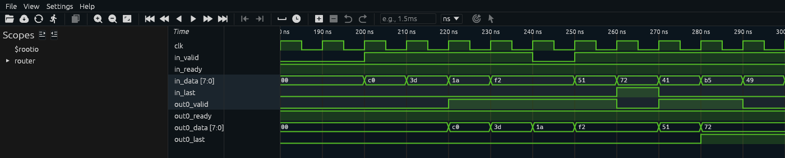
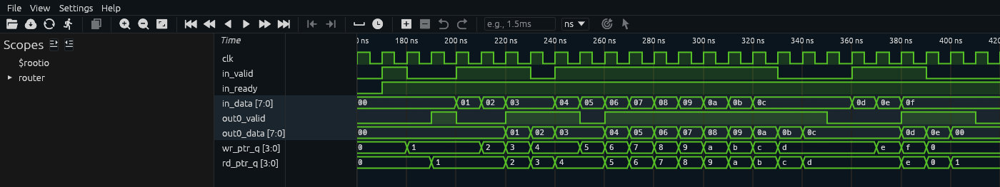

# Lab 02: A layered testbench without pyuvm

You'll finish a testbench for the router. Its pieces are plain Python classes on cocotb, with no
pyuvm. You'll write the monitor, which turns the handshakes on a valid/ready stream into packets,
and the scoreboard, which predicts the packets that should come out of output 0 and checks the
ones that do. Then you'll use the testbench to catch two planted bugs, B05 and B09, and rerun it
with different plusargs to find out what each catch depends on.

Package: [`labs/lab-02-a-layered-testbench-without-pyuvm/`](https://github.com/uoftasic/dd105-b/tree/main/labs/lab-02-a-layered-testbench-without-pyuvm)

## Before you start

- Finish [Lab 01](lab-01-one-alu-two-frameworks-overview.md). This lab uses the same `make`
  targets, the same terminal and the same course folder.
- Read [The router in one page](../reference/the-router-in-one-page.md), and keep the
  [specification](../reference/router-spec.md) open. You'll use its Cycles and handshakes, Packets,
  Routing and The outputs sections, and the stream rules under Valid/ready rules.

Time: about 1 h 30 min.

## Part 1: The starter

What does the shipped testbench do, and what does it check?

1. Open a terminal on the workbench desktop, as in Lab 01, and go to the lab folder:

   ```bash
   . /foss/designs/common/.designinit   # in every new terminal
   mod dd105-b
   cd labs/lab-02-a-layered-testbench-without-pyuvm
   ```

2. Build the simulator:

   ```bash
   make build
   ```

   You should see:

   ```text
   python3 ../common/inject.py --all --out build/rtl
   faulty build with 15 bugs -> build/rtl/router.f
   ========================================================================
    BUILD  router   (Verilator, 2 jobs)
    Full log: /foss/designs/modules/dd105-b/labs/lab-02-a-layered-testbench-without-pyuvm/build/build.log
   ========================================================================
   ========================================================================
    built /foss/designs/modules/dd105-b/labs/lab-02-a-layered-testbench-without-pyuvm/build/sim_build/Vtop in 2.2 s (1.9M in /foss/designs/modules/dd105-b/labs/lab-02-a-layered-testbench-without-pyuvm/build/sim_build)
    ccache:  Hits: 11 / 21 (52.38%)  Misses: 10 / 21 (47.62%)
   ========================================================================
    /foss/designs/modules/dd105-b/labs/lab-02-a-layered-testbench-without-pyuvm/build/sim_build/Vtop is up to date.
   ```

   In the first two lines, `inject.py` writes a copy of the router's RTL with all fifteen planted
   bugs in it, each behind the `+BUG` switch, as Lab 01's ALU had its three bugs. So the simulator
   you just built is the one that every run in this lab uses, whichever bug you switch on.

   The ccache's counts add up over every build in your clone. Before this build, our counts
   covered only Lab 01's two builds, which came to 6 hits and 8 misses, so this build's own counts
   were 5 hits and 2 misses. The two files that this build compiled are `Vtop__ALL.o`, the router,
   and `verilator.o`, cocotb's `main()` for the simulator, which includes the header that
   Verilator writes for whichever design it built. The other five are Verilator's support code,
   which Lab 01's builds had already put in the ccache. With an empty ccache, the build took us
   7.6 to 7.7 s.

3. Read the files in `tb/`. The generator hands its packets to the driver through a queue, and
   each monitor hands the packets it sees to the scoreboard through a queue of its own. Each queue
   is a `cocotb.queue.Queue`. One end calls `await q.put(p)`, and the other calls `await q.get()`,
   which waits until there's a packet to take.

   | File | Class | Its job |
   |---|---|---|
   | `packet.py` | `Packet` | one packet: its beats, header first |
   | | `RouterCfg` | the test's knobs, read from plusargs |
   | `generator.py` | `Generator` | makes the packets and puts them in a queue |
   | `driver.py` | `Driver` | offers each beat on the input until the router takes it |
   | | `Sink` | holds one output's ready (`out0_ready` or `out1_ready`) at 1, and counts its beats |
   | | `ApbMaster` | writes the routing table and `CTRL.EN` |
   | `monitor.py` | `Monitor` | yours: turns a stream's handshakes into packets |
   | `scoreboard.py` | `Scoreboard` | yours: predicts output 0 and checks it |
   | `env.py` | `Env` | makes the pieces from `Generator` to `Scoreboard`, connects them with queues, and runs the test |
   | `test_router.py` | `router_class_test` | the clock, the reset, the `Env`, and the assert at the end, which fails the test if the testbench reported errors |

   Read `Env.run()` closely. It waits for the reset to end and writes the routing table and
   `CTRL.EN`. Then it starts the sinks, the monitors, the scoreboard and the generator with
   `cocotb.start_soon()`, which runs each one's `run()` as a task of its own beside the test. It
   runs the driver itself. When the driver has sent every packet, `Env.run()` waits 50 cycles for
   the outputs to drain and asks the scoreboard for its report. Nothing in `Env.run()` waits for
   the monitors or the scoreboard, so the test ends after those 50 cycles however much of the
   monitor and the scoreboard you've written.

   `router_class_test` starts a 10 ns clock, holds `rst_n` low through the rising edges at 0, 10
   and 20 ns, and then makes the `Env` and runs it. The driver and the scoreboard log each error
   they find and count it. A logged error fails nothing by itself, so the test's last line is an
   `assert` that the count is 0. When the count isn't 0, the assert raises an `AssertionError`,
   which the verdict counts as a check that fired. This lab has no pyuvm and no `BaseTest`, so its
   Makefile sets `BASE_TEST := 0`, as Lab 01's `cocotb/Makefile` did. That setting tells the
   verdict not to look for the line that `BaseTest` prints at the end of a test.

4. Run the test:

   ```bash
   make run
   ```

   After cocotb's start-up lines you should see:

   ```text
        0.00ns INFO     cocotb.regression                  running test_router.router_class_test (1/1)
       20.00ns INFO     tb.env                             [ENV] 100 packets, DST from 0123, routes 0110, 1 to 8 beats
     7960.00ns INFO     tb.env                             [ENV] sent 100 packets (476 beats); output 0 took 243 beats and output 1 took 233
     7960.00ns INFO     tb.sb                              [SB] 0 packets in, 0 predicted for output 0, 0 checked, 0 errors
     7960.00ns INFO     cocotb.regression                  test_router.router_class_test passed
   ```

   and, last:

   ```text
   ------------------------------------------------------------------------
    ok: passed   0.25 s   log: build/runs/router_class_test-s1/run.log
   ------------------------------------------------------------------------
   ```

   The third column is the logger that wrote the line. The environment, the driver, the two
   monitors and the scoreboard each have a logger of their own, named `tb.` followed by a short
   name for the piece: `tb.env`, `tb.drv`, `tb.in`, `tb.out0` and `tb.sb`. The first `[ENV]` line
   gives the test's knobs, which are plusargs (the package README lists them). `routes 0110` is the
   routing table, one character per entry from `ROUTE0` to `ROUTE3`, and each character is the
   output that the entry sends packets to. So packets for `DST` 0 and 3 go to output 0, and packets
   for `DST` 1 and 2 go to output 1.

5. `make check-all` runs the test on the golden router and on the two bugs this lab hunts. Write
   down what you expect it to report, then run it:

   ```bash
   make check-all
   ```

   You should see:

   ```text
         ok  the golden design                        passed                          0.2s
   ------------------------------------------------------------------------
     MISSED  tier 2  B05_dst_field_off_by_one         passed                          0.2s
     MISSED  tier 3  B09_write_pointer_power_of_two   passed                          0.2s
   ------------------------------------------------------------------------
    0 of 2 caught.
    Still hiding from this test:
      B05_dst_field_off_by_one
         hides behind: sending to DST 0 only, or setting every route the same way
      B09_write_pointer_power_of_two
         hides behind: short tests: fewer than 16 beats through one output
   ```

   On the golden router, output 0 took 243 beats and the test passed. It passed on both broken
   routers as well. Why?

   <details>
   <summary>Answer</summary>

   The starter's monitor and scoreboard are empty, so nothing compared those 243 beats with
   anything. That's why the `[SB]` line says the scoreboard took in 0 packets and checked 0. A
   pass means only that no check fired, and this testbench has no checks that could fire, so it
   passes on all three routers.

   </details>

Check: `0 of 2 caught`, and `[SB] 0 packets in` in `make run`.

## Part 2: The monitor

What goes into the router, and what comes out of output 0, packet by packet?

1. Open `tb/monitor.py`. A `Monitor` is given the prefix of one stream's signal names, so the
   same class watches `in_valid`, `in_ready`, `in_data` and `in_last` on the input and
   `out0_valid`, `out0_ready`, `out0_data` and `out0_last` on output 0. `Driver`, `Sink` and
   `ApbMaster` change the router's inputs right after a rising edge, and every class that reads the
   pins, `Monitor` included, reads them at the falling edge in the middle of the cycle. The
   router's outputs come from flip-flops and change just after a rising edge too, so at the
   falling edge every signal holds the value it has for the whole cycle. That's what the
   specification means by a signal's value "in cycle n". A cycle in which `valid` and `ready` are
   both 1 is a handshake, and the beat moves at the rising edge that ends it. The monitor sees the
   handshake at the falling edge in the middle of that cycle, so the times it records are 5 ns
   before the edges at which the beats moved.

2. This is the golden router taking the first packet on its input and delivering it on output 0:

   

   *Seed 1, 180 to 300 ns. `in_valid` goes high at 200 ns with `c0`, the header, and the router
   takes it at the rising edge at 210 ns. `c0` is on `out0_data` from 220 ns. `out0_ready` is 1
   throughout.*

   Find `f2` on `in_data`. At how many falling edges is it on `in_data`, and how many beats is it?

   <details>
   <summary>Answer</summary>

   It's on `in_data` at two falling edges, 235 ns and 245 ns, and it's one beat. The driver put it
   there at 230 ns, the router took it at the edge at 240 ns, and the driver then left one idle
   cycle with `in_valid` at 0. So at 245 ns `in_data` still shows `f2`, but with `in_valid` at 0
   there's no handshake. A monitor that looked only at `in_data` would record it twice. Output 0
   shows the same idle cycle two cycles later, with `out0_valid` at 0 from 260 to 270 ns.

   </details>

3. Write `Monitor.run()` as the `TODO` describes. Each time round a `while True` loop, wait for the
   next falling edge with `await FallingEdge(self.dut.clk)`; drop any half-assembled packet while
   `rst_n` is 0; and in a handshake cycle add the beat to the packet `p`, starting a new one when
   `p` is `None`. When the beat has `last` = 1, the packet is finished, so put it in `to_sb` with
   `await self.to_sb.put(p)` and set `p` back to `None` for the next one. Log each finished packet
   with the `self.log.info(f"{p}")` line and the condition in the `TODO`, so that you can compare
   your output with the one below.

4. Run `make build`. It prints `Vtop is up to date.`, because the simulator is built from the
   router's RTL alone and `tb/` is Python, as in Lab 01. So you'll find a mistake in your code
   only when you run the test. If `run()` raises an exception, such as a `NameError`, the test ends
   there, the verdict is `BROKEN`, and the traceback is in the log.

5. `+SHOW=5` makes each monitor log the first 5 packets it sees, each at the time it saw the
   packet's last handshake. Using the routing table `0110` and rule O8 of the specification, write
   down which input packets you expect to see again on output 0, and how many ns each `tb.out0`
   line should come after the `tb.in` line of the same packet. Then run it:

   ```bash
   make run PLUSARGS="+SHOW=5"
   ```

   You should see, with the reference monitor:

   ```text
       20.00ns INFO     tb.env                             [ENV] 100 packets, DST from 0123, routes 0110, 1 to 8 beats
      265.00ns INFO     tb.in                              dst 3, 6 beats: c0 3d 1a f2 51 72
      285.00ns INFO     tb.out0                            dst 3, 6 beats: c0 3d 1a f2 51 72
      365.00ns INFO     tb.in                              dst 1, 8 beats: 41 b5 49 a0 a6 fc 48 0e
      405.00ns INFO     tb.in                              dst 3, 1 beat: c2
      425.00ns INFO     tb.out0                            dst 3, 1 beat: c2
      485.00ns INFO     tb.in                              dst 0, 4 beats: 03 03 16 14
      505.00ns INFO     tb.out0                            dst 0, 4 beats: 03 03 16 14
      525.00ns INFO     tb.in                              dst 0, 4 beats: 04 57 6c 1b
      545.00ns INFO     tb.out0                            dst 0, 4 beats: 04 57 6c 1b
      555.00ns INFO     tb.out0                            dst 0, 1 beat: 05
     7960.00ns INFO     tb.env                             [ENV] sent 100 packets (476 beats); output 0 took 243 beats and output 1 took 233
     7960.00ns INFO     tb.sb                              [SB] 0 packets in, 0 predicted for output 0, 0 checked, 0 errors
   ```

   The header's low six bits are the packet's sequence number, so `c0` is packet 0, `41` packet 1
   and `c2` packet 2. Why is packet 1 missing from output 0, why does each `tb.out0` line come
   20 ns after the `tb.in` line of the same packet, and why does `05` come out of output 0 with no
   `tb.in` line?

   <details>
   <summary>Answer</summary>

   Packet 1's header, `41`, has `DST` 1 in bits 7:6, and `ROUTE1` sends packets to output 1, which
   this testbench doesn't watch. The 20 ns is two clock cycles. Rule O8 puts each beat on the
   output from the second cycle after its input handshake, as example E2 in the specification
   shows, unless the beat before it is still waiting there, as in E3. Here the sink takes every
   beat in the first cycle it's offered, so nothing waits, and each packet's last beat is taken
   from output 0 two cycles after it went in. `05` is packet 5. The five packets that the input
   monitor logged were packets 0 to 4, including packet 1, which went to output 1, so output 0's
   fifth packet is packet 5, which went in after the input monitor had stopped logging.

   </details>

   The `[SB]` line says 0 packets in, because you haven't written the scoreboard yet.

Check: your `tb.in` and `tb.out0` lines match the ones above. Your seed is the same as ours, so
your packets are the same too.

## Part 3: The scoreboard

Which packets should come out of output 0, and did they?

1. Read the docstring at the top of `tb/scoreboard.py`. The rule you're checking is O5, which says
   that an output delivers the beats of the packets routed to it in the order the router accepted
   them, unchanged. (The full rule also allows a changed `out_last` on a packet that the router cut
   for being oversize, but every packet in this lab is 1 to 8 beats, so none is cut.) In this lab
   the sinks never stall, so no packet is dropped for a full output, and a packet goes to output 0
   exactly when `ROUTE[DST]` is enabled with `PORT` 0.

2. Write the four `TODO`s:

   - `run()`: two loops that each run forever, each in an `async def` method of its own. One takes
     packets from `from_in` and calls `predict()` with each, and the other takes packets from
     `from_out0` and calls `check()` with each. Start both with `cocotb.start_soon()` and await
     both.
   - `predict()`: append the packet to `expected` if it will come out of output 0.
   - `check()`: compare what came out with the oldest packet in `expected`, using
     `Packet.same()`. A packet that comes out while `expected` is empty is an error too.
   - `report()`: report an error for each packet still in `expected`, because it never came out,
     and one more if the test checked no packets at all.

   Report each error with `self.error()`, which logs the message on the `tb.sb` logger and counts
   it in `n_errors`:

   ```python
   self.error(f"out0 delivered {got} at {got.t_last} ns; expected {want}, which went in at {want.t_last} ns")
   ```

3. Run the test on the golden router:

   ```bash
   make run
   ```

   You should see `[SB] 100 packets in, 51 predicted for output 0, 51 checked, 0 errors` and
   `ok: passed`. The golden router is correct, so if an error fires here, the mistake is in your
   scoreboard or your monitor.

4. Run it on five seeds:

   ```bash
   make seeds SEEDS="1 2 3 4 5"
   ```

   You should see `5 ok  (5 runs)`. The command took us 1.5 s.

5. Write down what you now expect from `make check-all`, then run it. With the reference
   scoreboard you should see:

   ```text
         ok  the golden design                        passed                          0.3s
   ------------------------------------------------------------------------
     caught  tier 2  B05_dst_field_off_by_one         AssertionError                  0.3s
     caught  tier 3  B09_write_pointer_power_of_two   AssertionError                  0.3s
   ------------------------------------------------------------------------
    2 of 2 caught.
    Every bug in the list, each one caught by a check that fired.
   ```

   Each caught row names the exception that ended the run, which is the `AssertionError` from the
   test's last line. The number of errors is in that assert's message, which you'll see in the
   next step.

6. Look at the first error on B05:

   ```bash
   make run BUG=B05
   ```

   With the reference scoreboard, the first line after `[ENV]` is:

   ```text
      505.00ns ERROR    tb.sb                              out0 delivered dst 0, 4 beats: 03 03 16 14 at 505 ns; expected dst 3, 6 beats: c0 3d 1a f2 51 72, which went in at 265 ns
   ```

   and the end of the run is:

   ```text
     7960.00ns INFO     tb.sb                              [SB] 100 packets in, 51 predicted for output 0, 49 checked, 47 errors
     7960.00ns WARNING  ..ter_class_test.router_class_test the testbench reported 47 errors; the first: out0 delivered dst 0, 4 beats: 03 03 16 14 at 505 ns; expected dst 3, 6 beats: c0 3d 1a f2 51 72, which went in at 265 ns
                                                           assert 47 == 0
   ```

   followed by the traceback of the failed assert and the verdict, `caught: AssertionError`. In
   the `WARNING` line, cocotb prints the assert's message, and under it the comparison that
   failed.

   In Part 2, on the golden router, `c0 3d 1a f2 51 72` came out of output 0, 20 ns after it went
   in. Its header, `c0`, is `1100_0000`. Which routing table entry should the router have used,
   which one did it use, and which bits of the header did it read?

   <details>
   <summary>Answer</summary>

   `DST` is bits 7:6 of the header, and in `c0` they're `11`, so the router should have used
   `ROUTE3`, which sends packets to output 0. Bits 6:5 of `c0` are `10`, so this router read the
   field one bit too low and used `ROUTE2`, which sends packets to output 1. That's B05,
   `dst_field_off_by_one`. Packet 0 never came out of output 0, so the scoreboard compared it with
   the first packet that did, `03 03 16 14`, and reported the mismatch. Packet 3's header, `03`,
   has `00` in both bits 7:6 and bits 6:5, so it went where it should.

   </details>

7. Now the first error on B09:

   ```bash
   make run BUG=B09
   ```

   ```text
      775.00ns ERROR    tb.sb                              out0 delivered dst 3, 6 beats: c0 3d 1a f2 51 72 at 775 ns; expected dst 0, 1 beat: 05, which went in at 535 ns
   ```

   You've seen this packet before, in your Part 2 printout. Where, and which beat into output 0 is
   the first bad one?

   <details>
   <summary>Answer</summary>

   It's packet 0, `c0 3d 1a f2 51 72`. It was the first packet that output 0 delivered, at 285 ns,
   in your Part 2 printout and in this run alike. At 775 ns its beats came out of the buffer a
   second time. Before that, output 0 had delivered 15 beats: packet 0's 6 beats, then `c2`, then
   `03 03 16 14` and `04 57 6c 1b`. So the 16th beat into output 0, `05`, is the first bad one.
   Part 4 shows why.

   </details>

Check: `2 of 2 caught` from `make check-all`.

## Part 4: What each catch depends on

Which property of the stimulus does each catch depend on? The test's knobs are plusargs, so none of
these runs rebuilds anything.

1. `+ROUTES=0000` sets all four routes to output 0. Predict whether your test still catches B05,
   then run:

   ```bash
   make check BUG=B05 PLUSARGS="+ROUTES=0000"
   ```

   You should see `ok` on the golden design, `MISSED` on B05 and
   `VERDICT: FAIL -- your test passes B05_dst_field_off_by_one too.` Why does the test miss B05
   now?

   <details>
   <summary>Answer</summary>

   B05 changes which routing table entry the router reads. With `+ROUTES=0000`, every entry sends
   packets to output 0, so whichever entry the router reads, each packet still comes out of output
   0 in the order it went in, and nothing at the pins shows which entry was used. A test checks the
   `DST` field only when each of its bits has an effect of its own on where a packet goes. With the
   default `0110`, changing either bit of `DST` changes the output a packet goes to, and with
   `0000` neither bit does.

   </details>

2. `+DSTS=0` makes the generator give every packet `DST` 0. Predict both results, then run:

   ```bash
   make check BUG=B05 PLUSARGS="+DSTS=0 +N=32"
   make check BUG=B05 PLUSARGS="+DSTS=0"
   ```

   The first prints `MISSED`. The second, with the default 100 packets, prints

   ```text
     caught  B05_dst_field_off_by_one                 AssertionError                  0.3s
           router_class_test: AssertionError: the testbench reported 68 errors; the first: out0 delivered dst 0
   ```

   and `make run BUG=B05 PLUSARGS="+DSTS=0"` shows its first error in full:

   ```text
     4845.00ns ERROR    tb.sb                              out0 delivered dst 0, 6 beats: 00 77 ce 9b 6b 1e at 4845 ns; expected dst 0, 8 beats: 20 27 e4 05 51 e4 6b 4f, which went in at 2345 ns
   ```

   Why does `DST` 0 alone catch B05 with 100 packets and not with 32?

   <details>
   <summary>Answer</summary>

   The header's other six bits are the sequence number, which counts 0 to 63 and wraps. For
   packets 0 to 31, bits 7:5 are all 0, so bits 6:5 read `00`, the same as `DST`, and the bug has
   no effect. A run of 32 packets sends only those. Packet 32's header is `20`, which is
   `0010_0000`, so its bits 6:5 are `01`. The router uses `ROUTE1` for packets 32 to 63, so it
   sends all of them to output 1. In the first error, output 0 was expecting packet 32 (`20`), and
   the next packet it delivered was packet 64, whose sequence number has wrapped to 0, so its
   header is `00`.

   </details>

3. In Part 1, `make check-all` said that B09 hides behind short tests, with fewer than 16 beats
   through one output. With `+DSTS=0 +LEN=1`, every packet is one beat long and goes to output 0.
   Work out the smallest `+N` that should catch B09 and write it down. Then try it and the number
   below it:

   ```bash
   make check BUG=B09 PLUSARGS="+DSTS=0 +LEN=1 +N=15"
   make check BUG=B09 PLUSARGS="+DSTS=0 +LEN=1 +N=16"
   ```

   You should see, from the two commands:

   ```text
     MISSED  B09_write_pointer_power_of_two           passed                          0.2s
   ```

   ```text
     caught  B09_write_pointer_power_of_two           AssertionError                  0.2s
           router_class_test: AssertionError: the testbench reported 1 error; the first: out0 delivered dst 0,
   ```

   `make run` with the same `BUG` and `PLUSARGS` prints the whole error:
   `out0 delivered dst 0, 1 beat: 00 at 405 ns; expected dst 0, 1 beat: 0f, which went in at 385 ns`.

4. Record the 16-beat run and open it:

   ```bash
   make waves BUG=B09 PLUSARGS="+DSTS=0 +LEN=1 +N=16"
   surfer build/runs/router_class_test-s1-B09/waves.fst &
   ```

   Surfer lists two scopes at the top. `$rootio` holds the router's ports a second time, and
   `router` is the router itself, which is cocotb's top level. Add `clk`, `in_valid`, `in_ready`,
   `in_data`, `out0_valid` and `out0_data` from `router`, and `wr_ptr_q` and `rd_ptr_q` from
   `router.u_buf0`, output 0's buffer:

   

   *B09, 160 to 420 ns. The first beat, `00`, is offered from 170 ns; `in_data` already held `00`,
   so only `in_valid` shows it. Beats `00` to `0e` come out as they went in. `wr_ptr_q` goes on from
   `e` to `f` while `rd_ptr_q` wraps from `e` to `0`, and the 16th beat comes out as `00` instead
   of `0f`.*

   The buffer holds 16 beats, one in the output register that drives the pins and 15 in a small
   RAM behind it (`labs/common/rtl/router_fifo.sv`), so both pointers should wrap after entry
   `e`. Why does the 16th beat come out as `00`?

   <details>
   <summary>Answer</summary>

   The write pointer wrapped at 16, as if the RAM had 16 entries, so beat `0f` was written to
   entry `f`, which doesn't exist, and was lost. The read pointer wrapped correctly to entry 0,
   which still held beat `00` from the start of the test. For the first 15 beats, each beat is
   read from the entry it was written to, so no test that puts fewer than 16 beats through an
   output can see the bug.

   </details>

Check: `MISSED` with `+ROUTES=0000` and with `+N=15`, and `caught` with `+N=16`.

## Finishing

You're done when `make check-all` prints `2 of 2 caught.` with the monitor and scoreboard you wrote
in `tb/monitor.py` and `tb/scoreboard.py`.

Questions:

1. In Lab 01 the pyuvm testbench was split into the same kinds of pieces. Which jobs did pyuvm do
   there that the shipped classes, or you, did by hand here?

   <details>
   <summary>Answer</summary>

   In Lab 01, `AluEnv.connect_phase()` connected the monitor's analysis port to the scoreboard.
   Here `Env.__init__()` makes three queues and passes each one to its two ends. In Lab 01, pyuvm's
   phases started every component's `run_phase()`, and the test's objection decided when the test
   was over. Here `Env.run()` starts the sinks, the monitors, the scoreboard and the generator with
   `cocotb.start_soon()`, runs the driver itself, and ends the test after a fixed 50-cycle drain.
   In Lab 01 `BaseTest` counted every error any component logged, and failed the test if the count
   wasn't 0. Here the driver and the scoreboard each keep their own `n_errors`, `Env.n_errors()`
   adds them up, and the test's `assert` fails the test if the sum isn't 0. In Lab 01 each test
   was its own class, picked with `TEST=`, and both tests reused the same driver, monitor and
   scoreboard. Here there is one test, its variations are the plusargs that `RouterCfg` reads, and
   anything those can't express needs a change to `Env.run()`. In Lab 04 you'll finish a pyuvm
   port of this testbench as it stands after Lab 03, and compare the two piece by piece.

   </details>

2. On B09 the reference scoreboard's second error is
   `out0 delivered dst 3, 1 beat: c2 at 785 ns; expected dst 3, 6 beats: c8 5c f3 ea 11 09, which went in at 765 ns`.
   Is that a second bug, and which error should you read first when a scoreboard reports many?

   <details>
   <summary>Answer</summary>

   It's the same bug. `c2` is packet 2, which was the second packet that output 0 delivered, and
   here its beat has come out of the buffer a second time. After the first wrong packet, the
   buffer keeps handing back old beats, and the packets that output 0 delivers no longer line up
   with the ones in `expected`.
   Read the first error first. Most of the later ones are comparisons that failed because the
   delivered packets and `expected` had fallen out of step, so their number says little about how
   many packets the router got wrong.

   </details>

Submit: Nothing to submit.

## Going further (optional)

Watch output 1 as well. The `Env` needs a third `Monitor`, on the prefix `out1`, and a fourth
queue to carry that monitor's packets to the scoreboard. The scoreboard needs a second list of
expected packets, which `predict()` fills for routes with `PORT` 1, and a third loop that takes
output 1's packets and checks them against it. Nothing needs rebuilding. Run
`make seeds SEEDS="1 2 3 4 5"` to check that the golden router still passes.

Next on the [Course path](../index.md#course-path): the reading on constrained random with pyvsc
and functional coverage, then Lab 03: Constraints and coverage.
