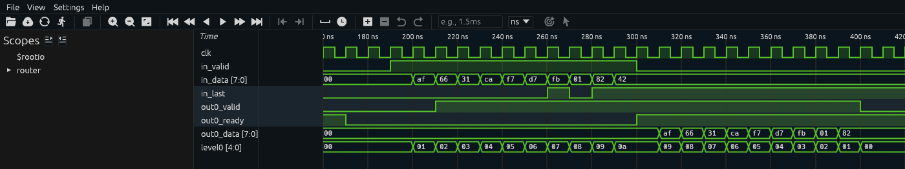
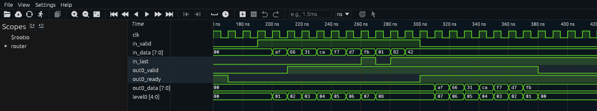

# Lab 03: Constraints and coverage

You'll use cocotb-coverage to add functional coverage to the Lab 02 testbench, and read the
coverage to find which kinds of drop and which output levels the testbench's random packets never
produce. Then you'll add constraints to the packet so that pyvsc's solver makes 1-beat, 2-to-7-beat
and 8-beat packets in the proportions you ask for. Last, you'll write stimulus that reaches the two
coverage holes, because that's where this lab's planted bugs, B07 and B08, are.

Package: [`labs/lab-03-constraints-and-coverage/`](https://github.com/uoftasic/dd105-b/tree/main/labs/lab-03-constraints-and-coverage)

## Before you start

- Finish [Lab 02](lab-02-a-layered-testbench-without-pyuvm-overview.md). This lab's package is the
  Lab 02 testbench, with our solution's `monitor.py` and `scoreboard.py` in `tb/`. Around them it
  adds a packet that pyvsc randomizes, a sink that can stall, an APB read, a tracker that predicts
  what the router does with each packet, and a check on `DROP_CNT`, and Part 1 walks you through
  each of them. If your own monitor and scoreboard passed Lab 02's `make check-all`, you can copy
  them over ours. The scoreboard's error messages on this page come from ours, so yours may read
  differently. Run the copy from the lab folder, which Part 1's first step takes you to:

  ```bash
  cp ../lab-02-a-layered-testbench-without-pyuvm/tb/monitor.py ../lab-02-a-layered-testbench-without-pyuvm/tb/scoreboard.py tb/
  ```

- Keep the [router specification](../reference/router-spec.md) open, and read its
  [Routing](../reference/router-spec.md#routing) section again, because this lab is about the level
  of an output and what the router does with a packet at each level.

Time: about 1 h 30 min. Every file you change is Python, so once Part 1 has built the simulator,
none of your changes makes it rebuild. A run of the graded test took us about 3 s as shipped and
about 5 s once Part 3's constraints were in, against 0.25 s for Lab 02's test.

## Part 1: The venv and the testbench you start from

What does the starting testbench check, and does it catch this lab's two bugs?

1. Open a terminal on the workbench desktop, as in Lab 02, and go to the lab folder:

   ```bash
   . /foss/designs/common/.designinit   # in every new terminal
   mod dd105-b
   cd labs/lab-03-constraints-and-coverage
   ```

2. The packets in this lab come from pyvsc, a Python library in which you write constraints and a
   solver picks values that meet them, and the coverage is counted by cocotb-coverage. Neither is
   in the course image, so make the course venv, a Python virtual environment that holds both:

   ```bash
   make venv
   ```

   You should see:

   ```text
   ========================================================================
    VENV  /foss/designs/.venvs/dd105-b
      from /foss/designs/modules/dd105-b/labs/common/requirements.txt
   ========================================================================
    imports: vsc, cocotb_coverage, cocotb 2.0.1 pyuvm 4.0.1
    created in 12.2 s, 37M
   cocotb                         2.0.1
   cocotb-coverage                2.0
   pyuvm                          4.0.1
   pyvsc                          1.1.0
   ```

   You make it once, for this lab and the ones after it. pip downloads the two packages and the
   ones they depend on, so this step needs the network. The venv is in your workspace under
   `/foss/designs`, so it survives a restart of the container. It sees the image's own packages
   too, which is why it lists the image's cocotb 2.0.1 and pyuvm 4.0.1 beside pyvsc 1.1.0 and
   cocotb-coverage 2.0. Every run in this lab uses the venv's Python. Until the venv exists,
   `make check-all`, `make cov` and `make traps` stop at once with the message below, and
   `make run` builds the simulator first and then stops with the same message:

   ```text
   ========================================================================
    This lab needs the course venv (pyvsc and cocotb-coverage), and it isn't there:
      /foss/designs/.venvs/dd105-b
    Create it once with:  make venv
   ========================================================================
   ```

3. Build the simulator:

   ```bash
   make build
   ```

   It ends with:

   ```text
    built /foss/designs/modules/dd105-b/labs/lab-03-constraints-and-coverage/build/sim_build/Vtop in 2.1 s (1.9M in /foss/designs/modules/dd105-b/labs/lab-03-constraints-and-coverage/build/sim_build)
    ccache:  Hits: 17 / 28 (60.71%)  Misses: 11 / 28 (39.29%)
   ```

   This is the same router as Lab 02's, with the same fifteen bugs behind `+BUG`. The ccache's
   counts add up over every build in your clone, as in Lab 02. Ours include Lab 01's and Lab 02's
   builds, which came to 11 hits and 10 misses, so this build's own were 6 hits and 1 miss. The one
   file it compiled is `Vtop__ALL.o`, from the C++ that Verilator wrote for the router. Verilator
   writes the RTL's file names, paths included, into that C++, and this lab's copy of the RTL is in
   its own `build/rtl/`, so the C++ differs from Lab 02's and the ccache had no compiled copy of it.

4. Read the files in `tb/`. Most of them are Lab 02's:

   | File | What it is |
   |---|---|
   | `monitor.py`, `scoreboard.py` | Lab 02's monitor and scoreboard: our solution, or yours |
   | `driver.py` | Lab 02's `Driver`, `Sink` and `ApbMaster`, with two additions: `ApbMaster.read()`, and `Sink.stall`, which holds the sink's ready at 0 from the next rising edge on, for as long as it is `True` |
   | `packet.py` | Lab 02's `Packet` and `RouterCfg`, and a new `RandPacket`, whose DST (`hdr_dst`) and length kind (`kind`) come from pyvsc's `randomize()`. Its constraint `c_dst` keeps a packet on an enabled route. Part 3 adds the weights on `kind` and the constraint that picks the length from `kind`. `RouterCfg` still reads `+N`, `+ROUTES` and `+SHOW`, but not Lab 02's `+DSTS` or `+LEN`, because `RandPacket` now picks the DST and the length. |
   | `generator.py` | randomizes `RandPacket`s, where Lab 02's generator called Python's `random` |
   | `tracker.py` | new: follows output 0's level and decides what happens to each packet |
   | `coverage.py` | new: `sample_pkt()`, which the tracker calls once for every packet and which has no coverpoints yet, and `report()`, which writes the coverage file at the end of the test. Part 2 adds the coverpoints. |
   | `env.py` | Lab 02's `Env`, with `run()` split into steps a test can call one by one, and `check_drops()` |
   | `test_router.py` | `router_rand_test`, `router_fill_test` and Lab 02's `router_class_test`, which now checks `DROP_CNT` at the end too. `close_holes()` is empty: Part 4 fills it in. |

   The tracker reads the pins of the input and of output 0 at the falling edge of every cycle, as
   the monitors do. Within a cycle it handles the input handshake before the output handshake, so
   the level that a header sees counts only the handshakes of earlier cycles, which is how the
   Routing section defines the level. From the routing table and that level, the tracker decides
   each packet's fate: NOROUTE, FULL, or forwarded to output 0 or 1. Nothing in the testbench
   watches output 1, and its sink is always ready, so its level stays far below 8, and the tracker
   takes it as 0. The tracker counts the drops it predicts, and `Env.check_drops()` reads
   `DROP_CNT` over APB and logs an error if the router's count and the tracker's disagree. Lab 02's
   scoreboard still checks the packets that come out of output 0.

   `router_rand_test` sets `CTRL.EN` and runs four phases. Each phase writes a random routing table
   with at least one disabled route and an enabled route to each output, sends 200 random packets
   with both sinks ready, waits for the outputs to drain, checks `DROP_CNT` and then clears it.
   After the last phase it calls `close_holes()` and checks `DROP_CNT` once more. It ends with an
   `assert` like the one in Lab 02's test, which now fails the test if the driver, the scoreboard or
   the `DROP_CNT` check logged an error.

5. Run the test:

   ```bash
   make run
   ```

   After cocotb's start-up lines you should see:

   ```text
        0.00ns INFO     cocotb.regression                  running test_router.router_rand_test (1/1)
       50.00ns INFO     tb.test                            [PHASE] 1 of 4: routes 0-11, 200 packets
    14410.00ns INFO     tb.env                             [DROP] DROP_CNT 00000000 as expected
    14440.00ns INFO     tb.test                            [PHASE] 2 of 4: routes 0-1-, 200 packets
    28470.00ns INFO     tb.env                             [DROP] DROP_CNT 00000000 as expected
    28500.00ns INFO     tb.test                            [PHASE] 3 of 4: routes -011, 200 packets
    42490.00ns INFO     tb.env                             [DROP] DROP_CNT 00000000 as expected
    42520.00ns INFO     tb.test                            [PHASE] 4 of 4: routes 1-01, 200 packets
    57060.00ns INFO     tb.env                             [DROP] DROP_CNT 00000000 as expected
    57130.00ns INFO     tb.env                             [DROP] DROP_CNT 00000000 as expected
    57130.00ns INFO     tb.env                             [ENV] sent 800 packets (3621 beats); output 0 took 1408 beats and output 1 took 2213
    57130.00ns INFO     tb.trk                             [TRK] 800 packets: 306 to output 0, 494 to output 1, 0 NOROUTE, 0 FULL; the highest level a header saw was 2
    57130.00ns INFO     tb.sb                              [SB] 800 packets in, 306 predicted for output 0, 306 checked, 0 errors
    57130.00ns INFO     tb.env                             [COV] no coverpoint named router.pkt.* yet, so no coverage.xml
    57130.00ns INFO     cocotb.regression                  test_router.router_rand_test passed
   ```

   and last, `ok: passed   4.14 s   log: build/runs/router_rand_test-s1/run.log`. A second run
   took us 3.04 s. The `[PHASE]` lines give the routes in the form Lab 02's `+ROUTES` took, one
   character per route: `0` or `1` for the output, and `-` for disabled.

6. This lab's two bugs are B07 and B08. B07 counts a packet for a disabled route as a FULL drop as
   well as a NOROUTE drop when the output that its route names holds more than 8 beats. B08 drops a
   packet that arrives when its output holds exactly 8 beats, although an output at 8 still has
   room for it. B07 changes no packet that comes out, only `FULL_CNT` (and `STATUS.FULL`), so the
   `DROP_CNT` check is the only check in the package that could see it. Write down whether you
   expect `router_rand_test` to catch the two bugs, then run it against both:

   ```bash
   make check-all
   ```

   You should see:

   ```text
         ok  the golden design                        passed                          3.0s
   ------------------------------------------------------------------------
     MISSED  tier 2  B07_full_counted_on_disabled_route passed                          3.0s
     MISSED  tier 3  B08_admission_off_by_one         passed                          3.1s
   ------------------------------------------------------------------------
    0 of 2 caught.
    Still hiding from this test:
      B07_full_counted_on_disabled_route
         hides behind: testing each drop reason on its own
      B08_admission_off_by_one
         hides behind: keeping the outputs drained, or flooding them, and never stopping at exactly 8
   ```

   followed by an error line from `make`, because the verdict is a fail. Using the `[TRK]` line
   from step 5, explain why `router_rand_test` can't reach either bug, on any seed.

   <details>
   <summary>Answer</summary>

   Both sinks are always ready, so every beat leaves its output within a couple of cycles of
   arriving, and beats don't pile up. In 800 packets the highest level a header saw was 2. B08
   needs a header that arrives while its output holds exactly 8 beats. B07 needs a NOROUTE drop
   while the output that its route names holds more than 8 beats, but `c_dst` keeps every random
   packet on an enabled route, so there are no NOROUTE drops at all (`0 NOROUTE`). The seed changes
   the packets and the routing tables, but not the sinks or `c_dst`.

   </details>

Check: `ok` on the golden design and `0 of 2 caught.`

## Part 2: Coverage you can read

What does `router_rand_test` send the router, and which fates and levels does it never reach?

1. Read `RandPacket` in `tb/packet.py`: how `kind` is declared, and `post_randomize()`, which pyvsc
   calls after every `randomize()`. No constraint names `kind`. Write down how many of the 800
   packets you expect to be 1 beat long, and how many 8.

2. Open `tb/coverage.py`. The tracker calls `sample_pkt()` once for every packet, with a
   `PktRecord` (declared in `tracker.py`) that holds the packet's length, its DST, its fate
   (`NOROUTE`, `FULL`, `OUT0` or `OUT1`, which are 0 to 3), and the level of the output that its
   route names, in the cycle in which its header was accepted. In cocotb-coverage a coverpoint is a
   decorator on the function that receives the values. The coverpoint's `xf=` takes its value out of
   the function's arguments, and each call of the function adds one to the bin that the value falls
   in. The length's coverpoint is:

   ```python
   @CoverPoint("router.pkt.len", xf=lambda rec: rec.length, bins=list(range(1, 9)),
               bins_labels=[f"len{n}" for n in range(1, 9)])
   ```

   Put it above `def sample_pkt(rec):`, and add the others under it, with these names and labels,
   because the outputs below use them:

   | Coverpoint | Value | Bins | Labels |
   |---|---|---|---|
   | `router.pkt.len` | `rec.length` | 1 to 8 | `len1` to `len8` |
   | `router.pkt.dst` | `rec.dst` | 0 to 3 | `dst0` to `dst3` |
   | `router.pkt.fate` | `rec.fate` | 0 to 3 | `noroute`, `full`, `out0`, `out1` |
   | `router.pkt.level` | `rec.level` | `[0, (1, 7), 8, 9, (10, 16)]` | `empty`, `low`, `at_8`, `at_9`, `high` |

   and last the cross of the fate and the level:

   ```python
   @CoverCross("router.pkt.x_fate_level", items=["router.pkt.fate", "router.pkt.level"])
   ```

   Write the level's bins exactly as the table gives them, with the two ranges as tuples.

3. Each run's `report()` writes the hit count of every bin to `coverage.xml` in its run folder, and
   `make cov` merges every `coverage.xml` under `build/runs` with cocotb-coverage's
   `merge_coverage()`, so a run left over from earlier would be counted too. Delete the old runs
   first, then run the test and read its coverage:

   ```bash
   rm -rf build/runs
   make run
   make cov
   ```

   The run's `[COV]` line says `router.pkt: 17 of 41 bins hit`, and `make cov` prints:

   ```text
   ========================================================================
    COVERAGE   1 run, merged by cocotb-coverage into build/coverage/merged.xml
   ========================================================================
     top                                           41.46 %   17 of 41 bins
       top.router                                    41.46 %   17 of 41 bins
         top.router.pkt                                41.46 %   17 of 41 bins
           top.router.pkt.len                           100.00 %   8 of 8 bins
           top.router.pkt.dst                           100.00 %   4 of 4 bins
           top.router.pkt.fate                           50.00 %   2 of 4 bins
               not hit: noroute, full
           top.router.pkt.level                          20.00 %   1 of 5 bins
               not hit: low, at_8, at_9, high
           top.router.pkt.x_fate_level                   10.00 %   2 of 20 bins
               not hit: ('noroute', 'empty'), ('noroute', 'low'), ('noroute', 'at_8'), ('noroute', 'at_9'), ('noroute', 'high'), ('full', 'empty'), ('full', 'low'), ('full', 'at_8'), ('full', 'at_9'), ('full', 'high'), ('out0', 'low'), ('out0', 'at_8'), ... (6 more)
   ========================================================================
   ```

   The cross names each of its 20 bins by the pair of labels it stands for. The `[TRK]` line says
   headers saw levels up to 2, so some packets were decided at a level of 1 or 2. Why is `low`
   empty?

   <details>
   <summary>Answer</summary>

   cocotb-coverage puts a value in a bin when `value == bin`, unless the coverpoint is given a
   `rel=` function that says what "in the bin" means. The bins 0, 8 and 9 are numbers, so a level
   of 0 lands in `empty`. The bins `(1, 7)` and `(10, 16)` are tuples, and no number is equal to a
   tuple, so `low` and `high` can never be hit. cocotb-coverage doesn't warn you about it, so you
   have to find it by reading the list of empty bins against what the test did, as you just did
   with the `[TRK]` line.

   </details>

4. Write every level bin as a range, `bins=[(0, 0), (1, 7), (8, 8), (9, 9), (10, 16)]`, and give
   the coverpoint `rel=lambda value, rng: rng[0] <= value <= rng[1]`. Then delete the runs, run and
   merge again. The `[COV]` line now says `router.pkt: 19 of 41 bins hit`, and `make cov` prints:

   ```text
     top                                           46.34 %   19 of 41 bins
       top.router                                    46.34 %   19 of 41 bins
         top.router.pkt                                46.34 %   19 of 41 bins
           top.router.pkt.len                           100.00 %   8 of 8 bins
           top.router.pkt.dst                           100.00 %   4 of 4 bins
           top.router.pkt.fate                           50.00 %   2 of 4 bins
               not hit: noroute, full
           top.router.pkt.level                          40.00 %   2 of 5 bins
               not hit: at_8, at_9, high
           top.router.pkt.x_fate_level                   15.00 %   3 of 20 bins
               not hit: ('noroute', 'empty'), ('noroute', 'low'), ('noroute', 'at_8'), ('noroute', 'at_9'), ('noroute', 'high'), ('full', 'empty'), ('full', 'low'), ('full', 'at_8'), ('full', 'at_9'), ('full', 'high'), ('out0', 'at_8'), ('out0', 'at_9'), ... (5 more)
   ```

5. `make cov` names only the empty bins, but the merged file, `build/coverage/merged.xml`, has
   every bin with its count. Look at the length's bins:

   ```bash
   grep 'pkt.len.bin' build/coverage/merged.xml
   ```

   ```text
           <bin0 bin="len1" hits="263" abs_name="top.router.pkt.len.bin0" />
           <bin1 bin="len2" hits="46" abs_name="top.router.pkt.len.bin1" />
           <bin2 bin="len3" hits="42" abs_name="top.router.pkt.len.bin2" />
           <bin3 bin="len4" hits="41" abs_name="top.router.pkt.len.bin3" />
           <bin4 bin="len5" hits="51" abs_name="top.router.pkt.len.bin4" />
           <bin5 bin="len6" hits="41" abs_name="top.router.pkt.len.bin5" />
           <bin6 bin="len7" hits="53" abs_name="top.router.pkt.len.bin6" />
           <bin7 bin="len8" hits="263" abs_name="top.router.pkt.len.bin7" />
   ```

   Compare the two 263s with what you wrote down in step 1. Nothing in the packet says how often
   each kind should come out, so where does a third each come from?

   <details>
   <summary>Answer</summary>

   SystemVerilog makes an unconstrained `rand` enum uniform over its named values, and pyvsc does
   the same for a `rand_enum_t`, so each of the three kinds should come out about 267 times. Here
   they came out 263, 274 and 263. The six lengths from 2 to 7 share `LEN_MID`'s 274, so each is
   about 45. A third of the packets are single beats and a third are 8 beats long only because the
   enum has three names. In Part 3 you give the kinds weights of your own.

   </details>

6. Read the hides-behind lines that `make check-all` printed in Part 1. Which empty bins would a
   packet hit if it met B08's condition, and which if it met B07's? And of the 41 bins, which can
   no test ever hit, and which can't this testbench hit?

   <details>
   <summary>Answer</summary>

   B08 needs a packet admitted to output 0 at a level of exactly 8, which is `('out0', 'at_8')`.
   B07 needs a NOROUTE drop while the output that its route names holds more than 8 beats, which is
   `('noroute', 'at_9')` or `('noroute', 'high')`.

   Seven bins are impossible by the specification, because a FULL drop happens only at a level of
   9 or more (`('full', 'empty')`, `('full', 'low')`, `('full', 'at_8')`), and a packet is admitted
   only at 8 or less (`('out0', 'at_9')`, `('out0', 'high')`, `('out1', 'at_9')`,
   `('out1', 'high')`). This testbench can't hit two more, `('out1', 'low')` and
   `('out1', 'at_8')`, because the tracker takes output 1's level as 0. Three more, `full`,
   `('full', 'at_9')` and `('full', 'high')`, need a FULL drop, which the router can make but no
   test in this lab asks for (Part 4 says why). So this testbench can reach 29 of the 41 bins.

   Bins that this lab can't hit still count in the percentage, which is why you read the list of
   bins rather than the percentage. cocotb-coverage's 46.34% is the number of bins hit over all 41
   bins, the cross's included. SystemVerilog's formula instead averages the coverage of the five
   items (100, 100, 50, 40 and 15%), which gives 61%.

   </details>

Check: `router.pkt: 19 of 41 bins hit`, and `len1` at 263.

## Part 3: Constraints the solver honours

How do you get the length distribution you ask for, and how do you know you got it?

1. Open `traps/traps.py`. It has eight experiments, numbered 1 to 8, and each one randomizes a small
   pyvsc class over and over, most of them 1000 times. Each experiment prints one or more lines
   that start with its number, so this page calls them lines 1 to 8. Lines 1 to 3 use the shapes of
   this lab's packet, and lines 4 to 6 use shapes that a test might use. Line 7 times the solver,
   and line 8 shows when a pyvsc object takes its random state. pyvsc's constraints are meant to
   work as SystemVerilog's do, so for each of lines 1 to 6, write down what SystemVerilog's rules
   say it should show. DD105-A ran the same experiments on Verilator's solver, which got several of
   them wrong.

2. Run it:

   ```bash
   make traps
   ```

   It runs with the venv's Python and no simulator, and took us 13 s. You should see:

   ```text
   1  three names, no constraint names kind      LEN_ONE  336  LEN_MID  342  LEN_MAX  322
   1  four names, no constraint names op         OP_ADD  220  OP_SUB  252  OP_AND  275  OP_OR  253
   2  kind dist, weights on LEN_ONE ... LEN_MAX  LEN_ONE  257  LEN_MID  505  LEN_MAX  238
   2  kind dist, weights on 0, 1, 2              LEN_ONE  248  LEN_MID  515  LEN_MAX  237
   3  length dist {...} and length != 7          randomize() failed 0 times in 1000; 1:280 2:91 3:81 4:100 5:83 6:94 8:271
   3  kind dist, length from kind, length == 3   randomize() failed 0 times in 1000; 3:1000
   4  solve_order(big, length)                   big in 469 of 1000
   4  the same without solve_order               big in 342 of 1000
   5  lens.sum == 8, list of 8                   randomize() failed 0 times in 20; the sum was 8 in 20
   5  lens.sum == 8, list of random size         randomize() failed 0 times in 20; the sum was 8 in 20
   6  unique on a list of four 4-bit values      a value repeated in 0 of 1000
   6  unique on w, x, y, z                       a value repeated in 0 of 1000
   7  T3Sel randomize(), per second              one object 571; a new object each time 521; random.randint() 2804954
   8  seed 7, make T3Sel, 6 x randomize()        [6, 7, 2, 1, 8, 8]
   8  the same, seed 99 before the first         [1, 7, 5, 3, 1, 8]
   8  the same, seed 99 after the first          [6, 7, 2, 1, 8, 8]
   ========================================================================
    traps: 13.0 s, seed 1
   ========================================================================
   ```

   Compare each line with what you wrote.

   <details>
   <summary>Answer</summary>

   1. An unconstrained enum is uniform over its names, so about 333 each for three names and 250
      each for four, and the counts came out close to that. (In DD105-A, Verilator's enum whose
      four names fill its two bits came out as its first name 809 times in 1000.)
   2. Both should give about 250, 500 and 250, and both did. In DD105-A, Verilator gave the weight
      of 50 to `LEN_MAX` when the weights were written with the enum's names.
   3. Neither should fail. `length != 7` leaves a value in every weighted range, and with
      `length == 3` the solver should choose `LEN_MID`. Neither failed once, where Verilator, in
      DD105-A, failed 72 and 478 times in 1000.
   4. With `solve_order`, `big` is chosen first, at 50/50, so about 500, and it came out 469.
      Without it, SystemVerilog makes each of the 8 solutions equally likely, so `big` is 1 in 8,
      about 125. pyvsc gave 342, so it doesn't choose evenly among the solutions.
   5. A sum should work on a list of fixed size and on one whose size is random, and it worked on
      both.
   6. Neither should repeat a value, and neither did.

   Line 7 measures pyvsc's speed. A two-field class was randomized 571 times a second, about
   1.8 ms a call, while `random.randint()` ran 2.8 million times a second. That's why the packet's
   payload bytes and idle cycles come from Python's `random`, in `build()`, and the solver picks
   only the packet's random fields: the DST, the kind and, once step 3 makes it random, the length.

   Line 8 shows that a pyvsc object takes its random state from Python's `random` at its first
   `randomize()`. Seeding `random` again between making the object and that first call gave a
   different list from the first row's, and seeding it again after the first call gave the same
   list as the first row. The generator makes and randomizes every packet inside the test, after
   cocotb has seeded Python's `random` from the run's seed, so the seed decides every packet.

   </details>

3. Now give the packet its constraints. In `RandPacket` in `tb/packet.py`:

   - make `length` random: `self.length = vsc.rand_uint8_t()`;
   - add three weights in `__init__`, `self.w_one = vsc.uint8_t(25)`, `self.w_mid = vsc.uint8_t(50)`
     and `self.w_max = vsc.uint8_t(25)`. The solver reads them at every `randomize()`, so a test can
     change them first;
   - add a constraint `c_kind` with a `dist` on `kind`:

     ```python
     @vsc.constraint
     def c_kind(self):
         vsc.dist(self.kind, [vsc.weight(LenKind.LEN_ONE, self.w_one),
                              vsc.weight(LenKind.LEN_MID, self.w_mid),
                              vsc.weight(LenKind.LEN_MAX, self.w_max)])
     ```

   - add a constraint `c_len` that picks `length` from `kind`, with `vsc.if_then`, `vsc.else_if`
     and `vsc.else_then`: `self.length == 1` for `LEN_ONE`,
     `self.length.inside(vsc.rangelist((2, 7)))` for `LEN_MID`, and `self.length == 8` for
     `LEN_MAX`;
   - in `post_randomize()`, delete the `if`, `elif` and `else` branches that set `length`, so that
     only the call to `build()` is left.

4. Before you run, write down how many of the 800 packets you expect in each length bin. Then run
   and read the coverage:

   ```bash
   rm -rf build/runs
   make run
   make cov
   grep 'pkt.len.bin' build/coverage/merged.xml
   ```

   With the reference solution's `coverage.py` and `packet.py` you should see:

   ```text
           <bin0 bin="len1" hits="218" abs_name="top.router.pkt.len.bin0" />
           <bin1 bin="len2" hits="62" abs_name="top.router.pkt.len.bin1" />
           <bin2 bin="len3" hits="78" abs_name="top.router.pkt.len.bin2" />
           <bin3 bin="len4" hits="63" abs_name="top.router.pkt.len.bin3" />
           <bin4 bin="len5" hits="82" abs_name="top.router.pkt.len.bin4" />
           <bin5 bin="len6" hits="53" abs_name="top.router.pkt.len.bin5" />
           <bin6 bin="len7" hits="42" abs_name="top.router.pkt.len.bin6" />
           <bin7 bin="len8" hits="202" abs_name="top.router.pkt.len.bin7" />
   ```

   and the run's `[ENV]` line says `sent 800 packets (3466 beats)`. The three kinds came out 218,
   380 and 202 times, close to the 200, 400 and 200 you asked for. The run took us 4.67 s. Your own
   constraints may give different counts with the same seed, but they should be about as close.

5. The six lengths from 2 to 7 share their kind's 380 packets, and came out between 42 and 82
   times each. What would SystemVerilog's rules give for `self.length.inside(vsc.rangelist((2, 7)))`,
   and how would you find out whether 42 against 82 is more than chance?

   <details>
   <summary>Answer</summary>

   SystemVerilog makes each of the six equally likely, about 63 each of 380. In a sample this size
   some spread is chance, so draw more packets and see whether the same lengths stay high. We drew
   3000 packets from this class outside the simulator, twice: lengths 2 to 5 came out 269 to 298
   times each, and 6 and 7 came out 180 to 197 times, against about 250 for an even spread. So
   pyvsc's solver doesn't pick evenly among the values that a constraint allows, either here or in
   line 4 of the experiments. The constraint decides which lengths can come out, and to find out
   how often each one does, you count them with the length coverpoint.

   </details>

Check: `len1` near 200, `len8` near 200, and the lengths from 2 to 7 adding up to near 400.

## Part 4: Close the two holes

What stimulus reaches B07's and B08's bins, and does the testbench catch the bugs once it does?

1. Work it out on paper first, from the specification's Routing section. Output 0 is empty and its
   sink is stalled. Which packets put it at exactly 8? What happens to the next packet for an
   enabled route to output 0, and then to a packet for a disabled route whose `PORT` is 0?

   <details>
   <summary>Answer</summary>

   Any packets for an enabled route to output 0 whose lengths add up to 8 beats. Nothing leaves
   while the sink is stalled, so the level in the next header's cycle is 8, and a packet for that
   route is admitted (`('out0', 'at_8')`, B08's bin) and raises the level to between 9 and 16. A
   packet for a disabled route is then a NOROUTE drop at that level (`('noroute', 'at_9')` or
   `('noroute', 'high')`, B07's bin), and the specification says it's never counted as FULL as
   well.

   </details>

2. In `tb/test_router.py`, where the first `TODO (Part 4)` is, write a pyvsc class `FillPlan` with
   `self.lens = vsc.rand_list_t(vsc.uint8_t(), sz=8)`, and a constraint that keeps each length at
   most 8 (`with vsc.foreach(self.lens, idx=True) as i:` and `self.lens[i] <= 8`) and makes
   `self.lens.sum == 8`. A 0 means "no packet". Line 5 of the experiments showed that pyvsc solves
   a sum on a list of fixed size and on one of random size, so a list of random size would work
   too, and the fixed size of 8 is only our choice.

3. Fill in `close_holes()`. The test's environment is `env`, and the steps are:

   - `await env.write_routes("0---")`: `ROUTE0` enabled to output 0, the other three disabled
     (with `PORT` 0);
   - `env.snk0.stall = True`, then `await env.cycles(2)`, so that `out0_ready` is already 0 before
     any beat can reach output 0;
   - randomize a `FillPlan`, and for each length `n` that isn't 0, put `RandPacket.make(0, n)` on a
     list of packets;
   - one random packet for DST 0: `p = env.gen.new_packet()`, then
     `with p.randomize_with() as it:` and `it.hdr_dst == 0`, and onto the list;
   - one random packet for DST 1, the same way but with `q.c_dst.constraint_mode(False)` before it
     is randomized, because `c_dst` would otherwise forbid a disabled route and the solver would
     find no solution;
   - `await env.send(pkts)`, which returns when the last packet has gone in; then
     `env.snk0.stall = False` and `await env.drain()`.

   Both tests that call `close_holes()` check `DROP_CNT` after it returns, so `close_holes()`
   doesn't need a check of its own. `RandPacket.make()` builds a fill packet without the solver,
   with its beats back to back. You could also make each fill packet with `randomize_with()` and
   `it.length == n` (line 3 of the experiments showed that this works), but `build()` would then
   put idle cycles before about one beat in four. A log line that prints the plan's lengths will
   help you read the waveform later.

4. The list stops after the packet for DST 1, with output 0 still stalled and holding 9 to 16
   beats. Suppose `close_holes()` sent one more random packet for DST 0 at that point. What would
   the golden router do with it, and what would this testbench report? Write down your answer
   before you open ours.

   <details>
   <summary>Answer</summary>

   The router drops it as FULL, because output 0 holds more than 8 beats. The tracker predicts
   that, so the `DROP_CNT` check passes. But Lab 02's scoreboard expects every packet for an
   enabled route with `PORT` 0 to come out of output 0, so it reports the packet missing, even on
   the golden router. We tried it in a copy of the solution, with a 7-beat packet, and
   `router_fill_test` printed:

   ```text
      910.00ns INFO     tb.env                             [DROP] DROP_CNT 00000101 as expected
      910.00ns ERROR    tb.sb                              dst 0, 7 beats: 03 2f 67 b4 02 99 32, which went in at 365 ns, never came out of output 0
   ```

   To check FULL drops, the scoreboard has to model the levels itself, which is what Lab 04's
   scoreboard does. In this lab, don't send a packet for output 0 while output 0 holds more than 8
   beats.

   </details>

5. Run the short test, which calls `close_holes()` on its own and then checks `DROP_CNT`:

   ```bash
   rm -rf build/runs
   make run TEST=router_fill_test
   ```

   Until `close_holes()` sends something, this test fails on the golden router, because the
   scoreboard reports a test that checked no packet. With the reference solution you should see:

   ```text
      190.00ns INFO     tb.test                            [HOLES] output 0 stalled and filled to 8 by packets of 8 beats, then 2 beats for DST 0 and 1 for DST 1
      840.00ns INFO     tb.env                             [DROP] DROP_CNT 00000001 as expected
      840.00ns INFO     tb.env                             [ENV] sent 3 packets (11 beats); output 0 took 10 beats and output 1 took 0
      840.00ns INFO     tb.trk                             [TRK] 3 packets: 2 to output 0, 0 to output 1, 1 NOROUTE, 0 FULL; the highest level a header saw was 10
      840.00ns INFO     tb.sb                              [SB] 3 packets in, 2 predicted for output 0, 2 checked, 0 errors
      840.00ns INFO     tb.env                             [COV] router.pkt: 13 of 41 bins hit; coverage.xml written
   ```

   and `ok: passed   1.79 s`. On seed 1 this plan is a single 8-beat packet. If your run fails
   here, read the first error in the log. The router is the golden one, so the mistake is in your
   stimulus.

6. Run the graded test too, and read the coverage of both runs:

   ```bash
   make run
   make cov
   ```

   The `[HOLES]` line of `router_rand_test` says
   `filled to 8 by packets of 2 2 3 1 beats, then 7 beats for DST 0 and 7 for DST 1`. That's a
   different plan from `router_fill_test`'s on the same seed, because cocotb seeds Python's
   `random` for each test from the seed and the test's name, and because `router_rand_test` has
   drawn 800 packets from `random` before `close_holes()` starts. `make cov` reports:

   ```text
     top                                           58.54 %   24 of 41 bins
       top.router                                    58.54 %   24 of 41 bins
         top.router.pkt                                58.54 %   24 of 41 bins
           top.router.pkt.len                           100.00 %   8 of 8 bins
           top.router.pkt.dst                           100.00 %   4 of 4 bins
           top.router.pkt.fate                           75.00 %   3 of 4 bins
               not hit: full
           top.router.pkt.level                          80.00 %   4 of 5 bins
               not hit: at_9
           top.router.pkt.x_fate_level                   25.00 %   5 of 20 bins
               not hit: ('noroute', 'empty'), ('noroute', 'low'), ('noroute', 'at_8'), ('noroute', 'at_9'), ('full', 'empty'), ('full', 'low'), ('full', 'at_8'), ('full', 'at_9'), ('full', 'high'), ('out0', 'at_9'), ('out0', 'high'), ('out1', 'low'), ... (3 more)
   ```

   That leaves 17 bins never hit, and five of the 29 bins that this testbench can reach are among
   them.
   Which are they, and what would hit each one?

   <details>
   <summary>Answer</summary>

   `at_9` and `('noroute', 'at_9')` need the packet for DST 1 to arrive while output 0 holds
   exactly 9 beats, which happens when the random packet for DST 0 before it is 1 beat long. A
   packet for a disabled route would hit `('noroute', 'empty')`, `('noroute', 'low')` or
   `('noroute', 'at_8')` if it arrived while output 0 held 0, 1 to 7 or 8 beats. Both of our
   packets for DST 1 arrived at a level of 10 or more, so they hit `('noroute', 'high')`.

   </details>

7. Now ask for the verdict:

   ```bash
   make check-all
   ```

   With the reference solution you should see:

   ```text
         ok  the golden design                        passed                          4.7s
   ------------------------------------------------------------------------
     caught  tier 2  B07_full_counted_on_disabled_route AssertionError                  4.8s
     caught  tier 3  B08_admission_off_by_one         AssertionError                  4.7s
   ------------------------------------------------------------------------
    2 of 2 caught.
    Every bug in the list, each one caught by a check that fired.
   ```

   `make run BUG=B07` shows the check that fired on B07:

   ```text
    56020.00ns ERROR    tb.env                             DROP_CNT read 00000101, expected 00000001 (FULL_CNT 0, NOROUTE_CNT 1)
   ```

   `FULL_CNT` is bits 15:8 and `NOROUTE_CNT` is bits 7:0, so the router counted the packet for DST 1
   as NOROUTE and as FULL. `make run BUG=B08` logs the same `DROP_CNT` line first, because B08
   counts the packet for DST 0 that it drops at level 8 as a FULL drop. Then comes the scoreboard's
   report of that packet:

   ```text
    56020.00ns ERROR    tb.sb                              dst 0, 7 beats: 24 28 19 4b 53 55 0b, which went in at 55355 ns, never came out of output 0
   ```

8. Record the waveforms of `router_fill_test` on both routers and open them:

   ```bash
   make waves TEST=router_fill_test
   make waves TEST=router_fill_test BUG=B08
   surfer build/runs/router_fill_test-s1/waves.fst &
   surfer build/runs/router_fill_test-s1-B08/waves.fst &
   ```

   Add `clk`, `in_valid`, `in_data`, `in_last`, `out0_valid`, `out0_ready`, `out0_data` and
   `level0` from `router`, and look at 160 to 420 ns. `level0` is the router's own count of the
   beats in output 0, which is the value that `LEVEL` reads in its `LEVEL0` field. Surfer shows it
   in hex.

   

   *The golden router. `out0_ready` falls at 170 ns. The fill packet `00 af 66 31 ca f7 d7 fb` goes
   in from 190 ns (`in_data` already held `00`, so only `in_valid` shows the header), and `level0`
   counts up to 08. The header `01` is accepted at level 8, so its packet `01 82` is admitted and
   `level0` climbs to 0a. The packet `42`, for DST 1, is dropped. `out0_ready` rises at 300 ns,
   and output 0 delivers all 10 beats.*

   

   *B08. The same packets go in, and `level0` stops at 08, because the packet `01 82` is dropped.
   Output 0 delivers 8 beats.*

   Which rising edge ends the cycle in which the header `01` is accepted, what is `level0` in that
   cycle, and what does `level0` do at that edge on each router?

   <details>
   <summary>Answer</summary>

   The edge at 280 ns. In the cycle that edge ends, `level0` is 08, because the eight beats of the
   fill packet have gone in and none has left. The specification admits a packet at a level of 8 or
   less, so the golden router writes `01` into output 0 at that edge, and `level0` reads 09 in the
   next cycle. B08 drops the packet, so `level0` stays at 08. Before Part 4 no header arrived at
   exactly 8, so the two routers did the same thing with every packet.

   </details>

Check: `2 of 2 caught.`

## Finishing

You're done when `make check-all` prints `2 of 2 caught.` with your own coverpoints in
`tb/coverage.py`, your constraints in `tb/packet.py` and your `close_holes()` in
`tb/test_router.py`.

Questions:

1. The scoreboard and the `DROP_CNT` check you started with passed on both bugs, and you didn't
   change either of them. What did the coverage tell you that the passing test couldn't?

   <details>
   <summary>Answer</summary>

   A pass says that the router agreed with the scoreboard and the tracker on everything the
   stimulus did. The empty bins showed that no header ever arrived while its output held 8 beats
   or more, and that the stimulus never made a NOROUTE or FULL drop. B07 and B08 sat in two of
   those empty bins, so in the starter's runs the router with either bug switched on did the same
   thing as the golden router. Once the stimulus reached those bins, the same checks caught both
   bugs.

   </details>

2. Would running the starter on more seeds (`make seeds` runs seeds 1 to 10) have found B08?

   <details>
   <summary>Answer</summary>

   No. On every seed the sinks are always ready, so output 0 never reaches 8. More seeds help only
   with holes that the random stimulus can reach, and Part 1's answer explains why it can't reach
   these two.

   </details>

Submit: Nothing to submit.

## Going further (optional)

- Run `make traps SEED=2` and see which lines move. Then change a class in `traps/traps.py`,
  predict its line, and run it again.
- Hit the five reachable bins that Part 4 step 6 lists, and check with `make cov`.
- Give the cross the seven impossible bins as `ign_bins`, a list of label pairs such as
  `("full", "empty")`, and see what happens to the number of bins `make cov` counts.

Next on the [Course path](../index.md#course-path): the reading on the pyuvm skeleton, sequences,
monitors and the factory, then Lab 04: The same testbench in pyuvm.
