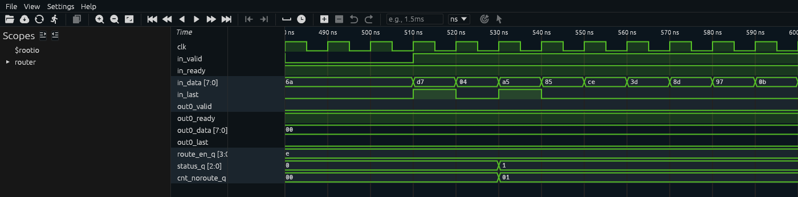
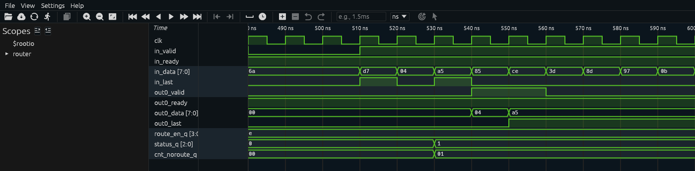

# Lab 04: The same testbench in pyuvm

In this lab you'll finish our pyuvm port of the Lab 03 testbench. As shipped, it checks only
output 0, as Lab 03's testbench did, and it misses this lab's two bugs, B06 and B13. You'll add an
agent for output 1. You'll write a test that stalls one output at a time, and fix the scoreboard so
that it can judge that test. Then you'll write `NoroutePkt`, a packet that goes to a disabled route
one time in four, and a factory override that puts it in place of every packet the random sequence
makes. Last, you'll count the lines in the port and in your Lab 03 testbench.

Package: [`labs/lab-04-the-same-testbench-in-pyuvm/`](https://github.com/uoftasic/dd105-b/tree/main/labs/lab-04-the-same-testbench-in-pyuvm)

## Before you start

- Finish [Lab 02](lab-02-a-layered-testbench-without-pyuvm-overview.md) and
  [Lab 03](lab-03-constraints-and-coverage-overview.md). Keep your Lab 03 files in that lab's
  `tb/`, because Part 5 counts them.
- Look again at `tb/alu_uvm.py` from [Lab 01](lab-01-one-alu-two-frameworks-overview.md). The port
  has the same kinds of pieces (sequences, drivers, monitors, agents, an environment, and tests
  that derive from `BaseTest`). It also leans on two things that file used and Lab 01's page didn't
  explain. `ConfigDB` holds objects under a component's path, so a test can put an object there
  for a component below it to fetch. `create()` makes an object through the factory, which a test
  can tell to make a subclass instead.
- Keep the [router specification](../reference/router-spec.md) open. Parts 3 and 4 use its
  [Routing](../reference/router-spec.md#routing) section.
- Copy this table into your notes and fill it in as you go:

  | | `make check-all` |
  |---|---|
  | The port as shipped (Part 1) | |
  | After Part 2 | |
  | After Part 3 | |
  | After Part 4 | |

Time: about 2 h. Every file you change is Python, so nothing in this lab rebuilds the simulator,
and a run of the graded test takes about 5 s.

## Part 1: Run the port

Does the port do what the Lab 03 testbench did, and which of this lab's bugs does it miss?

1. Open a terminal on the workbench desktop, as in Lab 03, go to the lab folder, and build the
   simulator:

   ```bash
   . /foss/designs/common/.designinit   # in every new terminal
   mod dd105-b
   cd labs/lab-04-the-same-testbench-in-pyuvm
   make build
   ```

   It ends with:

   ```text
    built /foss/designs/modules/dd105-b/labs/lab-04-the-same-testbench-in-pyuvm/build/sim_build/Vtop in 2.2 s (1.9M in /foss/designs/modules/dd105-b/labs/lab-04-the-same-testbench-in-pyuvm/build/sim_build)
    ccache:  Hits: 23 / 35 (65.71%)  Misses: 12 / 35 (34.29%)
   ```

   This is the same router as in Labs 02 and 03. Our counts include the builds of Labs 01 to 03,
   which came to 17 hits and 11 misses, so this build's own were 6 hits and 1 miss, as in Lab 03.
   The course venv you made in Lab 03 is still there, and this lab uses it.

2. Open the files in `tb/`. Every piece of the Lab 03 testbench is in one of these three files, and
   most of its classes are now pyuvm classes:

   | File | What's in it |
   |---|---|
   | `router_agents.py` | the packet, `RouterPkt`, which is Lab 03's `RandPacket` with the same fields and the same constraints (`c_dst`, `c_kind`, `c_len`); an agent for the input, one for the APB port, and one output agent class, `OutAgent`; the sequences |
   | `router_env.py` | the scoreboard, which is Lab 03's scoreboard and tracker in one component; the coverage, which is our Lab 03 solution's; and `RouterEnv`, which builds and connects everything |
   | `test_router.py` | `FillPlan`; the base test, `RouterLabTest`, with the steps Lab 03's `Env` had (`write_routes`, `send_random`, `check_drops` and the rest) and `close_holes()`; and the tests, which are `RouterClassTest` (Lab 02's), `RouterRandTest` and `RouterFillTest` (Lab 03's), and the two that this lab adds, `RouterStallTest` and `RouterInjectTest` |

   Your Lab 02 and Lab 03 testbenches watched only output 0, and so does the port. `RouterEnv`
   makes only one `OutAgent`, the scoreboard queues only output 0's beats, and the scoreboard's
   `level()` takes output 1's level as 0, as Lab 03's tracker did. With no agent on output 1,
   nothing would drive `out1_ready`, so `RouterEnv` holds it at 1, as Lab 03's sink did. Find the
   `TODO (Part n)` comments. There are four in `router_env.py` and three in `test_router.py`.

3. Run Lab 02's test, then the default test, then Lab 03's random test:

   ```bash
   make run TEST=RouterClassTest
   make run
   make run TEST=RouterRandTest
   ```

   `TEST=` picks the test when the simulator starts, so none of these rebuilds anything. You
   should see, from the first run:

   ```text
       20.00ns INFO     ..-in-pyuvm/tb/test_router.py(299) [uvm_test_top]: [ENV] 100 packets, routes 0110
     6865.00ns INFO     ..h-in-pyuvm/tb/router_env.py(207) [uvm_test_top.env.sb]: [DROP] DROP_CNT 00000000 as expected
     6870.00ns INFO     ..h-in-pyuvm/tb/router_env.py(224) [uvm_test_top.env.sb]: [SB] 100 packets in: 55 to output 0, 45 to output 1, 0 NOROUTE, 0 FULL; the highest level a header saw was 2
     6870.00ns INFO     ..h-in-pyuvm/tb/router_env.py(227) [uvm_test_top.env.sb]: [SB] beats checked: 233 on output 0, 0 on output 1; 1 DROP_CNT reads checked
     6870.00ns INFO     ..h-in-pyuvm/tb/router_env.py(230) [uvm_test_top.env.sb]: [SB] 193 beats went to output 1, which nothing watches
     6870.00ns INFO     ..h-in-pyuvm/tb/router_env.py(268) [uvm_test_top.env.cov]: [COV] router.pkt: 19 of 41 bins hit; coverage.xml written
   DD105-B BaseTest: 0 errors logged, no bound assertions
   ```

   and `ok: 0 errors   3.61 s`. After the time and the level, each line names the file and line of
   the logging call and then, in brackets, the component that logged it: `uvm_test_top` is the
   test, and `uvm_test_top.env.sb` is the scoreboard. The `[DROP]` line comes from Lab 03's `DROP_CNT` check,
   which the scoreboard now does: it compares every read of `DROP_CNT` that the APB monitor reports
   with the drops it predicted.

   The default test is `RouterInjectTest`, which for now does what `RouterRandTest` does: Lab 03's
   four phases and its `close_holes()`. The second run prints:

   ```text
        0.00ns INFO     cocotb.regression                  running test_router.RouterInjectTest (1/1)
       50.00ns INFO     ..-in-pyuvm/tb/test_router.py(250) [uvm_test_top]: [PHASE] 1 of 4: routes 0-1-, 200 packets; output 0 ready 100%, output 1 ready 100%
    14165.00ns INFO     ..h-in-pyuvm/tb/router_env.py(207) [uvm_test_top.env.sb]: [DROP] DROP_CNT 00000000 as expected
    14200.00ns INFO     ..-in-pyuvm/tb/test_router.py(250) [uvm_test_top]: [PHASE] 2 of 4: routes --10, 200 packets; output 0 ready 100%, output 1 ready 100%
    27255.00ns INFO     ..h-in-pyuvm/tb/router_env.py(207) [uvm_test_top.env.sb]: [DROP] DROP_CNT 00000000 as expected
    27290.00ns INFO     ..-in-pyuvm/tb/test_router.py(250) [uvm_test_top]: [PHASE] 3 of 4: routes -1-0, 200 packets; output 0 ready 100%, output 1 ready 100%
    41625.00ns INFO     ..h-in-pyuvm/tb/router_env.py(207) [uvm_test_top.env.sb]: [DROP] DROP_CNT 00000000 as expected
    41660.00ns INFO     ..-in-pyuvm/tb/test_router.py(250) [uvm_test_top]: [PHASE] 4 of 4: routes 1-0-, 200 packets; output 0 ready 100%, output 1 ready 100%
    54425.00ns INFO     ..h-in-pyuvm/tb/router_env.py(207) [uvm_test_top.env.sb]: [DROP] DROP_CNT 00000000 as expected
    54600.00ns INFO     ..-in-pyuvm/tb/test_router.py(229) [uvm_test_top]: [HOLES] output 0 stalled and filled to 8 by packets of 4 3 1 beats, then 6 beats for DST 0 and 1 for DST 1
    55015.00ns INFO     ..h-in-pyuvm/tb/router_env.py(207) [uvm_test_top.env.sb]: [DROP] DROP_CNT 00000001 as expected
    55020.00ns INFO     ..h-in-pyuvm/tb/router_env.py(224) [uvm_test_top.env.sb]: [SB] 805 packets in: 417 to output 0, 387 to output 1, 1 NOROUTE, 0 FULL; the highest level a header saw was 14
    55020.00ns INFO     ..h-in-pyuvm/tb/router_env.py(227) [uvm_test_top.env.sb]: [SB] beats checked: 1884 on output 0, 0 on output 1; 5 DROP_CNT reads checked
    55020.00ns INFO     ..h-in-pyuvm/tb/router_env.py(230) [uvm_test_top.env.sb]: [SB] 1720 beats went to output 1, which nothing watches
    55020.00ns INFO     ..h-in-pyuvm/tb/router_env.py(268) [uvm_test_top.env.cov]: [COV] router.pkt: 24 of 41 bins hit; coverage.xml written
   DD105-B BaseTest: 0 errors logged, no bound assertions
   ```

   ending in `ok: 0 errors   5.13 s`. The routes are written as in Lab 03, with one character per
   route: `0` or `1` for the output, `-` for disabled.

   The third run, `RouterRandTest`, runs the same code on different packets. Its first phase has
   the routes `-110`, and it ends with:

   ```text
    51770.00ns INFO     ..-in-pyuvm/tb/test_router.py(229) [uvm_test_top]: [HOLES] output 0 stalled and filled to 8 by packets of 1 1 6 beats, then 8 beats for DST 0 and 1 for DST 1
    52240.00ns INFO     ..h-in-pyuvm/tb/router_env.py(224) [uvm_test_top.env.sb]: [SB] 805 packets in: 314 to output 0, 490 to output 1, 1 NOROUTE, 0 FULL; the highest level a header saw was 16
    52240.00ns INFO     ..h-in-pyuvm/tb/router_env.py(227) [uvm_test_top.env.sb]: [SB] beats checked: 1328 on output 0, 0 on output 1; 5 DROP_CNT reads checked
    52240.00ns INFO     ..h-in-pyuvm/tb/router_env.py(230) [uvm_test_top.env.sb]: [SB] 2006 beats went to output 1, which nothing watches
   ```

   Why are its packets not the second run's, when both tests run the same steps on seed 1?

   <details>
   <summary>Answer</summary>

   cocotb seeds Python's `random` for each test from the seed and the test's name, as you saw in
   Lab 03, Part 4, step 6. pyuvm gives each test its class's name, so `RouterInjectTest` and
   `RouterRandTest` start from different seeds, and every routing table, packet and fill plan
   differs.

   </details>

4. Look at the coverage of the three runs:

   ```bash
   make cov
   ```

   You should see:

   ```text
   ========================================================================
    COVERAGE   3 runs, merged by cocotb-coverage into build/coverage/merged.xml
   ========================================================================
     top                                           58.54 %   24 of 41 bins
       top.router                                    58.54 %   24 of 41 bins
         top.router.pkt                                58.54 %   24 of 41 bins
           top.router.pkt.len                           100.00 %   8 of 8 bins
           top.router.pkt.dst                           100.00 %   4 of 4 bins
           top.router.pkt.fate                           75.00 %   3 of 4 bins
               not hit: full
           top.router.pkt.level                          80.00 %   4 of 5 bins
               not hit: at_9
           top.router.pkt.x_fate_level                   25.00 %   5 of 20 bins
               not hit: ('noroute', 'empty'), ('noroute', 'low'), ('noroute', 'at_8'), ('noroute', 'at_9'), ('full', 'empty'), ('full', 'low'), ('full', 'at_8'), ('full', 'at_9'), ('full', 'high'), ('out0', 'at_9'), ('out0', 'high'), ('out1', 'low'), ... (3 more)
   ========================================================================
   ```

   The three bins behind `... (3 more)` are `('out1', 'at_8')`, `('out1', 'at_9')` and
   `('out1', 'high')`. The 17 empty bins fall into four groups:

   - seven that no test can hit, as you found in Lab 03: `('full', 'empty')`, `('full', 'low')`,
     `('full', 'at_8')`, `('out0', 'at_9')`, `('out0', 'high')`, `('out1', 'at_9')` and
     `('out1', 'high')`;
   - `full`, `('full', 'at_9')` and `('full', 'high')`: no packet was dropped as FULL;
   - `('out1', 'low')` and `('out1', 'at_8')`: the scoreboard takes output 1's level as 0;
   - `at_9`, `('noroute', 'empty')`, `('noroute', 'low')`, `('noroute', 'at_8')` and
     `('noroute', 'at_9')`: the only NOROUTE drops are `close_holes()`'s packets for DST 1, one in
     each of the last two runs, and they met levels of 14 and 16.

   Keep the second and third groups in mind for Part 3.

5. The port should catch what your Lab 02 and Lab 03 testbenches caught. Write down which of B05,
   B07, B08 and B09 you expect it to catch, then check:

   ```bash
   make check-all BUG_LIST="B05 B07 B08 B09"
   ```

   You should see `4 of 4 caught.`, with 50, 1, 2 and 50 errors. The scoreboard stops a test at its
   50th error, so 50 means it found at least that many.

6. Now check this lab's two bugs, B06 and B13:

   ```bash
   make check-all
   ```

   You should see:

   ```text
         ok  the golden design                        0 errors                        5.1s
   ------------------------------------------------------------------------
     MISSED  tier 2  B06_disabled_route_forwards      0 errors                        5.1s
     MISSED  tier 5  B13_admission_checks_other_output 0 errors                        5.1s
   ------------------------------------------------------------------------
    0 of 2 caught.
    Still hiding from this test:
      B06_disabled_route_forwards
         hides behind: never disabling a route
      B13_admission_checks_other_output
         hides behind: stalling both outputs together, or never letting one fill
   ```

   followed by a note and an error line from `make`, because the verdict is a fail. Write the
   result in your table. B06 forwards a packet for a disabled route when its output has room. B13
   judges whether an output has room from the level of the other output. Why does this test miss
   each of them?

   <details>
   <summary>Answer</summary>

   `RouterPkt`'s `c_dst` constraint sends random packets only to enabled routes. The only packet
   the test sends to a disabled route is `close_holes()`'s packet for DST 1. It arrives when
   output 0 already holds 9 to 16 beats (14 on this seed: the fill of 4, 3 and 1 beats, then a
   6-beat packet for DST 0), so there's no room, and B06 drops it just as the golden router does.

   B13 changes a packet's fate only when one output holds more than 8 beats and the other 8 or
   fewer. In the random phases both outputs are always ready, so neither holds more than a beat or
   two (Lab 02's test reports a highest level of 2). In `close_holes()` output 0 fills, but the
   packet for DST 0 arrives at exactly 8, which B13 admits too, because output 1 is empty, and the
   last packet goes to a disabled route, which is a NOROUTE drop either way. No packet for an
   enabled route met an output holding more than 8 beats, which is also why `full` was never hit.

   </details>

Check: `4 of 4 caught.` for Lab 02's and Lab 03's bugs, and `0 of 2 caught.` for this lab's.

## Part 2: Watch the second output

What does it take to watch output 1, when an output agent is a class you can make twice?

1. Read `OutAgent`, `OutMonitor` and `OutReadyDriver` in `router_agents.py`. Nothing in them says
   which output they're on. The driver and the monitor each get an `OutCfg` from `ConfigDB`, and
   its `port` says which pins to use (`out0_ready` or `out1_ready`, and so on). The base test's
   `build_phase` puts an `OutCfg` in `ConfigDB` for the paths `env.out0*` and `env.out1*`, so output
   1's is already there for an agent named `out1`.

2. In `RouterEnv`, do the two Part 2 TODOs: make the agent for output 1 with
   `OutAgent.create("out1", self)` and add it to `self.out`, and connect its monitor's `ap` to the
   scoreboard's `out_imp.analysis_export`, as output 0's is. Leave the scoreboard alone for now.
   Before you run, write down what you expect `RouterRandTest` to report on the golden router.

3. Run it:

   ```bash
   make run TEST=RouterRandTest
   ```

   It should fail on the golden router, with 50 errors that start:

   ```text
      195.00ns ERROR    ..h-in-pyuvm/tb/router_env.py(105) [uvm_test_top.env.sb]: output 1: got 40 last in cycle 20, and no beat was expected
      325.00ns ERROR    ..h-in-pyuvm/tb/router_env.py(105) [uvm_test_top.env.sb]: output 1: got 42 last in cycle 33, and no beat was expected
      335.00ns ERROR    ..h-in-pyuvm/tb/router_env.py(105) [uvm_test_top.env.sb]: output 1: got 83 in cycle 34, and no beat was expected
   ```

   and then `50 errors: stopping the test`, `DD105-B BaseTest: 50 errors logged` and
   `FAIL: 50 errors`. The cycle in each message is the monitor's count of falling edges since the
   start of the test, so cycle *n* is the clock period that holds the *n*th falling edge, which is
   where the monitor saw the beat. What is wrong, the router or the testbench?

   <details>
   <summary>Answer</summary>

   The testbench. The new monitor reports every beat on output 1, but `write_in` still queues only
   output 0's beats (that's the scoreboard's Part 2 TODO), so the scoreboard has nothing to compare
   them with. When a check fires on the golden router, look for the bug in the check first.

   </details>

4. Do the Part 2 TODO in `RouterScoreboard.write_in`: queue every forwarded beat on
   `self.expected[self.in_port]`. Run `RouterRandTest` again. You should see:

   ```text
    52280.00ns INFO     ..h-in-pyuvm/tb/router_env.py(221) [uvm_test_top.env.sb]: [SB] 805 packets in: 314 to output 0, 490 to output 1, 1 NOROUTE, 0 FULL; the highest level a header saw was 16
    52280.00ns INFO     ..h-in-pyuvm/tb/router_env.py(224) [uvm_test_top.env.sb]: [SB] beats checked: 1328 on output 0, 2006 on output 1; 5 DROP_CNT reads checked
   ```

   and `ok`. The 2006 beats that went unwatched in Part 1 are now checked. The number in
   parentheses after each file name is a line in that file. We left each TODO comment in place when
   we filled it in, so if you deleted yours, your line numbers here and in Part 3 are a few lower:
   218 and 221 here, for example.

   These are the same 805 packets as Part 1's run of this test, although the new agent's
   `OutReadyDriver` runs in every cycle. Read its `run_phase`: why did it change none of them?

   <details>
   <summary>Answer</summary>

   Every packet comes from Python's `random`, one draw after another, so a component that draws a
   number in between changes every packet after it, as you saw in Lab 03. `OutReadyDriver` draws
   only when `ready_pct` is between 0 and 100. Output 1's is 100, so its driver sets `out1_ready`
   to 1 in every cycle without drawing anything.

   </details>

5. Predict whether `make check-all` catches B06 or B13 now, then run it, and write the result in
   your table.

   <details>
   <summary>Answer</summary>

   Neither. `make check-all` says `0 of 2 caught.` again. The scoreboard now sees both outputs,
   but the stimulus hasn't changed, so the router never gets a packet that either bug would treat
   differently.

   </details>

Check: `RouterRandTest` passes with beats checked on both outputs, and `make check-all` still
says `0 of 2 caught.`

## Part 3: Stall one output at a time

What does B13 need from the stimulus, and does the scoreboard know enough to judge the result?

1. Read the Routing section of the specification, and `level()` and `write_in` in the scoreboard.
   Then write down the situation in which B13 does something different from the golden router,
   given that it judges an output's room from the other output's level.

   <details>
   <summary>Answer</summary>

   When a header arrives, one output has to hold more than 8 beats and the other 8 or fewer. A
   packet for the output with room is then dropped as FULL, because B13 looks at the full one, and
   a packet for the full output is admitted, because B13 looks at the one with room.

   </details>

2. Do the Part 3 TODO in `test_router.py`: in `RouterStallTest`, override `set_sinks(k)` so that in
   phase `k` one output is ready in 5% of cycles and the other in 100%, output 0 stalling in
   phases 1 and 3 and output 1 in phases 2 and 4. `RouterRandTest` calls `set_sinks(k)` at the
   start of each phase, with `k` from 1 to 4. Set `self.ocfg[p].ready_pct`: the base test made
   those `OutCfg` objects and kept them, and each `OutReadyDriver` reads its `ready_pct` again after
   every rising edge, so a change takes effect at the next edge. `ready_pct` is Lab 03's
   `Sink.stall` grown into a percentage, where 0 is a stall and 100 is a sink that is always ready.

3. Before you run it, look at `level()` again. Phase 2 stalls output 1. What will the scoreboard
   predict for the packets routed there?

4. Run the stall test on the golden router:

   ```bash
   make run TEST=RouterStallTest
   ```

   You should see phase 1 end with its `DROP_CNT` check, and phase 2 fail:

   ```text
    13575.00ns INFO     ..h-in-pyuvm/tb/router_env.py(204) [uvm_test_top.env.sb]: [DROP] DROP_CNT 00007900 as expected
    13610.00ns INFO     ..-in-pyuvm/tb/test_router.py(250) [uvm_test_top]: [PHASE] 2 of 4: routes 1-10, 200 packets; output 0 ready 100%, output 1 ready 5%
    16505.00ns ERROR    ..h-in-pyuvm/tb/router_env.py(105) [uvm_test_top.env.sb]: output 1: got 9d in cycle 1651, expected 0b
    16995.00ns ERROR    ..h-in-pyuvm/tb/router_env.py(105) [uvm_test_top.env.sb]: output 1: got 3d in cycle 1700, expected fe
   ```

   `FULL_CNT` is bits 15:8 of `DROP_CNT`, so phase 1 dropped 0x79, or 121, packets as FULL, and
   the scoreboard predicted every one of them. The grader can't use this test yet, because it fails
   on the golden router. `make check BUG=B13 TEST=RouterStallTest` stops after the golden run:

   ```text
       FAIL  the golden design                        50 errors                       3.5s
           RouterStallTest: AssertionError: 50 errors logged, the first: output 1: got 9d in cycle 1651, expect
   ------------------------------------------------------------------------
    VERDICT: FAIL -- your test does not pass the GOLDEN design.
   ```

   Why does phase 2 fail on the golden router?

   <details>
   <summary>Answer</summary>

   `level()` returns 0 for output 1, a shortcut that was safe while output 1 was always ready, as
   it was in every test before this one. With output 1 ready in only 5% of cycles it fills past 8,
   and the router drops its next packets as FULL, as the specification says, but the scoreboard
   still expected them. The packet starting `0b` (DST 0, routed to output 1 by `1-10`) was
   dropped in cycle 1396, when output 1 held 13 beats, so the next header to come out of output 1,
   `9d` (DST 2, also routed to output 1), was compared with `0b`. Output 0's level was right all
   along, which is why phase 1 passed.

   </details>

5. Do the Part 3 TODO in `level()`, so that it gives output 1's level the way it gives output 0's.
   Run the stall test again. You should see:

   ```text
    13575.00ns INFO     ..h-in-pyuvm/tb/router_env.py(202) [uvm_test_top.env.sb]: [DROP] DROP_CNT 00007900 as expected
    28245.00ns INFO     ..h-in-pyuvm/tb/router_env.py(202) [uvm_test_top.env.sb]: [DROP] DROP_CNT 00007400 as expected
    41775.00ns INFO     ..h-in-pyuvm/tb/router_env.py(202) [uvm_test_top.env.sb]: [DROP] DROP_CNT 00002700 as expected
    54985.00ns INFO     ..h-in-pyuvm/tb/router_env.py(202) [uvm_test_top.env.sb]: [DROP] DROP_CNT 00004c00 as expected
    55485.00ns INFO     ..h-in-pyuvm/tb/router_env.py(202) [uvm_test_top.env.sb]: [DROP] DROP_CNT 00000001 as expected
    55490.00ns INFO     ..h-in-pyuvm/tb/router_env.py(219) [uvm_test_top.env.sb]: [SB] 804 packets in: 206 to output 0, 245 to output 1, 1 NOROUTE, 352 FULL; the highest level a header saw was 16
    55490.00ns INFO     ..h-in-pyuvm/tb/router_env.py(222) [uvm_test_top.env.sb]: [SB] beats checked: 935 on output 0, 1014 on output 1; 5 DROP_CNT reads checked
   ```

   and `ok`. The four phases dropped 121, 116, 39 and 76 packets as FULL, 352 in all, where the
   random test dropped none, and the scoreboard predicted each one.

6. Ask for the verdict on B13:

   ```bash
   make check BUG=B13 TEST=RouterStallTest
   ```

   You should see:

   ```text
         ok  the golden design                        0 errors                        5.2s
     caught  B13_admission_checks_other_output        50 errors                       2.4s
           RouterStallTest: AssertionError: 50 errors logged, the first: output 0: got cf in cycle 125, expecte
   ------------------------------------------------------------------------
    VERDICT: PASS
   ```

   Phase 1 stalls output 0 and routes DST 2 and DST 3 to it (`-100`), and DST 1 to output 1. The
   first error is on output 0 in cycle 125, where `cf` came out. Which of B13's two wrong decisions
   from step 1 put a wrong beat on output 0?

   <details>
   <summary>Answer</summary>

   B13 admits a packet for output 0 while output 0 holds more than 8 beats, because it judges
   output 0's room from output 1, which is nearly empty. In the waves of this run
   (`make waves TEST=RouterStallTest BUG=B13`), the first was the packet with header `83` (DST 2),
   which arrived in cycle 40, from 390 to 400 ns. Output 0 held 11 beats then and output 1 none;
   the router's own counts, `level0` and `level1`, read `0b` and `00` in Surfer's hex. The golden
   router dropped the packet as FULL. B13 admitted it and the packets after it, and in cycle 59,
   from 580 to 590 ns, `level0` read `14`, which is 20 beats, for a buffer that holds 16. The
   buffer writes each beat at the next place in a ring, so the beats beyond 16 wrote over beats
   that were still waiting. Output 0 was ready in only 5% of cycles, so the first wrong beat took
   until cycle 125 to come out.

   B13 made the other wrong decision too, from cycle 75 on: it dropped packets for output 1 as
   FULL because output 0 was above 8, and the first was `47` (DST 1). Those packets never came
   out, and the scoreboard reported it in cycle 185, when `5a` came out of output 1 where it
   expected `47`. That was 60 cycles after the first error on output 0.

   </details>

7. Run `make check-all` and write the result in your table. It prints `1 of 2 caught.`, because
   `RouterInjectTest` derives from `RouterStallTest` and so stalls the outputs too.

Check: `RouterStallTest` passes on the golden router with 352 FULL drops, and
`make check BUG=B13 TEST=RouterStallTest` prints `VERDICT: PASS`.

## Part 4: A factory override for disabled routes

How do you make a test send some packets to disabled routes, without editing the sequence that
makes them or the driver that sends them?

1. Read `RouterRandSeq` in `router_agents.py`. It makes each packet with `RouterPkt.create("pkt")`,
   which asks the factory for a `RouterPkt`. If a test has told the factory to substitute a
   subclass of `RouterPkt`, the sequence gets the subclass without knowing it. Then read
   `RouterPkt`'s `c_dst` constraint, which is Lab 03's.

2. Do the first Part 4 TODO: write `NoroutePkt`, which extends `RouterPkt` and sends one packet in
   four to a disabled route. Decorate it with `@vsc.randobj`, as `RouterPkt` is, and give it a
   constraint of its own named `c_dst`. A pyvsc constraint is a method, and a Python method with
   the same name as one in the parent class replaces the parent's, so `RouterPkt`'s `c_dst` no
   longer applies. Decide which packets go to a disabled route with a non-random attribute,
   `self.to_disabled = vsc.uint8_t(0)`, which `pre_randomize()` sets from Python's `random`.
   pyvsc calls `pre_randomize()` before it solves, so `c_dst` reads `to_disabled` as a fixed
   value, the way it reads `route_en`. Draw it only when some route is disabled
   (`int(self.route_en) != 0xF`). Every routing table that `random_routes()` writes has one, but
   `RouterClassTest`'s `0110` doesn't, and with no disabled route `c_dst` couldn't be met.

   pyvsc also solves a `dist` beside another constraint (line 3 of Lab 03's experiments), so a
   random `to_disabled` with a `dist` works as well. We tried it, and it caught both bugs on seeds
   1 to 5. The counts below come from the `pre_randomize()` version.

3. Do the second Part 4 TODO: in `RouterInjectTest`, add a `build_phase` that calls
   `uvm_factory().set_type_override_by_type(RouterPkt, NoroutePkt)` and then
   `super().build_phase()`. Nothing else in the test changes, so it's still the stall test, with
   different packets.

   The override reaches every packet the factory makes, wherever it's made. `close_holes()` picks
   the DST of its two random packets itself, so it needs both to be plain `RouterPkt`s. It makes
   them in `new_packet()` with the constructor, `RouterPkt("pkt")`, which the override can't reach.
   When we made them with `create()` instead, `RouterInjectTest` ended `BROKEN: SolveFailure` on 2
   of seeds 1 to 20. The packet for DST 0 was then a `NoroutePkt`, and whenever `pre_randomize()`
   set its `to_disabled`, no DST could meet both its `c_dst` and `hdr_dst == 0`, since `ROUTE0` is
   the one enabled route.

4. Write down what you expect the golden run's first `[SB]` line to say about NOROUTE drops. Then
   run the default test:

   ```bash
   make run
   ```

   With the reference solution you should see:

   ```text
    53890.00ns INFO     ..h-in-pyuvm/tb/router_env.py(212) [uvm_test_top.env.sb]: [SB] 804 packets in: 193 to output 0, 196 to output 1, 218 NOROUTE, 197 FULL; the highest level a header saw was 16
    53890.00ns INFO     ..h-in-pyuvm/tb/router_env.py(215) [uvm_test_top.env.sb]: [SB] beats checked: 860 on output 0, 818 on output 1; 5 DROP_CNT reads checked
   ```

   and `ok: 0 errors   5.29 s`. You didn't have to change the scoreboard for this. It was written
   from the specification's Routing table, so it already predicts a NOROUTE drop for a packet to a
   disabled route; until now, no test had sent one while its output had room. Your counts match
   ours only if your `pre_randomize()` makes the same draws from `random` as ours, so if they
   differ, compare your draw with the reference solution's once step 5 says `2 of 2 caught.`

5. Ask for the lab's verdict:

   ```bash
   make check-all
   ```

   You should see:

   ```text
         ok  the golden design                        0 errors                        5.3s
   ------------------------------------------------------------------------
     caught  tier 2  B06_disabled_route_forwards      50 errors                       2.6s
     caught  tier 5  B13_admission_checks_other_output 50 errors                       2.2s
   ------------------------------------------------------------------------
    2 of 2 caught.
   ```

   Write the result in your table.

6. You can also apply a factory override from the command line, without a test class. pyuvm 4.0.1
   has no plusarg for this, so the base test reads one of its own, `+OVERRIDE`, and calls
   `uvm_factory().set_type_override_by_name()` with the two class names before it builds anything.
   Apply your override to Lab 03's test that way, on the golden router and then on B06, and time
   the first run:

   ```bash
   time make run TEST=RouterRandTest PLUSARGS=+OVERRIDE=RouterPkt,NoroutePkt
   make run TEST=RouterRandTest PLUSARGS=+OVERRIDE=RouterPkt,NoroutePkt BUG=B06
   ```

   The first prints
   `[OVERRIDE] the factory makes NoroutePkt for every RouterPkt (+OVERRIDE)` at 0 ns, then
   `806 packets in: 333 to output 0, 264 to output 1, 209 NOROUTE, 0 FULL` and `ok`, in 5.2 s.
   The second is caught with 50 errors, and its first error is:

   ```text
      545.00ns ERROR    ..h-in-pyuvm/tb/router_env.py(105) [uvm_test_top.env.sb]: output 0: got 04 in cycle 55, and no beat was expected
   ```

   Without the plusarg, the same test on B06 says `MISSED`.

7. Record both runs from step 6 and look at the first packet that B06 forwards:

   ```bash
   make waves TEST=RouterRandTest PLUSARGS=+OVERRIDE=RouterPkt,NoroutePkt
   make waves TEST=RouterRandTest PLUSARGS=+OVERRIDE=RouterPkt,NoroutePkt BUG=B06
   surfer build/runs/RouterRandTest-s1/waves.fst &
   surfer build/runs/RouterRandTest-s1-B06/waves.fst &
   ```

   Add `clk`, `in_valid`, `in_ready`, `in_data`, `in_last`, `out0_valid`, `out0_ready`,
   `out0_data` and `out0_last` from `router`, and `route_en_q`, `status_q` and `cnt_noroute_q` from
   `router.u_regs`, and look at 480 to 600 ns:

   

   *The golden router. The header `04` (DST 0) is accepted at the edge at 530 ns, while
   `route_en_q` is `e` (routes 1, 2 and 3 enabled, route 0 disabled). `status_q`, whose bit 0 is
   `STATUS.NOROUTE`, and `cnt_noroute_q` change at that edge, and `out0_valid` stays low.*

   

   *B06. The router counts the same NOROUTE drop, and then puts `04` and `a5` on output 0 in the
   cycles that end at 550 and 560 ns. The first is two cycles after the header's cycle, which is
   when rule O8 says a forwarded beat first appears on an output.*

   Both pictures have the same input and the same register values, because the seed is the same
   and this is the first packet for a disabled route in the run, so B06 has changed nothing
   before it.

8. Run every test on five seeds and read the coverage:

   ```bash
   make regress SEEDS="1 2 3 4 5"
   ```

   It took us about 97 s. You should see `25 ok  (25 runs)`, and then the coverage of those runs:

   ```text
     top                                           82.93 %   34 of 41 bins
       top.router                                    82.93 %   34 of 41 bins
         top.router.pkt                                82.93 %   34 of 41 bins
           top.router.pkt.len                           100.00 %   8 of 8 bins
           top.router.pkt.dst                           100.00 %   4 of 4 bins
           top.router.pkt.fate                          100.00 %   4 of 4 bins
           top.router.pkt.level                         100.00 %   5 of 5 bins
           top.router.pkt.x_fate_level                   65.00 %   13 of 20 bins
               not hit: ('full', 'empty'), ('full', 'low'), ('full', 'at_8'), ('out0', 'at_9'), ('out0', 'high'), ('out1', 'at_9'), ('out1', 'high')
   ```

   The seven empty bins are the ones no test can hit, so this is as far as the percentage goes.
   The stall test's FULL drops hit the three bins of Part 1's second group. The two bins of the
   third group are hit because `level()` now gives output 1's real level. The five bins of the
   fourth group are hit now that `RouterInjectTest` sends packets to disabled routes while one output is stalled.

Check: `2 of 2 caught.` from `make check-all`, and the bin `full` hit.

## Part 5: Count what the port cost

Where did the lines go, compared with your Lab 03 testbench, and what did they buy you?

1. Count both testbenches. `FILES` takes the paths of your Lab 03 files, which are in Lab 03's
   `tb/` with the coverage, the constraints and the `close_holes()` you wrote:

   ```bash
   make loc FILES="../lab-03-constraints-and-coverage/tb/*.py"
   ```

   With the reference solution's edits, the pyuvm part prints:

   ```text
   This lab's pyuvm testbench:
     file                  lines    code
     tb/router_agents.py     439     261
     tb/router_env.py        284     173
     tb/test_router.py       355     196
     total                  1078     630
   ```

   As shipped it was 1062 lines and 616 code lines, so the reference solution's edits added 14
   code lines. Code lines leave out blank lines, comments and docstrings. With our Lab 03 solution
   in Lab 03's `tb/`, the `FILES:` part totals 1033 lines and 595 code lines. Write your two totals,
   for this lab's testbench and for your Lab 03 testbench, in your notes.

2. For each piece of your Lab 03 testbench, find the pyuvm piece that does its job, and write down
   whether its code moved across nearly unchanged or changed shape. Then list the pyuvm pieces
   that have no Lab 03 counterpart at all.

   <details>
   <summary>Answer</summary>

   | Lab 03 | Lab 04 | What happened |
   |---|---|---|
   | `Packet` and `RandPacket` | `RouterPkt` | moved: the fields and the constraints `c_dst`, `c_kind` and `c_len` are the same; it derives from `uvm_sequence_item` and is made through the factory |
   | `Generator` and the queue to the driver | `RouterRandSeq` on the input agent's sequencer | changed shape: `start_item()` and `finish_item()` instead of a queue's `put()` |
   | `Driver` | `SrcDriver` | moved: `get_next_item()` and `item_done()` replace the queue's `get()`, and the idle cycles and the drives are the same |
   | `Sink` and its `stall` knob | `OutReadyDriver` and `OutCfg.ready_pct` | moved: the stall grew into a percentage, which the driver reads after every rising edge |
   | `Monitor` and the queues to the scoreboard | `SrcMonitor`, `OutMonitor` and their analysis ports | changed shape: each beat goes to `ap.write()` as it moves, instead of a whole packet into a queue |
   | `Scoreboard` and `Tracker`, each with its own `run()` coroutine | `write_in`, `write_out`, `write_apb`, `level()` | changed shape: one component, which the monitors call through its three `Fwd` inputs, with no coroutine; it predicts FULL drops as well, from the tracker's levels |
   | `coverage.py` | the same coverpoints, and `RouterCoverage` as a subscriber | moved: the same bins, sampled from the scoreboard's `fate_ap` |
   | `ApbMaster` with `write()` and `read()` | `ApbAgent`, `ApbRwSeq`, `write_reg()`, `read_reg()` | grew: a driver, a monitor and a sequence, and the monitor reports every transfer to the scoreboard |
   | `Env` and its steps (`write_routes`, `send_random`, `check_drops`, ...) | `RouterEnv`, and the steps as methods of `RouterLabTest` | changed shape: `build_phase` and `connect_phase` instead of a constructor that makes the queues |
   | `FillPlan` and `close_holes()` | the same, in `test_router.py` | moved: the same steps in the same order, now sent through the agents' sequences |
   | `RouterCfg` and its plusargs | plusargs read in the tests | moved, except `+SHOW`, which is gone |
   | `n_errors()` and the `assert` at the end of each test | `self.logger.error()` and `BaseTest` | changed: `BaseTest` counts every component's errors, and the scoreboard stops the test at 50 |
   | three test functions | `RouterLabTest` and five test classes | moved: the three tests run the same steps, and two tests are new; `TEST=` picks one at run time, as it did in Lab 03 |
   | nothing | the agent classes, `OutCfg` and `ConfigDB`, the `Fwd` inputs | new |

   The code that touches the router (the drives, the sampling, the prediction) does the same work
   in both testbenches. pyuvm changed how the pieces find each other and pass data between them:
   through `ConfigDB` and the factory instead of the environment's constructor, and through
   sequencers and analysis ports instead of queues.

   </details>

3. Using Parts 2 to 4, what did the extra lines buy you in this lab?

   <details>
   <summary>Answer</summary>

   Watching output 1 took two lines in `RouterEnv` and one in the scoreboard, which Lab 03 had
   written for output 0 alone. Two lines were enough in `RouterEnv` because the output agent's
   driver and monitor get from `ConfigDB` everything that differs between the two outputs.
   Stalling one output took a short method in a new test, which you pick at run time, and it works
   because the test holds the `OutCfg` objects that the drivers read. The factory override changed
   every packet that the sequence made, in every phase, without an edit to the sequence or the
   driver, and you could apply it from a test class or from the command line. Lab 03's testbench
   could have done each of these, but each would have meant editing classes that already worked.
   In DD105-A each of these edits also cost a rebuild of 30 to 105 s, and the command-line
   override saved one. Here none of them rebuilt anything, and the port has 35 more code lines
   than our Lab 03 solution (630 against 595).

   </details>

Check: your notes have a line count for both testbenches, and your table has a `make check-all`
result for each part.

## Finishing

You're done when `make check-all` prints `2 of 2 caught.` with the `RouterStallTest`, `NoroutePkt`
and `RouterInjectTest` you wrote.

Questions:

1. The first B13 error came in phase 1, where output 1 is always ready and the old `level()`
   shortcut gave the right answer. Why did you still have to fix `level()` before `make check`
   would give a verdict on B13?

   <details>
   <summary>Answer</summary>

   `make check` runs the golden router first and stops if your test fails it (Part 3, step 4),
   because a test that fails on a correct design tells you nothing about a broken one. The
   shortcut predicted the wrong fate for output 1's packets in phases 2 and 4, where output 1
   stalls, so the scoreboard reported errors on the golden router.

   </details>

2. In Part 4, step 7, why does the B06 run's `cnt_noroute_q` agree with the golden run's?

   <details>
   <summary>Answer</summary>

   B06 changes only whether the packet is written to its output, and the router still counts it
   as a NOROUTE drop. So at this point the counters agree, and the bug shows as beats on an output
   that should have stayed idle, which the scoreboard checks.

   </details>

Submit: Nothing to submit.

Next on the [Course path](../index.md#course-path): the reading on assertions, reactive agents and
virtual sequences, then Lab 05: Protocol rules and backpressure.
