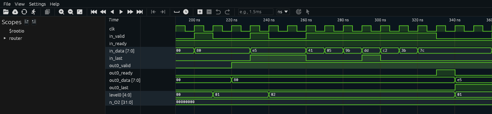
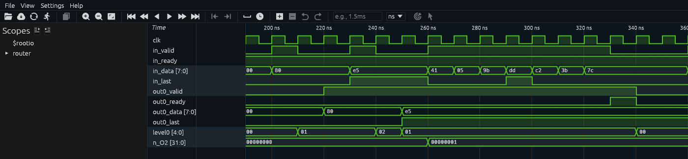

# Lab 05: Protocol rules and backpressure

In this lab you'll write three SystemVerilog assertions for the router's output rules. The testbench
binds them into the router, and the base test fails any test in which one of them fails. Then
you'll finish a sink driver that answers each output beat with an item from a sequence, and write a
virtual sequence that changes the routing table, the traffic and the backpressure together. You
start from our Lab 04 testbench, which already catches two of this lab's three planted bugs, B10
and B12. Your assertions fail on both of them as well, and each failure names a rule that the
router broke. On B10 your first assertion failure comes 8 cycles before the scoreboard's first
error. The third bug, B11, shows only on packets of more than 8 beats. No Lab 04 test sends packets
that long, so you'll send them from your virtual sequence.

Package: [`labs/lab-05-protocol-rules-and-backpressure/`](https://github.com/uoftasic/dd105-b/tree/main/labs/lab-05-protocol-rules-and-backpressure)

## Before you start

- Finish [Lab 04](lab-04-the-same-testbench-in-pyuvm-overview.md).
- Read [Assertions for interface rules](../guide/assertions-for-interface-rules.md),
  [Reactive agents and backpressure](../guide/reactive-agents-and-backpressure.md) and
  [Virtual sequences](../guide/virtual-sequences.md).
- Keep the router specification open at
  [Valid/ready rules](../reference/router-spec.md#validready-rules). The rule names on this page
  (I1, I2, O1, O2, O6, O7 and O8) are the ones defined there.

The package is Lab 04's testbench with our solution to Lab 04 in it: the agent for output 1, the
scoreboard's queue of output 1's beats, a `level()` that gives output 1's real level,
`RouterStallTest`, `NoroutePkt` and the factory override. If your own Lab 04 printed
`2 of 2 caught.`, your code does the same job, but use ours anyway, because this lab's additions are
already in our copies of the same three files, `router_agents.py`, `router_env.py` and
`test_router.py`. We added these pieces for you:

| File | What Lab 05 adds |
|---|---|
| `tb/router_sva.sv`, `tb/router_sva_bind.sv` | the assertion module and the `bind` that puts it in the router; you write three of its assertions (Part 2) |
| `tb/router_agents.py` | `SinkDriver`, which replaces `OutReadyDriver` and can answer each beat with a `ReadyItem` from the sink's sequence, `SinkSeq` (you finish the driver in Part 3); an oversize length kind in `RouterPkt`, switched off until a sequence gives it a weight; how long each output beat waited, which the output monitor stamps on the beat; the cycle in which each APB transfer completed, which the APB monitor stamps on the transfer; and `gap_one_in` and `w_over` on `RouterRandSeq`, which `send_rand()` sets (Part 4) |
| `tb/router_env.py` | the coverage group `router.wait`, an `oversize` bin in `router.pkt.len`, and a scoreboard that follows route writes made while packets are coming in |
| `tb/router_vseq.py` | the virtual sequences; you write `RouterLab05Vseq` (Part 4) |
| `tb/test_router.py` | `RouterTest` (Lab 04's `RouterInjectTest`, then your virtual sequence), `RouterLab05Test` (the sequence alone) and `RouterSinkTest` (Part 3); the base test now starts a `SinkSeq` on each output |

Time: about 2 h. Part 2's edit is SystemVerilog, so it rebuilds the simulator, which took us 2.4 s.
Every other file you change is Python, and editing one rebuilds nothing. A run of `RouterTest` takes
about 6 to 7 s.

## Part 1: The Lab 04 testbench against this lab's bugs

Which of this lab's bugs does the testbench you already have catch, and how close does it get to
the cycle in which the router went wrong?

1. Open a terminal on the workbench desktop, as in Lab 04, go to the lab folder, and build the
   simulator:

   ```bash
   . /foss/designs/common/.designinit   # a new terminal loads this by itself; safe to rerun
   mod dd105-b
   cd labs/lab-05-protocol-rules-and-backpressure
   make build
   ```

   Near the top it prints `BUILD  router with 2 bound file(s)`, which are `tb/router_sva.sv` and
   `tb/router_sva_bind.sv`, and it ends with:

   ```text
    built /foss/designs/modules/dd105-b/labs/lab-05-protocol-rules-and-backpressure/build/sim_build/Vtop in 2.4 s (2.0M in /foss/designs/modules/dd105-b/labs/lab-05-protocol-rules-and-backpressure/build/sim_build)
    ccache:  Hits: 29 / 42 (69.05%)  Misses: 13 / 42 (30.95%)
   ========================================================================
    /foss/designs/modules/dd105-b/labs/lab-05-protocol-rules-and-backpressure/build/sim_build/Vtop is up to date.
   ```

   Our counts include the builds of Labs 01 to 04, which came to 23 hits and 12 misses, so this
   build's own were 6 hits and 1 miss.

2. Run the graded test, `RouterTest`. It runs everything `RouterInjectTest` did in Lab 04 and then
   `RouterLab05Vseq`, which is empty for now:

   ```bash
   make run
   ```

   You should see `ok: 0 errors, 0 assertions   7.14 s`, and above it:

   ```text
    53830.00ns INFO     ..kpressure/tb/test_router.py(407) [uvm_test_top]: [VSEQ] RouterInjectTest's steps are done; starting RouterLab05Vseq
    53830.00ns INFO     ..ckpressure/tb/router_env.py(229) [uvm_test_top.env.sb]: [SB] 806 packets in: 184 to output 0, 189 to output 1, 179 NOROUTE, 254 FULL; the highest level a header saw was 16
    53830.00ns INFO     ..ckpressure/tb/router_env.py(232) [uvm_test_top.env.sb]: [SB] beats checked: 788 on output 0, 828 on output 1; 5 DROP_CNT reads checked
    53830.00ns INFO     ..ckpressure/tb/router_env.py(276) [uvm_test_top.env.cov]: [COV] router.pkt: 34 of 42 bins hit; router.wait: 13 of 14; coverage.xml written
   DD105-B BaseTest: 0 errors logged, 0 assertion failures (u_sva.n_fail)
   ```

   In Lab 04 the `BaseTest` line ended `no bound assertions`. Now `BaseTest` reads the bound
   assertions' failure count, `cocotb.top.u_sva.n_fail`, at the end of every test, and fails the
   test if it isn't 0. The packets differ from the ones `RouterInjectTest` sent in Lab 04, because
   cocotb seeds each test from its name (you saw this in Lab 04, Part 1, step 3), and this test is
   `RouterTest`. The run's first `[PHASE]` line shows the routes `--01`, with output 0 ready in 5%
   of cycles, and step 7 of this part uses that phase.

3. Look at the coverage of that run:

   ```bash
   make cov
   ```

   You should see, among the other lines:

   ```text
           top.router.pkt.len                            88.89 %   8 of 9 bins
               not hit: oversize
   ```

   and at the end:

   ```text
         top.router.wait                               92.86 %   13 of 14 bins
           top.router.wait.port                         100.00 %   2 of 2 bins
           top.router.wait.wait                         100.00 %   4 of 4 bins
           top.router.wait.x_port_wait                   87.50 %   7 of 8 bins
               not hit: ('out1', 'short_wait')
   ```

   For each packet that an output delivers, `router.wait` records the longest time that any of its
   beats waited for `out_ready`. Its bins are `none` for 0 cycles, `short_wait` for 1 to 3,
   `long_wait` for 4 to 20 and `stalled` for more than 20. `oversize` counts packets of 9 beats or
   more on the input, before the router cuts them. Lab 04's sink decides `out_ready` anew in every
   cycle, without looking at what is on the output. At 100% it is always 1, so a beat never waits,
   and at 5% it is 1 in one cycle in twenty, so a beat waits about 20 cycles on average. So a
   packet whose longest wait is 1 to 3 cycles is rare, and output 1 delivered none in this run.

4. Now run Lab 04's graded test on its own:

   ```bash
   make run TEST=RouterInjectTest
   ```

   You should see `ok`, and these two lines:

   ```text
    53890.00ns INFO     ..ckpressure/tb/router_env.py(229) [uvm_test_top.env.sb]: [SB] 804 packets in: 193 to output 0, 196 to output 1, 218 NOROUTE, 197 FULL; the highest level a header saw was 16
    53890.00ns INFO     ..ckpressure/tb/router_env.py(232) [uvm_test_top.env.sb]: [SB] beats checked: 860 on output 0, 818 on output 1; 5 DROP_CNT reads checked
   ```

   They are the lines `RouterInjectTest` printed in Lab 04, Part 4, step 4, number for number.
   (The line numbers after `router_env.py` differ, because the file has grown.) This lab's base
   test starts a new sequence on each sink, and each sink has a new driver. Why didn't they change
   any of Lab 04's packets?

   <details>
   <summary>Answer</summary>

   Every packet comes from Python's `random`, one draw after another, so anything that drew one
   more number would change every packet after it. In Lab 04's tests, none of this lab's new code
   draws a number. Every sink in them stays in `SNK_PCT`, Lab 04's mode, where `SinkDriver` runs
   Lab 04's loop, which draws only when `ready_pct` is between 0 and 100 and asks for no items.
   `SinkSeq` decides each item's values only after `start_item()` returns, which happens when the
   driver asks for the item, so in these tests it waits in `start_item()` and draws nothing. The
   new oversize kind has a weight of 0.

   </details>

5. Run the grader against this lab's three bugs:

   ```bash
   make check-all
   ```

   You should see:

   ```text
         ok  the golden design                        0 errors, 0 assertions          5.8s
   ------------------------------------------------------------------------
     MISSED  tier 4  B11_cut_packet_has_no_last       0 errors, 0 assertions          5.8s
     caught  tier 4  B10_output_reloads_while_stalled 50 errors, 0 assertions         3.0s
     caught  tier 5  B12_out1_uses_out0_ready         50 errors, 0 assertions         2.0s
   ------------------------------------------------------------------------
    2 of 3 caught.
    Still hiding from this test:
      B11_cut_packet_has_no_last
         hides behind: sending only legal packets of 8 beats or fewer
   ```

   `make check`, which grades the first bug in the list, says
   `VERDICT: FAIL -- your test passes B11_cut_packet_has_no_last too.` B12 shows only when the two
   `out_ready` signals differ, and B10 only when a beat has to wait for `out_ready`. Lab 04's stall
   test already makes both happen. B11 needs a packet of more than 8 beats, and none of Lab 04's
   tests sends one.

6. Look at the first errors for the two bugs the testbench catches:

   ```bash
   make run BUG=B10
   make run BUG=B12
   ```

   You should see, from the first:

   ```text
    caught: 50 errors, 0 assertions   2.98 s   log: build/runs/RouterTest-s1-B10/run.log
      RouterTest: AssertionError: 50 errors logged, the first: output 0: got e5 last in cycle 34, expected 80
   ```

   and from the second:

   ```text
    caught: 50 errors, 0 assertions   2.05 s   log: build/runs/RouterTest-s1-B12/run.log
      RouterTest: AssertionError: 50 errors logged, the first: output 1: got c2 in cycle 34, expected 3b
   ```

7. Predict a cycle before you go on. In phase 1, routes `--01` send DST 2 to output 0, which is
   ready in 5% of cycles. The router accepts the 2-beat packet `80 e5` into an empty output 0, the
   header `80` in cycle 21 and `e5` in cycle 24, and output 0's sink is next ready in cycle 34. By
   rule O8, in which cycle is `80` first on `out0_data`? B10 loads the next beat into the output
   register even while `out0_ready` is 0. In which cycle does `out0_data` first change while `80`
   waits? Write that cycle down; Part 2 checks it.

   <details>
   <summary>Answer</summary>

   By O8, a beat that goes into an empty output appears two cycles after its input handshake, so
   `80` is on the output from cycle 23. B10 loads `e5` over it as soon as `e5` gets there, two
   cycles after its own handshake, so `out0_data` first changes in cycle 26. The scoreboard sees
   only beats that are taken, and output 0's sink took nothing until cycle 34, when it took `e5`
   where the scoreboard expected `80`. The router went wrong 8 cycles before the scoreboard could
   see it.

   </details>

Check: `make check-all` printed `2 of 3 caught.`, and you've written down a cycle for B10.

## Part 2: Assertions for the output rules

Which rule did B10 break, and in which cycle?

1. Open `tb/router_sva.sv`. The module `router_sva` has two assertions written for you, `a_I1`
   and `a_I2`, for the source's rules I1 and I2, so they check the testbench's own source driver.
   Read `a_I1` with the specification's I1 beside it. The part left of `|=>` (the antecedent)
   picks the cycles the rule talks about, and `|=>` means "then, in the next cycle".
   `disable iff (!rst_n)` switches the check off while `rst_n` is 0, because a reset ends a beat
   without a handshake and that doesn't break the rule. A failure adds one to `n_I1` and calls
   `$error`.

2. In `router_sva_out`, which is instantiated once per output, write the three assertions the
   TODOs describe:
   - `a_O1`: once `out_valid` is 1, it stays 1 until the handshake;
   - `a_O2`: while `out_valid` is 1 and `out_ready` is 0, `out_data` and `out_last` don't change;
   - `a_O6`: a beat taken when `beats` is 7 has `out_last` = 1. (`beats` counts the beats of the
     current output packet already taken, and the file keeps it for you.) This one is about the
     cycle of the handshake itself, so it uses `|->` (the same cycle).

   Count each one's failures in its own counter (`n_O1`, `n_O2`, `n_O6`) and give each one an
   `$error` message, as `a_I1` does. The outputs on this page show our messages. For O1 and O2
   they are `a_I1`'s and `a_I2`'s with `O1` and `O2` in place of `I1` and `I2`, and `out_` in place
   of `in_`. For O6 it is `O6: an output packet is longer than 8 beats`.

3. Open `tb/router_sva_bind.sv`. Why does the testbench attach the assertions with `bind`?

   <details>
   <summary>Answer</summary>

   cocotb's top level is the router itself, so there is no SystemVerilog top module to put an
   instance of `router_sva` in, and editing the router's RTL to add one would change the design
   under test. `bind` puts an instance, `u_sva`, inside the router, wired to the router's own
   ports, from a file of its own. The same file works on the golden design and with any planted
   bug switched on, and the checker sees the same pins that the rules are written about. Python
   reads the failure count through the router as `cocotb.top.u_sva.n_fail`, which is how
   `BaseTest` gets it.

   </details>

4. Rebuild and run on the golden design:

   ```bash
   make build
   make run
   ```

   The rebuild took us 2.4 s, with 6 of its 7 files from the ccache. You should see `ok`, the same
   two `[SB]` lines as in Part 1, and
   `DD105-B BaseTest: 0 errors logged, 0 assertion failures (u_sva.n_fail)`. A failure here means
   one of your assertions is wrong, because the golden router keeps all three rules.

5. Run B10 with the simulator's own error limit, which is 1. The course's makefile gives every run
   of a lab with assertions `+verilator+error+limit+100000`, and `ERROR_LIMIT=1` makes that
   `+verilator+error+limit+1`:

   ```bash
   make run BUG=B10 ERROR_LIMIT=1
   cat build/runs/RouterTest-s1-B10/exit_status
   ```

   You should see the run stop at the first failure, and `cat` print `1` after it. The failure
   looks like this:

   ```text
   [260000] %Error: router_sva.sv:53: Assertion failed in router.u_sva.u_out0.a_O2: O2: out_data or out_last changed while the beat waited
   %Error: /foss/designs/modules/dd105-b/labs/lab-05-protocol-rules-and-backpressure/tb/router_sva.sv:53: Verilog $stop
   Aborting...
   ```

   and, at the end:

   ```text
    caught: 1 assertion   1.98 s   log: build/runs/RouterTest-s1-B10/run.log
      router_sva.sv:53: Assertion failed in router.u_sva.u_out0.a_O2: O2: out_data or out_last changed while the bea
      note: Verilator stopped the run at its error limit, so the rest of the test didn't run. Runs through make raise it (+verilator+error+limit+N).
   ```

   The line number is the line of the `$error` call in your `a_O2`, so yours may differ, here and
   later. The time, 260000, is in picoseconds, so the failure was at 260 ns. The clock's period is
   10 ns, so cycle $n$ is the period that ends at the rising edge at $10n$ ns, and its falling
   edge, where the monitors read the pins and count the cycle, is at $10n - 5$ ns. This failure was
   sampled at the edge that ends cycle 26. Compare it with your prediction from Part 1.

   With a limit of 1, the first failing assertion ends the run with exit status 1, and nothing
   after it is checked. The makefile raises the limit so that every failure prints, each
   assertion's counter keeps counting, and `BaseTest` reports their sum at the end of the test.

6. Run B10 again with the makefile's limit, and find the first check of each kind that fired:

   ```bash
   make run BUG=B10
   grep -m1 "%Error" build/runs/RouterTest-s1-B10/run.log
   grep -m1 ERROR build/runs/RouterTest-s1-B10/run.log
   ```

   You should see `caught: 50 errors, 284 assertions`, then:

   ```text
   [260000] %Error: router_sva.sv:53: Assertion failed in router.u_sva.u_out0.a_O2: O2: out_data or out_last changed while the beat waited
      335.00ns ERROR    ..ckpressure/tb/router_env.py(116) [uvm_test_top.env.sb]: output 0: got e5 last in cycle 34, expected 80
   ```

   The assertion fired at the edge that ends cycle 26, and the scoreboard reported its first error
   8 cycles later, in cycle 34.

7. To see the rule break, record both runs and open them in Surfer:

   ```bash
   make waves
   make waves BUG=B10
   surfer build/runs/RouterTest-s1/waves.fst &
   surfer build/runs/RouterTest-s1-B10/waves.fst &
   ```

   Add `clk`, `in_valid`, `in_ready`, `in_data`, `in_last`, `out0_valid`, `out0_ready`,
   `out0_data`, `out0_last` and `level0` from `router`, and `n_O2` from `router.u_sva.u_out0`, and
   look at 190 to 360 ns:

   

   *The golden router. The header `80` is taken at the edge at 210 ns and `e5` at the edge at
   240 ns. `80` reaches `out0_data` at the edge at 220 ns, the start of cycle 23, and stays there
   while `out0_ready` is 0; `level0` goes to 2 when `e5` arrives. `out0_ready` is 1 in cycle 34,
   from 330 to 340 ns, the sink takes `80` at the edge at 340 ns, and `e5` follows. `n_O2` stays
   0.*

   

   *B10. `out0_data` changes from `80` to `e5` at the edge at 250 ns, while `out0_ready` is 0,
   and `level0` drops from 2 to 1. `n_O2` counts its first failure at the edge at 260 ns, which
   ends cycle 26. When `out0_ready` rises in cycle 34, the beat on the output is `e5`, and after
   the sink takes it `out0_valid` falls, so `80` is lost.*

8. Run the grader again:

   ```bash
   make check-all
   ```

   You should see B10 caught by your assertions as well, B12 with three assertion failures, and
   B11 still missed:

   ```text
     MISSED  tier 4  B11_cut_packet_has_no_last       0 errors, 0 assertions          5.6s
     caught  tier 4  B10_output_reloads_while_stalled 50 errors, 284 assertions       2.9s
     caught  tier 5  B12_out1_uses_out0_ready         50 errors, 3 assertions         2.0s
   ------------------------------------------------------------------------
    2 of 3 caught.
   ```

   The three failures on B12 are all `a_O6`, on output 1, and the first was at the edge at 400 ns,
   which ends cycle 40. Run `grep -m1 "%Error" build/grade/B12/run.log` to see it. The
   scoreboard's first error was in cycle 34. B11 is the bug that breaks O6, but your `a_O6` passes
   on B11 and fails on B12. Why?

   <details>
   <summary>Answer</summary>

   An assertion can only fail on something that the stimulus makes the router do. Under B11, O6
   can fail only on the 8th beat of a packet that has a 9th, and nothing in `RouterTest` sends a
   packet longer than 8 beats yet, so on B11 the router never has a packet to cut.

   B12 makes output 1's buffer move on `out0_ready`. In phase 1 output 1's sink is ready in every
   cycle, so it takes whatever beat is on output 1's pins. Output 0 is ready in only 5% of
   cycles, so in most of those cycles the buffer behind output 1's pins doesn't move on to the next
   beat, and the pins show a handshake with the same data again. In cycle 34 the scoreboard, which
   had already matched `c2`, saw the sink take `c2` again where `3b` was due. Each repeat is one
   more beat of the packet on output 1's pins, so once eight beats in a row have had no `out_last`,
   O6 fails. O1 and O2 check only cycles in which `out_ready` is 0, and `out1_ready` is 1 all
   through phase 1. The run stops at its 50th error in cycle 83, long before phase 2 stalls
   output 1.

   </details>

Check: `make check-all` prints `50 errors, 284 assertions` for B10, and the cycle you predicted in
Part 1 matches cycle 26.

## Part 3: A sink that answers each beat

What changes when each sink answers each beat at its own pace, instead of setting `out_ready` in
every cycle whatever is on the output?

1. Read the output agent in `tb/router_agents.py`: `OutCfg`, `ReadyItem`, `SinkSeq`, `SinkDriver`
   and `OutAgent`. `OutCfg.mode` picks how the sink answers. In `SNK_PCT`, the default, the driver
   works as Lab 04's did, and sets `out_ready` to 1 right after every rising edge with probability
   `ready_pct` percent. In the other modes it is a reactive driver. The router decides when a beat
   appears, and the driver answers each beat with a `ReadyItem` from `SinkSeq`. With `pre_ready`
   set, `ready` is already 1 when the beat appears; otherwise the sink waits `delay` cycles after
   the beat's first cycle on offer, then raises `ready`. `SNK_FAST` makes every item `pre_ready`,
   `SNK_SLOW` gives every beat a delay of 4 to 20, and `SNK_RANDOM` randomizes each item. In those
   modes the driver looks at the output at the falling edge in the middle of each cycle, decides
   the next cycle's `ready` there, and drives it just after the rising edge; that loop is written
   for you.

   pyuvm's driver has `get_next_item()`, which waits until its sequence hands over an item. It
   doesn't have `try_next_item()`. The base test starts a `SinkSeq` on each sink before it resets
   the router, and the sequence never ends. Why does the driver need a sequence like that, when the
   source driver can work with sequences that send a few packets and stop?

   <details>
   <summary>Answer</summary>

   The source driver can wait in `get_next_item()`, because nothing happens on the input until it
   has a packet. The sink driver can't wait there, because it drives `out_ready` in every cycle,
   and the router puts a beat on the output whether or not the sink has an item for it. `SinkSeq`
   is always waiting in `start_item()` with the next item, so the driver's `get_next_item()`
   returns in the same time step, and the loop goes on to drive the next cycle's `out_ready`. If
   no sequence were running on the sink, the driver would stop at that call for the rest of the
   test, `out_ready` would keep the last value it drove, and no beat on that output would be
   answered again.

   </details>

2. `RouterSinkTest` is Lab 03's random test with both sinks in `SNK_RANDOM`. Run it as shipped, on
   its own, and look at its waits:

   ```bash
   rm -rf build/runs
   make run TEST=RouterSinkTest
   make cov
   ```

   You should see `ok` in about 6 s, a first `[PHASE]` line that ends
   `output 0 SNK_RANDOM, output 1 SNK_RANDOM`, and:

   ```text
    54960.00ns INFO     ..ckpressure/tb/router_env.py(229) [uvm_test_top.env.sb]: [SB] 805 packets in: 456 to output 0, 348 to output 1, 1 NOROUTE, 0 FULL; the highest level a header saw was 16
   ```

   ```text
         top.router.wait                               50.00 %   7 of 14 bins
           top.router.wait.port                         100.00 %   2 of 2 bins
           top.router.wait.wait                          50.00 %   2 of 4 bins
               not hit: short_wait, stalled
           top.router.wait.x_port_wait                   37.50 %   3 of 8 bins
               not hit: ('out0', 'short_wait'), ('out0', 'stalled'), ('out1', 'short_wait'), ('out1', 'long_wait'), ('out1', 'stalled')
   ```

   As shipped, the driver is always ready in the per-beat modes, whatever the item says, so the
   packets on output 1 never waited, and no FULL drop happened. The `long_wait` packets on output 0
   come from `close_holes()`, which stalls output 0 in Lab 04's mode, `SNK_PCT`.

3. Fill in the two TODOs in `SinkDriver.run_phase`: the countdown while a beat waits, and the
   expression for `rdy`, the next cycle's `ready`. The countdown has to stop at 0. A beat whose
   wait is over can still be on offer if a virtual sequence then stalls its output (Part 4), and
   the countdown goes on running in every cycle the beat waits, in `SNK_PCT` too, since the driver
   still holds the item. One more count would take `wait_left` below 0, and once the sink was
   back in a per-beat mode, a test for `wait_left == 0` would never let it raise `ready` for that
   beat.

4. Before you run it again, predict what happens to the `[SB]` line's `FULL` count and to the
   `router.wait` bins.

   <details>
   <summary>Answer</summary>

   Each beat now waits 0 cycles when its item is `pre_ready` and otherwise 1 to 13, so packets
   land in `short_wait` and `long_wait` on both outputs. A sink that waits a cycle or more on
   about half its beats takes them more slowly than the input can bring them, so an output
   sometimes fills past 8 beats, and the packets that arrive for it then are FULL drops.

   </details>

5. Run it again and look at the coverage. Your edit is Python, so nothing rebuilds:

   ```bash
   rm -rf build/runs
   make run TEST=RouterSinkTest
   make cov
   ```

   If your driver does what the TODOs say, you should see `ok` and:

   ```text
    53660.00ns INFO     ..ckpressure/tb/router_env.py(229) [uvm_test_top.env.sb]: [SB] 804 packets in: 369 to output 0, 319 to output 1, 1 NOROUTE, 115 FULL; the highest level a header saw was 16
   ```

   ```text
         top.router.wait                               92.86 %   13 of 14 bins
           top.router.wait.port                         100.00 %   2 of 2 bins
           top.router.wait.wait                         100.00 %   4 of 4 bins
           top.router.wait.x_port_wait                   87.50 %   7 of 8 bins
               not hit: ('out1', 'stalled')
   ```

   The run passed, so every phase's `DROP_CNT` read matched the scoreboard's count, which means
   the scoreboard predicted all 115 FULL drops. The packets differ from step 2's (804 of them
   instead of 805), because each item `SinkSeq` makes in `SNK_RANDOM` draws from `random`, and
   your driver asks for its items in different cycles from the shipped driver. Output 1 has no
   `stalled` packet, because a `ReadyItem`'s longest wait is 13 cycles and nothing stalls output
   1 in this test.

6. Run the grader:

   ```bash
   make check-all
   ```

   You should see `2 of 3 caught.` again, with the same counts as in Part 2. `RouterTest` keeps its
   sinks in `SNK_PCT` until its virtual sequence starts, and that sequence is still empty, so your
   driver changes none of its stimulus, and B11 still needs a packet longer than 8 beats.

Check: `RouterSinkTest` passes with `115 FULL` in its `[SB]` line, and `make check-all` says
`2 of 3 caught.`

## Part 4: A virtual sequence

How do you make the configuration, the traffic and the backpressure change together, from one
place?

1. Read `RouterBaseVseq` and `RouterLab05Vseq` in `tb/router_vseq.py`. pyuvm has no
   `p_sequencer`, so a virtual sequence is given the environment when it's made, and it runs on no
   sequencer of its own: `RouterTest` starts yours with
   `await RouterLab05Vseq("vseq", self.env).start()`. The helpers you'll use are
   `route(n, en, port)`, `ctrl(en)`, `sink(p, mode)`, `stall(p)`, `burst(dst, n, length)`,
   `send_rand(n, gap_one_in, w_over)`, `backpressure()`, `cycles(n)`, `drain()` and `rd(DROP_CNT)`.
   Most of them are the base test's steps from Lab 04, rewritten as methods of a sequence, and they
   start the same Lab 04 sequences that the steps started. Why do `sink()` and `stall()` change the
   sink's `OutCfg`, and not start a sequence on the sink's sequencer?

   <details>
   <summary>Answer</summary>

   The base test starts each sink's `SinkSeq`, and it runs for the whole test, one item per beat.
   A virtual sequence steers the backpressure by changing `mode` and `ready_pct` in the sink's
   `OutCfg`. `SinkSeq` reads `mode` for every item, and the driver reads `mode` in every cycle,
   and `ready_pct` as well while the mode is `SNK_PCT`. Starting another sequence on a sink's
   sequencer would compete with the one already running there.

   </details>

2. Run the test that runs your sequence alone, as it is now:

   ```bash
   make run TEST=RouterLab05Test
   ```

   You should see `FAIL: 1 error, 0 assertions   1.90 s`, and above it:

   ```text
       20.00ns ERROR    ..ckpressure/tb/router_env.py(116) [uvm_test_top.env.sb]: no beat was checked: neither output delivered a beat that matched a prediction
   ```

   The scoreboard fails a test that checked nothing. `make regress`, which runs every test in the
   Makefile, fails for the same reason until you finish this part.

3. Read `write_apb` and the start of `write_in` in the scoreboard. In Lab 04 a route write changed
   the scoreboard's routing table at once, which was safe because the tests wrote routes only
   between phases. Now the APB monitor stamps each transfer with the cycle it completed in,
   `write_apb` puts a route write in `pending` with that cycle, and `write_in` applies it at the
   first header of a later cycle. Why does the scoreboard go by the cycle, and not by the order in
   which the two calls arrive?

   <details>
   <summary>Answer</summary>

   The specification's Routing section says a header accepted in the cycle a register write
   completes still uses the old value. The APB monitor and the input monitor both read the pins
   at the same falling edge, and cocotb runs them in no fixed order (which is also why `level()`
   adds back a beat taken in the header's own cycle), so a header and a route write in the same
   cycle could reach the scoreboard in either order. The cycle stamps don't depend on that order.

   </details>

4. Write `RouterLab05Vseq.body()`. The TODO lists four steps:
   1. Configure the router: every route enabled, two DSTs to each output, and `CTRL.EN` set.
   2. Stall output 1 and send packets to both outputs, then stall output 0 instead, with a
      `drain()` after each.
   3. Send oversize packets (9 beats or more) to every DST with both sinks in `SNK_RANDOM`, then
      drain.
   4. All at once: random packets with oversize ones among them (`send_rand()`'s `w_over`),
      `backpressure()`, and a coroutine that moves two routes to the other output and back while
      the packets are in flight. Then drain, and read `DROP_CNT`.

   Step 4 has this shape. `par()` starts each coroutine and waits until all of them are done, and
   `backpressure()` loops until `traffic_done` is set:

   ```python
   self.traffic_done = False

   async def traffic():
       await self.send_rand(...)          # the packets
       self.traffic_done = True

   async def moves():
       ...                                # route changes, with cycles() between them

   await self.par(traffic(), self.backpressure(), moves())
   ```

   `send_rand()` takes two settings. `gap_one_in` makes one beat in that many wait 1 to 3 idle
   cycles first, and it's 4, as in Lab 04, unless you give it. `w_over` is the weight of oversize
   packets, against 100 for the other lengths.

5. Predict how each oversize packet should come out, and which bug your sequence now reaches.

   <details>
   <summary>Answer</summary>

   Each one should come out cut to 8 beats, with `out_last` on the 8th, and the router takes the
   rest of its beats from the input and throws them away (example E6 in the specification). Your
   sequence now reaches B11. Under B11 the 8th beat has no `out_last`, so O6 fails on it, and the
   scoreboard, which already expected the cut, sees the wrong `out_last` on the same beat.

   </details>

6. Run both tests and look at the coverage. Your sequence is Python, so nothing rebuilds:

   ```bash
   rm -rf build/runs
   make run TEST=RouterLab05Test
   make run
   make cov
   ```

   You should see `ok` from both runs, and `router.pkt.len` with all 9 bins hit. The counts
   depend on your sequence. Our `RouterLab05Test` sent 317 packets, and `RouterTest` said:

   ```text
    77350.00ns INFO     ..ckpressure/tb/router_env.py(229) [uvm_test_top.env.sb]: [SB] 1123 packets in: 282 to output 0, 286 to output 1, 179 NOROUTE, 376 FULL; the highest level a header saw was 16
    77350.00ns INFO     ..ckpressure/tb/router_env.py(232) [uvm_test_top.env.sb]: [SB] beats checked: 1283 on output 0, 1254 on output 1; 6 DROP_CNT reads checked
   ```

   The first 806 packets are the ones from Part 1, and our sequence sent the other 317. Our
   `make cov` of the two runs showed `top` at `87.50 %   49 of 56 bins` and `router.wait` at
   `14 of 14 bins`. The seven empty bins are the seven of `x_fate_level` that the specification
   rules out, so no test can hit them.

7. Run the grader:

   ```bash
   make check-all
   ```

   You should see `3 of 3 caught.` Our run printed:

   ```text
         ok  the golden design                        0 errors, 0 assertions          7.1s
   ------------------------------------------------------------------------
     caught  tier 4  B11_cut_packet_has_no_last       20 errors, 18 assertions        7.2s
     caught  tier 4  B10_output_reloads_while_stalled 50 errors, 284 assertions       2.9s
     caught  tier 5  B12_out1_uses_out0_ready         50 errors, 3 assertions         2.0s
   ------------------------------------------------------------------------
    3 of 3 caught.
    Every bug in the list, each one caught by a check that fired.
   ```

   On B11 our `a_O6` failed at the edge that ends cycle 5496, and the scoreboard reported the
   same beat in the same cycle:

   ```text
   [54960000] %Error: router_sva.sv:58: Assertion failed in router.u_sva.u_out1.a_O6: O6: an output packet is longer than 8 beats
    54955.00ns ERROR    ..ckpressure/tb/router_env.py(116) [uvm_test_top.env.sb]: output 1: got 55 in cycle 5496, expected 55 last
   ```

   `grep -m1 "%Error" build/grade/B11/run.log` and `grep -m1 ERROR build/grade/B11/run.log` show
   them, and `BaseTest` ended the test with
   `DD105-B BaseTest: 20 errors logged, 18 assertion failures (u_sva.n_fail)`. What did O6 add that
   the scoreboard's error didn't already give you?

   <details>
   <summary>Answer</summary>

   O6 names the rule, and it needs no model of the router. It checks one line of the
   specification against the pins, so it would catch B11 in any testbench that binds the file and
   sends an oversize packet, including one whose scoreboard didn't know that the router cuts long
   packets. The scoreboard knows what every beat should be, so it catches far more, but its message
   gives only the beat that was wrong and what it expected instead.

   </details>

8. Now run B12 against your sequence alone, which stalls output 1 first, and compare the first
   check of each kind:

   ```bash
   make run TEST=RouterLab05Test BUG=B12
   grep -m1 "%Error" build/runs/RouterLab05Test-s1-B12/run.log
   grep -m1 ERROR build/runs/RouterLab05Test-s1-B12/run.log
   ```

   Ours said `caught: 50 errors, 39 assertions`, and:

   ```text
   [330000] %Error: router_sva.sv:53: Assertion failed in router.u_sva.u_out1.a_O2: O2: out_data or out_last changed while the beat waited
     3515.00ns ERROR    ..ckpressure/tb/router_env.py(116) [uvm_test_top.env.sb]: output 1: got 46 in cycle 352, expected 44
   ```

   Our O2 failed in cycle 33 and the scoreboard complained in cycle 352. In `RouterTest` the
   scoreboard was first. Why is it so much later here?

   <details>
   <summary>Answer</summary>

   Step 2 of the sequence stalls output 1 while output 0 takes its beats. Under B12 output 1's
   buffer moves on `out0_ready`, so its beats leave while `out1_ready` is 0. None of them has a
   handshake on output 1's pins, so its monitor reports nothing. By the time the stall ends, every
   beat routed to output 1 has left its buffer, so output 1's sink has nothing to take either,
   and `drain()` waits its full 300 cycles, because the scoreboard still expects those beats.
   Output 1's first handshake of the run is in cycle 352, when the second half of step 2 sends it
   new packets, and that is the scoreboard's first chance to compare a beat on output 1. O2
   watches the pins, so it fails in the first cycle the beat on output 1 changes while it waits.
   In `RouterTest`'s phase 1 the readies differ the other way round, with output 1 ready and
   output 0 stalled, so output 1's sink takes the repeated beats and the scoreboard sees them at
   once.

   </details>

9. Check that your testbench still passes the golden design on other seeds:

   ```bash
   make seeds SEEDS="1 2 3 4 5"
   ```

   You should see `5 ok  (5 runs)`, at about 7 s a run.

## Finishing

You're done when `make check-all` prints `3 of 3 caught.` with your assertions, your sink driver
and your virtual sequence in `tb/`, and `make seeds SEEDS="1 2 3 4 5"` prints `5 ok  (5 runs)`.

Questions:

1. B12 breaks rule O7, because it makes output 1 depend on `out0_ready`. Your file has no
   `a_O7`. Which checks caught B12, and why is there no assertion for O7?

   <details>
   <summary>Answer</summary>

   In `RouterTest` the scoreboard reported errors from cycle 34, and O6 on output 1 failed from
   cycle 40. In `RouterLab05Test` O2 on output 1 failed from cycle 33 and O1 from cycle 38, the
   scoreboard's first error was in cycle 352 (Part 4, step 8), and O6 on output 1 failed in cycle
   359. O7 says what an output does not depend on, and the specification points out that no single
   trace can show that. You can only see its consequences, when the two `out_ready` signals differ
   and output 1 then does something that O1, O2, O6 or the scoreboard's model forbids. Lab 04's
   stall test was the first test to make them differ while both outputs carried traffic, which is
   why your Lab 04 testbench already caught B12.

   </details>

2. Your O1 and O2 are disabled while `rst_n` is 0. What would O1 do on the golden design, without
   `disable iff`, in a test that resets the router while a beat waits on a stalled output?

   <details>
   <summary>Answer</summary>

   It would fail. A reset lowers `out_valid` at once, with no handshake (the specification's
   Valid/ready rules and example E8), but O1's consequent needs `out_valid` to be 1 in the next
   cycle. Rules about normal operation don't hold across a reset, so their assertions are switched
   off during one.

   </details>

Submit: Nothing to submit.

Next on the [Course path](../index.md#course-path): the reading on register models and regressions,
then Lab 06: The register block.
