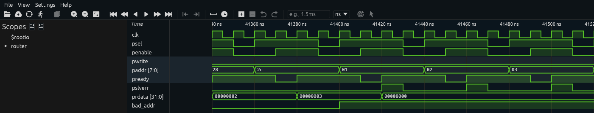
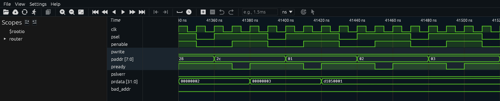

# Lab 06: The register block

In this lab you'll give the Lab 05 testbench a register model built on pyuvm's register classes. You
write the fields of `STATUS`, `DROP_CNT`, `LEVEL` and the four `ROUTE` registers, the adapter that
turns a register operation into an APB transfer, and a sequence that reads each register and
compares it with its reset value. Then you write the predictor, which keeps the model's copy of the
registers in step with every transfer on the bus, and a bit-bash sequence, which writes every bit
both ways and reads it back. SystemVerilog UVM's library has these three pieces, and pyuvm 4.0.1
doesn't, so here you write them yourself. After that you test the 246 addresses that the model can't
reach, and make the scoreboard check `irq` against `STATUS` and `INT_EN` in every cycle. The Lab 05
testbench misses all five of this lab's planted bugs (B01, B02, B03, B04 and B14), and with your
additions it catches all five by the end of Part 5.

Package: [`labs/lab-06-the-register-block/`](https://github.com/uoftasic/dd105-b/tree/main/labs/lab-06-the-register-block)

## Before you start

- Finish [Lab 05](lab-05-protocol-rules-and-backpressure-overview.md).
- Keep the router specification open at its
  [Register map](../reference/router-spec.md#register-map), [APB](../reference/router-spec.md#apb),
  [STATUS](../reference/router-spec.md#status), [INT_EN](../reference/router-spec.md#int_en) and
  [Reset](../reference/router-spec.md#reset) sections.

The package is the Lab 05 testbench with our solution to Lab 05 in it: the three assertions, the
sink driver's countdown and `RouterLab05Vseq.body()`. If your own Lab 05 printed `3 of 3 caught.`,
your code did the same job, but use ours anyway, because this lab adds to the same files. What we
added for you:

| File | What Lab 06 adds |
|---|---|
| `tb/router_ral.py` | the register model, the adapter, the predictor and the two register sequences; four registers' fields, the adapter and the reset sequence are yours (Part 2), and so are the predictor and the bit-bash sequence (Part 3) |
| `tb/router_agents.py` | `SysMonitor`, which reports `rst_n` and `irq` every cycle |
| `tb/router_env.py` | the environment makes the register model, the adapter and the predictor, and you connect the predictor (Part 3); the scoreboard models `STATUS` and `INT_EN`, checks `STATUS` reads, `PSLVERR` and reads of bad addresses, and has an `irq` check for you to write (Part 5) |
| `tb/router_vseq.py` | helpers that go through the model (`wr_reg`, `rd_reg`, `check_reg`, `rd_all_regs`), and `RouterLab06Vseq`, with one `TODO` per part |
| `tb/test_router.py` | `RouterTest` runs `RouterLab06Vseq` first, then everything Lab 05's `RouterTest` ran; `RouterLab06Test` runs the sequence alone |
| `src/predict.py` | `make predict`, which shows what `predict()` does to your model (Part 3) |

Time: about 2 h 15 min. Every file you change is Python, so nothing in this lab rebuilds the
simulator. A run of `RouterTest` takes about 8 s, and `make check-all`, which runs it six times,
about 45 s.

## Part 1: The Lab 05 testbench against the registers

What does your Lab 05 testbench check about the registers?

1. Open a terminal on the workbench desktop, as in Lab 05, go to the lab folder, and build the
   simulator:

   ```bash
   . /foss/designs/common/.designinit   # in every new terminal
   mod dd105-b
   cd labs/lab-06-the-register-block
   make build
   ```

   It ends with:

   ```text
    built /foss/designs/modules/dd105-b/labs/lab-06-the-register-block/build/sim_build/Vtop in 2.4 s (2.1M in /foss/designs/modules/dd105-b/labs/lab-06-the-register-block/build/sim_build)
    ccache:  Hits: 41 / 56 (73.21%)  Misses: 15 / 56 (26.79%)
   ========================================================================
    /foss/designs/modules/dd105-b/labs/lab-06-the-register-block/build/sim_build/Vtop is up to date.
   ```

   Our counts include the builds of Labs 01 to 05, which came to 35 hits and 14 misses, so this
   build's own were 6 hits and 1 miss.

2. Run the graded test, `RouterTest`, and pull the scoreboard's summary out of the log:

   ```bash
   make run
   grep -o '\[SB\] [0-9a-z].*' build/runs/RouterTest-s1/run.log
   ```

   You should see `ok: 0 errors, 0 assertions   8.61 s` from `make run`, and from `grep`:

   ```text
   [SB] 1123 packets in: 282 to output 0, 286 to output 1, 179 NOROUTE, 376 FULL; the highest level a header saw was 16
   [SB] beats checked: 1283 on output 0, 1254 on output 1; 6 DROP_CNT reads checked
   [SB] registers: 6 reads, 0 of STATUS checked; 0 transfers to bad addresses; irq checked in 0 cycles, wrong in 0
   ```

   The third line is new in this lab. The six reads are `RouterInjectTest`'s five `DROP_CNT` reads
   and the one at the end of your Lab 05 sequence. Nothing checks `irq` yet, so the line says it
   was checked in 0 cycles.

3. The first two lines are the ones `RouterTest` printed at the end of Lab 05 (Part 4, step 6),
   number for number. `RouterTest` now makes `RouterLab06Vseq` and starts it before anything else,
   and every packet comes from Python's `random`, one draw after another, so a single extra draw
   would change every packet after it. Why didn't the new sequence change any?

   <details>
   <summary>Answer</summary>

   `RouterLab06Vseq` does nothing yet, and making and starting a pyuvm sequence draws nothing from
   `random`. The other things this lab added (the sys monitor, the scoreboard's model of `STATUS`
   and `INT_EN`, the register model and the predictor) don't call `random` at all. We also ran our
   finished `RouterTest` with `RouterLab06Vseq` left out, on seeds 1 to 5, and it printed Lab 05's
   lines every time. Part 5 comes back to this, when the numbers do change.

   </details>

4. `make check-all` runs `RouterTest` on the golden router and on this lab's five bugs. Write down
   how many you expect the starter to catch, then run it:

   ```bash
   make check-all
   ```

   You should see:

   ```text
         ok  the golden design                        0 errors, 0 assertions          7.2s
   ------------------------------------------------------------------------
     MISSED  tier 1  B01_status_write_clears_all      0 errors, 0 assertions          7.2s
     MISSED  tier 1  B02_irq_ignores_int_en           0 errors, 0 assertions          7.2s
     MISSED  tier 1  B03_route3_readback_swapped      0 errors, 0 assertions          7.2s
     MISSED  tier 1  B04_misaligned_address_accepted  0 errors, 0 assertions          7.3s
     MISSED  tier 6  B14_enable_resets_to_one         0 errors, 0 assertions          7.2s
   ------------------------------------------------------------------------
    0 of 5 caught.
   ```

   followed by each bug's "hides behind" hint. `make check`, which grades the first bug in the
   list, says `VERDICT: FAIL -- your test passes B01_status_write_clears_all too.`

   B14 makes `CTRL.EN` reset to 1 instead of 0. Why doesn't your testbench see it?

   <details>
   <summary>Answer</summary>

   A wrong reset value shows only between the reset and the first write to the register. A read
   of `CTRL` in that window would show it, and so would a packet offered then, because `in_ready`
   stays 0 after reset until software sets `CTRL.EN`. Lab 04's steps write `CTRL` before the first
   packet and never read it, and the scoreboard wouldn't check a read of `CTRL` anyway: the only
   register reads it checks are those of `DROP_CNT` and `STATUS`, and nothing checks `in_ready`.
   B02 hides because nothing checks `irq` yet, as the third `[SB]` line says.

   </details>

Check: `0 of 5 caught.`, and `irq checked in 0 cycles`.

## Part 2: The register model

What does a register model need to know about each register, and what does a reset sequence do
with it?

1. Open `tb/router_ral.py` and read `IdReg`, `CtrlReg`, `IntEnReg` and `RouterRegs`. Each register
   is a `uvm_reg` subclass whose `build()` makes its fields and configures each one with

   ```python
   field.configure(parent, size, lsb_pos, access, is_volatile, reset)
   ```

   that is, its width, its lowest bit, its access policy (`"RO"`, `"RW"`, `"W1C"`, `"WC"` and so
   on), whether the router changes it on its own (volatile), and its reset value.
   `RouterRegs` configures each register at its address and adds it to the map. pyuvm keys the
   map by the address as Python's `hex()` writes it, `"0x8"`, so the addresses are given as
   `hex(addr)`. The specification's Register map gives each field's policy and volatility.

   The graders build the model on its own, outside the simulator, before every verdict. Run that
   build yourself:

   ```bash
   make regcheck
   ```

   You should see:

   ```text
    REGCHECK  tb/router_ral.py:RouterRegs
        0x0  ID         ID[31:0] RO
        0x4  CTRL       EN[0:0] RW
        0x8  STATUS     
        0xc  INT_EN     NOROUTE[0:0] RW, FULL[1:1] RW, OVERSIZE[2:2] RW
       0x10  DROP_CNT   
       0x14  LEVEL      
       0x20  ROUTE0     
       0x24  ROUTE1     
       0x28  ROUTE2     
       0x2c  ROUTE3     
      the model builds: 10 registers
   ```

   The seven registers with no fields listed are the ones you finish in the next step.

2. Write `build()` for `StatusReg`, `DropCntReg`, `LevelReg` and `RouteReg`, as their `TODO`s
   describe; the four `ROUTE` registers are all made from `RouteReg`. pyuvm checks each field
   against the one configured just before it, so configure them from bit 0 up. Then run
   `make regcheck` again. You should see every register with its fields:

   ```text
        0x8  STATUS     NOROUTE[0:0] W1C, FULL[1:1] W1C, OVERSIZE[2:2] W1C
        0xc  INT_EN     NOROUTE[0:0] RW, FULL[1:1] RW, OVERSIZE[2:2] RW
       0x10  DROP_CNT   NOROUTE_CNT[7:0] WC, FULL_CNT[15:8] WC
       0x14  LEVEL      LEVEL0[4:0] RO, LEVEL1[12:8] RO
       0x20  ROUTE0     EN[0:0] RW, PORT[1:1] RW
   ```

   with `ROUTE1` to `ROUTE3` like `ROUTE0`. When we configured `STATUS`'s fields from bit 2 down,
   `make regcheck` printed this instead, spaces and all:

   ```text
      the model doesn't build: AssertionError: STATUS -- _add_field:                 Fields FULL overlap                 with field                 OVERSIZE
   ```

   and `make check` stopped with
   `VERDICT: FAIL -- the register model doesn't build, so nothing was graded.` In a test, that
   `AssertionError` would have looked like a check that fired, which is why the graders build the
   model first.

3. Write the adapter's two methods, `ApbRegAdapter.reg2bus()` and `bus2reg()`. The map calls
   `reg2bus()` with each register operation and starts the `ApbItem` it returns on the APB
   sequencer. When the driver has finished the transfer, the map calls
   `bus2reg()` with the same item, and the status `bus2reg()` puts in `rw.status` is what the
   register's `read()` or `write()` returns. Give a transfer that ended with `PSLVERR` the status
   `uvm_resp_t.ERROR_RESP`. pyuvm passes the address as the string the register was configured
   with, so `reg2bus()` turns it back into a number with `int(rw.addr, 16)`.

4. Write `RegResetSeq.body()`. It puts the mirror (the model's copy of each register) at the reset
   values, then reads each register that has a field it can check, one that isn't volatile, and
   compares the value read with the register's reset value outside its volatile fields.
   `reset_value(reg)` and `volatile_mask(reg)`, above the adapter, compute those for you. Then
   write the Part 2 step of `RouterLab06Vseq` in `tb/router_vseq.py`, which starts the sequence;
   its `TODO` gives the line.

5. Write down which of the ten registers you expect your sequence to read. Then run the test and
   look at the line the sequence logs when it ends:

   ```bash
   make run
   grep -o '\[RegResetSeq\].*' build/runs/RouterTest-s1/run.log
   ```

   You should see `ok` and:

   ```text
   [RegResetSeq] 0 writes and 7 reads of 7 registers (ID, CTRL, INT_EN, ROUTE0, ROUTE1, ROUTE2, ROUTE3); 0 mismatches
   ```

   Right after the reset, `STATUS`, `DROP_CNT` and `LEVEL` hold their reset values too. Why does
   the sequence leave them out?

   <details>
   <summary>Answer</summary>

   Every field in them is volatile: the router sets `STATUS` bits on drops, counts drops in
   `DROP_CNT` and changes `LEVEL` with every beat, without any write. A register model doesn't
   compare a volatile field, because the design may have changed it since the model last looked,
   and a reset sequence skips a register in which nothing would be compared. SystemVerilog UVM's
   built-in reset sequence skips the same three. If your sequence read more than seven registers,
   one of your fields in those three isn't marked volatile.

   </details>

6. Run `make check-all`. B14's row becomes

   ```text
     caught  tier 6  B14_enable_resets_to_one         1 error, 0 assertions           7.2s
   ```

   and the other four stay `MISSED`, for `1 of 5 caught.` The error is your reset sequence's:

   ```bash
   grep ERROR build/grade/B14/run.log | grep -o '\[uvm_test_top[^]]*\]: .*'
   ```

   ```text
   [uvm_test_top.env]: [RegResetSeq] CTRL reads 0x1 after reset; its reset value is 0x0
   ```

   (Your message may be worded differently; that one is ours.)

7. `RouterTest` runs `RouterLab06Vseq` before Lab 04's steps. What would the reset sequence report
   on the golden router if it ran after them?

   <details>
   <summary>Answer</summary>

   It would report errors although the router is right. The sequence puts the mirror at the reset
   values and compares every read with them, but the router is reset only once, at time 0, and
   Lab 04's steps leave `CTRL.EN` at 1 and some of the routes set. We tried it: after
   `RouterInjectTest`'s steps, whose last routing table is `0---`, it reported `CTRL` and `ROUTE0`,
   both reading `0x1`. A reset sequence has to run while the registers still hold their reset
   values, which in this testbench means first.

   </details>

Check: B14 is `caught`, and the other four are `MISSED`.

## Part 3: The predictor and the bit bash

How does the register model keep its mirror in step with the router, and what does a bit-bash
sequence test?

1. A predictor updates the mirror by calling a register's `predict()` with the value a transfer
   wrote or read, and the kind of prediction says what to do with that value:
   `UVM_PREDICT_WRITE` (it was written, so each field takes what its policy gives it),
   `UVM_PREDICT_READ` (it was read) or `UVM_PREDICT_DIRECT` (take it as it is). `make predict`
   builds your model and calls `predict()` on four of its registers. Read `src/predict.py`, write
   down what the mirror of `STATUS` should hold after each of its four calls, then run it:

   ```bash
   make predict
   ```

   You should see:

   ```text
   STATUS (W1C), after the reset: 0x0
     then predict(0x7, UVM_PREDICT_DIRECT)     0x7
     then predict(0x1, UVM_PREDICT_WRITE)      0x6
     then predict(0x6, UVM_PREDICT_READ)       0x0
     then predict(0x6, UVM_PREDICT_DIRECT)     0x6
   DROP_CNT (WC), after the reset: 0x0
     then predict(0x302, UVM_PREDICT_DIRECT)   0x302
     then predict(0x5, UVM_PREDICT_WRITE)      0x0
     then predict(0x302, UVM_PREDICT_DIRECT)   0x302
     then predict(0x302, UVM_PREDICT_READ)     0x0
   CTRL (RW), after the reset: 0x0
     then predict(0x1, UVM_PREDICT_WRITE)      0x1
     then predict(0x1, UVM_PREDICT_READ)       0x1
   ID (RO), after the reset: 0xd1050001
     then predict(0x1234, UVM_PREDICT_WRITE)   0xd1050001
   ```

   A write of `0x1` to `STATUS` clears only bit 0, any write clears `DROP_CNT`, and `ID` ignores a
   write. Your predictor will call `predict()` after every read it sees. Which kind should it use?

   <details>
   <summary>Answer</summary>

   `UVM_PREDICT_DIRECT`. After a read of `0x6`, `UVM_PREDICT_READ` left the mirror of `STATUS` at
   0, and after a read of `0x302` it left `DROP_CNT`'s at 0, where the registers hold what was
   read. In pyuvm 4.0.1, a read prediction puts a field whose policy is `W1C` or `WC`, or one of
   twelve other policies, back at its reset value instead of the value read; an `RW` or `RO`
   field keeps the value read. `UVM_PREDICT_DIRECT` takes the value read for every policy. No
   check in this testbench would notice the difference, since the mirror is never compared in a
   volatile field: with
   `UVM_PREDICT_READ` our solution still passed the golden router and still caught all five bugs.
   Code that uses the mirror of `STATUS`, for example to clear exactly the bits it last read,
   would go wrong.

   </details>

2. Lab 04's steps and your Lab 05 sequence set up the router with raw transfers, which go around
   the model, and `route()` and `ctrl()` in `RouterBaseVseq` send raw transfers too. Write the
   second Part 3 `TODO` of `RouterLab06Vseq`, "the router set up around the model": the five raw
   writes it lists, then `check_reg()` on `CTRL` and the four `ROUTE` registers. `check_reg()`
   reads a register through the model and compares the value read with what the mirror held
   before the read, as SystemVerilog UVM's `mirror()` does when it's told to check. Leave the
   first Part 3 `TODO`, the bit bash, for step 4.

   The predictor isn't written yet. Predict what `RouterTest` does on the golden router, then run
   it:

   ```bash
   make run
   grep ERROR build/runs/RouterTest-s1/run.log | grep -o '\[uvm_test_top[^]]*\]: .*'
   ```

   You should see `FAIL: 5 errors, 0 assertions   7.15 s` from `make run`, and from `grep`:

   ```text
   [uvm_test_top.env]: [VSEQ] check_reg: CTRL read 0x1; the mirror held 0x0
   [uvm_test_top.env]: [VSEQ] check_reg: ROUTE0 read 0x1; the mirror held 0x0
   [uvm_test_top.env]: [VSEQ] check_reg: ROUTE1 read 0x3; the mirror held 0x0
   [uvm_test_top.env]: [VSEQ] check_reg: ROUTE2 read 0x2; the mirror held 0x0
   [uvm_test_top.env]: [VSEQ] check_reg: ROUTE3 read 0x3; the mirror held 0x0
   ```

   The test fails on the golden router. Which side is wrong, and would writing the five registers
   through the model, with `wr_reg()`, fix it?

   <details>
   <summary>Answer</summary>

   The mirror is wrong; the router returned what was written. The mirror changes only when
   something calls `predict()`, and nothing has: the raw writes went around the model, and pyuvm
   doesn't predict after the model's own operations either, because its auto-predict is off. We
   wrote the five registers with `wr_reg()` instead, and the same five errors came back. The
   testbench needs a predictor that updates the mirror from every transfer on the bus, whoever
   started it.

   </details>

3. Write the predictor, `RouterRegPredictor.write()` in `tb/router_ral.py`. The APB monitor calls
   it with every transfer it sees complete. Skip a transfer that ended with `PSLVERR`, or to an
   address with no register. Predict a write with `UVM_PREDICT_WRITE`. For a read, first compare
   the value read with the mirror outside the volatile fields, report a mismatch with
   `self.logger.error()`, and then predict the value read with the kind you chose in step 1. Count
   the reads, writes and mismatches as the `TODO` says, for the `[RAL]` line. Then write the Part 3
   `TODO` in `RouterEnv.connect_phase()` in `tb/router_env.py`: give the predictor the model, and
   connect the APB monitor's analysis port to it, the way the coverage is connected earlier in
   the same method. Run the test again:

   ```bash
   make run
   grep -o '\[RAL\].*' build/runs/RouterTest-s1/run.log
   ```

   You should see `ok: 0 errors, 0 assertions   7.17 s`, and:

   ```text
   [RAL] 18 register reads checked against the mirror, 39 writes predicted; 0 mismatches
   ```

   The 18 reads are the reset sequence's 7, your 5 `check_reg()` reads and the 6 reads of
   `DROP_CNT` from Labs 04 and 05.

4. Write `RegBitBashSeq.body()` in `tb/router_ral.py`. For every bit that isn't in a volatile
   field, twice, it writes the register with that bit flipped from the mirror, takes the mirror
   (which your predictor has just moved), reads the register back, and compares the value read
   with the mirror it took. Take the mirror before the read: once the read completes, your
   predictor puts the value read in the mirror, and a sequence that compared with it then would
   be comparing the value read with itself. Then write the first Part 3 `TODO` of
   `RouterLab06Vseq`, which runs the bit bash before the raw writes. Run the test and look at
   the two sequences' lines:

   ```bash
   make run
   grep -o '\[\(RAL\|RegResetSeq\|RegBitBashSeq\)\].*' build/runs/RouterTest-s1/run.log
   ```

   You should see `ok` and:

   ```text
   [RegResetSeq] 0 writes and 7 reads of 7 registers (ID, CTRL, INT_EN, ROUTE0, ROUTE1, ROUTE2, ROUTE3); 0 mismatches
   [RegBitBashSeq] 582 writes and 582 reads of 10 registers (ID, CTRL, STATUS, INT_EN, DROP_CNT, LEVEL, ROUTE0, ROUTE1, ROUTE2, ROUTE3); 0 mismatches
   [RAL] 600 register reads checked against the mirror, 621 writes predicted; 0 mismatches
   ```

   Every field of `STATUS` is volatile, and the bit bash skips the bits of volatile fields. What
   does it test in `STATUS`?

   <details>
   <summary>Answer</summary>

   Bits 3 to 31, which belong to no field. A bit with no field is read-only and reads 0, and the
   mirror has 0 there, so each write sets the bit to 1 and the read must still return 0. That way
   the bit bash tests the reserved bits of every register that has them. In `STATUS`, `DROP_CNT`
   and `LEVEL`, the reserved bits are the only ones it tests: 29 bits of `STATUS`, 16 of
   `DROP_CNT` and 22 of `LEVEL`, two writes and two reads each. With all 32 bits of `ID`, `CTRL`,
   `INT_EN` and each `ROUTE` register, that is 291 bits and 582 writes.

   </details>

5. Run `make check-all`. You should see `caught` on B03 (4 errors) and B14 (2), and the other three
   `MISSED`, for `2 of 5 caught.` B14 has one error more than in Part 2, because your predictor now
   checks the reset sequence's read of `CTRL` as well. Look at B03's errors:

   ```bash
   grep ERROR build/grade/B03/run.log | grep -o '\[uvm_test_top[^]]*\]: .*'
   ```

   ```text
   [uvm_test_top.env.predictor]: [RAL] ROUTE3 read 0x2 in cycle 3663; the mirror holds 0x1
   [uvm_test_top.env]: [RegBitBashSeq] writing a 1 to bit 0 of ROUTE3 (was 0x0) read back 0x2, not 0x1
   [uvm_test_top.env.predictor]: [RAL] ROUTE3 read 0x2 in cycle 3677; the mirror holds 0x1
   [uvm_test_top.env]: [RegBitBashSeq] writing a 0 to bit 1 of ROUTE3 (was 0x3) read back 0x2, not 0x1
   ```

   We tried taking the mirror after the read instead: our bit bash then reported nothing on B03,
   and only the predictor's two errors caught it. Where did the 1 written to `EN` come back, and
   why did your Lab 05 testbench never notice B03?

   <details>
   <summary>Answer</summary>

   It came back in bit 1, `PORT`, because B03 swaps `ROUTE3`'s two fields when it's read. The
   route itself works, because B03 is in the read path only, so every packet still went where
   `ROUTE3` sent it. Lab 04's steps and your Lab 05 sequence never read a `ROUTE` register, so no
   read ever came back with the fields swapped. The `check_reg()` you wrote in step 2 reads
   `ROUTE3` after `route(3, 1, 1)`, and `0x3` swapped is still `0x3`. The bit bash reads the
   register back after every write, and each write changes one bit, so the two fields hold
   different values at some point.

   </details>

Check: B03 and B14 are `caught`, and B01, B02 and B04 are `MISSED`.

## Part 4: The addresses outside the map

Which addresses can the register model never test?

1. The APB address has 8 bits, so there are 256 addresses, and the map has a register at ten of
   them. A transfer to any of the other 246 completes with `PSLVERR`; a bad read returns 0 and a
   bad write changes nothing. The model can't send a transfer to an address it has no register
   for, so you have to reach these with raw transfers. Write the Part 4 step of
   `RouterLab06Vseq`: read every bad address with `rd(a)`, write each with
   `wr(a, 0xFFFF_FFFF)`, then read every register with `rd_all_regs()`. `good_addr(a)` is true for
   the ten good addresses. The scoreboard already checks `PSLVERR` on every transfer and the data
   of every bad read.

2. Write down what the golden router should return for a read of `0x01`, and what `pslverr`
   should be. Then run `make check-all`, and look at the scoreboard's summary in the golden run,
   whose log `make check-all` keeps in `build/grade/golden/`:

   ```bash
   make check-all
   grep -o '\[SB\] [0-9a-z].*' build/grade/golden/run.log
   ```

   You should see B04 `caught` with `50 errors` (the run stops at 50) and `3 of 5 caught.`, and
   the last of the three `[SB]` lines should be:

   ```text
   [SB] registers: 856 reads, 59 of STATUS checked; 492 transfers to bad addresses; irq checked in 0 cycles, wrong in 0
   ```

3. Look at B04's first two errors:

   ```bash
   grep ERROR build/grade/B04/run.log | grep -o '\[uvm_test_top[^]]*\]: .*' | head -2
   ```

   ```text
   [uvm_test_top.env.sb]: a read of 01, completing in cycle 4143: pslverr is 0, but 01 is a bad address
   [uvm_test_top.env.sb]: a read of 01, completing in cycle 4143 returned d1050001; a read of a bad address returns 0
   ```

   `d1050001` is `ID`'s value. Why did a read of `0x01` return it?

   <details>
   <summary>Answer</summary>

   The registers are 4 bytes apart, so the router finds the register from `paddr[7:2]`, and for
   `0x01` that's 0, the word where `ID` lives. The router calls an address bad if no register is
   at its word or if `paddr[1:0]` isn't `00`. B04 drops the second test, so a misaligned address
   reaches the register below it, for reads and writes alike.

   </details>

4. To see these reads in a waveform, record `RouterLab06Test`, which runs your sequence alone, on
   the golden router and on B04. It runs cycle for cycle like the first part of `RouterTest`, so
   the read of `01` completes in cycle 4143 there too:

   ```bash
   make waves TEST=RouterLab06Test
   make waves TEST=RouterLab06Test BUG=B04
   surfer build/runs/RouterLab06Test-s1-B04/waves.fst &
   ```

   Add `clk`, `psel`, `penable`, `pwrite`, `paddr`, `pready`, `pslverr` and `prdata` from
   `router`, and `bad_addr` from `router.u_regs`, and look at 41340 to 41520 ns. Cycle $n$ ends at
   the rising edge at $10n$ ns, so the read of `01` takes cycles 4141 to 4143, from 41400 to
   41430 ns. The first error in the B04 run's log is printed at 41425 ns, the falling edge of
   cycle 4143, where the APB monitor sees the read complete.

   

   *The golden router, 41340 to 41520 ns. The read of `2c` is the `check_reg()` of `ROUTE3` from
   Part 3, and it returns `00000003`. `bad_addr` rises with `paddr` at `01`. `pslverr` is 1 in
   the last cycle of each of the reads of `01`, `02` and `03`, and each of those reads returns 0.*

   

   *With B04, `bad_addr` stays 0, `pslverr` never rises, and `prdata` is `d1050001` for the reads
   of `01`, `02` and `03`.*

   How many cycles does each read take, and in which of them does the router decide what `prdata`
   will be?

   <details>
   <summary>Answer</summary>

   Each read takes three cycles: a setup cycle (`psel` 1, `penable` 0), a first access cycle with
   `pready` 0, and a second with `pready` 1, in which the read completes. The router copies the
   register into `prdata` at the edge that ends the first access cycle (rule A8), so `prdata`
   changes in the middle of each read, at 41420 ns for the read of `01`. `pslverr` is 1 only in
   the cycle in which a bad transfer completes (rule A7). The idle cycle with `psel` 0 between
   reads comes from the APB driver, which waits for a rising edge before it starts each transfer.

   </details>

Check: B03, B04 and B14 are `caught`, and B01 and B02 are `MISSED`.

## Part 5: The interrupt

Does `irq` follow `STATUS` and `INT_EN` in every cycle?

1. The specification's INT_EN section defines `irq` as the OR, over the three bits, of
   `STATUS[i] & INT_EN[i]`, with no delay. The scoreboard already models both registers cycle by
   cycle. Each drop, oversize packet, or write to `STATUS` or `INT_EN` waits in `changes` until
   `advance()` reaches the cycle in which it takes effect, as route writes waited in `pending` in
   Lab 05, and `irq()` combines the two registers. Write the two Part 5 `TODO`s in
   `RouterScoreboard.write_sys()`, which the sys monitor calls every cycle: in a reset cycle
   `irq` must be 0, and in every other cycle it must equal `irq()`.

2. You haven't written any stimulus for `irq` yet. Write down which of B01 and B02 the check will
   catch with the stimulus you already have, then run `make check-all` and look at B02's error:

   ```bash
   make check-all
   grep ERROR build/grade/B02/run.log | grep -o '\[uvm_test_top[^]]*\]: .*'
   ```

   You should see `4 of 5 caught.`, with B01 still `MISSED` and B02 caught by one error. You chose
   the wording of your message; in ours it is:

   ```text
   [uvm_test_top.env.sb]: irq is 1 from cycle 5927, but STATUS = 001 and INT_EN = 000 make it 0
   ```

   In the golden run, the scoreboard's summary (the `grep` in Part 4, step 2) now says
   `irq checked in 13632 cycles, wrong in 0`. Why does B02 show up in Lab 04's traffic, and why
   does B01 still hide?

   <details>
   <summary>Answer</summary>

   Your `RouterLab06Vseq` sends no packets yet, so the drop that set `STATUS.NOROUTE` was in Lab
   04's traffic. Every phase of `RouterInjectTest` disables a route and sends packets to it (in
   the first phase the routing table is `--01`). `INT_EN` stays 0 all through that traffic,
   because Lab 04's steps and your Lab 05 sequence never write it, and the bit bash leaves each of
   its bits the way it found it. So `irq` must stay 0, but B02, which ignores `INT_EN`, raises it
   at the first NOROUTE drop. Nothing after that drop clears `STATUS`, so `irq` stays wrong and
   the check reports it once. B01 shows only when something writes `STATUS` while a bit that the
   write shouldn't clear is set. The only writes to `STATUS` so far are the bit bash's, right after
   the reset, when every bit is 0.

   </details>

3. Write the Part 5 step of `RouterLab06Vseq`:

   - disable `DST` 1 with `route(1, 0, 0)` and make both sinks fast with `sink(p, SNK_FAST)`;
   - with `INT_EN` still 0, set all three `STATUS` bits, sending the packets with `burst()`: one
     1-beat packet to `DST` 1, which is a NOROUTE drop, and one 9-beat packet to `DST` 0, which is
     OVERSIZE; then `drain()`, stall output 0 with `stall(0)`, and send ten 1-beat packets to
     `DST` 0, the last of which is dropped as FULL;
   - read `STATUS`;
   - turn each `INT_EN` bit on by itself, waiting two cycles after each write;
   - set `INT_EN` to `0b111`, then clear the `STATUS` bits one at a time by writing `0b001`,
     `0b100` and `0b010`, and read `STATUS` after each write;
   - `drain()`, then `rd_all_regs()`.

   Write `INT_EN` and `STATUS` with `wr_reg()` and read them with `rd_reg()`. The predictor doesn't
   compare a read of `STATUS`, because its fields are volatile, but the scoreboard checks every
   one.

4. Run `make check-all`. You should see:

   ```text
         ok  the golden design                        0 errors, 0 assertions          8.1s
   ------------------------------------------------------------------------
     caught  tier 1  B01_status_write_clears_all      3 errors, 0 assertions          7.9s
     caught  tier 1  B02_irq_ignores_int_en           1 error, 0 assertions           7.9s
     caught  tier 1  B03_route3_readback_swapped      4 errors, 0 assertions          8.0s
     caught  tier 1  B04_misaligned_address_accepted  50 errors, 0 assertions         2.5s
     caught  tier 6  B14_enable_resets_to_one         2 errors, 0 assertions          8.0s
   ------------------------------------------------------------------------
    5 of 5 caught.
    Every bug in the list, each one caught by a check that fired.
   ```

   B01's errors, with our wording, are:

   ```text
   [uvm_test_top.env.sb]: irq is 0 from cycle 5955, but STATUS = 110 and INT_EN = 111 make it 1
   [uvm_test_top.env.sb]: a read of 08, completing in cycle 5958 returned 00000000; it should return 00000006, STATUS in cycle 5957
   [uvm_test_top.env.sb]: a read of 08, completing in cycle 5965 returned 00000000; it should return 00000002, STATUS in cycle 5964
   ```

   The first write of `0b001` cleared `NOROUTE` and, with B01, `FULL` and `OVERSIZE` too. B02 is
   still caught by one error, but the error is now `irq is 1 from cycle 5906`, in your own step.
   Why doesn't Lab 04's traffic catch B02 any more?

   <details>
   <summary>Answer</summary>

   Your step ends with `INT_EN` at `0b111`, and nothing writes it again, so Lab 04's traffic and
   your Lab 05 sequence run with every enable on. With every enable on,
   `STATUS & INT_EN` is `STATUS`, so B02 makes no difference to `irq`. That is the situation
   the catalogue means when it says that B02 hides behind "turning on every interrupt enable
   before looking at irq". Your step catches B02 earlier, after the NOROUTE drop and while
   `INT_EN` is still 0.

   </details>

5. Look at the golden run's summary again:

   ```bash
   grep -o '\[SB\] [0-9a-z].*' build/grade/golden/run.log
   ```

   You should see:

   ```text
   [SB] 1135 packets in: 311 to output 0, 288 to output 1, 177 NOROUTE, 359 FULL; the highest level a header saw was 16
   [SB] beats checked: 1423 on output 0, 1285 on output 1; 40 DROP_CNT reads checked
   [SB] registers: 870 reads, 64 of STATUS checked; 492 transfers to bad addresses; irq checked in 13918 cycles, wrong in 0
   ```

   Before your Part 5 step, the first two lines were Lab 05's: 1123 packets, 376 of them FULL.
   The total is 12 more, the 12 packets your step sent, but the split moved by more than they
   explain: 359 FULL drops where Lab 05 had 376. Why did Lab 04's and Lab 05's packets change now, and not
   in Parts 2 to 4?

   <details>
   <summary>Answer</summary>

   The 9-beat packet's 8 payload bytes come from `random`, and every packet after them is drawn
   from a different place in the sequence of random numbers, so the routing tables, the packets
   and the sinks' coin flips of Labs 04 and 05 all differ. Parts 2 to 4 drew nothing: by Part 4
   your sequence ran for about 5,900 cycles before Lab 04's steps began, and every packet after it
   was still Lab 05's, so time alone doesn't move them. We checked the draws too. We saved
   `random`'s state before `RouterLab06Vseq` and put it back after: the sequence had drawn 8
   values, and every routing table and random packet after it was Lab 05's again, as the
   `[PHASE]` and `[HOLES]` lines showed.

   </details>

6. The register model has a mirror of `INT_EN` and `STATUS` as well. Why does the scoreboard keep
   its own copy of both, instead of reading the mirror?

   <details>
   <summary>Answer</summary>

   The mirror of `STATUS` is out of date most of the time, because the router sets its bits on its
   own and the model learns their value only when something reads the register. The mirror of
   `INT_EN` changes at the wrong moment for this check. The predictor updates it when the monitor
   reports the write, at the falling edge of the cycle in which the write completes, and the
   router uses the new value from the next cycle. The scoreboard checks `irq` for a cycle at that
   same falling edge, so it would get the old or the new `INT_EN` depending on which monitor
   cocotb ran first. That is the race your Lab 05 scoreboard avoided by stamping route writes with
   their cycle. To check `irq` exactly in every cycle, the scoreboard has to apply each change to
   the registers in the cycle in which the router applies it, so it keeps its own copy of both.

   </details>

Check: `5 of 5 caught.`, and `irq checked in 13918 cycles, wrong in 0` in the golden run.

## Finishing

You're done when `make check-all` prints `5 of 5 caught.` with the register fields, the adapter,
the reset and bit-bash sequences, the predictor and its connections, the `irq` check and the
`RouterLab06Vseq` steps you wrote in `tb/`, and `make seeds SEEDS="1 2 3 4 5"` prints
`5 ok  (5 runs)`.

Questions:

1. Before this lab, the scoreboard checked one register, `DROP_CNT`. What did the register model
   add, and what did it leave for the scoreboard and for raw transfers?

   <details>
   <summary>Answer</summary>

   It added stimulus made from the register description. The reset sequence read every register
   it could check, and the bit bash wrote and read back every bit it could check, which caught B14
   and B03 without a step written for either bug. It also added access by name
   (`wr_reg(self.regs.INT_EN, ...)`), and a mirror that the predictor compares with every read of
   a field the router doesn't change on its own. It left the 246 bad addresses (B04), the volatile
   registers, and what the registers do to the rest of the router, such as `irq` (B01 and B02), to
   raw transfers and the scoreboard. In pyuvm it also left you the predictor and both sequences,
   which SystemVerilog UVM's library would have given you.

   </details>

Submit: Nothing to submit.

## Going further (optional)

Run your testbench against every bug in the catalogue:

```bash
make check-all BUG_LIST="B01 B02 B03 B04 B05 B06 B07 B08 B09 B10 B11 B12 B13 B14 B15"
```

Our solution catches 14 of the 15, in 88 s, and its output ends with:

```text
  caught  tier 6  B14_enable_resets_to_one         2 errors, 0 assertions          8.0s
  MISSED  tier 6  B15_output_valid_survives_reset  0 errors, 0 assertions          8.0s
------------------------------------------------------------------------
 14 of 15 caught.
```

It misses only B15, which hides behind "resetting only at time 0, when every buffer is already
empty". You'll meet B15 in Lab 07.

Next on the [Course path](../index.md#course-path): the reading on verification plans and sign-off
and on writing the verification report, then Lab 07: Capstone.
