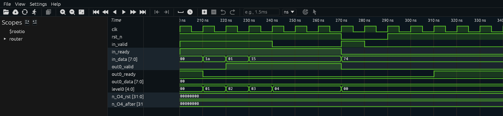
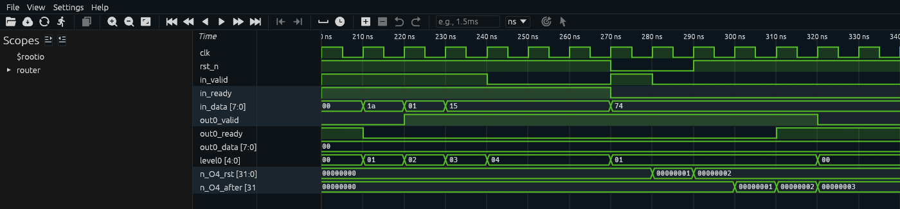

# Lab 07: Capstone

In this lab you take your Lab 06 testbench to sign-off. You write a verification plan from the
specification, run every test on ten seeds and read the merged coverage, and hunt three mystery
bugs, each dealt from all fifteen in the catalogue. The package you start from misses one of the
fifteen. You catch it by writing the assertions for the rules about reset and a sequence that resets
the router while packets are in flight, so that `make check-all` prints `15 of 15 caught.` Then you
write a sequence that takes both drop counters to 255, which fills the last two coverage bins that a
test can reach, and you finish with a verification report. The plan, the report, your testbench and
its results go into a GitHub repository of your own.

Package: [`labs/lab-07-capstone/`](https://github.com/uoftasic/dd105-b/tree/main/labs/lab-07-capstone)

## Before you start

- Finish [Lab 06](lab-06-the-register-block-overview.md).
- Keep [the router's specification](../reference/router-spec.md) open for the whole lab, with
  [the router in one page](../reference/the-router-in-one-page.md) beside it if you like. The plan
  you write in Part 2 is a list of the specification's rules.
- You need a GitHub account, and a token the workbench can push with. If you made one in
  [IC102-A Lab 01, Part 2](https://uoftasic.com/ic102-a/labs/lab-01-your-repo-from-the-template-overview.html#part-2-your-github-settings)
  and it hasn't expired, use it. Otherwise make one the way that part describes. This lab needs
  only the Contents permission, read and write, because your repository has no workflows.

The package is the Lab 06 testbench with our solution to Lab 06 in it: the seven registers' fields,
the adapter, the reset and bit-bash sequences, the predictor and its connections, the `irq` check
and `RouterLab06Vseq`'s steps. If your own Lab 06 printed `5 of 5 caught.`, your code did the same
job, but use ours anyway, because this lab adds to the files you edited. Until now the router has
been reset only at time 0, and nothing in the testbench could reset it again. What we added for
you:

| File | What Lab 07 adds |
|---|---|
| `tb/router_agents.py` | a reset the testbench can drive: `ResetDriver` and `ResetSeq`, in a sys agent beside Lab 06's sys monitor, and `ResetState`, through which the reset driver warns the other drivers a cycle before a reset; a source driver that abandons its packet at a reset (rule I3), and an APB driver that keeps `psel` at 0 during one and starts an interrupted transfer again (rule A4) |
| `tb/router_env.py` | in the scoreboard, `reset_model()`, which at a reset throws away every beat it expected and puts its own models and the register model's mirror back to their reset values; four corners that the scoreboard counts (a reset with beats still to come out, a reset with a packet half accepted, and a drop of each kind with its counter already at 255), and the coverage group `router.corner`, with a bin for each |
| `tb/router_sva.sv`, `tb/router_sva_bind.sv` | the APB port and `irq` in the bound module, and a counter for each rule about reset; the assertions are yours (Part 5) |
| `tb/router_vseq.py` | `reset()` in the base sequence; `RouterResetVseq` and `RouterSaturateVseq`, whose bodies are yours (Parts 5 and 6); `RouterLab07Vseq`, four phases of random traffic whose resets are yours (Part 5) |
| `tb/test_router.py` | `RouterTest` runs `RouterLab07Vseq` last; three new tests, `RouterLab07Test`, `RouterResetTest` and `RouterSaturateTest` |
| `Makefile` | `BUG_LIST`: all fifteen bugs, B15 first, because `make check` grades the first |
| `PLAN-template.md`, `REPORT-template.md` | the plan and the report you fill in |

Time: about 3 h 30 min. About 30 minutes of that is waiting for the machine, as we measured it on
the course's 2 CPUs: the two regressions took 8 min 27 s and 9 min 21 s, each of the three runs of
`make check-all` took 114 to 118 s, and a run of `RouterTest` takes about 12 s. Every file you
edit is Python apart from the assertions, so only Part 5's assertions rebuild the simulator, which
took us 2.5 s. You'll spend most of the rest writing the plan, eight assertions, two sequences and
the report.

## Part 1: Your repository and the first build

1. Open a terminal on the workbench desktop, as in Lab 06, go to the lab folder, and build the
   simulator:

   ```bash
   . /foss/designs/common/.designinit   # in every new terminal
   mod dd105-b
   cd labs/lab-07-capstone
   make build
   ```

   It ends with:

   ```text
    built /foss/designs/modules/dd105-b/labs/lab-07-capstone/build/sim_build/Vtop in 2.4 s (2.1M in /foss/designs/modules/dd105-b/labs/lab-07-capstone/build/sim_build)
    ccache:  Hits: 47 / 63 (74.60%)  Misses: 16 / 63 (25.40%)
   ========================================================================
    /foss/designs/modules/dd105-b/labs/lab-07-capstone/build/sim_build/Vtop is up to date.
   ```

   Our counts include the builds of Labs 01 to 06, which came to 41 hits and 15 misses, so this
   build's own were 6 hits and 1 miss.

2. On GitHub, create a new repository under your own account named `dd105-capstone`, with a
   README so that it starts with one commit. It can be private, because nobody needs to read it
   yet.

3. Clone it beside the course, and tell git who you are in it:

   ```bash
   mkdir -p /foss/designs/projects && cd /foss/designs/projects
   git clone https://github.com/YOUR-USERNAME/dd105-capstone.git
   cd dd105-capstone
   git config user.name "Your Name"
   git config user.email "ID+USERNAME@users.noreply.github.com"
   git config credential.helper 'cache --timeout=28800'
   cd /foss/designs/modules/dd105-b/labs/lab-07-capstone
   ```

   Use your GitHub no-reply address, and leave out `--global`. A global setting goes in the
   container's home folder, which is thrown away when the workbench restarts. Without `--global`
   the settings go in `.git/config`, which is inside your repository, on your own disk, so they
   stay. In IC102-A Lab 01,
   [Part 2](https://uoftasic.com/ic102-a/labs/lab-01-your-repo-from-the-template-overview.html#part-2-your-github-settings)
   says where to find your no-reply address, and
   [Part 3](https://uoftasic.com/ic102-a/labs/lab-01-your-repo-from-the-template-overview.html#part-3-make-the-repository)
   explains the token cache and `--global`. You'll write your plan and your report in the
   repository itself. The testbench stays here in the course clone while you work on it, because
   it builds only from inside `labs/`, and Part 8 copies it across.

4. Run the graded test, `RouterTest`, and pull the scoreboard's summary out of the log:

   ```bash
   make run
   grep -o '\[SB\] [0-9a-z].*' build/runs/RouterTest-s1/run.log
   ```

   You should see `ok: 0 errors, 0 assertions   12.54 s` from `make run`, and from `grep`:

   ```text
   [SB] 1735 packets in: 447 to output 0, 479 to output 1, 245 NOROUTE, 564 FULL; the highest level a header saw was 16
   [SB] beats checked: 2038 on output 0, 2139 on output 1; 45 DROP_CNT reads checked
   [SB] registers: 884 reads, 65 of STATUS checked; 492 transfers to bad addresses; irq checked in 18584 cycles, wrong in 0
   [SB] resets: 0 after the one at time 0, 0 expected beats lost; corners hit: reset_with_beats=0 reset_mid_packet=0 noroute_saturated=0 full_saturated=0
   ```

5. At the end of Lab 06 your `RouterTest` checked `irq` in 13918 cycles. This one checks it in
   18584. What ran in the other 4666 cycles, and did anything before them change?

   <details>
   <summary>Answer</summary>

   `RouterLab07Vseq`, which `RouterTest` now starts after everything Lab 06's `RouterTest` ran.
   Its four phases of random traffic, and its reads of every register at the end, take those
   cycles. Each phase sends 150 packets on a random
   routing table of its own and random interrupt enables, while both sinks change their modes. It
   doesn't run your two sequences yet. It goes last because every random value in the testbench
   comes from Python's `random`, one after another, so a sequence that ran earlier would move every
   packet after it, as Lab 06's Part 5 step did. We ran `RouterTest` with `RouterLab07Vseq` left
   out, on seeds 1 to 5, and it printed Lab 06's lines number for number (on seed 1,
   `1135 packets in: 311 to output 0, 288 to output 1, 177 NOROUTE, 359 FULL`, and
   `irq checked in 13918 cycles`), so nothing we added changes a run that has no reset in it.

   </details>

Check: `make run` passes, and `git -C /foss/designs/projects/dd105-capstone log --oneline` shows
the one commit that GitHub made.

## Part 2: The verification plan

Which of the specification's rules does this environment check, and which does it never make
happen?

1. Copy the template into your repository:

   ```bash
   cp PLAN-template.md /foss/designs/projects/dd105-capstone/PLAN.md
   ```

   It has a row for each rule in the specification. The input, output and APB rules keep the
   specification's numbers (I1 to I7, O1 to O8, A1 to A9), and the template gives labels of its own
   (RT1, DR2, RS2 and so on) to the rules that the specification states in prose. Three rows, O1,
   RT1 and A7, are filled in as examples.

2. Fill in the table under "How the environment checks". There are three checkers: the scoreboard
   (`write_in`, `write_out`, `write_apb` and `write_sys` in `RouterScoreboard`, in
   `tb/router_env.py`), the predictor (`RouterRegPredictor` in `tb/router_ral.py`, which you wrote
   and connected in Lab 06), and the assertions in `tb/router_sva.sv`. The reset and bit-bash
   sequences also compare what they read, but only while they run. The docstring or comment at the
   top of each file says what it covers.

3. Run `grep -n TODO tb/*.py tb/*.sv Makefile` first, because the parts that this lab leaves for
   you are marked `TODO`. Then, for every row, fill in "Checked by" and "Made to happen by", and
   write "nothing" where nothing does. The comments in `tb/router_vseq.py` say what each step of
   Lab 05's and Lab 06's sequences sets up, the comment above `RouterLab07Vseq` describes its
   phases, and the docstring of `RouterTest` in `tb/test_router.py` lists what the graded test runs.

4. Mark the rows you think `RouterTest` never reaches. Then look at what the scoreboard says
   about resets in your Part 1 run:

   ```bash
   grep -o '\[SB\] resets.*' build/runs/RouterTest-s1/run.log
   ```

   It's the line you saw in Part 1, `resets: 0 after the one at time 0`, with every corner at 0.
   Which rows of your plan need more than the reset at time 0, and which have no checker?

   <details>
   <summary>Answer</summary>

   At time 0 the router holds nothing, so RS2 and RS3 (a reset with beats in a buffer, and a
   reset in the middle of an input packet), the second half of O4 and the source's rule I3 all
   need a reset with traffic in flight. I7, O4, the first half of A4 and RS1 have no assertion
   yet, because theirs are the `TODO (Part 5)` comments in `tb/router_sva.sv`. Of RS1's four
   values, only `irq` is checked, by the scoreboard. DR2, the rule that each counter stops at 255,
   needs 255 drops with no clear or reset between them, but `RouterInjectTest` and
   `RouterLab07Vseq` both clear `DROP_CNT` at the end of each of their phases.

   Nothing in the environment checks `in_ready` (I4, I5, I6, RT5), the cycle a beat appears (O8),
   that the outputs come from flip-flops (O3), what `CTRL.EN` does (EN1), the APB master's rules
   (A1 to A3), `pready` (A5, A6) or `LEVEL` (RG4), and nothing in this lab adds a check for them,
   so those rows stay "nothing". Put them in the plan's Open items, because Part 8's report has to
   say what the environment doesn't show.

   </details>

Check: every row of your plan has an entry in "Checked by" and "Made to happen by", and the rows
that say "nothing" include the ones in the answer above.

## Part 3: A seed regression

Does a regression that passes on every seed tell you the environment is finished?

1. `make regress` runs every test in `TESTS` on seeds 1 to 10, then merges the coverage of those
   runs. Look at `TESTS` in the Makefile, and write down how many runs you expect and how many will
   pass.

2. Run it, and time it:

   ```bash
   time make regress
   ```

   It took us 8 min 27 s. You should see `100 ok  (100 runs)`, and then the merged coverage of the
   100 runs:

   ```text
     top                                           81.67 %   49 of 60 bins
       top.router                                    81.67 %   49 of 60 bins
         top.router.pkt                                83.33 %   35 of 42 bins
           top.router.pkt.len                           100.00 %   9 of 9 bins
           top.router.pkt.dst                           100.00 %   4 of 4 bins
           top.router.pkt.fate                          100.00 %   4 of 4 bins
           top.router.pkt.level                         100.00 %   5 of 5 bins
           top.router.pkt.x_fate_level                   65.00 %   13 of 20 bins
               not hit: ('full', 'empty'), ('full', 'low'), ('full', 'at_8'), ('out0', 'at_9'), ('out0', 'high'), ('out1', 'at_9'), ('out1', 'high')
         top.router.wait                              100.00 %   14 of 14 bins
           top.router.wait.port                         100.00 %   2 of 2 bins
           top.router.wait.wait                         100.00 %   4 of 4 bins
           top.router.wait.x_port_wait                  100.00 %   8 of 8 bins
         top.router.corner                              0.00 %   0 of 4 bins
           top.router.corner.kind                         0.00 %   0 of 4 bins
               not hit: reset_with_beats, reset_mid_packet, noroute_saturated, full_saturated
   ```

3. `router.corner` has a bin for each of the four corners named near the top of
   `tb/router_env.py`, and the scoreboard counts each corner and sends it to the corner coverage
   as it happens. Which of the eleven empty bins could any test ever hit, and which rows of your
   plan are they?

   <details>
   <summary>Answer</summary>

   Only the four in `router.corner`. The seven in `router.pkt.x_fate_level` are ones the
   specification rules out, as they were in Labs 04 to 06, because a packet is FULL only at a level
   of 9 or more, and written to an output only at 8 or less. `noroute_saturated` and
   `full_saturated` are drops whose counter is already 255 (row DR2), and `reset_with_beats` and
   `reset_mid_packet` are a reset with beats in a buffer and a reset with a packet half accepted
   (RS2 and RS3). You found the same rows in Part 2 by reading the environment, and the
   regression's bins point at them too. So a regression that passes on every seed doesn't tell you
   the environment is finished. 100 passes mean that no check fired in 100 runs, and the
   four empty bins are situations that the stimulus never made, so no check ever saw them.

   </details>

4. Fill in "Seen in coverage" for every row, from the bin list (`build/coverage/regress/merged.xml`
   has every bin with its count) or from the `corners hit:` part of the `[SB] resets` line at the
   end of each run's log. Then write your sign-off criteria under "Sign-off criteria", each one a
   command and the output it must print.

5. Commit and push the plan:

   ```bash
   cd /foss/designs/projects/dd105-capstone
   git add PLAN.md && git commit -m "Verification plan for the router" && git push
   cd -
   ```

   git asks for your username and, as the password, the token.

Check: `100 ok  (100 runs)` and `81.67 %   49 of 60 bins`, and your plan on GitHub with its
sign-off criteria written.

## Part 4: Mystery hunts

Can you tell which rule a design breaks from your environment's log alone?

1. Deal a mystery bug, and run `RouterTest` against it:

   ```bash
   make new
   make hunt
   ```

   `make new` seals one of the fifteen bugs in `.hunt` without telling you which. `make hunt` runs
   the graded test with that bug switched on, which takes about 12 s, or less for a bug that piles
   up 50 errors early, because the scoreboard stops a run at its 50th. On one of our deals, the
   hunt printed:

   ```text
     caught  the mystery bug                          1 error, 0 assertions          11.3s
           RouterTest: AssertionError: 1 error logged, the first: irq is 1 from cycle 5906, but STATUS = 001 an
   ```

2. Copy `REPORT-template.md` into your repository as `REPORT.md`:

   ```bash
   cp REPORT-template.md /foss/designs/projects/dd105-capstone/REPORT.md
   ```

   Before you ask for a verdict, fill in the first three columns of its hunt table. They hold the
   deal's number, the first check that fired, copied from the hunt, and your diagnosis, which is
   the rule the router broke and the file in `labs/common/rtl/` that you'd look in. The
   specification's [Building the router](../reference/router-spec.md#building-the-router) section
   says what each file holds, and in the log from `make hunt VERBOSE=1` the `[VSEQ]` lines say
   which sequence was running when the first error came. What would you write for the hunt above?

   <details>
   <summary>Answer</summary>

   The rule is IRQ1, that `irq` is the OR of `STATUS & INT_EN`. In cycle 5906 `STATUS.NOROUTE` is
   set and its enable is 0, and the router raises `irq` anyway, so it isn't masking with `INT_EN`.
   The interrupt is in `router_regs.sv`, with the registers. The hunt's line cuts the message
   short, and the full log from `make hunt VERBOSE=1` has all of it,
   `irq is 1 from cycle 5906, but STATUS = 001 and INT_EN = 000 make it 0`. In that log the error
   comes between `starting RouterLab06Vseq` and `RouterLab06Vseq is done`, so it came from the step
   you wrote in Lab 06, Part 5, which drops a packet while `INT_EN` is still 0.

   </details>

3. Ask for the grade:

   ```bash
   make verdict
   ```

   It runs the golden design first (row 1) and then the mystery bug (row 2), about 23 s in all. For
   the hunt above you should see:

   ```text
         ok  1. the golden design  must PASS          0 errors, 0 assertions         11.3s
     caught  2. the mystery bug    must FAIL          1 error, 0 assertions          11.3s
   ```

   then the same error, and:

   ```text
    VERDICT: PASS
      The bug was B02_irq_ignores_int_en.
      It hides behind: turning on every interrupt enable before looking at irq
      It teaches: an enable is a mask, and a mask has to be tested off as well as on
   ```

   Fill in the last two columns of the row.

4. Deal again, until the table has three rows. If a hunt prints this instead:

   ```text
      quiet  the mystery bug                          0 errors, 0 assertions         11.5s
   ------------------------------------------------------------------------
    Nothing your test drives tells this design from a correct one. The
    bug is in there; your stimulus or your checks have not reached it.
    `make cov` shows what the stimulus covered.
   ```

   keep that one. `make new` replaces whatever is in `.hunt`, so copy the file aside
   (`cp .hunt hunt-quiet.sealed`) before you deal again, and copy it back to `.hunt` when you come
   to its verdict in Part 7. In its row, write which rows of your plan could hide a bug from
   `RouterTest`. `make reveal` would tell you the bug's name, and then remind you that the name
   isn't the deliverable, because `make verdict` still needs row 2 to fire.

Check: your report's hunt table has three rows, each with its diagnosis written before its
verdict.

## Part 5: Reset with traffic in flight

What does the environment need before it can check a reset that happens while the router is
busy?

1. Read `reset_model()` and `write_sys()` in `RouterScoreboard`. Lab 06's `write_sys()` reset only
   its model of `STATUS` and `INT_EN`, because the router was never reset after time 0. Write down
   what the Lab 06 scoreboard would have reported, on the golden router, after a reset with a beat
   waiting on a stalled output.

   <details>
   <summary>Answer</summary>

   It would have reported errors on a router that is right. We tried it: with the call to
   `reset_model()` taken out, the reference solution's `RouterResetTest` failed the golden router
   with 56 errors. The register model's mirror still held the values from before the E8 reset, so
   the predictor failed the first reads after it (`[RAL] CTRL read 0x0 in cycle 57; the mirror
   holds 0x1`). The beats the scoreboard expected were still queued, so the first beats out of
   output 0 after the reset were compared with beats from before it (`output 0: got 02 in cycle
   120, expected 00`). Its routing table, its levels and its drop counts would still hold the values
   from before the reset as well, so it would decide the next packets' fates wrongly.
   `reset_model()` throws all of that away in the first reset cycle.

   Lab 06's drivers needed changing too. We tried them in place of this lab's: after the E8 reset
   the source driver went on offering the third beat of the packet the reset had cut, `CTRL.EN` was
   0 again so nothing took it, and 1000 cycles later the driver gave up with
   `in_ready stayed 0 for 1000 cycles with beat 2 of dst 0, 8 beats: 01 15 74 d5 6f da 03 ae on offer; dropping the rest of it`.
   In a later reset the APB driver kept `psel` at 1, which `a_A4` reported as
   `A4: psel is 1 during reset`.

   </details>

2. Write the assertions marked `TODO (Part 5)` in `tb/router_sva.sv`: `a_I7`, `a_O4_rst`,
   `a_O4_after` and `a_A4`, and `a_R_pready`, `a_R_pslverr`, `a_R_prdata` and `a_R_irq` for the
   specification's Reset table. All but `a_O4_after` check rules about reset itself, so unlike
   Lab 05's assertions they have no `disable iff (!rst_n)`; the specification's
   [Valid/ready rules](../reference/router-spec.md#validready-rules) section says why.
   `a_O4_after` checks the cycles after a reset, so it keeps the `disable iff`, and it needs the
   two flip-flops that its comment describes. As in `a_O1`, each failure should increment the
   assertion's counter and call `$error` with the rule's name.

3. Predict which of the eight will fail on the golden router. Then rebuild and run:

   ```bash
   make build
   make run
   ```

   The rebuild took us 2.5 s. You should see `ok: 0 errors, 0 assertions   11.50 s` from
   `make run`, and the same `[SB]` lines as in Part 1. None of the assertions fails. The golden router obeys every one of these rules that is
   its own, and `a_A4` checks a rule of the APB master's, which our APB driver obeys. If one of
   yours does fail, its `%Error` line names it, and the mistake is in that assertion. So far the
   only reset they have seen is the one at time 0, two cycles long, when the router holds
   nothing.

4. Write `RouterResetVseq.body()` in `tb/router_vseq.py`. Its `TODO` lists the situations to reach.
   The first is the specification's example E8, in which output 0 is stalled with a packet in its
   buffer and the next packet is half accepted when `rst_n` falls. Run the reset beside the
   traffic with `par()`, the way `RouterLab05Vseq` runs its route writes beside its random
   packets, and after each reset let the sinks take beats, call `setup()` and send more. `reset()`
   warns the other drivers at the next rising edge and pulls `rst_n` low at the one after, so a
   reset starts two cycles after you call it.

5. In `RouterLab07Vseq`, write the line that runs your sequence (the `TODO (Parts 5 and 6)`;
   Part 6 adds the other line), and the two `TODO (Part 5)`s in the random phases, which set
   `do_reset` and add the thread that resets the router. Then add `RouterResetTest` to `TESTS` in
   the Makefile.

6. Write down what you expect the `corners hit:` part of the `[SB] resets` line to say for your
   test. Then run it:

   ```bash
   make run TEST=RouterResetTest
   grep -E 'reset from|abandoned|\[SB\] resets' build/runs/RouterResetTest-s1/run.log
   ```

   With the reference solution's sequence, the first lines are from the E8 reset:

   ```text
      275.00ns INFO     ..7-capstone/tb/router_env.py(369) [uvm_test_top.env.sb]: [SB] reset from cycle 28: 4 expected beats are lost, 2 beats of the packet coming in
      275.00ns INFO     ..apstone/tb/router_agents.py(270) [uvm_test_top.env.src.drv]: [SRC] reset: abandoned dst 0, 8 beats: 01 15 74 d5 6f da 03 ae after 2 beats
   ```

   then, in the reset during register traffic,

   ```text
     1390.00ns INFO     ..apstone/tb/router_agents.py(582) [uvm_test_top.env.apb.drv]: [APB] reset: abandoned a read of 08; it will start again after the reset
   ```

   and the run ends with
   `[SB] resets: 4 after the one at time 0, 14 expected beats lost; corners hit: reset_with_beats=3 reset_mid_packet=1 noroute_saturated=0 full_saturated=0`
   and `ok`, in 2.29 s. If your log has no `[APB] ... abandoned` line, your reset fell between two
   transfers, and nothing in your test has made rule A4 happen yet. A read and a write take 7
   cycles together in our sequence, the APB driver's idle cycle before each one included. After
   `cycles(8)`, `reset(1)` warned the APB driver as the second read's setup cycle ended, and `rst_n`
   fell after the read's first access cycle. Move your reset a cycle at a time until it lands in a
   transfer.

Check: `RouterResetTest` passes on the golden router, with `reset_with_beats` and
`reset_mid_packet` above 0, and an `[APB] ... abandoned` line in its log.

## Part 6: Counters at 255

Does each drop counter stop at 255, and how will you know that the regression got there?

1. Write `RouterSaturateVseq.body()`. Its `TODO` names the two corners. The specification's
   [Sizes](../reference/router-spec.md#sizes) section says that a stream of 1-beat packets for a
   disabled route makes one drop per cycle, so it takes a counter to 255 in 255 cycles. Read
   `DROP_CNT` on the way past 255, but only between bursts. The scoreboard compares a read with the
   drops it has counted when the read completes, and a read returns the counter as it was a cycle
   earlier, so while drops are still coming in the two can differ, and the check would report an
   error that isn't the router's. Then clear the counters with a write and read them again.

2. Add the line that runs it to `RouterLab07Vseq`, add `RouterSaturateTest` to `TESTS`, and run the
   test:

   ```bash
   make run TEST=RouterSaturateTest
   ```

   With the reference solution you should see `noroute_saturated=5 full_saturated=5` in the
   `[SB] resets` line, and `ok`, in 2.47 s.

3. Will closing these two bins catch a bug that your environment misses now? Write down your
   answer. Then run the regression again, keeping its output:

   ```bash
   mkdir -p results
   time make regress | tee results/regress.txt
   ```

   It took us 9 min 21 s. You should see `120 ok  (120 runs)` and:

   ```text
     top                                           88.33 %   53 of 60 bins
   ```

   with only the seven bins of `router.pkt.x_fate_level` never hit.

   <details>
   <summary>Answer</summary>

   No. None of the fifteen bugs changes what a counter does at 255. We ran `make check-all` with
   Part 5's work in and none of Part 6's, and it printed `15 of 15 caught.` on seed 1, with B15 at
   `50 errors, 14 assertions`. The new sequence reads `DROP_CNT` past 255, and a check that you
   already had looks at those reads. The scoreboard compares every `DROP_CNT` read with its own
   counts, which stop at 255, so it would catch a counter that wraps. Until now nothing gave row DR2
   of your plan any evidence either way.

   </details>

4. Update the Status column of your plan, then commit and push it.

Check: `120 ok  (120 runs)` and `88.33 %   53 of 60 bins`.

## Part 7: Sign-off

Does your environment meet the plan's sign-off criteria, and what did your work in Parts 5 and 6
add?

1. If you kept a quiet mystery bug, copy its file back to `.hunt`, run `make verdict`, and fill in
   its row.

2. Write down how many of the fifteen you expect `RouterTest` to catch now. Then run the catalogue
   on three seeds, keeping the output:

   ```bash
   make check-all | tee results/check-all-s1.txt
   make check-all SEED=2 | tee results/check-all-s2.txt
   make check-all SEED=3 | tee results/check-all-s3.txt
   ```

   Each took us 114 to 118 s. With the reference solution, seed 1 printed:

   ```text
         ok  the golden design                        0 errors, 0 assertions         11.7s
   ------------------------------------------------------------------------
     caught  tier 6  B15_output_valid_survives_reset  50 errors, 37 assertions       11.3s
     caught  tier 1  B01_status_write_clears_all      3 errors, 0 assertions         11.7s
     caught  tier 1  B02_irq_ignores_int_en           4 errors, 0 assertions         11.8s
     caught  tier 1  B03_route3_readback_swapped      5 errors, 0 assertions         11.8s
     caught  tier 1  B04_misaligned_address_accepted  50 errors, 0 assertions         2.5s
     caught  tier 2  B05_dst_field_off_by_one         50 errors, 0 assertions         2.9s
     caught  tier 2  B06_disabled_route_forwards      50 errors, 0 assertions         3.1s
     caught  tier 2  B07_full_counted_on_disabled_route 6 errors, 0 assertions         11.9s
     caught  tier 3  B08_admission_off_by_one         50 errors, 0 assertions         3.4s
     caught  tier 3  B09_write_pointer_power_of_two   50 errors, 1 assertion          2.9s
     caught  tier 4  B10_output_reloads_while_stalled 50 errors, 368 assertions       3.5s
     caught  tier 4  B11_cut_packet_has_no_last       50 errors, 45 assertions       11.6s
     caught  tier 5  B12_out1_uses_out0_ready         50 errors, 3 assertions         2.7s
     caught  tier 5  B13_admission_checks_other_output 50 errors, 0 assertions         2.9s
     caught  tier 6  B14_enable_resets_to_one         3 errors, 20 assertions        11.6s
   ------------------------------------------------------------------------
    15 of 15 caught.
   ```

   Seeds 2 and 3 printed `15 of 15 caught.` too, with B15 at `27 errors, 31 assertions` and
   `50 errors, 31 assertions`. Your error counts will differ, because your sequences aren't ours.

3. As shipped, the package caught 14 of the 15. Which one did it miss, and which check fires first
   on it now?

   <details>
   <summary>Answer</summary>

   It missed B15. We ran `make check-all` on the package before Parts 5 and 6, and it printed:

   ```text
     MISSED  tier 6  B15_output_valid_survives_reset  0 errors, 0 assertions         11.5s
   ```

   and, after the other fourteen rows,

   ```text
    14 of 15 caught.
    Still hiding from this test:
      B15_output_valid_survives_reset
         hides behind: resetting only at time 0, when every buffer is already empty
   ```

   With B15 on, a reset doesn't clear an output's register, so a beat that was waiting on a
   stalled output when `rst_n` fell is still there afterwards. Until Part 5 the only reset came at
   time 0, with both buffers empty, so there was never a beat for B15 to keep. After your last
   run, `build/grade/B15/run.log` holds seed 3, and in our seed 3 run the first failure came in
   the E8 step of the reset sequence:

   ```text
   [140020000] %Error: router_sva.sv:83: Assertion failed in router.u_sva.u_out0.a_O4_rst: O4: out_valid is 1 during reset
   ```

   `a_O4_rst` failed again at the next rising edge and `a_O4_after` at the two after that, and
   then the scoreboard reported the beat that came out:

   ```text
   140055.00ns ERROR    ..7-capstone/tb/router_env.py(181) [uvm_test_top.env.sb]: output 0: got 00 in cycle 14006, and no beat was expected
   ```

   </details>

4. B14 makes `CTRL.EN` reset to 1. Your reset sequence caught it in Lab 06, Part 2, and your
   predictor from Part 3 on. Which check fires first on it now?

   ```bash
   grep -m1 -E '%Error|ERROR' build/grade/B14/run.log
   ```

   <details>
   <summary>Answer</summary>

   In the package as shipped, the first check was the predictor's, in cycle 10, on the reset
   sequence's read of `CTRL` in `RouterLab06Vseq`: `[RAL] CTRL read 0x1 in cycle 10; the mirror
   holds 0x0`, followed by `RegResetSeq`'s own error. Now the first is your assertion `a_I7`, at
   the rising edge at 10000 ps, which ends cycle 1, during the reset at time 0:
   `[10000] %Error: router_sva.sv:148: Assertion failed in router.u_sva.a_I7: I7: in_ready is 1 during reset`.
   With `CTRL.EN` at 1 the router is ready even while `rst_n` is 0. The predictor catches B14 nine
   cycles later and says which register is wrong; `a_I7` catches it at once and names the rule the
   router breaks.

   </details>

5. Look at B15 beside the golden router, in the E8 step of the reset sequence:

   ```bash
   make waves TEST=RouterResetTest
   make waves TEST=RouterResetTest BUG=B15
   surfer build/runs/RouterResetTest-s1/waves.fst &
   surfer build/runs/RouterResetTest-s1-B15/waves.fst &
   ```

   Add `clk`, `rst_n`, `in_valid`, `in_ready`, `in_data`, `out0_valid`, `out0_ready`,
   `out0_data` and `level0` from `router`, and `n_O4_rst` and `n_O4_after` from
   `router.u_sva.u_out0`, and look at 200 to 340 ns:

   

   *The golden router, with the reference solution's sequence. Output 0 has been stalled since
   210 ns. The 2-beat packet `00 1a` went in first, and its header `00` has been waiting on
   output 0 since 220 ns, when `out0_valid` rose. The next packet's first two beats, `01 15`, went
   in after it, so `level0` is 4. (From 240 ns `in_valid` is 0, because that packet's third beat
   waits out a 3-cycle gap.) `rst_n` falls at 270 ns, and `out0_valid`, `in_ready` and `level0`
   fall with it, without waiting for a clock edge. The source driver offers the third beat, `74`,
   in the first reset cycle, then lowers `in_valid` at 280 ns and drops the rest of the packet.
   `rst_n` rises at 290 ns, the sink is ready from 310 ns, and nothing comes out, as example E8
   says.*

   

   *B15, from the same seed. The reset empties the buffer behind the output but not the output
   register, so `out0_valid` stays 1 through the reset with `00` still on `out0_data`, and
   `level0` reads 1, because the level counts the beat on the pins. `a_O4_rst` counts a failure at
   each of the two rising edges inside the reset (280 and 290 ns), and `a_O4_after` at the next
   three (300, 310 and 320 ns). The sink takes `00` at the edge at 320 ns, and the scoreboard
   reports it: `output 0: got 00 in cycle 32, and no beat was expected`.*

6. Go through your plan's sign-off criteria one at a time, against the files in `results/`.

Check: `15 of 15 caught.` on three seeds, with the reset assertions and the two sequences that you
wrote.

## Part 8: The report

Can someone else check your claim without redoing your work?

1. Fill in `REPORT.md` section by section. Paste each number as the tool printed it, from
   `results/` and from your notes. Section 7, "What this doesn't show", is the only place where a
   reader who has to rely on your claim can find out where your evidence stops, so don't leave it
   short. Your plan's Open items from Part 2 go there.

2. Copy your testbench and its outputs into the repository, and push:

   ```bash
   R=/foss/designs/projects/dd105-capstone
   mkdir -p $R/tb $R/results
   cp Makefile $R/ && cp tb/*.py tb/*.sv $R/tb/ && cp results/*.txt $R/results/
   cd $R
   git add -A && git commit -m "The capstone environment, its results and the report" && git push
   cd -
   ```

   The last line takes you back to the lab folder. The copy is safe to repeat from there, so run
   the block again whenever you change a file and want the repository to have it.

3. Open the repository on GitHub, and check that a reader who has only that page could find the
   command behind every number in your report.

Check: your repository on GitHub has `PLAN.md`, `REPORT.md`, `Makefile`, `tb/` and `results/`.

## Finishing

You're done when `make check-all` prints `15 of 15 caught.` with the reset assertions and the reset
and saturation sequences that you wrote, and the `REPORT.md` in your GitHub repository quotes that
run.

Questions:

1. B15 was caught by an assertion and by the scoreboard. If you could keep only one of the two
   checks, which would you keep?

   <details>
   <summary>Answer</summary>

   Either can be defended. `a_O4_rst` fired in the reset cycle itself and names the rule it
   checks. It needs no model, so it fires whether or not the sink ever takes the stale beat. In our
   seed 3 log the scoreboard fired four cycles later, and only because the sink took the beat, but
   its message says what the bug does to whoever uses the router, which is to deliver a beat from
   before the reset as if it were new.

   </details>

2. Part 3's regression passed 100 runs out of 100. What would a reader who saw only that
   line have believed, and what did your plan say at the time?

   <details>
   <summary>Answer</summary>

   That the router worked. At the time the plan had no assertion for I7, O4, the first half of A4
   or RS1, nothing that made RS2, RS3 or DR2 happen, and a list of rows with no checker at all;
   the coverage had four empty bins that a test could hit; and, as Part 7 showed, the graded test
   passed on one of the fifteen planted bugs.

   </details>

Submit: nothing yet. Your repository is the record of your capstone. We plan a certification
process that will review capstone repositories, but it doesn't exist yet.

## Going further (optional)

- Close one of the reference plan's open items (`solutions/PLAN.md`). Assertions for I5 and I6,
  with `CTRL.EN` as written over APB kept beside them, would give the `in_ready` rows a checker,
  and a check of `LEVEL` reads against the levels the scoreboard already counts would close RG4.
  Run `make check-all` afterwards. If your new check fires on the golden router, the mistake is in
  the check.
- Run more seeds, with `make regress NSEEDS=50`. In Part 6's regression the twelve tests took about
  56 s a seed, so 50 seeds take about 47 minutes.
- Deal more mystery bugs, until you've had one from every tier.

Next on the [Course path](../index.md#course-path): this is the last lab.
